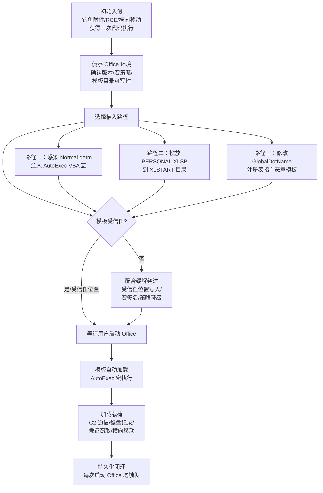

# Office 模板宏 (T1137.001)

> 父技术：[Office 应用程序启动执行 (T1137)](../T1137-Office-Application-Startup.md) · 战术：[持久化 (Persistence)](../README.md)

## 一句话通俗理解

攻击者不给你发带毒的文档，而是悄悄改写 Word/Excel 的"出厂默认模板"（如 `Normal.dotm`），让你以后**每次正常打开** Office 软件时，恶意宏都会自动运行——相当于把后门装进了软件的"启动基因"里。

## 30秒速查卡

| 维度 | 你需要知道的 |
|------|-------------|
| 技术编号 | T1137.001 |
| 所属战术 | 持久化 (Persistence) |
| 父技术 | T1137 Office Application Startup Execution（Office 应用程序启动执行） |
| 适用平台 | Office Suite、Windows |
| 核心对象 | `Normal.dotm`、`PERSONAL.XLSB`、`GlobalDotName` 注册表键 |
| 执行触发点 | Office 应用程序启动时自动加载模板并执行其中的 VBA 宏 |
| 最大优势 | 无需再次投递恶意文档，受害者打开任意（甚至空白）文档即触发 |
| 典型工具 | Cobalt Strike、MacroPack、SET |
| 检测关键点 | 模板目录文件写入/哈希变更、AutoExec 宏、`GlobalDotName` 键值监控 |
| 缓解核心 | 阻止来自 Internet 的宏、ASR 攻击面收缩规则、禁用 VBA |

## 难度等级

⭐⭐ 中级

利用本技术本身不需要漏洞利用，只需对目标主机有一次代码执行权限 plus 用户对宏策略的宽松配置。难点不在"写入模板"这个动作，而在于：写入的宏要能绕过宏安全策略（受信任位置/受信任发布者）、躲过模板文件基线比对，并在蓝队审计 VBA 工程时经得起看。

## 前置知识检查

阅读本篇前，请确认你理解以下概念：

- **VBA 宏 (Visual Basic for Applications Macro)**：嵌入 Office 文档/模板中的 Visual Basic 代码，可自动化操作文档与应用程序。
- **AutoExec 宏**：Word 中名为 `AutoExec` 的特殊宏，在 Word **启动时**自动执行，无需打开任何文档——这是模板宏持久化的核心机制。
- **Office 模板 (Office Template)**：定义文档默认样式与内容的骨架文件（`.dotm`/`.dotx`/`.xltm`）。`.dotm`/`.xltm` 后缀中的 `m` 表示内含宏。
- **受信任位置 (Trusted Location)**：Office 安全设置中指定的目录，位于其中的模板/文档无需宏提示即被信任。
- **注册表持久化概念**：理解修改 `HKCU` 配置单元下 Office 选项键即可改变应用加载行为。

若以上概念清晰，继续阅读。

## 技术描述

Office 应用程序（Word、Excel、PowerPoint 等）在启动时会加载一个或多个**模板文件**作为会话基础。 adversaries 可以向这些模板注入 VBA 宏，或令应用加载攻击者指定的模板，从而在每次应用程序启动时获得自动执行的代码——实现无需再次投递恶意文档的隐蔽持久化。

### 核心机制

**1. Word 默认模板 `Normal.dotm`**

Word 默认在用户配置目录创建并维护基础模板 `Normal.dotm`（"Normal" 模板），所有新文档默认基于它创建。该模板默认路径为：

```
C:\Users\<username>\AppData\Roaming\Microsoft\Templates\Normal.dotm
```

由于 `Normal.dotm` 天然包含宏存储能力，攻击者获得一次代码执行后，可向其注入带 `AutoExec` 例程（或 `Document_Open` 等自动例程）的 VBA 工程。此后**每次启动 Word**（哪怕是双击打开一个干净的 `.docx`），模板宏都会执行。历史上著名的 Melissa 病毒（1999）感染 Normal 模板（当时的 `Normal.dot`）实现自我复制，是该手法的开山鼻祖。

**2. Excel 启动目录与 `PERSONAL.XLSB`**

Excel 没有类似 Normal 模板的默认全局模板，但存在**启动加载目录** XLSTART。任何放入该目录的工作簿都会在 Excel 启动时自动加载：

```
C:\Users\<username>\AppData\Roaming\Microsoft\Excel\XLSTART\PERSONAL.XLSB
```

`PERSONAL.XLSB` 是用户"个人宏工作簿"的惯例文件名，攻击者可以创建它并植入 `Workbook_Open` 自动宏，达到与 Word 模板感染等价的效果。

**3. 共享/远程模板**

Office 支持从网络共享等远程位置加载模板。组织若将模板目录指向远程 UNC 路径，攻击者篡改远程模板即可一次性影响所有拉取该模板的主机（横向扩散放大器）。

**4. 模板搜索顺序劫持 (Search Order Hijacking)**

Word 2016 及更高版本在定位 Normal 模板时，会**优先**搜索安装目录（例如 `C:\Program Files (x86)\Microsoft Office\root\Office16\`）再回退到用户模板目录。攻击者若能在安装目录放置模板文件，可抢先于用户目录中的合法 `Normal.dotm` 被加载（需要更高权限写入 Program Files，但隐蔽性更强）。

**5. `GlobalDotName` 注册表劫持**

注册表值：

```
HKCU\Software\Microsoft\Office\<版本>\Word\Options\GlobalDotName
```

指定 Word 启动时加载的"全局模板"路径与文件名（扩展名可任意）。攻击者修改该值后，Word 会加载攻击者指定的任意路径文件作为基础模板。注意：该模板需位于受信任位置或本身受信任，且通常要求宏策略允许执行。由于 `GlobalDotName` 允许**任意扩展名**，攻击者可把恶意模板伪装成 `.gif`、`.doc` 等不起眼的文件，显著增加检测难度。

### 与父技术及兄弟子技术的关系

本技术是 [Office 应用程序启动执行 (T1137)](../T1137-Office-Application-Startup.md) 的首种子技术，与 [Office 测试 (T1137.002)](T1137.002-Office-Test.md)、[Outlook 表单 (T1137.003)](T1137.003-Outlook-Forms.md) 等同属"劫持 Office 应用启动环节"的大家族。相比依赖用户点击恶意附件的[用户执行 (T1204)](../../04-Execution/T1204-User-Execution.md)，模板宏只需**一次**初始执行即可换来此后每次开机的自动运行；相比普通文档宏，它不再需要持续的社会工程投递。

## 攻击流程



### 步骤详解

**步骤 1：初始入侵**

- **通俗描述**：攻击者先通过任意途径（钓鱼、漏洞、弱口令）在目标机器上跑起来一段代码。
- **技术细节**：本技术是"第二步"——它不负责入侵，只负责把已经到手的权限变成每次 Office 启动都自动续期的持久化。初始载体通常是带宏的钓鱼文档（本身可能借助[用户执行 (T1204)](../../04-Execution/T1204-User-Execution.md) 触发）。
- **常用工具**：Cobalt Strike、PowerShell Empire、自定义加载器。

**步骤 2：侦察 Office 环境**

- **通俗描述**：摸清目标装的 Office 版本、宏安全策略、模板目录是否可写。
- **技术细节**：读取 `HKCU\Software\Microsoft\Office\<版本>\Common\Security` 与 `AccessVBOM`、`VBAWarnings` 等键值；确认 `%APPDATA%\Microsoft\Templates` 写权限；确认是否存在受信任位置（`HKCU\Software\Microsoft\Office\<版本>\Word\Security\Trusted Locations`）。
- **常用工具**：`reg query`、Seatbelt、SharpUp。

**步骤 3：植入模板宏**

- **通俗描述**：把恶意 VBA 写进 `Normal.dotm`、投放到 XLSTART，或改注册表让 Word 去加载攻击者的文件。
- **技术细节**：
  - 直接用 COM 自动化（PowerShell `New-Object -ComObject Word.Application`）打开 `Normal.dotm`，调用 `VBProject.VBComponents` 注入宏后保存；
  - 或落地一个全新的 `PERSONAL.XLSB` / 恶意 `.dotm` 到模板路径；
  - 高权限场景可尝试安装目录搜索顺序劫持（`Office16\` 下的 `Normal.dotm`）；
  - 更隐蔽的方式是 `GlobalDotName` 指向伪装扩展名文件，如 `C:\Users\Public\pics\logo.gif`（实为模板）。
- **常用工具**：Cobalt Strike（MS Office 宏攻击模块）、MacroPack、SET。

**步骤 4：触发与载荷执行**

- **通俗描述**：用户下次打开 Word/Excel，恶意宏随模板加载静默执行。
- **技术细节**：`AutoExec` 在 Word 启动瞬间运行（无需打开文档）；`Document_Open`/`Workbook_Open` 在基于模板的文档打开时运行。载荷常驻内存，可直接注入合法进程以规避落盘检测，必要时配合 [VBA Stomping (T1564.007)](../../07-Stealth/T1564/T1564.007-VBA-Stomping.md) 清除宏源代码仅留 p-code，增加取证难度。
- **常用工具**：Cobalt Strike Beacon、Metasploit、自定义 RAT。

## 真实案例

### 案例 1：Melissa 病毒（1999）——模板宏持久化的"始祖"

- **时间**：1999 年 3 月
- **目标**：大规模无差别传播，全球企业与个人用户
- **攻击组织**：David L. Smith（个人作者，非组织化 APT）
- **手法**：Melissa 以 Word 宏病毒形态通过 Outlook 大规模群发自身；感染主机后修改 Word 的 Normal 模板（`Normal.dot`），使此后创建的每个新文档均携带病毒宏，形成"文档生产链污染"。
- **影响**：感染数小时内席卷全球，迫使微软、英特尔等大型企业关闭邮件网关；造成估计约 8000 万美元损失，是史上最著名的宏病毒事件之一，直接推动了 Office 宏安全机制的演进。
- **参考链接**：[Wikipedia: Melissa (virus)](https://en.wikipedia.org/wiki/Melissa_(virus))

### 案例 2：MuddyWater 组织（2017）——Normal.dotm 持久化用于中东定向攻击

- **时间**：2017 年
- **目标**：中东地区（沙特阿拉伯、阿联酋、以色列等）政府与电信部门
- **攻击组织**：MuddyWater (G0069)，伊朗关联 APT 组织
- **手法**：利用带有恶意 VBA 宏的 PowerPoint/Word 文档实施鱼叉钓鱼；部分 payload 落地后修改 Word 模板 `Normal.dotm` 实现持久化，即使初始文档被清除，攻击代码仍随 Word 启动反复执行。
- **影响**：多国政府机构文档被窃取；MuddyWater 借此在受害网络中长期潜伏。
- **参考链接**：[Reaqta: MuddyWater APT targeting Middle East](https://reaqta.com/2017/11/muddywater-apt-targeting-middle-east/)

### 案例 3：Earth Kasha / MirrorFace——ROAMINGHOUSE 以 Word 模板形态驻留（2024）

- **时间**：2024 年 11 月
- **目标**：日本政治、媒体、智库领域的关键人员
- **攻击组织**：Earth Kasha（Trend Micro 命名，与 MirrorFace 关联）
- **手法**：鱼叉钓鱼投递诱饵文档的同时，将 ROAMINGHOUSE（S9026）以 Word 模板文件形式放置于 `%APPDATA%\Microsoft\Templates` 目录——与 T1137.001 描述的模板目录滥用完全吻合；宏侧配合部署 ANEL 远控实现回连。
- **影响**：ANEL 后门时隔多年重出江湖；目标人物敏感文档与通信面临持续窃取风险。
- **参考链接**：[Trend Micro: Return of ANEL in the recent Earth Kasha spearphishing campaign](https://www.trendmicro.com/en_us/research/24/k/return-of-anel-in-the-recent-earth-kasha-spearphishing-campaign.html)

### 案例 4：Operation AkaiRyū——MirrorFace 借恶意 Word 模板复燃 ANEL（2025）

- **时间**：2025 年 3 月披露
- **目标**：欧洲（含 2025 年大阪·关西世博会相关的欧洲参展方）组织
- **攻击组织**：MirrorFace (G1054)
- **手法**：ESET 监测到该组织投放含 VBA 的恶意 Word 模板，模板加载后释放 NOOPDATA/UPPERCUT 等阶段载荷并重新启用 ANEL 后门，形成针对欧洲目标的完整攻击链。
- **影响**：日本与欧洲间政治经济交往相关实体遭渗透；ANEL、UPPERCUT 等老牌武器库被重新激活。
- **参考链接**：[ESET WeLiveSecurity: Operation AkaiRyū](https://www.welivesecurity.com/en/eset-research/operation-akairyu-mirrorface-invites-europe-expo-2025-revives-anel-backdoor/)

## 红队视角

### 实战技巧

1. **优先感染而非重建**：直接打开现有 `Normal.dotm` 追加 VBA 组件并保存，比整个替换文件更不容易被哈希基线发现（文件本来就会因用户改样式而变化）。
2. **AutoExec vs Document_Open 的取舍**：`AutoExec` 在 Word 启动即触发、无感更强，但部分加载场景（如 `/n` 启动参数）不执行；`Document_Open` 覆盖面更稳但要等用户开文档。实战可两者并存互为备份。
3. **GlobalDotName 伪装扩展名**：将恶意模板改名为 `.gif`/`.txt` 再由 `GlobalDotName` 指向，蓝队按扩展名过滤模板目录的规则会直接失明。
4. **受信任位置顺手牵羊**：先把自己控制的目录写入 Office 受信任位置，再投放模板，绕过宏警告（注意这本身会产生可检测的注册表变更）。
5. **配合 VBA Stomping**：植入后清除 VBA 源码只留编译后 p-code，使 `vba_extract` 类工具与人工审计拿不到可读代码。
6. **载荷驻留策略**：模板宏只做轻量 stager（十几行），主体载荷放别处，模板文件保持"干净"，降低模板被取证时的暴露面。

### 常用工具

| 工具名称 | 用途 | 平台 | 链接 |
|---------|------|------|------|
| Cobalt Strike（MS Office Macro 攻击包） | 生成宏载荷并指导植入 | Windows | [官方站点](https://www.cobaltstrike.com/) |
| MacroPack | 一键生成/注入 VBA 宏到 Office 载体 | Windows | [GitHub](https://github.com/sevagas/macro_pack) |
| SET (Social-Engineer Toolkit) | 钓鱼投递带宏诱饵文档建立初始执行 | Windows/Linux | [GitHub](https://github.com/trustedsec/social-engineer-toolkit) |
| Atomic Red Team (T1137.001) | 标准化测试本技术的原子操作 | Windows | [GitHub](https://github.com/redcanaryco/atomic-red-team/blob/master/atomics/T1137.001/T1137.001.md) |
| PowerShell + Word COM | 自动化注入 Normal.dotm（无需第三方工具） | Windows | 内置 |

### 注意事项

- 模板植入动作（尤其 COM 自动化调用 `VBProject`）在开启 AMSI 的主机上可能被脚本块日志记录，评估任务时先确认日志态势。
- `VBProject.VBComponents` 写入需要注册表 `AccessVBOM=1`（"信任对 VBA 工程对象模型的访问"），默认关闭——你需要先改这个键，而这本身是一个高保真检测点。
- 不要忽略宏安全策略：即使模板就位，策略设为"禁用所有宏并发出通知"时你的 `AutoExec` 仍会被拦，实战需要组合受信任位置或数字签名绕过。
- 红队作业务必在授权范围与专用实验环境进行，模板持久化会污染用户所有后续文档产出，真实环境误操作影响面大。

## 蓝队视角

### 检测要点

1. **模板目录写入事件**（最高价值）：监控 `%APPDATA%\Microsoft\Templates\`、`%APPDATA%\Microsoft\Excel\XLSTART\` 以及 Office 安装目录下的 `.dotm`/`.xlsb` 创建、修改、重命名。普通用户几乎不会在日常工作中改动这些文件。
2. **`GlobalDotName` 注册表监控**：`HKCU\Software\Microsoft\Office\<版本>\Word\Options\GlobalDotName` 的任何新增/修改都值得告警，尤其当值指向非常规扩展名或用户可写目录时。
3. **AutoExec 宏审计**：定期导出 `Normal.dotm` 与 XLSTART 工作簿的 VBA 工程，审计是否存在 `AutoExec`、`Document_Open`、`Workbook_Open` 例程；MITRE 官方检测数据（v20 检测策略 DET0519，分析 AN1436/AN1437）即围绕模板宏注入与 `GlobalDotName` 劫持构建。
4. **模板哈希基线**：对标准环境镜像的 `Normal.dotm` 建立哈希基线，结合文件年龄（新近大改的 Normal.dotm + 异常父进程）做置信度叠加。
5. **Office 进程异常派生**：Word/Excel 启动即派生 `powershell.exe`、`cmd.exe`、`wscript.exe` 是模板宏运行的强信号。

### 监控建议

- 将模板目录与 XLSTART 纳入文件完整性监控（FIM）范围，采集进程上下文（谁写的：`WINWORD.EXE` 自身改样式 vs `powershell.exe` 落盘，后者几乎必是攻击）。
- Sysmon Event ID 11（文件创建）+ 13（注册表值设置）组合规则：注册表 `GlobalDotName` 变更后短时间内模板目录文件写入选中即高危。
- ED R/Defender 开启 Office 相关 ASR 规则并监控阻断事件（见缓解措施），阻断记录本身就是检测数据源。
- 每月对重点岗位（高管、财务、涉密岗）主机做一次模板 VBA 工程抽查，弥补自动化规则对白名单宏的盲区。

## 避坑指南

1. **别只盯 `.dotm` 扩展名**：`GlobalDotName` 技巧允许任意扩展名，检测规则按"路径 + 写入行为"建，不要按后缀建。
2. **Normal.dotm 变更 ≠ 100% 恶意**：用户自定义默认字体、页边距也会改它。结合修改进程、VBA 内容、时间窗口综合判断，避免告警疲劳。
3. **清除时三处同查**：处置时只删 `Normal.dotm` 不够——检查 XLSTART、`GlobalDotName`、受信任位置列表与 Office16 安装目录，否则攻击者留的备份路径会让持久化复活。
4. **宏策略"禁用并通知"挡不住受信任位置**：模板位于受信任位置时宏静默运行。加固必须同时覆盖宏策略与受信任位置，缺一即漏。
5. **取证先拔网线再开 Word**：确认感染后切勿直接打开 Word"看看有没有问题"——启动即执行等于亲手触发载荷。离线环境中用独立工具解析模板。

## 检测建议

### 网络层

- 模板宏本身是本地行为，但**其载荷有网络指纹**：Office 进程（`WINWORD.EXE`/`EXCEL.EXE`）直接发起的出站连接（尤其非常见端口、原始 IP、DGA 域名）应重点告警。
- 关注 Word/Excel 启动后数秒内的 C2 回连时序模式（启动→立即外联），与浏览器产生的流量区分。
- 监控远程模板加载：SMB 访问 `\\...\Templates` 共享或 HTTP(S) 拉取 `.dotm`/`.xltx` 的流量。

### 主机层

- **文件监控**：
  - `C:\Users\*\AppData\Roaming\Microsoft\Templates\*.dotm` 的创建/修改（Sysmon EID 11）；
  - `C:\Users\*\AppData\Roaming\Microsoft\Excel\XLSTART\*` 任何文件落地；
  - `C:\Program Files (x86)\Microsoft Office\root\Office16\` 下出现模板文件（搜索顺序劫持特征）。
- **注册表监控**（Sysmon EID 13）：
  - `HKCU\Software\Microsoft\Office\*\Word\Options\GlobalDotName` 设置；
  - `HKCU\Software\Microsoft\Office\*\Word\Security\Trusted Locations\*` 新增；
  - `AccessVBOM` 被置 1。
- **进程监控**：`WINWORD.EXE`/`EXCEL.EXE` 启动即派生脚本解释器或注入行为（对应 MITRE 官方检测数据中模板宏注入分析 AN1436 的思路）。

### 应用层

- **模板完整性审计**：定期用脚本（VBA `OrganizerCopy` 或开源提取器）导出 Normal.dotm / PERSONAL.XLSB 中的宏代码，检测 `AutoExec`/`Workbook_Open` 自动例程；商业办公安全工具（如厂商 Office 宏审计组件）可对模板宏做签名比对。
- **宏执行日志**：启用 Office "VBA 宏执行日志"（组策略 `EnableVBAOM` 相关遥测）与 Microsoft 365 高级审计，记录宏启动来源（文档 vs 模板）。
- **AMS I**：Windows 10+ 上 Office VBA 调用 COM/脚本接口会过 AMSI 扫描，确保终端 AMSI 未被禁用，可捕获模板宏中的混淆载荷。
- **检测规则参考**：MITRE ATT&CK v20 为本技术提供检测策略 DET0519，含模板宏注入（AN1436）与 `GlobalDotName` 注册表劫持（AN1437）两条分析思路，可直接转化为 SIEM 规则。

## 缓解措施

### 优先级 1（立即实施，收益最大）

**措施名称：阻止来自 Internet 的宏并收紧宏策略**

具体实施步骤：

1. 通过组策略/云策略将 Office 宏设置调整为"禁用所有宏，除了数字签名的宏"或更高（对应 MITRE 缓解措施 M1042 Disable or Remove Feature or Program）。
2. 启用"阻止来自 Internet 的宏运行"（Microsoft 默认推送的新策略，使网络下载标记（MOTW）的宏一律拒绝）。
3. 清点并删除非必要的受信任位置，禁止用户自行添加（策略 `Trust Locations` 管控），必须保留的改为只读共享。

**措施名称：部署 ASR 攻击面收缩规则**

具体实施步骤：

1. 在 Microsoft Defender for Endpoint（或等效 EDR）启用"阻止 Office 应用程序创建子进程"与"阻止 Office 应用程序写入可执行内容"等 ASR 规则（对应 MITRE 缓解措施 M1040 Behavior Prevention on Endpoint）。
2. 先以审计模式运行 2 周，排除业务宏误报，再切换阻断模式。
3. 将 ASR 阻断事件接入 SIEM，与模板目录监控联动。

### 优先级 2（纵深加固）

**措施名称：VBA 运行环境最小化**

具体实施步骤：

1. 无宏业务需求的终端直接卸载/禁用 VBA 组件（Office 安装自定义，对应 M1042）。
2. 保留 VBA 的环境使用"受信任发布者"签名白名单，仅放行内部签名的宏。
3. 禁用"信任对 VBA 工程对象模型的访问"（确保 `AccessVBOM=0`），切断自动化注入通道。

**措施名称：模板目录基线化**

具体实施步骤：

1. 建立标准 `Normal.dotm` 企业模板并统一下发，纳入 FIM 监控。
2. NTFS 权限收紧：普通用户对共享模板目录只读。

### 优先级 3（长期机制）

**措施名称：用户意识与开发治理**

具体实施步骤：

1. 对高频使用宏的业务部门开展定制化安全培训（对应 M1017 User Training，部分适用）：不明来源模板不放行、宏告警不点"启用"。
2. 推动业务宏代码走内部签名、集中分发流程，消灭"个人宏工作簿随手共用"的文化土壤。
3. 订阅厂商 Office 安全通告，及时跟进新的宏安全特性（如宏默认阻止策略的阶段性变化）。

### MITRE ATT&CK 缓解措施映射

| MITRE ID | 缓解措施名称 | 对本技术的适用性 |
|----------|-------------|-----------------|
| M1040 | Behavior Prevention on Endpoint（端点行为防护） | 高：ASR 规则直接斩断模板宏派生子进程/写载荷的行为链 |
| M1042 | Disable or Remove Feature or Program（禁用或移除功能/程序） | 高：禁用 VBA 与不必要加载项即釜底抽薪 |
| M1017 | User Training（用户培训） | 部分：降低初始入侵成功率，间接压缩模板植入机会 |

## 动手实验

> ⚠️ **合规警告**：以下实验仅限自建隔离虚拟机环境，切勿在任何未授权系统上操作。

### 实验环境准备

- Windows 10/11 虚拟机（可随时快照回滚）。
- Microsoft Office（Word，建议 2016+ 以覆盖 `GlobalDotName` 场景）。
- Sysmon（可选，用于观察自身告警）+ Procmon（进程/文件/注册表行为观察）。
- 实验用"无害载荷"：弹出一个对话框的 VBA 代码（`MsgBox "PWNED-TEST"`），切勿使用真实恶意载荷。

### 实验 1（初级）：感染 Normal.dotm 实现 Word 启动弹窗

1. 打开 Word，按 `Alt+F11` 进入 VBA 编辑器。
2. 在工程资源管理器中选择 `Normal` 工程的 `ThisDocument`，插入模块并写入：

```vb
Sub AutoExec()
    MsgBox "PWNED-TEST: template macro executed at startup!"
End Sub
```

3. 保存并**完全退出** Word。
4. 从开始菜单重新启动 Word（不打开任何文档）——观察弹窗出现，证明 `AutoExec` 已随 `Normal.dotm` 在启动时执行。
5. 验证持久化语义：重启虚拟机后再开 Word，弹窗依旧。
6. 清理：删除 VBA 模块，或恢复快照。
7. 观察要点：Procmon 记录 `WINWORD.EXE` 读取 `%APPDATA%\Microsoft\Templates\Normal.dotm` 的时序；思考蓝队应在此路径布设什么规则。

### 实验 2（中级）：PowerShell COM 自动化注入 + GlobalDotName 劫持模拟

1. 管理员 PowerShell 中先允许 VBA 工程访问（仅实验机）：

```powershell
New-ItemProperty -Path "HKCU:\Software\Microsoft\Office\16.0\Word\Security" `
  -Name AccessVBOM -Value 1 -PropertyType DWord -Force
```

2. 用 COM 自动化把恶意宏写入 Normal 模板（模拟攻击者脚本，无文件落地宏）：

```powershell
$word = New-Object -ComObject Word.Application
$word.Visible = $false
$doc = $word.Documents.Open("$env:APPDATA\Microsoft\Templates\Normal.dotm")
$vbp = $doc.VBProject
$component = $vbp.VBComponents.Add(1)  # 1 = vbext_ct_StdModule
$component.CodeModule.AddFromString('Sub AutoExec(): MsgBox "COM-INJECT-TEST": End Sub')
$doc.Save()
$doc.Close()
$word.Quit()
```

3. 启动 Word 验证弹窗；随后删除注入的宏，改试注册表路径——把步骤 2 的模板另存为 `C:\Users\Public\test.gif`（改扩展名），再设置：

```powershell
New-ItemProperty -Path "HKCU:\Software\Microsoft\Office\16.0\Word\Options" `
  -Name GlobalDotName -Value "C:\Users\Public\test.gif" -PropertyType String -Force
```

4. 重启 Word，观察是否加载伪装扩展名的模板并触发宏（注意受信任位置对结果的影响，尝试把 `C:\Users\Public` 加入受信任位置前后对比）。
5. 清理：删除 `GlobalDotName` 值、`test.gif`，恢复 `AccessVBOM=0`，还原 Normal.dotm（或直接回滚快照）。
6. 观察要点：Sysmon EID 13 应捕获 `GlobalDotName` 写入；对照 Atomic Red Team [T1137.001 原子测试](https://github.com/redcanaryco/atomic-red-team/blob/master/atomics/T1137.001/T1137.001.md)复现标准流程并核对检测覆盖。

## 术语解释

| 术语 | 英文原名 | 通俗解释 |
|------|---------|---------|
| 模板宏 | Template Macro | 存储在 Office 模板文件（如 Normal.dotm）中的 VBA 宏，随模板加载而具备自动执行机会 |
| 默认模板 | Normal Template (Normal.dotm) | Word 的基础模板，所有新文档默认基于它创建，天然是持久化注入点 |
| 个人宏工作簿 | Personal Macro Workbook (PERSONAL.XLSB) | Excel 存放全局宏的隐藏工作簿，位于 XLSTART，随 Excel 启动自动加载 |
| 自动执行宏 | AutoExec Macro | Word 启动瞬间自动运行的特殊 VBA 例程，无需打开任何文档 |
| 启动目录 | XLSTART | Excel 的自动加载目录，放入其中的工作簿启动时全部打开 |
| 全局模板名 | GlobalDotName | 注册表值，指定 Word 启动时加载的全局模板路径，可被劫持指向任意文件 |
| 受信任位置 | Trusted Location | Office 安全白名单目录，其中文件的宏无需提示直接运行 |
| VBA 工程对象模型访问 | AccessVBOM | 允许程序化操作 VBA 工程的开关，自动化注入宏的前提 |
| 搜索顺序劫持 | Search Order Hijacking | 利用应用查找文件的目录优先级差异，抢先放置同名恶意文件 |
| 攻击面收缩规则 | Attack Surface Reduction (ASR) Rules | Microsoft Defender 的行为阻断规则集，可拦截 Office 派生子进程等行为 |
| 标记网络下载 | Mark of the Web (MOTW) | Windows 对网络下载文件附加的 Zone 标记，宏阻止策略依赖它识别来源 |
| VBA 踩踏 | VBA Stomping | 删除 VBA 源码仅保留编译后 p-code 的混淆手法（T1564.007） |

## 参考资料

### 📚 官方文档

- [MITRE ATT&CK: Office Template Macros (T1137.001)](https://attack.mitre.org/techniques/T1137/001)
- [Microsoft: Change the Normal template (Normal.dotm)](https://support.office.com/article/Change-the-Normal-template-Normal-dotm-06de294b-d216-47f6-ab77-ccb5166f98ea)
- [Microsoft: Attack surface reduction rules](https://docs.microsoft.com/microsoft-365/security/defender-endpoint/attack-surface-reduction)

### 📰 安全报告

- [Reaqta (2017): MuddyWater APT targeting Middle East](https://reaqta.com/2017/11/muddywater-apt-targeting-middle-east/)
- [Trend Micro (2024): Return of ANEL in the recent Earth Kasha spearphishing campaign](https://www.trendmicro.com/en_us/research/24/k/return-of-anel-in-the-recent-earth-kasha-spearphishing-campaign.html)
- [ESET WeLiveSecurity (2025): Operation AkaiRyū — MirrorFace invites Europe Expo 2025, revives ANEL backdoor](https://www.welivesecurity.com/en/eset-research/operation-akairyu-mirrorface-invites-europe-expo-2025-revives-anel-backdoor/)
- [221 Bluestreet (2019): Office Templates and GlobalDotName – A Stealthy Office Persistence Technique](https://www.221bluestreet.com/post/office-templates-and-globaldotname-a-stealthy-office-persistence-technique)
- [Hexacorn (2017): Beyond good ol' Run key, Part 62](http://www.hexacorn.com/blog/2017/04/19/beyond-good-ol-run-key-part-62/)
- [enigma0x3 (2014): Maintaining Access with normal.dotm](https://enigma0x3.net/2014/01/23/maintaining-access-with-normal-dotm/comment-page-1/)

### 🔧 工具与资源

- [MacroPack — 渗透测试 VBA 宏生成/注入框架](https://github.com/sevagas/macro_pack)
- [Atomic Red Team: T1137.001 原子测试](https://github.com/redcanaryco/atomic-red-team/blob/master/atomics/T1137.001/T1137.001.md)
- [Social-Engineer Toolkit (SET)](https://github.com/trustedsec/social-engineer-toolkit)
