# 隐蔽 (TA0005)

## 一句话理解

攻击者像小偷一样隐藏自己的行踪——擦掉指纹、改监控录像、把工具伪装成普通物品，让你发现不了有人来过。

## 战术概述

隐蔽（原名防御规避）是MITRE ATT&CK框架中攻击者进入系统后使用的战术，编号为TA0005。

**通俗解释：**
就像小偷入室盗窃——他们不仅偷东西，还会戴手套不留指纹、关掉监控摄像头、把撬锁工具藏起来、假装自己是维修工。攻击者做同样的事：他们删除日志（擦指纹）、禁用杀毒软件（关摄像头）、把恶意软件伪装成正常文件（藏工具）、用合法账户登录（假扮维修工）。

**在攻击中的作用：**
隐蔽战术贯穿整个攻击链的全过程。从初始访问到数据窃取，攻击者在每一个环节都需要隐藏自己。如果没有隐蔽手段，攻击者很快就会被安全系统发现并清除。隐蔽做得越好，攻击者在网络中存活的时间就越长，造成的危害也就越大。

**包含的技术类型：**
该战术包含30种技术，涵盖10个主要方向：隐藏痕迹（隐藏文件/进程/账户）、混淆代码（加密/加壳/编码）、伪装身份（冒充系统工具/合法文件）、清除证据（删日志/改时间戳）、劫持执行流（DLL劫持/进程注入）、利用系统工具（LOLBins/白名单绕过）、令牌与账户操纵（访问令牌/有效账户）、虚拟化/沙箱规避、执行护栏以及社会工程。

### v19.1 变更说明

在 ATT&CK v19.1 中，原"防御规避 (Defense Evasion)"战术被拆分为两个独立战术：

- **TA0005 (隐蔽 / Stealth)**：保留以"隐藏自身"为核心的技术，如伪装、混淆、痕迹清除、执行流劫持等
- **TA0112 (防御削弱 / Defense Impairment)**：迁移以"破坏防御能力"为核心的技术，详见 [08-Defense-Impairment](../08-Defense-Impairment/)

本次拆分的具体迁移情况：

| 原技术 | 迁移/变更 | 现归属 |
| ------ | --------- | ------ |
| T1553 (颠覆信任控制) | 迁移 | TA0112 (08-Defense-Impairment) |
| T1556 (修改认证过程) | 迁移 | TA0112 (08-Defense-Impairment) |
| T1562 (削弱防御) | 撤销 (Revoked) | 由 T1685 替代，归属 TA0112 |
| T1610 (部署容器) | 类别纠正 | TA0002 (04-Execution) |
| T1056 (输入捕获) | 类别纠正 | TA0006 (09-Credential-Access) / TA0009 (12-Collection) |
| [T1684](T1684-Social-Engineering.md) (社会工程) | 新增 | TA0005 (07-Stealth) |

## 战术在攻击链中的位置

### 攻击链全景图

```mermaid
graph LR
    A["侦察<br/>TA0043"] --> B["资源开发<br/>TA0042"]
    B --> C["初始访问<br/>TA0001"]
    C --> D["执行<br/>TA0002"]
    D --> E["持久化<br/>TA0003"]
    E --> F["权限提升<br/>TA0004"]
    F --> G["隐蔽<br/>TA0005"]
    G --> H["防御削弱<br/>TA0112"]
    H --> I["凭证访问<br/>TA0006"]
    I --> J["发现<br/>TA0007"]
    J --> K["横向移动<br/>TA0008"]
    K --> L["收集<br/>TA0009"]
    L --> M["命令与控制<br/>TA0011"]
    M --> N["数据窃取<br/>TA0010"]
    N --> O["影响<br/>TA0040"]

    style G fill:#ff6b6b,stroke:#333,stroke-width:2px,color:#fff
```

### 当前战术的角色

隐蔽战术是攻击者的"保护伞"。在获得初始访问权限后，攻击者必须立即开始隐藏自己的存在，否则任何后续操作都可能被发现。隐蔽措施做得越好，攻击者在网络中的活动时间就越长。现代APT攻击平均潜伏时间超过200天，这很大程度上归功于精心的隐蔽策略。

### 前置战术

- **执行 (TA0002)**：攻击者需要先执行恶意代码，然后才能开始隐藏自己的活动
- **持久化 (TA0003)**：建立持久化机制后，需要隐藏这些机制不被发现
- **权限提升 (TA0004)**：获得高权限后，才能更深入地破坏安全防御机制

### 后续战术

- **防御削弱 (TA0112)**：隐蔽自身后，进一步破坏安全系统的检测能力
- **凭证访问 (TA0006)**：在隐藏状态下窃取更多账户凭证
- **发现 (TA0007)**：隐蔽地探索网络环境，寻找高价值目标

## 技术索引表

| 序号 | 技术ID | 中文名称 | 难度 | 子技术数 | 一句话理解 | 文档状态 |
| :-: | ------ | -------- | :-: | :------: | ---------- | :------: |
| 1 | [T1014](./T1014-Rootkit.md) | Rootkit | ⭐⭐⭐ | 0 | 像系统里的"隐身衣"，让恶意软件对杀毒软件完全不可见 | ✅ 已完成 |
| 2 | [T1027](./T1027-Obfuscated-Files-or-Information.md) | 混淆文件或信息 | ⭐⭐ | 14 | 把恶意代码伪装成普通数据，像把偷来的东西藏在玩具盒里 | ✅ 已完成 |
| 3 | [T1036](./T1036-Masquerading.md) | 伪装 | ⭐⭐ | 9 | 把恶意程序改名成系统文件的名字，好比小偷穿上保安制服 | ✅ 已完成 |
| 4 | [T1055](./T1055-Process-Injection.md) | 进程注入 | ⭐⭐⭐ | 12 | 把恶意代码藏到合法程序里面运行，好比把偷来的东西藏在别人包里 | ✅ 已完成 |
| 5 | [T1070](./T1070-Indicator-Removal.md) | 清除痕迹 | ⭐⭐ | 10 | 删除操作日志和临时文件，像罪犯擦掉指纹和脚印 | ✅ 已完成 |
| 6 | [T1078](./T1078-Valid-Accounts.md) | 有效账户 | ⭐⭐ | 5 | 用偷来的账号密码登录系统，像捡到别人的门禁卡进大楼 | ✅ 已完成 |
| 7 | [T1134](./T1134-Access-Token-Manipulation.md) | 访问令牌操纵 | ⭐⭐⭐ | 6 | 偷取系统的"通行证"，冒充高级用户执行操作 | ✅ 已完成 |
| 8 | [T1140](./T1140-Deobfuscate-Decode-Files-or-Information.md) | 去混淆/解码文件或信息 | ⭐⭐ | 0 | 把加密或编码的恶意代码还原为原始可执行内容 | ✅ 已完成 |
| 9 | [T1202](./T1202-Indirect-Command-Execution.md) | 间接命令执行 | ⭐⭐ | 0 | 用系统信任的工具间接执行恶意命令，让保安信任的人帮你做事 | ✅ 已完成 |
| 10 | [T1218](./T1218-System-Binary-Proxy-Execution.md) | 系统二进制代理执行 | ⭐⭐ | 10 | 利用微软签名的合法程序（如rundll32）运行恶意代码 | ✅ 已完成 |
| 11 | [T1480](./T1480-Execution-Guardrails.md) | 执行护栏 | ⭐⭐⭐ | 2 | 设置检查条件，只在真实目标上运行恶意代码，不在沙箱中暴露 | ✅ 已完成 |
| 12 | [T1497](./T1497-Virtualization-Sandbox-Evasion.md) | 虚拟化/沙箱规避 | ⭐⭐⭐ | 3 | 检测自己是否在分析环境中，如果是就假装无害 | ✅ 已完成 |
| 13 | [T1542](./T1542-Pre-OS-Boot.md) | 操作系统启动前 | ⭐⭐⭐ | 5 | 在操作系统加载前植入恶意代码，重置系统也无法清除 | ✅ 已完成 |
| 14 | [T1564](./T1564-Hide-Artifacts.md) | 隐藏痕迹 | ⭐⭐ | 14 | 用各种方法隐藏文件、进程、网络连接等存在痕迹 | ✅ 已完成 |
| 15 | [T1574](./T1574-Hijack-Execution-Flow.md) | 劫持执行流 | ⭐⭐⭐ | 14 | 劫持合法程序的加载过程，让它们加载恶意代码 | ✅ 已完成 |
| 16 | [T1684](./T1684-Social-Engineering.md) | 社会工程 | ⭐⭐ | 2 | 通过社会工程手段影响用户采取错误行动 | ✅ 已完成 |
| 17 | [T1006](./T1006-Direct-Volume-Access.md) | 直接卷访问 | ⭐⭐ | 0 | 像小偷绕过监控直接撬保险箱，通过原始卷访问绕过文件系统防护读取受保护文件 | ✅ 已完成 |
| 18 | [T1127](./T1127-Trusted-Developer-Utilities-Proxy-Execution.md) | 受信任的开发者实用程序代理执行 | ⭐⭐⭐ | 3 | 像借用保安制服混入大楼，利用 MSBuild 等可信开发工具执行恶意代码 | ✅ 已完成 |
| 19 | [T1197](./T1197-BITS-Jobs.md) | BITS作业 | ⭐⭐ | 0 | 像用快递公司定期送货掩护走私，利用 Windows BITS 后台传输服务隐秘下载 | ✅ 已完成 |
| 20 | [T1205](./T1205-Traffic-Signaling.md) | 流量信令 | ⭐⭐⭐ | 2 | 像暗号敲门才开门，通过端口敲击等信号触发隐藏后门服务 | ✅ 已完成 |
| 21 | [T1211](./T1211-Exploitation-for-Stealth.md) | 隐蔽性利用 | ⭐⭐⭐ | 0 | 像利用门锁漏洞进入而不破坏门框，利用软件漏洞实现隐蔽执行 | ✅ 已完成 |
| 22 | [T1216](./T1216-System-Script-Proxy-Execution.md) | 系统脚本代理执行 | ⭐⭐ | 2 | 像伪造公司公函盖章，利用微软签名脚本（pubprn.vbs 等）代理执行恶意代码 | ✅ 已完成 |
| 23 | [T1220](./T1220-XSL-Script-Processing.md) | XSL脚本处理 | ⭐⭐ | 0 | 像把密信藏在公文格式里，利用 XSL 脚本处理执行嵌入的恶意代码 | ✅ 已完成 |
| 24 | [T1221](./T1221-Template-Injection.md) | 模板注入 | ⭐⭐ | 0 | 像在标准模板里偷塞假章，注入恶意模板到 Office 文档加载远程代码 | ✅ 已完成 |
| 25 | [T1535](./T1535-Unused-Unsupported-Cloud-Regions.md) | 未使用/不支持的云区域 | ⭐⭐ | 0 | 像小偷专挑没装探头的角落下手，在云厂商未启用监控的区域创建资源 | ✅ 已完成 |
| 26 | [T1612](./T1612-Build-Image-on-Host.md) | 在主机上构建镜像 | ⭐⭐ | 0 | 像在海关外组装违禁品，在主机上构建容器镜像规避镜像扫描 | ✅ 已完成 |
| 27 | [T1620](./T1620-Reflective-Code-Loading.md) | 反射式代码加载 | ⭐⭐⭐ | 0 | 像把道具直接变到舞台上，反射式加载代码到内存不留文件痕迹 | ✅ 已完成 |
| 28 | [T1622](./T1622-Debugger-Evasion.md) | 调试器规避 | ⭐⭐ | 0 | 像小偷识破警察钓鱼执法，检测并规避调试器和分析工具 | ✅ 已完成 |
| 29 | [T1678](./T1678-Delay-Execution.md) | 延迟执行 | ⭐⭐ | 0 | 像小偷等到保安换班才行动，延迟执行规避沙箱时间窗口 | ✅ 已完成 |
| 30 | [T1679](./T1679-Selective-Exclusion.md) | 选择性排除 | ⭐⭐ | 0 | 像劫匪故意不砸收银机保持店铺运转，勒索软件排除关键系统文件不加密 | ✅ 已完成 |
| 31 | [T1696](./T1696-Anti-Automation-Evasion.md) | 反自动化防御规避 | ⭐⭐ | 2 | 像黄牛雇人过闸机验票，自动破解或绕开验证码以批量自动化操作 | ✅ 已完成 |

## 子技术索引

| 子技术ID | 名称 | 难度 | 一句话理解 | 文档状态 |
|----------|------|:----:|-----------|:--------:|
| [T1027.001](./T1027/T1027.001-Binary-Padding.md) | 二进制填充 | ⭐⭐ | 在恶意文件末尾添加大量无用的垃圾数据，增大文件体积逃避检测 | ✅ 已完成 |
| [T1027.002](./T1027/T1027.002-Software-Packing.md) | 软件加壳 | ⭐⭐ | 用压缩工具把恶意程序打包，像把衣服真空压缩节省空间 | ✅ 已完成 |
| [T1027.003](./T1027/T1027.003-Steganography.md) | 隐写术 | ⭐⭐ | 把恶意代码藏在图片或音频的像素/声音数据中 | ✅ 已完成 |
| [T1027.004](./T1027/T1027.004-Compile-After-Delivery.md) | 交付后编译 | ⭐⭐ | 发送源代码文件，在目标系统上编译执行（绕过可执行文件检测） | ✅ 已完成 |
| [T1027.005](./T1027/T1027.005-Indicator-Removal-from-Tools.md) | 工具中的指示器移除 | ⭐⭐ | 删除或修改恶意工具中的特征标识，隐藏其真实身份 | ✅ 已完成 |
| [T1027.006](./T1027/T1027.006-HTML-Smuggling.md) | HTML走私 | ⭐⭐ | 在HTML中嵌入加密的恶意代码，通过浏览器解密执行 | ✅ 已完成 |
| [T1027.007](./T1027/T1027.007-Dynamic-API-Resolution.md) | 动态API解析 | ⭐⭐ | 运行时才计算API地址，避免在导入表中留下痕迹 | ✅ 已完成 |
| [T1027.008](./T1027/T1027.008-Stripped-Payloads.md) | 基于混淆的载荷分段 | ⭐⭐ | 把恶意代码切成多段分别混淆，组合起来才是完整代码 | ✅ 已完成 |
| [T1027.009](./T1027/T1027.009-Embedded-Payloads.md) | 明文混淆的载荷 | ⭐⭐ | 使用简单的字符串操作（反转、替换）混淆命令 | ✅ 已完成 |
| [T1027.010](./T1027/T1027.010-Command-Obfuscation.md) | 命令混淆 | ⭐⭐ | 将命令通过变量替换、字符串拼接等方式打乱 | ✅ 已完成 |
| [T1027.011](./T1027/T1027.011-Fileless-Storage.md) | XOR | ⭐⭐ | 使用XOR（异或）运算加密数据，简单但有效 | ✅ 已完成 |
| [T1027.012](./T1027/T1027.012-LNK-Icon-Smuggling.md) | LZNT1 | ⭐⭐ | 使用Windows内置的LZNT1压缩算法压缩恶意负载 | ✅ 已完成 |
| [T1027.013](./T1027/T1027.013-Encrypted-encoded-File.md) | 加密/编码 | ⭐⭐ | 使用AES、RC4等标准加密算法保护恶意代码 | ✅ 已完成 |
| [T1027.014](./T1027/T1027.014-Polymorphic-Code.md) | 垃圾数据 | ⭐⭐ | 在代码中插入大量无用指令，混淆分析工具 | ✅ 已完成 |
| [T1036.001](./T1036/T1036.001-Invalid-Code-Signature.md) | 无效代码签名 | ⭐⭐ | 为恶意软件伪造或盗用数字签名 | ✅ 已完成 |
| [T1036.002](./T1036/T1036.002-Right-to-Left-Override.md) | 从右至左覆盖 | ⭐⭐ | 用特殊字符让文件名"反过来"显示，如evilcod.exe显示为evil.doc | ✅ 已完成 |
| [T1036.003](./T1036/T1036.003-Rename-Legitimate-Utilities.md) | 重命名系统工具 | ⭐⭐ | 把恶意程序命名为系统工具名，如svchost.exe | ✅ 已完成 |
| [T1036.004](./T1036/T1036.004-Masquerade-Task-Or-Service.md) | 伪装任务/服务 | ⭐⭐ | 创建名称像Windows Update一样的恶意服务 | ✅ 已完成 |
| [T1036.005](./T1036/T1036.005-Match-Legitimate-Resource-Name-Or-Location.md) | 匹配合法名称/位置 | ⭐⭐ | 在合法软件的安装目录放置恶意文件 | ✅ 已完成 |
| [T1036.006](./T1036/T1036.006-Space-After-Filename.md) | 文件名后加空格 | ⭐⭐ | 在文件名后加空格隐藏真实扩展名 | ✅ 已完成 |
| [T1036.007](./T1036/T1036.007-Double-File-Extension.md) | 双扩展名 | ⭐⭐ | 文件命名为document.pdf.exe，系统隐藏exe后显示为pdf | ✅ 已完成 |
| [T1036.008](./T1036/T1036.008-Masquerade-File-Type.md) | 伪装文件类型 | ⭐⭐ | 修改文件头部信息，使exe文件看起来像图片或文档 | ✅ 已完成 |
| [T1036.009](./T1036/T1036.009-Break-Process-Trees.md) | 破坏父映像路径 | ⭐⭐ | 在路径中用特殊字符混淆进程树关系 | ✅ 已完成 |
| [T1055.001](./T1055/T1055.001-Dynamic-link-Library-Injection.md) | DLL注入 | ⭐⭐⭐ | 让目标进程加载恶意DLL文件 | ✅ 已完成 |
| [T1055.002](./T1055/T1055.002-Portable-Executable-Injection.md) | PE注入 | ⭐⭐⭐ | 把完整的可执行文件注入到目标进程中 | ✅ 已完成 |
| [T1055.003](./T1055/T1055.003-Thread-Execution-Hijacking.md) | 线程执行劫持 | ⭐⭐⭐ | 劫持目标进程中已有的线程来执行恶意代码 | ✅ 已完成 |
| [T1055.004](./T1055/T1055.004-Asynchronous-Procedure-Call.md) | 异步过程调用 | ⭐⭐⭐ | 利用APC机制让目标线程执行恶意代码 | ✅ 已完成 |
| [T1055.005](./T1055/T1055.005-Thread-Local-Storage.md) | 线程本地存储 | ⭐⭐⭐ | 利用TLS回调在目标进程中执行代码 | ✅ 已完成 |
| T1055.006 | Ptrace系统调用 | ⭐⭐⭐ | Linux下使用ptrace附加到目标进程 | ✅ 已完成 |
| T1055.007 | Proc内存 | ⭐⭐⭐ | 通过/proc文件系统操作进程内存 | ✅ 已完成 |
| [T1055.008](./T1055/T1055.008-Ptrace-System-Calls.md) | VDSO劫持 | ⭐⭐⭐ | 在Linux中劫持VDSO区域注入代码 | ✅ 已完成 |
| [T1055.009](./T1055/T1055.009-Proc-Memory.md) | Proc内存 | ⭐⭐⭐ | 通过/proc/<pid>/mem写入恶意代码 | ✅ 已完成 |
| T1055.010 | 额外窗口内存注入 | ⭐⭐⭐ | 利用Windows窗口内存存储恶意代码 | ✅ 已完成 |
| [T1055.011](./T1055/T1055.011-Extra-Window-Memory-Injection.md) | 进程镂空 | ⭐⭐⭐ | 创建合法进程后替换其内存为恶意代码 | ✅ 已完成 |
| [T1055.012](./T1055/T1055.012-Process-Hollowing.md) | 进程双胞胎 | ⭐⭐⭐ | 挂起合法进程，修改其内存后恢复执行 | ✅ 已完成 |
| [T1070.001](../08-Defense-Impairment/T1685/T1685.005-Clear-Windows-Event-Logs.md) | 清除应用事件日志 | ⭐⭐ | 删除特定应用程序的事件日志 | ✅ 已完成 |
| [T1070.002](../08-Defense-Impairment/T1685/T1685.006-Clear-Linux-or-Mac-System-Logs.md) | 清除Windows事件日志 | ⭐⭐ | 使用wevtutil删除Windows系统事件日志 | ✅ 已完成 |
| [T1070.003](./T1070/T1070.003-Clear-Command-History.md) | 清除命令行历史 | ⭐⭐ | 删除cmd/PowerShell的命令历史记录 | ✅ 已完成 |
| [T1070.004](./T1070/T1070.004-File-Deletion.md) | 文件删除 | ⭐⭐ | 删除使用的恶意文件、工具和脚本 | ✅ 已完成 |
| [T1070.005](./T1070/T1070.005-Network-Share-Connection-Removal.md) | 网络连接历史清除 | ⭐⭐ | 删除网络连接记录 | ✅ 已完成 |
| [T1070.006](./T1070/T1070.006-Timestomp.md) | Timestomp | ⭐⭐ | 修改文件创建/修改/访问时间戳 | ✅ 已完成 |
| [T1070.007](./T1070/T1070.007-Clear-Network-Connection-History-And-Configurations.md) | 清除系统日志 | ⭐⭐ | 删除系统日志文件 | ✅ 已完成 |
| [T1070.008](./T1070/T1070.008-Clear-Mailbox-Data.md) | 邮件日志清除 | ⭐⭐ | 删除邮件服务日志 | ✅ 已完成 |
| [T1070.009](./T1070/T1070.009-Clear-Persistence.md) | 清除云审计日志 | ⭐⭐ | 删除云平台的审计记录 | ✅ 已完成 |
| [T1070.010](./T1070/T1070.010-Relocate-Malware.md) | 清除PowerShell历史 | ⭐⭐ | 删除PowerShell控制台历史文件 | ✅ 已完成 |
| [T1078.001](./T1078/T1078.001-Default-Accounts.md) | 默认账户 | ⭐ | 使用系统默认的账户（如Guest、Administrator）登录 | ✅ 已完成 |
| [T1078.002](./T1078/T1078.002-Domain-Accounts.md) | 域账户 | ⭐ | 使用域管理员或普通域用户账户 | ✅ 已完成 |
| [T1078.003](./T1078/T1078.003-Local-Accounts.md) | 本地账户 | ⭐ | 使用本机管理员或普通用户账户 | ✅ 已完成 |
| [T1078.004](./T1078/T1078.004-Cloud-Accounts.md) | 云账户 | ⭐ | 使用云服务（如AWS IAM、Azure AD）的账户 | ✅ 已完成 |
| T1078.005 | 应用程序账户 | ⭐ | 使用应用程序的服务账户或机器人账户 | ✅ 已完成 |
| [T1134.001](./T1134/T1134.001-Token-Impersonation-theft.md) | 令牌窃取/复制 | ⭐⭐⭐ | 复制高权限进程的令牌给自己用 | ✅ 已完成 |
| [T1134.002](./T1134/T1134.002-Create-Process-with-Token.md) | 创建进程带令牌 | ⭐⭐⭐ | 用窃取的令牌启动一个新进程 | ✅ 已完成 |
| [T1134.003](./T1134/T1134.003-Make-And-Impersonate-Token.md) | 模拟令牌 | ⭐⭐⭐ | 模拟其他用户的身份执行操作 | ✅ 已完成 |
| [T1134.004](./T1134/T1134.004-Parent-PID-Spoofing.md) | 父进程PID欺骗 | ⭐⭐⭐ | 让恶意进程伪装成合法进程的子进程 | ✅ 已完成 |
| [T1134.005](./T1134/T1134.005-SID-History-Injection.md) | SID-History注入 | ⭐⭐⭐ | 在令牌中添加历史SID来获得额外权限 | ✅ 已完成 |
| T1134.006 | 提权令牌 | ⭐⭐⭐ | 启用令牌中的特权（如SeDebugPrivilege） | ✅ 已完成 |
| [T1218.001](./T1218/T1218.001-Compiled-HTML-File.md) | Mshta | ⭐⭐ | 利用mshta.exe执行HTA文件中的恶意脚本 | ✅ 已完成 |
| [T1218.002](./T1218/T1218.002-Control-Panel.md) | Rundll32 | ⭐⭐ | 利用rundll32.exe执行DLL导出函数或JavaScript | ✅ 已完成 |
| [T1218.003](./T1218/T1218.003-CMSTP.md) | Regsvr32 | ⭐⭐ | 利用regsvr32.exe注册或加载远程DLL | ✅ 已完成 |
| [T1218.004](./T1218/T1218.004-InstallUtil.md) | InstallUtil | ⭐⭐ | 利用InstallUtil.exe执行.NET安装程序代码 | ✅ 已完成 |
| [T1218.005](./T1218/T1218.005-Mshta.md) | Msiexec | ⭐⭐ | 利用msiexec.exe安装恶意MSI包 | ✅ 已完成 |
| [T1218.007](./T1218/T1218.007-Msiexec.md) | Msiexec | ⭐⭐ | 利用Msiexec执行远程安装 | ✅ 已完成 |
| [T1218.008](./T1218/T1218.008-Odbcconf.md) | BITSAdmin | ⭐⭐ | 利用bitsadmin.exe下载和上传文件 | ✅ 已完成 |
| [T1218.009](./T1218/T1218.009-Regsvcs-Regasm.md) | Certutil | ⭐⭐ | 利用certutil下载文件和解码Base64 | ✅ 已完成 |
| [T1218.011](./T1218/T1218.011-Rundll32.md) | WMIC | ⭐⭐ | 利用wmic执行WMI查询和命令 | ✅ 已完成 |
| [T1218.014](./T1218/T1218.014-MMC.md) | MMC | ⭐⭐ | 利用mmc.exe加载恶意管理单元 | ✅ 已完成 |
| [T1480.001](./T1480/T1480.001-Environmental-Keying.md) | 环境密钥 | ⭐⭐ | 利用目标环境的特定信息作为解密密钥 | ✅ 已完成 |
| [T1480.002](./T1480/T1480.002-Mutual-Exclusion.md) | 时间段延迟执行 | ⭐⭐ | 延迟到特定时间或满足特定条件才执行 | ✅ 已完成 |
| [T1497.001](./T1497/T1497.001-System-Checks.md) | 系统时间检测 | ⭐⭐ | 检查系统运行时间来判断是否在沙箱中 | ✅ 已完成 |
| [T1497.002](./T1497/T1497.002-User-Activity-Based-Checks.md) | 用户活动检测 | ⭐⭐ | 检查是否有用户交互（鼠标、键盘事件） | ✅ 已完成 |
| [T1497.003](./T1497/T1497.003-Time-Based-Checks.md) | 基于时间的规避 | ⭐⭐ | 延时执行或休眠规避沙箱时间限制 | ✅ 已完成 |
| [T1542.001](./T1542/T1542.001-System-Firmware.md) | 系统固件 | ⭐⭐⭐ | 在系统固件（BIOS/UEFI）中植入恶意代码 | ✅ 已完成 |
| [T1542.002](./T1542/T1542.002-Component-Firmware.md) | 组件固件 | ⭐⭐⭐ | 在硬件设备固件（硬盘、网卡）中植入后门 | ✅ 已完成 |
| [T1542.003](./T1542/T1542.003-Bootkit.md) | 主引导记录 | ⭐⭐⭐ | 改写硬盘MBR，在操作系统之前获得控制权 | ✅ 已完成 |
| [T1542.004](./T1542/T1542.004-ROMMONkit.md) | 引导扇区 | ⭐⭐⭐ | 感染卷引导记录（VBR），在分区加载时执行 | ✅ 已完成 |
| [T1542.005](./T1542/T1542.005-TFTP-Boot.md) | 磁盘区域擦除 | ⭐⭐⭐ | 使用磁盘上的隐藏区域存储持久化恶意负载 | ✅ 已完成 |
| [T1564.001](./T1564/T1564.001-Hidden-Files-and-Directories.md) | 隐藏文件和目录 | ⭐⭐ | 设置隐藏文件属性或文件名以"."开头让用户看不到 | ✅ 已完成 |
| [T1564.002](./T1564/T1564.002-Hidden-Users.md) | 隐藏用户 | ⭐⭐ | 创建隐藏用户账号（用户名以$结尾） | ✅ 已完成 |
| [T1564.003](./T1564/T1564.003-Hidden-Window.md) | 隐藏窗口 | ⭐⭐ | 运行程序时不显示窗口 | ✅ 已完成 |
| [T1564.004](./T1564/T1564.004-NTFS-File-Attributes.md) | NTFS文件属性 | ⭐⭐ | 使用NTFS的特殊属性隐藏数据 | ✅ 已完成 |
| [T1564.005](./T1564/T1564.005-Hidden-File-System.md) | 隐藏文件系统 | ⭐⭐ | 创建隐藏的分区或文件系统 | ✅ 已完成 |
| [T1564.006](./T1564/T1564.006-Run-Virtual-Instance.md) | 运行虚拟实例 | ⭐⭐ | 在虚拟机或容器中运行恶意代码以隐藏活动 | ✅ 已完成 |
| [T1564.007](./T1564/T1564.007-VBA-Stomping.md) | VBA隐藏 | ⭐⭐ | 在VBA宏代码中隐藏字符串 | ✅ 已完成 |
| [T1564.008](./T1564/T1564.008-Email-Hiding-Rules.md) | 邮箱隐藏规则 | ⭐⭐ | 隐藏邮件规则或邮箱文件夹 | ✅ 已完成 |
| [T1564.009](./T1564/T1564.009-Resource-Forking.md) | 资源派生 | ⭐⭐ | macOS上的资源派生隐藏数据 | ✅ 已完成 |
| [T1564.010](./T1564/T1564.010-Process-Argument-Spoofing.md) | 进程参数欺骗 | ⭐⭐ | 隐藏或伪造进程的命令行参数 | ✅ 已完成 |
| [T1564.011](./T1564/T1564.011-Ignore-Process-Interrupts.md) | 忽略进程中断 | ⭐⭐ | 在进程列表中隐藏指定进程 | ✅ 已完成 |
| [T1564.012](./T1564/T1564.012-File-Path-Exclusions.md) | 文件/路径排除 | ⭐⭐ | 利用杀毒软件的文件排除路径隐藏恶意文件 | ✅ 已完成 |
| [T1564.013](./T1564/T1564.013-Bind-Mounts.md) | 邮件隔离绕过 | ⭐⭐ | 攻击者通过各种技术绕过电子邮件隔离系统，使恶意邮件能够到达目标用户收件箱 | ✅ 已完成 |
| [T1564.014](./T1564/T1564.014-Extended-Attributes.md) | 通行证条目 | ⭐⭐ | 攻击者在iOS设备的钱包应用中创建恶意通行证条目，用于隐藏恶意活动或分发恶意内容 | ✅ 已完成 |
| [T1574.001](./T1574/T1574.001-DLL.md) | DLL搜索顺序劫持 | ⭐⭐ | 利用DLL搜索顺序加载恶意DLL | ✅ 已完成 |
| [T1574.002](../04-Execution/T1574/T1574.001-DLL.md) | DLL侧加载 | ⭐⭐ | 利用WinSxS侧载恶意DLL | ✅ 已完成 |
| T1574.003 | DLL劫持 | ⭐⭐ | 替换程序要加载的DLL为恶意版本 | ✅ 已完成 |
| [T1574.004](./T1574/T1574.004-Dylib-Hijacking.md) | Dylib劫持 | ⭐⭐ | macOS上的动态库劫持 | ✅ 已完成 |
| [T1574.005](./T1574/T1574.005-Executable-Installer-File-Permissions-Weakness.md) | 可执行安装程序文件权限弱点 | ⭐⭐ | 利用安装程序文件权限弱点劫持执行流 | ✅ 已完成 |
| [T1574.006](./T1574/T1574.006-Dynamic-Linker-Hijacking.md) | 动态链接器劫持 | ⭐⭐ | 劫持动态链接器加载恶意库 | ✅ 已完成 |
| [T1574.007](./T1574/T1574.007-Path-Interception-By-PATH-Environment-Variable.md) | 路径劫持 | ⭐⭐ | 修改PATH环境变量劫持程序执行 | ✅ 已完成 |
| [T1574.008](./T1574/T1574.008-Path-Interception-By-Search-Order-Hijacking.md) | 搜索顺序劫持 | ⭐⭐ | 利用搜索顺序加载恶意可执行文件 | ✅ 已完成 |
| [T1574.009](./T1574/T1574.009-Path-Interception-By-Unquoted-Path.md) | 未加引号的服务路径 | ⭐⭐ | 利用未加引号的服务路径劫持执行 | ✅ 已完成 |
| [T1574.010](./T1574/T1574.010-Services-File-Permissions-Weakness.md) | 服务权限劫持 | ⭐⭐ | 利用服务权限弱点劫持服务执行 | ✅ 已完成 |
| [T1574.011](./T1574/T1574.011-Services-Registry-Permissions-Weakness.md) | 服务注册表权限弱点 | ⭐⭐ | 利用服务注册表权限弱点劫持服务 | ✅ 已完成 |
| [T1574.012](./T1574/T1574.012-COR_PROFILER.md) | COR Profiler劫持 | ⭐⭐ | 劫持.NET Profiler接口加载恶意代码 | ✅ 已完成 |
| [T1574.013](./T1574/T1574.013-Kernelcallbacktable.md) | KernelCallbackTable劫持 | ⭐⭐ | 劫持KernelCallbackTable执行恶意代码 | ✅ 已完成 |
| [T1574.014](./T1574/T1574.014-Appdomainmanager.md) | AppDomainManager劫持 | ⭐⭐ | 劫持.NET AppDomainManager加载恶意代码 | ✅ 已完成 |
| [T1684.001](./T1684/T1684.001-Impersonation.md) | 伪装身份 | ⭐⭐ | 通过伪装身份伪造认证警报欺骗防御系统 | ✅ 已完成 |
| [T1684.002](./T1684/T1684.002-Email-Spoofing.md) | 电子邮件欺骗 | ⭐⭐ | 通过电子邮件欺骗伪造认证警报 | ✅ 已完成 |
| [T1127.001](./T1127/T1127.001-MSBuild.md) | MSBuild | ⭐⭐ | 利用 MSBuild 引擎处理恶意项目文件执行任意代码 | ✅ 已完成 |
| [T1127.002](./T1127/T1127.002-ClickOnce.md) | ClickOnce | ⭐⭐ | 利用 ClickOnce 部署机制从远程 URL 安装并执行恶意应用 | ✅ 已完成 |
| [T1127.003](./T1127/T1127.003-JamPlus.md) | JamPlus | ⭐⭐ | 利用 JamPlus 构建系统的恶意 JAM 文件代理执行代码 | ✅ 已完成 |
| [T1205.001](./T1205/T1205.001-Port-Knocking.md) | 端口敲门 | ⭐⭐⭐ | 通过预设的端口连接序列触发防火墙开放隐藏服务 | ✅ 已完成 |
| [T1205.002](./T1205/T1205.002-Socket-Filters.md) | 套接字过滤器 | ⭐⭐⭐ | 利用 BPF 套接字过滤器在内核层隐藏恶意网络流量 | ✅ 已完成 |
| [T1216.001](./T1216/T1216.001-PubPrn.md) | PubPrn | ⭐⭐ | 利用微软签名脚本 pubprn.vbs 通过 script: moniker 加载远程 COM 对象 | ✅ 已完成 |
| [T1216.002](./T1216/T1216.002-SyncAppvPublishingServer.md) | SyncAppvPublishingServer | ⭐⭐ | 利用微软签名脚本 SyncAppvPublishingServer.vbs 代理执行 PowerShell 命令 | ✅ 已完成 |
| [T1696.001](./T1696/T1696.001-Automate-CAPTCHA-Completion.md) | 自动化完成验证码 | ⭐⭐ | 用打码平台或视觉模型自动识别并通过验证码 | ✅ 已完成 |
| [T1696.002](./T1696/T1696.002-Avoid-CAPTCHA.md) | 规避验证码 | ⭐⭐ | 不破解而是绕开验证码挑战，如走免验证码的API路径 | ✅ 已完成 |

### 统计信息

- **技术总数**：31 个
- **子技术总数**：120 个
- **已完成文档**：151 个（31 父技术 + 120 子技术）
- **进行中文档**：0 个
- **待编写文档**：0 个

## 推荐阅读顺序

### 入门阶段（第1-2周）

> 适合零基础的安全爱好者，从最简单、最直观的技术开始。

**前置知识：** 了解基本的操作系统概念（文件、进程、账户），会使用浏览器搜索。

**推荐阅读：**

1. **[伪装 (T1036)](./T1036-Masquerading.md)** - 最容易理解——就像给恶意软件"换马甲"，生活化的类比让你快速上手
2. **[有效账户 (T1078)](./T1078-Valid-Accounts.md)** - 概念简单——用偷来的账号登录，你每天都在用账号登录，很容易理解
3. **[清除痕迹 (T1070)](./T1070-Indicator-Removal.md)** - 直觉性强——删除日志就好比擦掉指纹，几乎没有技术门槛
4. **[隐藏痕迹 (T1564)](./T1564-Hide-Artifacts.md)** - 有趣又直观——隐藏文件的各种"花招"，像玩捉迷藏

**学习建议：**
- 先理解每个技术的"一句话概括"，建立整体认知
- 不要纠结技术细节，先搞清楚"攻击者在干什么"
- 可以结合影视作品中的黑客情节来加深理解

### 进阶阶段（第3-4周）

> 适合有一定基础的学习者，开始接触需要操作系统知识的技术。

**前置知识：** 了解Windows/Linux基本操作、进程和文件系统概念。

**推荐阅读：**

1. **[去混淆/解码文件或信息 (T1140)](./T1140-Deobfuscate-Decode-Files-or-Information.md)** - 理解攻击者如何将加密或编码的恶意代码还原为可执行内容
2. **[系统二进制代理执行 (T1218)](./T1218-System-Binary-Proxy-Execution.md)** - 理解攻击者如何利用合法的系统工具"借刀杀人"
3. **[间接命令执行 (T1202)](./T1202-Indirect-Command-Execution.md)** - 学习攻击者如何通过系统信任的工具间接执行恶意命令
4. **[混淆文件或信息 (T1027)](./T1027-Obfuscated-Files-or-Information.md)** - 学习代码混淆和加密的基本原理

**学习建议：**
- 在虚拟机中搭建实验环境，动手尝试这些技术
- 使用Process Monitor、Wireshark等工具观察攻击行为
- 配合MITRE ATT&CK官网查阅更多子技术细节

### 高级阶段（第5-6周）

> 适合有较好技术基础的学习者，深入理解复杂的底层技术原理。

**前置知识：** 了解操作系统内核概念、网络协议、编译原理基础知识。

**推荐阅读：**

1. **[Rootkit (T1014)](./T1014-Rootkit.md)** - 深入系统内核，理解最底层的隐藏技术
2. **[进程注入 (T1055)](./T1055-Process-Injection.md)** - 学习恶意代码如何在合法进程中"寄生"
3. **[虚拟化/沙箱规避 (T1497)](./T1497-Virtualization-Sandbox-Evasion.md)** - 学习恶意软件如何检测并规避分析环境
4. **[操作系统启动前 (T1542)](./T1542-Pre-OS-Boot.md)** - 了解固件和引导级的持久化技术

**学习建议：**
- 使用WinDbg、GDB等调试工具分析恶意软件行为
- 阅读安全厂商的APT分析报告，理解真实世界的攻击
- 在CTF比赛中练习相关技术的检测与防御

## 参考资料

### 官方文档

- [MITRE ATT&CK - Defense Evasion](https://attack.mitre.org/tactics/TA0005/)
- [MITRE ATT&CK Enterprise Matrix](https://attack.mitre.org/matrices/enterprise/)
- [MITRE ATT&CK STIX Data](https://github.com/mitre-attack/attack-stix-data)

### 学习资源

- [Atomic Red Team](https://atomicredteam.io/) - 可执行的检测测试库，每个技术都有对应的测试用例
- [LOLBAS Project](https://lolbas-project.github.io/) - Windows系统"生活在陆地"的二进制文件列表
- [GTFOBins](https://gtfobins.github.io/) - Linux系统的类似项目
- [MITRE ATT&CK Navigator](https://mitre-attack.github.io/attack-navigator/) - 可视化ATT&CK矩阵的工具

### 检测工具

- [Sysinternals Suite](https://docs.microsoft.com/en-us/sysinternals/downloads/sysinternals-suite) - Windows系统诊断和监控工具集
- [Sigma Rules](https://github.com/SigmaHQ/sigma) - 通用的检测规则格式
- [YARA](https://virustotal.github.io/yara/) - 恶意软件识别和分类工具
- [Velociraptor](https://github.com/Velocidex/velociraptor) - 开源端点监控和取证平台

### 相关工具

- [BloodHound](https://github.com/BloodHoundAD/BloodHound) - Active Directory攻击路径分析
- [Mimikatz](https://github.com/gentilkiwi/mimikatz) - Windows凭证提取工具（仅用于合法测试）
- [Cobalt Strike](https://www.cobaltstrike.com/) - 对手模拟和红队工具
- [Impacket](https://github.com/SecureAuthCorp/impacket) - 网络协议工具集

## 速查卡

- **常用技术**：[T1684](T1684-Social-Engineering.md)（社会工程）、[T1070](T1070-Indicator-Removal.md)（清除日志）、[T1218](T1218-System-Binary-Proxy-Execution.md)（系统二进制代理执行——rundll32/regsvr32）、[T1027](T1027-Obfuscated-Files-or-Information.md)（代码混淆/加壳）
- **关键检测信号**：事件日志被清除（Event ID 1102）、rundll32执行异常DLL、可疑进程名/路径伪装（[T1036](T1036-Masquerading.md)）、DLL搜索顺序异常（[T1574](T1574-Hijack-Execution-Flow.md)）、异常认证警报涌入（[T1684](T1684-Social-Engineering.md)）
- **攻击者常用工具**：Cobalt Strike（进程注入/混淆）、ConfuserEx（加壳）、Process Hacker（结束安全进程）、Mimikatz
- **防御要点**：启用Sysmon详细日志、配置EDR不可终止保护、部署AMSI/ETW监控、使用AppLocker限制LOLBins执行
- **蓝队关注点**：隐蔽战术贯穿攻击全程——"日志突然中断"本身就是最重要的告警信号；伪造认证警报（[T1684](T1684-Social-Engineering.md)）会制造噪音干扰研判，需建立告警基线

> **版本**: v20 | **更新**: 2026-10-22 | **模板**: 战术README v3.1
