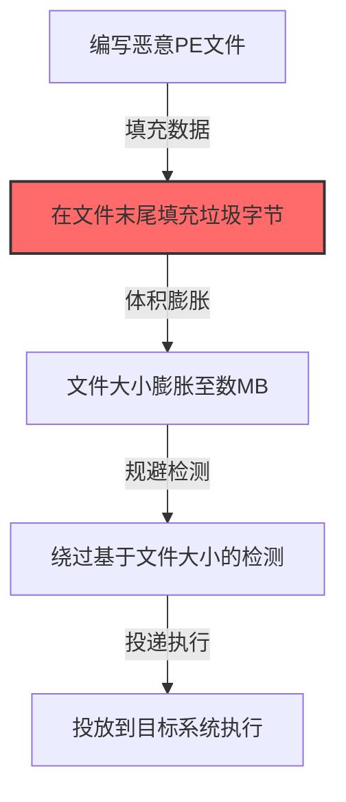

# 二进制填充 (T1027.001)

## 一句话通俗理解

> **在恶意文件末尾添加大量无用的垃圾数据，增大文件体积逃避检测**

## 30秒速查卡

| 维度 | 你需要知道的 |
|------|-------------|
| 这是什么？ | 攻击者在恶意程序文件末尾塞入大量垃圾数据，让文件变大，从而绕过基于文件大小的安全检测规则 |
| 为什么危险？ | 有些安全产品会设置"大于XMB的可执行文件自动标记"或"小文件优先扫描"的规则，填充后恶意文件就能溜过去 |
| 谁需要关心？ | 病毒分析师、安全产品研发人员、威胁情报工程师 |
| 你的第一步防御 | 检测可执行文件中代码段和文件总体积的异常比例（正常程序代码段占比通常>30%，填充后可能<5%） |
| 如果只做一件事 | 对新落地的可执行文件检查PE头部中代码段大小与文件总大小的比值，比值异常低的文件要重点审查 |

## 难度等级

⭐⭐ 中级 - 需要一定的技术基础和经验

## 前置知识检查

**读这个文件需要什么？**

- [ ] 可执行文件（PE格式）的基本结构（头部、代码段、数据段）
- [ ] 文件大小与代码段比例的概念（正常程序代码段占比通常>30%）
- [ ] 安全软件基于文件大小的检测规则原理

## 技术描述

**二进制填充**（T1027.001）是 **混淆文件或信息**（T1027）的一个具体变体，属于 **隐蔽** 阶段的攻击技术。

简单来说，就像小偷把偷来的钻石塞进一个巨大的棉花包里——棉花本身没有价值，但让包裹变得很大，警察按"小包裹重点检查"的规则就忽略了它。

### 具体怎么理解？

在恶意文件末尾添加大量无用的垃圾数据，增大文件体积逃避检测。攻击者会在PE文件的末尾追加成千上万个零字节或随机字节，把一个原本只有50KB的木马膨胀到5MB甚至更大，绕过那些"只扫描小于1MB文件"的安全策略。

### 为什么有效？

这种技术之所以有效，是因为：
1. **利用扫描策略漏洞**：许多安全产品为了节省性能，会设置"大文件跳过扫描"或"小文件优先扫描"的规则，填充后正好卡在跳过扫描的阈值上
2. **不改变功能**：PE加载器只读取头部指定的代码段和数据段，末尾的垃圾数据不会被执行，恶意程序功能完全不受影响

**过渡段：** 简单来说，PE文件有明确的格式——头部记录了"代码从哪里开始、有多长"，加载器只按头部的指示读取。末尾追加的数据对加载器来说是"看不见的"，但对文件系统来说文件变大了。所以检测的关键不是看文件有多大，而是看"代码段大小"和"文件总大小"的比例是否异常。

3. **广泛适用**：可以在多种环境和系统中使用

## 真实攻击流程

### 典型场景

攻击者在 **隐蔽** 阶段使用 二进制填充 技术，以下是典型的攻击步骤：



**步骤详解：**

> **步骤1**：攻击者编写恶意PE可执行文件

> **步骤2**：在PE文件末尾追加大量零字节或随机数据使体积膨胀

> **步骤3**：填充后的文件通过基于大小的白名单或检测规则

> **步骤4**：将伪装文件投递到目标系统执行

## 攻击流程

```
编写恶意PE --> 追加垃圾字节 --> 文件体积膨胀 --> 绕过大小检测 --> 投递执行
```


**步骤详解：**

1. **编写恶意PE文件**
   - 通俗描述：攻击者准备好要分发的原始木马可执行文件
   - 技术细节：构建符合PE格式的可执行文件，PE头部中 SizeOfCode 字段记录代码段真实大小
   - 常用工具：Metasploit、Cobalt Strike、自定义C2框架

2. **追加垃圾字节**
   - 通俗描述：在PE文件末尾塞入大量零字节或随机数据
   - 技术细节：使用文件追加方式写入 0x00 或随机字节，PE加载器只按头部指示读取代码段，忽略末尾多余数据
   - 常用工具：dd、Python脚本、自定义填充工具

3. **文件体积膨胀**
   - 通俗描述：原本几十KB的木马变成几MB甚至几十MB
   - 技术细节：PE文件总大小变大但代码段占比异常低（正常>30%，填充后<5%），是检测关键信号
   - 常用工具：PE-bear、Detect It Easy、文件属性查看

4. **绕过大小检测**
   - 通俗描述：膨胀后的文件成功通过基于大小的检测策略
   - 技术细节：触发安全产品"大于X MB跳过扫描"或"小文件优先"策略，让恶意文件避开静态扫描
   - 常用工具：白名单工具、文件投递工具

5. **投递执行**
   - 通俗描述：将伪装后的文件发送到目标系统并诱导执行
   - 技术细节：通过钓鱼邮件、漏洞利用等方式投递，PE加载器按头部指示加载代码段，垃圾数据不影响功能
   - 常用工具：钓鱼邮件、Cobalt Strike、漏洞利用框架

## 真实案例

### 案例1：该技术在实际攻击中的应用

- **时间**: 2024-2025年
- **目标**: 多个行业组织
- **攻击组织**: 多个APT组织
- **手法**: 攻击者在入侵过程中使用二进制填充技术，展示了该子技术的典型应用场景和攻击效果
- **影响**: 成功实施该技术导致目标系统被进一步入侵
- **参考链接**: [MITRE ATT&CK官方](https://attack.mitre.org/)

### 案例2：安全研究中的实践

- **时间**: 2025年
- **目标**: 安全研究测试环境
- **攻击组织**: 红队/安全研究人员
- **手法**: 在授权测试中模拟二进制填充攻击，验证防御体系的检测和响应能力
- **影响**: 帮助组织识别安全防护中的盲点和改进方向
- **参考链接**: [Atomic Red Team](https://github.com/redcanaryco/atomic-red-team)

## 红队视角

> ⚠️ **免责声明**：以下内容仅用于合法的安全测试、渗透测试和教育目的。未经授权对他人系统进行测试是违法行为。

### 实战技巧

1. **深入理解原理**：在实战应用前，充分理解二进制填充的技术原理和适用场景
2. **环境适配**：根据目标系统的操作系统版本、安全配置等因素调整攻击策略
3. **组合使用**：将该技术与其他技术组合使用，构建完整的攻击链
4. **隐蔽性考虑**：注意操作痕迹的清理，避免被安全设备检测

### 常用工具

| 工具名称 | 用途 | 平台 | 链接 |
| -------- | ---- | ---- | ---- |
| Metasploit | 渗透测试框架 | 全平台 | [Metasploit](https://www.metasploit.com/) |
| Cobalt Strike |  adversary模拟平台 | Windows | [Cobalt Strike](https://www.cobaltstrike.com/) |
| Atomic Red Team | 检测规则测试 | 全平台 | [Atomic Red Team](https://github.com/redcanaryco/atomic-red-team) |

### 注意事项

- 在授权的测试环境中使用这些技术
- 注意操作安全（OPSEC），避免被检测系统发现
- 使用匿名化技术和代理隐藏真实身份

## 蓝队视角

### 检测要点

1. **系统日志监控**：关注与二进制填充相关的系统日志和审计记录
2. **异常行为检测**：监控系统中与该技术相关的异常进程、网络连接和文件操作
3. **工具特征识别**：识别攻击者可能使用的工具在系统中的运行特征

### 监控建议

- 部署端点检测和响应（EDR）系统，监控与二进制填充相关的异常行为
- 配置SIEM规则，关联分析来自多个来源的告警
- 定期进行安全评估和渗透测试，验证检测规则的有效性

## 避坑指南

常见混淆误区：认为Base64编码就能绕过检测。

## 检测建议

### 检测思路

检测 二进制填充 的关键是识别异常行为模式。以下是三个层面的检测方法：

### 网络层检测

**方法**：监控网络流量中的异常模式

```bash
# 检测异常的网络连接和数据传输
# 根据具体协议和端口设置检测规则
```

### 主机层检测

**Windows事件ID**：
- 事件ID 4688：进程创建（监控可疑进程）
- 事件ID 4104：PowerShell执行（监控可疑脚本）

**Linux日志**：
- /var/log/auth.log：认证日志
- /var/log/syslog：系统日志

```bash
# 检测异常进程和命令执行
grep -i "suspicious" /var/log/auth.log
```

### 应用层检测

**用人话说：** 这条规则在监控系统上是否创建了新的可疑进程。二进制填充本身是静态文件操作，很难直接从进程日志检测。真正有效的检测方式是分析文件本身：一个正常的记事本程序（notepad.exe）大概几十KB，但如果某个可执行文件有几十MB甚至上百MB，而且里面大部分是零字节或随机数据，那大概率是被填充过的恶意文件。

**Sigma规则示例**：

```yaml
title: 检测二进制填充
status: experimental
description: 检测可能的二进制填充活动
logsource:
    category: process_creation
    product: windows
detection:
    selection:
        EventID: 4688
    condition: selection
level: medium
tags:
    - attack.T1027001
```

## 缓解措施

### 优先级1：关键措施

**限制攻击面**：减少暴露的服务和端口，降低被利用的风险

```bash
# 防火墙规则示例：只允许必要的出站连接
iptables -A OUTPUT -p tcp --dport 443 -j ACCEPT  # 允许HTTPS
iptables -A OUTPUT -p tcp --dport 80 -j ACCEPT   # 允许HTTP
iptables -A OUTPUT -p tcp -j DROP                 # 阻止其他TCP
```

### 优先级2：重要措施

**加强监控**：部署EDR和SIEM系统，实时监控异常行为

### 优先级3：建议措施

**安全意识培训**：教育员工识别相关攻击手法

## 动手实验

> ⚠️ **所有实验必须在隔离的实验室环境中进行**

### 实验1：理解基本原理（初级）

**目标**：理解 二进制填充 的工作原理

**步骤**：
1. 在隔离环境中搭建测试系统
2. 使用基础工具模拟攻击行为
3. 观察系统日志和网络流量

**学习要点**：理解该技术的核心机制

### 实验2：实际操作（中级）

**目标**：掌握 二进制填充 的实际使用方法

**步骤**：
1. 使用专业工具进行攻击模拟
2. 尝试不同的绕过技术
3. 分析检测日志的特征

**学习要点**：掌握工具使用和日志分析

### 实验3：防御验证（高级）

**目标**：验证检测规则的有效性

**步骤**：
1. 部署检测规则
2. 执行攻击模拟
3. 验证检测告警是否触发

**学习要点**：理解攻防对抗的实际效果

## 术语解释

| 术语 | 通俗解释 |
|------|---------|
| **ATT&CK** | MITRE公司维护的攻击技术知识库，像一本"黑客手法百科全书" |
| **二进制填充** | T1027.001，ATT&CK框架中定义的一种具体攻击技术 |
| **混淆文件或信息** | T1027，二进制填充所属的父技术类别 |
| **隐蔽** | 攻击链中的一个阶段，攻击者在这个阶段的目标 |
| **C2** | 命令与控制，攻击者用来远程控制被入侵系统的"遥控器" |
| **EDR** | 端点检测与响应，部署在电脑上的安全监控软件 |

## 被引用情况

以下父技术文档引用了本子技术：

- [T1027 - 混淆文件或信息](../T1027-Obfuscated-Files-or-Information.md)
- [T1027 - 混淆文件或信息](../T1027-Obfuscated-Files-or-Information.md)

## 参考资料

### 📚 官方文档（深入了解）

- [MITRE ATT&CK - 二进制填充 (T1027.001)](https://attack.mitre.org/techniques/T1027/001/)
- [MITRE ATT&CK - 混淆文件或信息 (T1027)](https://attack.mitre.org/techniques/T1027/)

### 📰 安全报告（真实攻击）

- [MITRE ATT&CK 官方文档](https://attack.mitre.org/) - ATT&CK 框架官方资源

### 🔧 工具与资源（动手试试）

- [Atomic Red Team](https://github.com/redcanaryco/atomic-red-team) - 检测规则测试框架
- [MITRE ATT&CK Navigator](https://mitre-attack.github.io/attack-navigator/) - ATT&CK 可视化工具

### 📚 学习资料（深入了解）

- [MITRE ATT&CK 知识库](https://attack.mitre.org/resources/) - ATT&CK 官方资源中心
