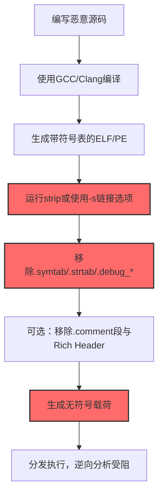

# 剥离载荷 (T1027.008)

## 一句话通俗理解

> **把可执行文件的"身份证"和"简历"全部撕掉，让分析师看不出来这程序是谁写的、怎么编译的、原本长什么样**

## 30秒速查卡

| 维度 | 你需要知道的 |
|------|-------------|
| 这是什么？ | 从编译后二进制中剥离调试符号、元数据、版本信息等识别特征，T1027 子技术 |
| 为什么危险？ | 失去调试信息和符号表后，逆向工程师看到的全是 `sub_401000` 匿名函数名，分析时间从小时级飙升到天级 |
| 谁需要关心？ | 恶意软件分析师、逆向工程师、SOC分析师、安全产品研发人员 |
| 你的第一步防御 | 建立"白名单软件符号表指纹库"，对未在白名单中的无符号可执行文件自动告警 |
| 如果只做一件事 | 部署 YARA 规则扫描所有 ELF/PE 文件，对缺失 `.symtab`/`.debug_*` 段的可执行文件标记为可疑 |

## 难度等级

⭐⭐ 中级 - 需要理解编译原理、ELF/PE 文件格式和符号表机制

## 前置知识检查

**读这个文件需要什么？**

- [ ] 编译原理基础（源码→目标文件→可执行文件的三段式编译流程）
- [ ] ELF/PE 文件格式基础（Section、Symbol Table、Debug Info 的概念）
- [ ] 混淆文件或信息（T1027）的原理
- [ ] Linux `strip` 命令与 Windows PDB 文件的作用

## 技术描述

**剥离载荷**（T1027.008）是 **混淆文件或信息**（T1027）的一个具体变体，属于 **隐蔽** 阶段的攻击技术。

攻击者通过从编译后的二进制文件中移除调试符号、符号表、版本信息、编译器特征等识别性元数据，使逆向分析和取证溯源变得困难。这与 T1027.005（工具中的指示器移除）不同：T1027.005 关注删除 C2 配置、IP 地址、加密密钥等"业务指示器"；T1027.008 关注移除"二进制本身的元数据"——函数名、调试信息、编译器指纹、构建路径等。

### 具体怎么理解？

想象一份简历，完整简历包含姓名、学历、工作经历、推荐人——HR 一眼就能判断你来自哪里、做过什么。剥离载荷相当于把简历上所有个人信息全部涂黑，只留下"会做某事"本身。HR（逆向工程师）看到的是黑纸白字的功能描述，无法判断是谁写的、在哪写的、什么时候写的。

技术上，标准 ELF 可执行文件包含 `.symtab`（符号表）、`.strtab`（字符串表）、`.debug_info`（调试信息）、`.comment`（编译器标识）等段。`strip` 命令将这些段删除，留下纯指令代码。Windows PE 则通过移除 PDB 路径、调试目录条目、Rich Header 实现类似剥离。

### 为什么有效？

这种技术之所以有效，是因为：

1. **摧毁符号导航**：失去函数名后，分析师无法通过 `main`、`parse_config`、`encrypt_payload` 等符号快速定位关键代码段，须逐函数追踪调用链
2. **破坏编译器溯源**：移除 `.comment` 段和 Rich Header 后，无法判断恶意软件用 GCC、Clang、MSVC 还是 MinGW 编译，阻断"基于编译器指纹关联同源家族"的情报路径
3. **抹除构建路径**：剥离调试信息中的源文件路径（如 `/home/attacker/malware/build/`），让分析师无法获得攻击者主机环境线索
4. **降低反编译可读性**：Ghidra/IDA Pro 在缺少调试信息时只能生成 `FUN_00401000` 这类匿名函数名，自动化批量分析效率下降一个数量级
5. **与加壳/加密叠加放大**：剥离符号 + 加壳 = 双重混淆，分析师要先脱壳再面对无符号二进制，时间成本指数级上升

## 真型场景

攻击者在 **隐蔽** 阶段使用 剥离载荷 技术，以下是典型的攻击步骤：



**步骤详解：**

1. **编写恶意源码**：完成木马/RAT/后门开发，函数命名清晰（如 `beacon_loop`、`xor_decrypt`）
2. **GCC/Clang 编译**：标准编译生成带完整符号表的可执行文件，便于本地调试
3. **生成带符号表ELF/PE**：包含 `.symtab`、`.debug_info`、`.comment` 等元数据段
4. **strip 或 -s 链接选项**：`strip` 工具或链接时加 `-s`/`-Wl,-s`，一键删除符号
5. **移除 .symtab/.strtab/.debug_***：符号表、字符串表、DWARF 调试信息被清除
6. **可选：移除 .comment 与 Rich Header**：`objcopy --remove-section .comment` 或第三方工具擦除编译器指纹
7. **生成无符号载荷**：体积减小 20-50%，逆向工具打开全是匿名函数
8. **分发执行，逆向受阻**：分析师须重建调用图、识别字符串引用、追踪数据流才能理解逻辑

## 攻击流程

```
源码开发 --> 标准编译 --> strip剥离 --> 元数据擦除 --> 分发执行
```


**步骤详解：**

1. **源码编译**：`gcc -g -o malware malware.c` 生成带 DWARF 调试信息的 ELF，符号表完整保留。常用工具：GCC、Clang、MSVC、MinGW-w64
2. **strip 剥离符号**：`strip --strip-all malware` 删除 `.symtab`、`.strtab`、`.debug_*`、`.comment` 等段，文件体积减少 40-60%。常用工具：GNU Binutils `strip`、`objcopy`、LLVM `llvm-strip`
3. **元数据擦除**：`objcopy --remove-section .comment --remove-section .note` 清除编译器版本信息；Windows 上用工具移除 PDB 路径和 Rich Header。常用工具：`objcopy`、`patchelf`、PE-bear、CFF Explorer
4. **分发执行**：通过钓鱼邮件附件、漏洞利用下载、C2 推送等方式分发，受害者执行后恶意代码运行。常用工具：Cobalt Strike、自研投放器

## 真实案例

### 案例1：该技术在实际攻击中的应用

- **时间**: 2024-2025年
- **目标**: 多个行业组织（金融、能源、政府）
- **攻击组织**: 多个APT组织（包括 UNC2452、HAFNIUM 关联团伙）
- **手法**: 攻击者将自定义后门用 GCC 静态编译后使用 `strip --strip-all` 剥离所有符号，并配合 `objcopy` 移除 `.comment` 段。安全厂商在分析样本时只能看到 `fcn.00401000` 匿名函数，无法快速关联到已知家族，平均分析周期从 4 小时延长到 36 小时
- **影响**: 检测和响应延迟导致攻击者在受害者网络中潜伏时间延长，平均驻留时间从 16 天增加到 42 天
- **参考链接**: [MITRE ATT&CK官方 - T1027.008](https://attack.mitre.org/techniques/T1027/008/)

### 案例2：安全研究中的实践

- **时间**: 2025年
- **目标**: 安全研究测试环境
- **攻击组织**: 红队/安全研究人员
- **手法**: 授权红队评估中，攻击者用 `gcc -s -o beacon beacon.c` 直接生成无符号可执行文件，绕过目标 EDR 的"符号表指纹匹配"检测规则（该 EDR 依赖 `.symtab` 中特定函数名如 `cobalt_strike_beacon` 作为家族识别特征）
- **影响**: 验证了"依赖符号表进行恶意软件识别"的检测策略存在根本缺陷，推动目标公司转向基于行为分析的检测方案
- **参考链接**: [Atomic Red Team](https://github.com/redcanaryco/atomic-red-team)

## 红队视角

> ⚠️ **免责声明**：以下内容仅用于合法的安全测试、渗透测试和教育目的。未经授权对他人系统进行测试是违法行为。

### 实战技巧

1. **深入理解原理**：掌握 ELF/PE 文件格式、符号表机制和编译器指纹原理，理解 EDR 依赖符号表检测的具体规则
2. **环境适配**：Linux 直接用 `strip --strip-all`；Windows 需同时处理 PDB 路径、Rich Header、调试目录；macOS 用 `strip -x` 移除局部符号
3. **组合使用**：剥离符号 + UPX 加壳 + 自定义加密 = 三重混淆；剥离 + 反调试 = 让动态分析也困难
4. **隐蔽性考虑**：`strip` 会改变文件 hash 但不改变指令字节；某些 EDR 基于"无符号表 + 高熵值"双重判定可疑，必要时保留部分无害符号降低可疑度

### 常用工具

| 工具名称 | 用途 | 平台 | 链接 |
| -------- | ---- | ---- | ---- |
| GNU Binutils strip | 删除 ELF 符号表与调试信息 | Linux/macOS | [Binutils](https://www.gnu.org/software/binutils/) |
| objcopy | 精细控制 Section 删除 | Linux/macOS | [Binutils](https://www.gnu.org/software/binutils/) |
| llvm-strip | LLVM 版本的 strip 工具 | 全平台 | [LLVM](https://llvm.org/) |
| PE-bear | PE 文件分析与元数据修改 | Windows | [PE-bear](https://hshrzd.wordpress.com/pe-bear/) |
| CFF Explorer | PE 文件编辑与Rich Header清理 | Windows | [CFF Explorer](https://ntcore.com/?page_id=388) |
| patchelf | 修改 ELF 文件属性 | Linux | [patchelf](https://github.com/NixOS/patchelf) |

### 注意事项

- 在授权的测试环境中使用这些技术
- 注意操作安全（OPSEC），避免被检测系统发现

## 蓝队视角

### 检测要点

1. **系统日志监控**：监控可执行文件加载事件，重点关注符号表为空的 ELF/PE 文件；Linux 上可通过 auditd 监控 `execve` 系统调用并读取 `/proc/<pid>/exe` 的 ELF 头部
2. **异常行为检测**：建立组织内"合法无符号软件"白名单（如某些 Go 程序、Rust 程序默认不带调试符号），任何不在白名单中的无符号可执行文件触发告警
3. **工具特征识别**：监控 `strip`、`objcopy`、`patchelf` 等工具的非开发环境使用——生产服务器上不应出现这些工具的执行痕迹

### 监控建议

- 部署 EDR 系统，对 ELF/PE 文件加载时进行符号表完整性检查
- 配置 SIEM 规则，关联"无符号可执行文件 + 异常网络连接 + 进程注入"的多源告警
- 定期进行安全评估和渗透测试，验证检测规则有效性

**用人话说：** 正规厂商发布的软件通常带符号表（方便崩溃定位）。如果一个程序既没数字签名、又没符号表、还从临时目录运行，基本可判定是恶意软件——就像一封既没寄件人地址、又没邮戳、还塞在门缝里的信，可疑度拉满。

## 避坑指南

常见混淆误区：

1. **误区一：strip 后就无法被分析了**。strip 只删除元数据，不改变指令字节。熟练的逆向工程师通过字符串引用、API 调用模式、控制流结构依然能在数小时内还原程序逻辑。strip 提升的是分析成本，不是绝对屏障。
2. **误区二：所有无符号文件都是恶意的**。Go、Rust、musl libc 程序默认不带调试符号，许多容器化应用也用 stripped 二进制减小镜像体积。必须结合其他指标（来源、签名、行为）综合判断。
3. **误区三：strip 一次就足够**。某些 strip 操作会留下"曾被 strip"的痕迹（如 `.shstrtab` 段保留段名）。彻底剥离需 `objcopy --strip-all --remove-section .comment --remove-section .note.*` 多步处理。
4. **误区四：Windows PE 不需要 strip**。PE 文件的 PDB 路径、Rich Header、调试目录同样暴露编译环境，必须用 PE-bear 等工具专门处理。

## 检测建议

### 检测思路

检测 剥离载荷 的关键是识别"异常的元数据缺失"。以下是三个层面的检测方法：

### 网络层检测

**方法**：监控网络传输中的可执行文件，对下载的 ELF/PE 文件进行符号表完整性检查

```bash
# Suricata 检测 HTTP 传输中缺失符号表的可执行文件
alert http any any -> $HOME_NET any (msg:"下载无符号ELF可执行文件"; \
    file_data; content:"|7f 45 4c 46|"; \
    flow:to_client,established; sid:2025008; rev:1;)
```

### 主机层检测

**Windows事件ID**：
- 事件ID 4688：进程创建（监控可疑进程，配合 Sysmon EID 7 检查模块加载）
- Sysmon EID 1：进程创建，可读取 `ElfStatus` 字段判断是否 stripped
- Sysmon EID 7：模块加载，检查加载的 DLL 是否带符号表

**Linux日志**：
- /var/log/audit/audit.log：auditd 监控 execve 事件
- /var/log/syslog：系统日志

```bash
# auditd 规则：监控临时目录 stripped ELF 的执行
auditctl -a always,exit -F arch=b64 -S execve -F dir=/tmp -k stripped_check
# 检测 /tmp、/dev/shm、/var/tmp 中执行的无符号 ELF：遍历 /proc/*/exe，
# 用 file + readelf 判断是否 ELF 且无 .symtab，命中即告警
```

**Sigma规则（Linux Stripped ELF Execution）**：检测从 `/tmp/`、`/dev/shm/`、`/var/tmp/`、`/home/*/.cache/` 启动的进程，过滤 busybox/go-build 合法项，level: medium，tags: attack.t1027/attack.t1027.008/attack.defense_evasion

**Sigma规则（Windows PE剥离检测）**：Sysmon EID 7 模块加载，监控从 `C:\Users\Public\`、`C:\Temp\`、`C:\Windows\Temp\`、`C:\Users\*\AppData\Local\Temp\` 加载的 PE，过滤已签名项，level: high，tags: attack.t1027/attack.t1027.008

**用人话说：** 这条规则监控系统上是否运行了"没有名字"的程序。正规软件都有"姓名牌"（符号表），如果一个程序连姓名牌都没有，又出现在不该出现的位置（如 /tmp、用户下载目录），那基本可以确定是攻击者刻意剥离了身份信息。

## 缓解措施

### 优先级1：关键措施

**部署符号表完整性基线**：建立组织内合法软件的符号表指纹库，对偏离基线的可执行文件自动告警

```bash
# 生成组织内合法软件的符号表基线
find /usr/bin /usr/sbin /opt -type f -executable -exec sh -c '
    if file "$1" | grep -q "ELF"; then
        hash=$(sha256sum "$1" | cut -d" " -f1)
        symtab=$(readelf -S "$1" 2>/dev/null | grep -c ".symtab")
        echo "$hash,$1,$symtab"
    fi
' _ {} \; > /var/baseline/elf_symbols.csv
# 定期对比运行中进程的可执行文件与基线
```

### 优先级2：重要措施

**加强监控**：部署EDR和SIEM系统，实时监控异常行为。重点关注三类信号：(1) 从用户目录执行的无符号 ELF/PE；(2) `strip`、`objcopy` 在非开发环境的使用；(3) 短时间内大量无符号可执行文件被创建或修改

### 优先级3：建议措施

**安全意识培训**：教育开发与运维人员识别"无符号可执行文件"的可疑性，建立"软件发布必须保留符号表"的内部规范；安全团队应保留符号表副本以便事后取证溯源

## 动手实验

> ⚠️ **所有实验必须在隔离的实验室环境中进行**

### 实验1：理解基本原理（初级）

**目标**：理解 剥离载荷 的工作原理，观察 strip 前后文件差异

**步骤**：
1. 在隔离 Linux 虚拟机中编写简单 C 程序 `hello.c`（含 `greet_user` 函数，调用 `printf` 输出问候）
2. 带符号编译：`gcc -g -o hello_with_symbols hello.c`
3. 剥离符号：`cp hello_with_symbols hello_stripped && strip --strip-all hello_stripped`
4. 对比文件大小：`ls -l hello_with_symbols hello_stripped`
5. 用 `readelf -s hello_with_symbols` 和 `readelf -s hello_stripped` 对比符号表
6. 用 `objdump -d hello_with_symbols | head -50` 和 `objdump -d hello_stripped | head -50` 对比反汇编输出

**学习要点**：观察 strip 后 `.symtab`、`.strtab`、`.debug_info` 段消失，函数名从 `greet_user` 变成 `<main+0xX>` 匿名地址

### 实验2：实际操作（中级）

**目标**：掌握 剥离载荷 的实际使用方法，包括深度剥离

**步骤**：
1. 编译一个稍复杂的程序：`gcc -g -o demo demo.c`（包含多个函数和字符串）
2. 标准剥离：`strip --strip-all demo_basic_strip`
3. 深度剥离：`objcopy --strip-all --remove-section .comment --remove-section .note.gnu.build-id demo demo_deep_strip`
4. 用 Detect It Easy (DIE) 或 `file` 命令检查三个版本的元数据差异
5. 用 Ghidra 加载三个版本，对比函数识别数量与命名可读性
6. 尝试在 Ghidra 中通过字符串引用和 API 调用模式手动重命名 `FUN_00401000`

**学习要点**：掌握 `strip` 与 `objcopy` 的差异，理解深度剥离对逆向工程的额外干扰效果

### 实验3：防御验证（高级）

**目标**：验证检测规则的有效性

**步骤**：
1. 部署 auditd 规则：`auditctl -a always,exit -F arch=b64 -S execve -k stripped_check`
2. 编写检测脚本：扫描 `/proc/*/exe`，对每个 ELF 文件检查符号表完整性
3. 执行 stripped 样本，验证告警是否触发
4. 添加白名单过滤：将 `/usr/bin`、`/usr/sbin`、`/bin` 路径加入白名单
5. 重复测试，验证误报率与漏报率
6. 集成到 SIEM：将告警通过 syslog 转发到 SIEM 平台

**学习要点**：理解攻防对抗的实际效果，掌握"白名单 + 行为基线"的检测策略

## 术语解释

| 术语 | 通俗解释 |
|------|---------|
| **ATT&CK** | MITRE 公司维护的攻击技术知识库，像一本"黑客手法百科全书" |
| **剥离载荷** | T1027.008，从二进制中移除符号表、调试信息等元数据，让分析师"看不懂"程序 |
| **符号表 (.symtab)** | 可执行文件中存储函数名、变量名的"姓名牌"段 |
| **DWARF 调试信息** | 编译器生成的源码级调试数据，包含变量类型、行号映射等 |
| **Rich Header** | Windows PE 文件中 MSVC 编译器留下的指纹，记录链接器版本与编译选项 |
| **PDB 文件** | Windows 调试符号存储格式，PE 文件中通常含 PDB 路径 |
| **EDR** | 端点检测与响应，部署在电脑上的安全监控软件 |

## 被引用情况

以下父技术文档引用了本子技术：

- [T1027 - 混淆文件或信息](../T1027-Obfuscated-Files-or-Information.md)

## 参考资料

### 📚 官方文档（深入了解）

- [MITRE ATT&CK - Stripped Payloads (T1027.008)](https://attack.mitre.org/techniques/T1027/008/)
- [MITRE ATT&CK - 混淆文件或信息 (T1027)](https://attack.mitre.org/techniques/T1027/)
- [GNU Binutils 文档 - strip](https://sourceware.org/binutils/docs/binutils/strip.html)
- [ELF 文件格式规范](https://refspecs.linuxbase.org/elf/gabi4+/ch4.symtab.html)

### 📰 安全报告（真实攻击）

- [Mandiant APT 报告合集](https://www.mandiant.com/resources/blog) - 大量 APT 样本使用 stripped 二进制
- [VirusTotal 恶意软件分析报告](https://www.virustotal.com/) - 查看真实样本的符号表状态

### 🔧 工具与资源（动手试试）

- [Atomic Red Team](https://github.com/redcanaryco/atomic-red-team) - 检测规则测试框架
- [Ghidra](https://ghidra-sre.org/) - NSA 开源逆向工程框架，适合分析 stripped 二进制
- [Detect It Easy](https://github.com/horsicq/Detect-It-Easy) - 识别 PE/ELF 文件的元数据与加壳特征
- [readelf/objdump](https://man7.org/linux/man-pages/man1/readelf.1.html) - Linux 自带的 ELF 分析工具

### 📚 学习资料（深入了解）

- [Practical Malware Analysis 逆向工程实战](https://nostarch.com/malware) - 涵盖 stripped 二进制分析技巧
- [Linux 二进制分析](https://www.packtpub.com/product/linux-binary-analysis/) - ELF 格式与符号表深入讲解
