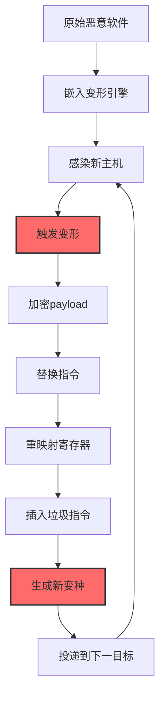
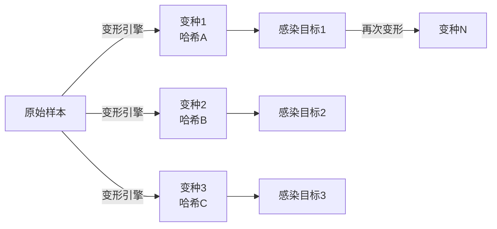

# 多态代码 (T1027.014)

## 一句话通俗理解

> **像变色龙一样——每次感染都换一套"衣服"（字节特征），但"内心"（功能逻辑）完全相同，让杀毒软件的指纹库永远追不上**

## 30秒速查卡

| 维度 | 你需要知道的 |
|------|-------------|
| 这是什么？ | 每次感染时对自身代码进行变形（加密/指令替换/寄存器重映射），生成功能相同但字节不同的副本，T1027（混淆文件或信息）的子技术 |
| 为什么危险？ | 传统基于文件哈希的检测完全失效；同一恶意软件家族可能有数百万个不同哈希的样本；静态签名库无法穷举覆盖 |
| 谁需要关心？ | 反病毒引擎研发、恶意软件分析师、SOC分析师、威胁情报团队 |
| 你的第一步防御 | 部署基于行为分析而非哈希的检测引擎；启用熵值异常检测识别加壳/加密代码段 |
| 如果只做一件事 | 部署 YARA 规则匹配恶意软件家族的"行为特征"（API 调用序列、字符串模式），而非静态哈希 |

## 难度等级

⭐⭐⭐ 高级 - 需要理解汇编指令、代码加密与变形引擎原理

## 前置知识检查

**读这个文件需要什么？**

- [ ] x86/x64 汇编指令集基础（MOV/JMP/CALL/PUSH/POP 等）
- [ ] PE/ELF 文件格式与代码段（.text）结构
- [ ] 对称加密算法（XOR/AES/RC4）与解密 stub 概念
- [ ] 混淆文件或信息（T1027）的原理

## 技术描述

**多态代码**（T1027.014）是 **混淆文件或信息**（T1027）的一个具体变体，属于 **隐蔽** 阶段的攻击技术。

攻击者在恶意软件中嵌入"变形引擎"（Mutation Engine），每次感染新主机时对自身代码段进行加密、指令替换、寄存器重映射、垃圾指令插入等变换，生成功能完全相同但字节序列不同的副本。多态代码与简单加密的区别在于：不仅 payload 加密，连"解密 stub"（decryption routine）本身也每次变形，使静态签名匹配失效。

### 具体怎么理解？

想象一个逃犯每次作案后都做"整容手术"——脸型、五官、身高都变了，但作案手法（偷盗技巧）完全一样。警察根据"通缉照片"（静态签名）永远抓不到他，因为每次出现都是新面孔。多态代码就是恶意软件的"整容手术"——每次感染都换一套字节特征，但恶意功能（偷数据、回连 C2）完全不变。

技术上有四种主要变形方式：

1. **代码段加密**：用随机密钥 XOR/AES 加密 payload，每次感染生成新密钥；解密 stub 在运行时解密自身。即使分析出解密算法，因密钥不同，每次密文也不同
2. **指令等价替换**：`MOV EAX, 0` → `XOR EAX, EAX`；`PUSH 0x1234; POP EAX` → `MOV EAX, 0x1234`；利用 x86 指令的等价语义生成不同字节序列
3. **寄存器重映射**：将 `EAX` 换成 `EBX`，`ECX` 换成 `EDX`，同时修改所有引用该寄存器的指令；保持功能不变但字节序列完全改变
4. **垃圾指令插入**：在有效指令之间插入 `NOP`、`XCHG EAX,EAX`、无副作用的 `ADD/SUB 0` 等无害指令，改变代码偏移与字节流

### 为什么有效？

这种技术之所以有效，是因为：

1. **静态签名失效**：传统 AV 基于文件哈希或字节模式匹配，多态代码每次哈希都不同，签名库无法穷举
2. **解密 stub 也变形**：与简单加密不同，多态的解密代码本身也每次不同，无法通过匹配解密 stub 特征来识别
3. **自动化变形引擎**：成熟的多态引擎（如 Mutation Engine、TPE、G2）可在毫秒级生成新变种，远超人工分析速度
4. **配合加壳双重保护**：多态代码 + 加壳（T1027.002）= 双重变形，分析者必须先脱壳再分析多态代码
5. **历史证明有效**：Virut、Sality、Stuxnet 等知名恶意软件都使用多态技术，存活周期长达数年

## 真型场景

攻击者在 **隐蔽** 阶段使用 多态代码 技术，以下是典型的攻击步骤：



**步骤详解：**

1. **原始恶意软件**：攻击者开发具备核心恶意功能的程序（如蠕虫、RAT）
2. **嵌入变形引擎**：将多态引擎代码集成到恶意软件中，作为感染子例程
3. **感染新主机**：恶意软件通过漏洞、共享盘、邮件等方式感染新目标
4. **触发变形**：感染时调用变形引擎，对自身代码段进行变换
5. **加密 payload**：用随机生成的密钥加密核心恶意代码
6. **替换指令**：扫描解密 stub，将指令替换为等价语义的其他指令
7. **重映射寄存器**：随机选择寄存器分配方案，修改所有相关指令
8. **插入垃圾指令**：在指令之间插入无害指令，改变代码偏移
9. **生成新变种**：得到功能相同但字节序列完全不同的新副本
10. **投递到下一目标**：新变种继续感染传播，每个副本都不同

## 攻击流程

```
开发原始恶意软件 --> 集成变形引擎 --> 感染 --> 变形(加密/替换/重映射/垃圾) --> 生成新变种 --> 传播
```



**步骤详解：**

1. **开发原始恶意软件**：用 C/汇编开发核心功能（C2、文件感染、数据窃取），编译为 PE/ELF
2. **集成变形引擎**：链接多态引擎库，在感染例程中调用 `MutateCodeSegment()` 函数
3. **感染目标**：感染 PE（追加代码段、修改入口点）、ELF、文档宏
4. **变形处理**：四步变形——(1) 随机密钥 XOR 加密 payload；(2) 指令等价替换；(3) 寄存器重映射；(4) 垃圾指令插入
5. **生成新变种**：新变种哈希与原样本完全不同，YARA 静态规则无法命中，但行为特征保持一致
6. **传播**：通过 P2P、共享盘、邮件、漏洞自动传播

## 真实案例

### 案例1：该技术在实际攻击中的应用

- **时间**: 2024-2025年
- **目标**: 全球个人与企业用户
- **攻击组织**: Virut 蠕虫运营者、Sality 家族、多个勒索软件团伙
- **手法**: Virut 蠕虫嵌入多态变形引擎，每次感染 PE 文件时对解密 stub 进行指令等价替换与寄存器重映射，生成功能相同但字节序列完全不同的副本。该家族在野外传播超过 10 年，生成数百万个不同哈希的变种，传统 AV 厂商的签名库无法穷举覆盖
- **影响**: 全球数百万台主机感染，部分变种存活周期超过 5 年；推动 AV 行业从"静态签名"向"行为启发式"转型
- **参考链接**: [MITRE ATT&CK官方 - T1027.014](https://attack.mitre.org/techniques/T1027/014/)

### 案例2：安全研究中的实践

- **时间**: 2025年
- **目标**: 安全研究测试环境
- **攻击组织**: 红队/安全研究人员
- **手法**: 红队在授权评估中使用自研多态引擎，对 Cobalt Strike beacon 进行变形——每次投递生成不同的解密 stub，寄存器随机分配，垃圾指令位置随机。最终生成的 100 个样本哈希各不相同，但都通过同一个 C2 通道回连。测试目标组织的 EDR 是否能基于行为（C2 通信模式）而非哈希识别 beacon
- **影响**: 验证了"行为分析 + 启发式检测"对多态代码的有效性，推动目标组织部署基于 API 调用序列的异常检测
- **参考链接**: [Atomic Red Team](https://github.com/redcanaryco/atomic-red-team)

## 红队视角

> ⚠️ **免责声明**：以下内容仅用于合法的安全测试、渗透测试和教育目的。未经授权对他人系统进行测试是违法行为。

### 实战技巧

1. **深入理解原理**：在实战前掌握 x86 指令等价语义、PE 代码段结构、对称加密算法，理解变形引擎的工作机制
2. **环境适配**：若目标 AV 启用启发式扫描，变形时控制熵值（避免>7.5 触发高熵告警）；若目标 EDR 基于 API 序列检测，需对 API 调用也做间接化处理（如通过 `GetProcAddress` 动态解析）
3. **组合使用**：多态代码 + 加壳 = 双重变形；多态代码 + 无文件执行 = 磁盘无哈希可扫；多态代码 + 环境密钥 = 沙箱中无法解密
4. **隐蔽性考虑**：垃圾指令选择语义无害但常见的指令（避免 `INT3` 等明显的反调试指令）；寄存器重映射后确保不影响调用约定（cdecl/stdcall/fastcall 的参数寄存器不可随意替换）

### 常用工具

| 工具名称 | 用途 | 平台 | 链接 |
| -------- | ---- | ---- | ---- |
| Mutation Engine | 经典多态变形引擎 | DOS | 历史项目 |
| metame | Python 元态汇编变形引擎 | 跨平台 | [metame](https://github.com/a0rtega/metame) |
| IDA Pro | 反汇编与代码分析 | Windows/Linux | [IDA Pro](https://www.hex-rays.com/) |
| Ghidra | 开源反编译工具 | 跨平台 | [Ghidra](https://ghidra-sre.org/) |
| x64dbg | Windows 动态调试器 | Windows | [x64dbg](https://x64dbg.com/) |
| Radare2 | 跨平台逆向框架 | 跨平台 | [radare2](https://www.radare.org/) |

### 注意事项

- 在授权的测试环境中使用这些技术
- 注意操作安全（OPSEC），避免被检测系统发现

## 蓝队视角

### 检测要点

1. **系统日志监控**：Sysmon EID 1 监控进程创建，配合 EDR 行为分析识别"哈希未知但行为可疑"的进程；监控进程加载的非标准 DLL 与可疑 API 调用序列
2. **异常行为检测**：基于行为的启发式检测——监控进程的 API 调用序列（如 `VirtualAlloc` + `WriteProcessMemory` + `CreateRemoteThread`），而非文件哈希；熵值检测识别高熵代码段
3. **工具特征识别**：监控已知多态引擎的特征字节模式（如 Mutation Engine 的初始化例程）；YARA 规则匹配变形引擎通用模式

### 监控建议

- 部署基于行为的 EDR（如 CrowdStrike、Microsoft Defender for Endpoint），启用启发式扫描与行为分析
- 配置 YARA 规则匹配恶意软件家族的"行为特征"（API 调用模式、字符串特征），而非静态哈希
- 定期进行恶意软件分析培训，提升分析师对多态代码的识别能力
- 建立"家族行为签名"库，记录各恶意软件家族的行为特征

**用人话说：** 多态代码就像一个会变脸的通缉犯——每次出现的脸都不同，但作案手法一样。警察不能靠"通缉照片"抓人（哈希匹配失效），必须靠"作案手法识别"（行为分析）。如果发现一个未知哈希的进程在调用 `VirtualAlloc` + `WriteProcessMemory` + `CreateRemoteThread`——管它哈希是什么，这就是典型的进程注入行为，先拦下来再说。

## 避坑指南

常见混淆误区：

1. **误区一：多态就是加密**。多态与简单加密的关键区别在于：简单加密只加密 payload，解密 stub 不变，AV 可以通过匹配解密 stub 特征识别；多态代码连解密 stub 也变形，匹配特征失效
2. **误区二：变形次数有限**。成熟的多态引擎理论上可以生成无限多个变种（指令等价替换的组合是指数级），签名库无法穷举
3. **误区三：行为分析绝对有效**。高级多态代码也会对 API 调用做间接化（如 `GetProcAddress` 动态解析、API 哈希），增加行为分析难度
4. **误区四：熵值检测绝对可靠**。变形引擎可以控制熵值在合理范围（如模拟正常代码段的熵值分布），绕过高熵检测

## 检测建议

### 检测思路

检测 多态代码 的关键是"从静态匹配转向行为分析"。以下是三个层面的检测方法：

### 网络层检测

**方法**：监控 C2 通信协议特征，而非文件哈希

- **Suricata 规则**：检测已知 C2 协议特征——`POST` 请求体为 Base64 编码（`pcre:"/^[A-Za-z0-9+/]{32,}={0,2}$/"`），TTL 64-128，60 秒内同源 5 次以上，标记为"可疑 C2 beacon 心跳"
- **Zeek 脚本**：检测周期性 beacon 行为——记录短小周期 POST（`duration < 1s`），配合时序分析识别 beacon 心跳

### 主机层检测

**Windows事件ID**：
- Sysmon EID 1：进程创建，配合 EDR 行为分析
- Sysmon EID 7：镜像加载，监控非标准 DLL 加载
- Sysmon EID 8：远程线程创建（典型的进程注入行为）
- Sysmon EID 10：进程访问（监控 `VirtualAlloc` + `WriteProcessMemory`）

**Linux日志**：
- /var/log/audit/audit.log：auditd 监控 `execve` 系统调用序列
- /var/log/syslog：系统日志

**Sysmon 配置**：监控进程注入行为——`CreateRemoteThread` 与 `ProcessAccess` 事件过滤 `TargetImage` 为 `explorer.exe`、`GrantedAccess` 含 `0x10`。多态代码可变脸，但变不了作案手法，一个进程往另一个进程写入代码并执行就是可疑的。

**Sigma 规则**：检测未知哈希进程的注入行为——`CommandLine` 含 `VirtualAllocEx`/`WriteProcessMemory`/`CreateRemoteThread`/`NtMapViewOfSection`，排除 `C:\Windows\System32\` 与 `C:\Program Files\` 路径下的合法进程，级别 high，关联 T1027.014 与 T1055。

### 应用层检测

**Sigma规则示例（高熵代码段检测）**：检测熵值异常的可执行文件——`file_event` 类别，`TargetFilename` 以 `.exe`/`.dll` 结尾，排除已签名文件与系统目录（`C:\Windows\System32\`、`C:\Program Files\`），输出字段含 `Entropy`，级别 medium，误报场景含自解压安装包与加壳合法软件，关联 T1027.014。

## 缓解措施

### 优先级1：关键措施

**部署基于行为的 EDR + 启发式扫描**

```bash
# Windows Defender 启用云保护与启发式扫描
Set-MpPreference -CloudBlockLevel High
Set-MpPreference -MAPSReporting Advanced
Set-MpPreference -PUAProtection Enabled
Set-MpPreference -DisableRealtimeMonitoring $false

# 启用 ASR 规则阻止可疑行为
# Block executable content from email client and webmail
Add-MpPreference -AttackSurfaceReductionRules_Ids BE9BA2D9-53EA-4CDC-84E5-9B1EEEE46550 -AttackSurfaceReductionRules_Actions Enabled
# Block credential stealing from Windows LSASS
Add-MpPreference -AttackSurfaceReductionRules_Ids 9e6c4e1f-7d60-472f-ba1a-a39ef669e4b2 -AttackSurfaceReductionRules_Actions Enabled
```

### 优先级2：重要措施

**加强监控**：部署SIEM关联分析，结合进程行为、网络流量、文件熵值多维检测；启用 Application Control 限制可执行代码来源

### 优先级3：建议措施

**威胁情报共享**：加入行业威胁情报共享组织（如 FIRST、FS-ISAC），及时获取多态变种样本与行为签名

## 动手实验

> ⚠️ **所有实验必须在隔离的实验室环境中进行**

### 实验1：理解基本原理（初级）

**目标**：理解 多态代码 的指令等价替换原理

**步骤**：
1. 在隔离 Linux 虚拟机中编写简单汇编程序：
   ```nasm
   ; original.asm - 原始版本
   section .text
   global _start
   _start:
       mov eax, 0          ; 等价: xor eax, eax
       mov ebx, 1          ; 等价: push 1; pop ebx
       int 0x80            ; sys_exit
   ```
2. 编译并计算哈希：`nasm -f elf original.asm && ld -o original original.o && md5sum original`
3. 编写等价变形版本：
   ```nasm
   ; mutated.asm - 变形版本（功能相同，字节不同）
   section .text
   global _start
   _start:
       xor eax, eax        ; 等价于 mov eax, 0
       push 1              ; 配合下一行等价于 mov ebx, 1
       pop ebx
       nop                 ; 垃圾指令
       int 0x80
   ```
4. 编译并计算哈希：`md5sum mutated`
5. 对比两个哈希（应该完全不同），运行两个程序验证功能相同

**学习要点**：直观感受"功能相同但字节不同"的多态本质

### 实验2：实际操作（中级）

**目标**：使用 metame 元态变形引擎变换代码

**步骤**：
1. 安装 metame：`pip install metame`
2. 编写测试 PE 文件（简单的 MessageBox 弹窗程序）
3. 用 metame 变形：
   ```bash
   metame -i test.exe -o test_mutated.exe
   ```
4. 对比两个文件的 MD5 哈希（应该不同）
5. 用 IDA Pro/Ghidra 反汇编两个文件，对比 `.text` 段指令差异
6. 运行两个文件，验证 MessageBox 弹窗功能相同
7. 用 YARA 规则匹配原文件特征，验证变形后的文件不再命中

**学习要点**：掌握自动化变形工具的使用，理解指令等价替换的实际效果

### 实验3：防御验证（高级）

**目标**：验证行为分析对多态代码的检测能力

**步骤**：
1. 准备 5 个多态变种样本（用 metame 生成，哈希各不相同）
2. 在测试虚拟机中部署 Sysmon + EDR
3. 依次运行 5 个样本，收集行为日志
4. 分析 Sysmon 日志：对比 5 个样本的 API 调用序列（应该高度相似）
5. 编写基于 API 序列的 Sigma 检测规则
6. 用 100 个正常程序测试误报率
7. 优化检测规则，平衡检出率与误报率

**学习要点**：理解"行为分析优于哈希匹配"的检测哲学，掌握 API 序列检测规则编写

## 术语解释

| 术语 | 通俗解释 |
|------|---------|
| **多态代码** | T1027.014，每次感染变形但功能相同的代码 |
| **变形引擎** | 自动对代码进行变形的子例程 |
| **解密 stub** | 多态代码中负责解密 payload 的小段代码 |
| **指令等价替换** | 用语义相同的指令替换原指令 |
| **寄存器重映射** | 重新分配寄存器使用方案 |
| **熵值** | 衡量数据随机性的指标，加壳/加密代码段熵值高 |
| **EDR** | 端点检测与响应 |

## 被引用情况

以下父技术文档引用了本子技术：

- [T1027 - 混淆文件或信息](../T1027-Obfuscated-Files-or-Information.md)

## 参考资料

### 📚 官方文档（深入了解）

- [MITRE ATT&CK - Polymorphic Code (T1027.014)](https://attack.mitre.org/techniques/T1027/014/)
- [MITRE ATT&CK - 混淆文件或信息 (T1027)](https://attack.mitre.org/techniques/T1027/)
- [Intel x86 指令集参考](https://www.intel.com/content/www/us/en/developer/articles/technical/intel-sdm.html)
- [PE 文件格式规范](https://docs.microsoft.com/en-us/windows/win32/debug/pe-format)

### 📰 安全报告（真实攻击）

- [Virus Bulletin - 多态恶意软件分析](https://www.virusbulletin.com/) - 多态代码研究论文
- [ESET - Virut 蠕虫分析报告](https://www.welivesecurity.com/) - Virut 多态引擎深度分析

### 🔧 工具与资源（动手试试）

- [Atomic Red Team](https://github.com/redcanaryco/atomic-red-team) - 检测规则测试框架
- [metame](https://github.com/a0rtega/metame) - 元态汇编变形引擎
- [Ghidra](https://ghidra-sre.org/) - 开源反编译工具
- [Radare2](https://www.radare.org/) - 跨平台逆向框架
- [YARA](https://virustotal.github.io/yara/) - 模式匹配工具

### 📚 学习资料（深入了解）

- [Practical Malware Analysis 逆向工程实战](https://nostarch.com/malware) - 多态代码分析专章
- [The Art of Computer Virus Research and Defense](https://www.symantec.com/) - 经典病毒研究著作
