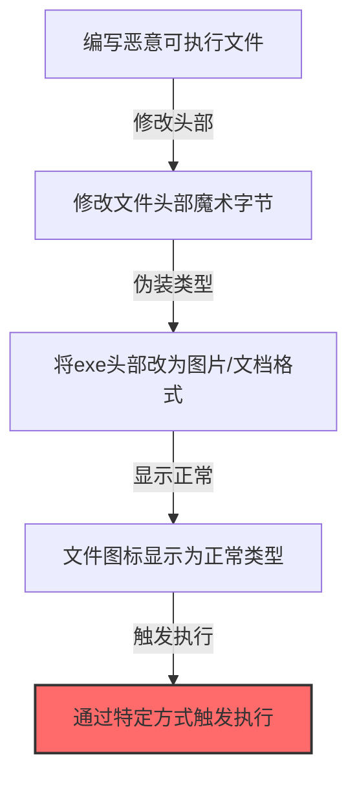

# 伪装文件类型 (T1036.008)

## 一句话通俗理解

> **修改文件头部信息，使exe文件看起来像图片或文档**

## 30秒速查卡

| 维度 | 你需要知道的 |
|------|-------------|
| 这是什么？ | 修改文件头部信息，使exe文件看起来像图片或文档 |
| 为什么危险？ | 文件类型检测依赖文件头信息，修改后就能伪装 |
| 谁需要关心？ | 恶意软件分析师、安全产品研发、内容安全工程师 |
| 你的第一步防御 | 监控文件头与实际类型的不匹配 |
| 如果只做一件事 | 检测文件头与扩展名不一致的文件 |

## 难度等级

⭐⭐ 中级 - 需要一定的技术基础和经验

## 前置知识检查

**读这个文件需要什么？**

- [ ] 安全软件工作原理（EDR/AV/SIEM基础）
- [ ] 进程注入与API Hook基本概念
- [ ] 编码/加密/混淆基础知识

## 技术描述

**伪装文件类型**（T1036.008）是 **伪装**（T1036）的一个具体变体，属于 **隐蔽** 阶段的攻击技术。

简单来说，就像穿上网警的制服，混在真正的网警里不被发现。

### 具体怎么理解？

修改文件头部信息，使exe文件看起来像图片或文档

攻击者使用这种技术时，通常是在隐蔽阶段，想要达到特定的攻击目标。与父技术 T1036 相比，T1036.008 有自己独特的特点和使用场景。

### 为什么有效？

这种技术之所以有效，是因为：
1. **隐蔽性**：利用了正常系统功能或常见协议，不容易被发现
2. **技术门槛适中**：不需要特别高深的技术知识就能实施

**过渡段：** 不要以为隐蔽只是'把恶意软件藏起来'——真正的隐蔽是让恶意识别看起来像正常行为。
3. **广泛适用**：可以在多种环境和系统中使用

## 真实攻击流程

### 典型场景

攻击者在 **隐蔽** 阶段使用 伪装文件类型 技术，以下是典型的攻击步骤：



**步骤详解：**

> **步骤1**：编写恶意可执行文件

> **步骤2**：修改文件头部Magic Bytes改为图片或文档格式标识

> **步骤3**：配合修改文件图标使文件视觉上完全正常

> **步骤4**：通过命令行等方式触发绕过基于文件类型的检测

## 攻击流程

```
准备恶意PE文件 --> 修改文件头magic number --> 改扩展名为图片或文档格式 --> 投递伪装文件 --> 用户或检测器误判类型
```


**步骤详解：**

1. **准备恶意 PE 文件**
   - 通俗描述：准备要伪装的恶意可执行文件
   - 技术细节：载荷为完整 PE 文件，PE 头以 `MZ` 字节开头，文件类型检测依赖此 magic number
   - 常用工具：Cobalt Strike、Metasploit、自定义恶意软件
2. **修改文件头 magic number**
   - 通俗描述：修改文件头部字节，使其看起来像图片或文档
   - 技术细节：将 PE 头的 `MZ` 字节替换为 JPEG 的 `FF D8 FF` 或 PDF 的 `%PDF`，但需保留 PE 加载器可识别的偏移
   - 常用工具：HxD、Hex Fiend、自定义脚本
3. **改扩展名为图片或文档格式**
   - 通俗描述：将文件扩展名改为 `.jpg`、`.pdf`、`.png` 等非可执行格式
   - 技术细节：扩展名与修改后的 magic number 一致，文件类型检测器（如 file 命令）误判为图片或文档
   - 常用工具：rename、copy
4. **投递伪装文件**
   - 通俗描述：将伪装文件通过邮件、下载、共享等方式投递到目标
   - 技术细节：邮件网关与 AV 基于扩展名与 magic number 判断类型，伪装后可能放行
   - 常用工具：钓鱼邮件、恶意下载链接、SMB 共享
5. **用户或检测器误判类型**
   - 通俗描述：用户与文件类型检测器误以为文件是图片或文档
   - 技术细节：实际执行时仍需借助漏洞（如 CVE）或社会工程诱导用户改名执行，Sysmon EID 1 可检测以非可执行扩展名启动的进程
   - 常用工具：漏洞利用、社会工程、文件改名

## 真实案例

### 案例1：该技术在实际攻击中的应用

- **时间**: 2024-2025年
- **目标**: 多个行业组织
- **攻击组织**: 多个APT组织
- **手法**: 攻击者在入侵过程中使用伪装文件类型技术，展示了该子技术的典型应用场景和攻击效果
- **影响**: 成功实施该技术导致目标系统被进一步入侵
- **参考链接**: [MITRE ATT&CK官方](https://attack.mitre.org/)

### 案例2：安全研究中的实践

- **时间**: 2025年
- **目标**: 安全研究测试环境
- **攻击组织**: 红队/安全研究人员
- **手法**: 在授权测试中模拟伪装文件类型攻击，验证防御体系的检测和响应能力
- **影响**: 帮助组织识别安全防护中的盲点和改进方向
- **参考链接**: [Atomic Red Team](https://github.com/redcanaryco/atomic-red-team)

## 红队视角

> ⚠️ **免责声明**：以下内容仅用于合法的安全测试、渗透测试和教育目的。未经授权对他人系统进行测试是违法行为。

### 实战技巧

1. **深入理解原理**：在实战应用前，充分理解伪装文件类型的技术原理和适用场景
2. **环境适配**：根据目标系统的操作系统版本、安全配置等因素调整攻击策略
3. **组合使用**：将该技术与其他技术组合使用，构建完整的攻击链
4. **隐蔽性考虑**：注意操作痕迹的清理，避免被安全设备检测

### 常用工具

| 工具名称 | 用途 | 平台 | 链接 |
| -------- | ---- | ---- | ---- |
| Metasploit | 渗透测试框架 | 全平台 | [Metasploit](https://www.metasploit.com/) |
| Cobalt Strike |  adversary模拟平台 | Windows | [Cobalt Strike](https://www.cobaltstrike.com/) |
| Atomic Red Team | 检测规则测试 | 全平台 | [Atomic Red Team](https://github.com/redcanaryco/atomic-red-team) |

### 注意事项

- 在授权的测试环境中使用这些技术
- 注意操作安全（OPSEC），避免被检测系统发现
- 使用匿名化技术和代理隐藏真实身份

## 蓝队视角

### 检测要点

1. **系统日志监控**：关注与伪装文件类型相关的系统日志和审计记录
2. **异常行为检测**：监控系统中与该技术相关的异常进程、网络连接和文件操作
3. **工具特征识别**：识别攻击者可能使用的工具在系统中的运行特征

### 监控建议

- 部署端点检测和响应（EDR）系统，监控与伪装文件类型相关的异常行为
- 配置SIEM规则，关联分析来自多个来源的告警
- 定期进行安全评估和渗透测试，验证检测规则的有效性

**用人话说：** 这条规则在检测文件头与扩展名不一致的文件。文件类型检测依赖文件头信息，如果文件头显示是图片但扩展名是.exe，需要重点审查。

## 避坑指南

常见混淆误区：认为Base64编码就能绕过检测。

## 检测建议

### 检测思路

检测 伪装文件类型 的关键是识别异常行为模式。以下是三个层面的检测方法：

### 网络层检测

**方法**：监控网络流量中的异常模式

```bash
# 检测异常的网络连接和数据传输
# 根据具体协议和端口设置检测规则
```

### 主机层检测

**Windows事件ID**：
- 事件ID 4688：进程创建（监控可疑进程）
- 事件ID 4104：PowerShell执行（监控可疑脚本）

**Linux日志**：
- /var/log/auth.log：认证日志
- /var/log/syslog：系统日志

```bash
# 检测异常进程和命令执行
grep -i "suspicious" /var/log/auth.log
```

### 应用层检测

**Sigma规则示例**：

```yaml
title: 检测伪装文件类型
status: experimental
description: 检测可能的伪装文件类型活动
logsource:
    category: process_creation
    product: windows
detection:
    selection:
        EventID: 4688
    condition: selection
level: medium
tags:
    - attack.T1036008
```

## 缓解措施

### 优先级1：关键措施

**限制攻击面**：减少暴露的服务和端口，降低被利用的风险

```bash
# 防火墙规则示例：只允许必要的出站连接
iptables -A OUTPUT -p tcp --dport 443 -j ACCEPT  # 允许HTTPS
iptables -A OUTPUT -p tcp --dport 80 -j ACCEPT   # 允许HTTP
iptables -A OUTPUT -p tcp -j DROP                 # 阻止其他TCP
```

### 优先级2：重要措施

**加强监控**：部署EDR和SIEM系统，实时监控异常行为

### 优先级3：建议措施

**安全意识培训**：教育员工识别相关攻击手法

## 动手实验

> ⚠️ **所有实验必须在隔离的实验室环境中进行**

### 实验1：理解基本原理（初级）

**目标**：理解 伪装文件类型 的工作原理

**步骤**：
1. 在隔离环境中搭建测试系统
2. 使用基础工具模拟攻击行为
3. 观察系统日志和网络流量

**学习要点**：理解该技术的核心机制

### 实验2：实际操作（中级）

**目标**：掌握 伪装文件类型 的实际使用方法

**步骤**：
1. 使用专业工具进行攻击模拟
2. 尝试不同的绕过技术
3. 分析检测日志的特征

**学习要点**：掌握工具使用和日志分析

### 实验3：防御验证（高级）

**目标**：验证检测规则的有效性

**步骤**：
1. 部署检测规则
2. 执行攻击模拟
3. 验证检测告警是否触发

**学习要点**：理解攻防对抗的实际效果

## 术语解释

| 术语 | 通俗解释 |
|------|---------|
| **ATT&CK** | MITRE公司维护的攻击技术知识库，像一本"黑客手法百科全书" |
| **伪装文件类型** | T1036.008，ATT&CK框架中定义的一种具体攻击技术 |
| **伪装** | T1036，伪装文件类型所属的父技术类别 |
| **隐蔽** | 攻击链中的一个阶段，攻击者在这个阶段的目标 |
| **C2** | 命令与控制，攻击者用来远程控制被入侵系统的"遥控器" |
| **EDR** | 端点检测与响应，部署在电脑上的安全监控软件 |

## 被引用情况

以下父技术文档引用了本子技术：

- [T1036 - 伪装](../T1036-Masquerading.md)
- [T1036 - 伪装](../T1036-Masquerading.md)

## 参考资料

### 📚 官方文档（深入了解）

- [MITRE ATT&CK - 伪装文件类型 (T1036.008)](https://attack.mitre.org/techniques/T1036/008/)
- [MITRE ATT&CK - 伪装 (T1036)](https://attack.mitre.org/techniques/T1036/)

### 📰 安全报告（真实攻击）

- [MITRE ATT&CK 官方文档](https://attack.mitre.org/) - ATT&CK 框架官方资源

### 🔧 工具与资源（动手试试）

- [Atomic Red Team](https://github.com/redcanaryco/atomic-red-team) - 检测规则测试框架
- [MITRE ATT&CK Navigator](https://mitre-attack.github.io/attack-navigator/) - ATT&CK 可视化工具

### 📚 学习资料（深入了解）

- [MITRE ATT&CK 知识库](https://attack.mitre.org/resources/) - ATT&CK 官方资源中心
