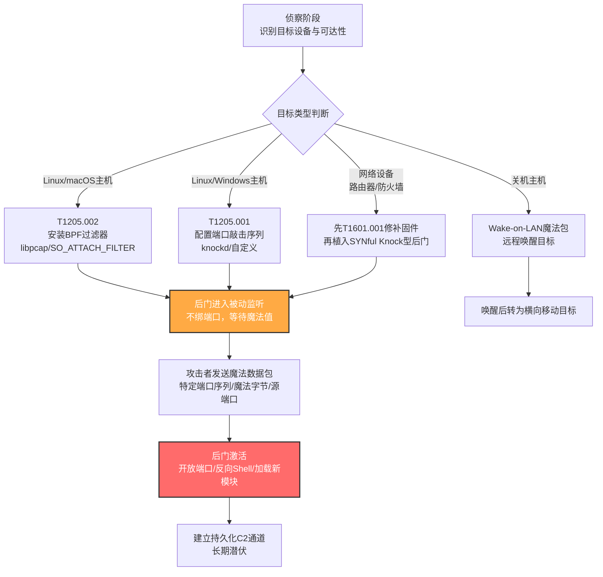

# 流量信令 (T1205)

## 一句话通俗理解

攻击者像在自家门口装了一个"暗号门铃"——你必须先按特定顺序敲几下、再说出特定口令，门才会开；不知暗号的人在门外怎么看都只是一堵墙，连门铃都没有。

## 30秒速查卡

| 维度 | 你需要知道的 |
|------|-------------|
| 这是什么？ | 通过发送预定义的"魔法值"或"魔法序列"数据包来触发后门激活、端口开放或特殊响应——只有知道暗号的攻击者才能唤醒隐藏功能 |
| 为什么危险？ | 后门平时完全静默（不监听端口、不向外通信），任何端口扫描、流量分析都看不见它；攻击者甚至能在已开放端口的合法服务上"叠加"一个仅响应魔法值的功能 |
| 谁需要关心？ | 网络设备管理员（路由器/防火墙/VPN设备）、Linux系统管理员、SOC分析师、IoT/嵌入式设备运维 |
| 你的第一步防御 | 在边界防火墙启用状态检测，关闭Wake-on-LAN；监控短时间内多个关闭端口的连接序列与紧随其后的防火墙规则变更 |
| 如果只做一件事 | 部署检测规则：远程IP短时间内触碰多个关闭端口（SYN→RST），随后宿主防火墙规则变更或新进程开始监听端口（DET0524 AN1448/AN1449） |

## 难度等级

⭐⭐⭐ 高级（需要深入的网络与系统底层知识）

流量信令属于高级隐蔽与持久化技术，原因在于：

- 攻击者需要熟悉TCP/IP协议栈、原始套接字、BPF（Berkeley Packet Filter）过滤器和libpcap/WinPcap的工作原理
- 不同的子技术对应不同的实现路径：端口敲击需要协调防火墙规则或自定义服务，套接字过滤器需要内核级或原始套接字级的数据包捕获能力
- 在网络设备上实施还需要先完成"修补系统镜像"（T1601.001）以持久化修改IOS/JunOS固件，技术链路长且需要设备级权限
- 防御方若不理解libpcap/原始套接字的工作方式，几乎无法在主机层发现"被动监听型"后门——它根本不开端口

## 前置知识检查

**读这个文件需要什么？**

- [ ] TCP三次握手与RST/ICMP unreachable 响应机制
- [ ] Linux iptables/nftables/ufw 防火墙规则与PF（macOS）配置
- [ ] libpcap/WinPcap/Npcap 抓包库与BPF过滤指令
- [ ] 原始套接字（raw socket）与`setsockopt(SO_ATTACH_FILTER)`系统调用
- [ ] Wake-on-LAN魔法包格式（6字节0xFF + 16次目标MAC地址）
- [ ] 网络设备（Cisco IOS/Juniper JunOS/Fortinet FortiOS）固件结构与补丁机制

## 技术描述

流量信令（T1205）是MITRE ATT&CK框架中**同时属于三个战术**的技术：隐蔽（TA0005）、持久化（TA0003）和命令与控制（TA0011）。攻击者通过发送一个"魔法值"或"魔法序列"来触发系统的特殊响应——例如打开一个原本关闭的端口、激活一个隐藏后门或执行某个恶意任务。

**通俗解释：**

想象一栋看似空置的废弃仓库——没有门铃、没有窗户亮光、敲门也没人应。但是仓库里其实藏着一个秘密基地，要进入它，你必须在门上按特定的节奏敲7下（比如"咚-咚咚-咚-咚咚咚"），门才会打开。任何不知节奏的人在门外怎么看都是废弃仓库——这正是流量信令的核心思想：让后门在"未激活"状态下对所有扫描与监控完全隐形，只有持有"暗号"的攻击者才能唤醒它。

**为什么是三个战术？**

- **隐蔽（TA0005）**：后门平时不监听任何端口、不向外通信，端口扫描、netstat、ss等传统手段都看不见它
- **持久化（TA0003）**：攻击者植入一次后，魔法值触发机制长期有效，重启也无法清除（尤其在固件级实现中）
- **命令与控制（TA0011）**：被激活的后门通常立即建立反向Shell或C2连接，成为攻击者的远程控制通道

**过渡段：** 流量信令的精髓在于"被动监听"——后门使用libpcap库或原始套接字在网络接口上"嗅探"数据包，但既不绑定端口也不响应，因此从主机网络栈的角度看，没有任何服务在监听。只有当数据包匹配预定义的魔法值时，后门才会"醒来"——可能是开放一个端口、激活反向Shell或修改防火墙规则。下面我们看看它的两种主要实现方式。

**技术原理（按实现方式分类）：**

### 一、端口敲击类（T1205.001）

最经典的流量信令实现。攻击者向目标发送一系列预定义的连接尝试（通常是到一组关闭端口的SYN包序列）。例如经典的cd00r后门监听5个端口（200, 80, 22, 53, 3）的TCP-SYN包，必须按顺序触发这5个端口才会激活。敲击序列完成后，主机防火墙（iptables/nftables/PF/Windows Filtering Platform）动态添加规则打开一个端口，或自定义软件直接绑定新端口。`knockd`是Linux上最常用的合法实现，被PROMETHIUM等APT组织滥用于C2持久化。

### 二、套接字过滤器类（T1205.002）

更隐蔽的实现。攻击者使用`libpcap`库或`setsockopt(SO_ATTACH_FILTER)`系统调用，在原始套接字上安装BPF（Berkeley Packet Filter）过滤器。这个过滤器会检查所有经过指定网络接口（或全部接口）的数据包，只有匹配预定义"魔法字节"的数据包才会触发后续动作（如fork出反向Shell）。由于过滤器安装在内核态BPF虚拟机中，CPU开销极低，且不暴露任何监听端口，BPFDoor、Penquin、PITSTOP等知名后门均采用此方式。

### 三、网络设备信令

在Cisco IOS/Juniper JunOS/Fortinet FortiOS等嵌入式系统上，由于架构是单片的（monolithic），攻击者必须先完成"修补系统镜像"（T1601.001）才能持久化植入信令后门。SYNful Knock是经典案例——它通过特殊构造的SYN包激活，并支持通过特殊数据包动态加载新功能模块。攻击者还会向路由器接口IP、广播IP和网络地址IP发送同源同端口的连接尝试（例如同源IP在3秒内同时尝试连接1.1.1.1:23、1.1.1.255:23、1.1.1.0:23），以触发设备级认证或telnet服务开放。

### 四、Wake-on-LAN魔法包

特殊变体。攻击者发送Wake-on-LAN"魔法包"（UDP广播，6字节0xFF开头后跟16次目标MAC地址），远程唤醒处于关机或休眠状态的主机，使其变为横向移动的目标。Ryuk勒索软件曾使用此技术唤醒离线设备以加密它们。Wake-on-LAN是硬件级特性，操作系统关机后网卡仍能响应，因此难以在OS层检测。

**用途与影响：**

流量信令是APT组织在**网络设备、Linux服务器和持久化场景**下的最爱。它的价值体现在三个层面：**强隐蔽性**（端口扫描和netstat完全看不见）、**强持久化**（固件级实现重启也无法清除）、**精准控制**（只有攻击者能激活，蓝队即使发现可疑也无法触发）。从SYNful Knock到BPFDoor，从UNC3886到Mustang Panda，几乎所有针对网络基础设施的高级攻击都会用到流量信令——它已成为现代APT在网络设备持久化中的"标准配置"。

## 真实攻击流程

### 典型攻击流程

```
侦察目标环境与可达性 --> 植入被动监听型后门（libpcap/原始套接字/BPF过滤器） --> 配置魔法值或敲击序列 --> 攻击者发送魔法数据包 --> 后门激活并开放端口/反向Shell --> 建立持久化C2通道
```



**步骤详解：**

1. **侦察目标环境与可达性**
   - 通俗描述：攻击者像小偷踩点，先看目标网络里有什么"门面"——服务器、路由器、防火墙，以及它们能不能从外面访问
   - 技术细节：扫描目标IP范围，识别开放端口与设备类型（Cisco/Juniper/Fortinet），评估是否需要先入侵其他凭据才能植入后门
   - 常用工具：nmap、masscan、Shodan、厂商指纹识别

2. **植入被动监听型后门**
   - 通俗描述：把"暗号门铃"装到目标里——表面上看不出来，但内部已经准备好响应特定暗号
   - 技术细节：根据目标类型选择实现——Linux上用libpcap安装BPF过滤器（T1205.002），网络设备上先修补固件再植入SYNful型后门，主机上配置knockd端口敲击（T1205.001）
   - 常用工具：BPFDoor、REPTILE、Chaos、SYNful Knock、TABLEFLIP

3. **配置魔法值或敲击序列**
   - 通俗描述：设定暗号本身——比如"先敲200端口、再敲80端口、再敲22端口"或"在TCP载荷开头放'17 03 03'"
   - 技术细节：在BPF过滤器中预定义匹配字节序列（如PUBLOAD使用`17 03 03`或`46 77 4d`），或在knockd配置文件中定义端口序列；某些后门还使用特定源端口（如Kobalos）或特定用户代理字符串（如BUSHWALK）
   - 常用工具：自定义BPF字节码、knockd配置、恶意模块配置文件

4. **攻击者发送魔法数据包**
   - 通俗描述：从外部按暗号敲门
   - 技术细节：使用`knock`工具或自定义脚本按顺序发送SYN包到指定端口；对于BPF型后门，发送包含魔法字节的TCP/UDP/ICMP包到任意端口（Chaos甚至接受任意端口）
   - 常用工具：knock、sendip、scapy、hping3

5. **后门激活**
   - 通俗描述：暗号对上后门开了——可能是悄悄打开一个端口，或直接fork出反向Shell
   - 技术细节：iptables动态添加ACCEPT规则；BPFDoor型后门fork子进程执行反向Shell，父进程继续嗅探；网络设备型后门可能加载新功能模块或开放telnet
   - 常用工具：iptables/nftables、bash反弹Shell、Cobalt Strike Beacon

6. **建立持久化C2通道**
   - 通俗描述：站稳脚跟后，开始长期潜伏和远程控制
   - 技术细节：通过新开放的端口建立加密C2通道，定期回连攻击者控制的服务器；由于后门本身是被动监听型，每次C2都需要先发送魔法包激活
   - 常用工具：Cobalt Strike、自定义HTTPS C2、Protocol Tunneling（T1572）

## 子技术概览

**该技术共有 2 个子技术：**

| 子技术ID | 中文名称 | 一句话理解 | 主要平台 |
|----------|----------|------------|----------|
| [T1205.001](./T1205/T1205.001-Port-Knocking.md) | 端口敲击 | 按预定义顺序向一组关闭端口发送连接尝试，触发防火墙规则变更或后门激活 | Linux、Network Devices、Windows、macOS |
| [T1205.002](./T1205/T1205.002-Socket-Filters.md) | 套接字过滤器 | 使用libpcap或`SO_ATTACH_FILTER`在原始套接字上安装BPF过滤器，匹配魔法字节后激活反向Shell | Linux、Windows、macOS |

## 检测建议

**用人话说：** 流量信令的检测核心是"识别敲击序列+规则变更的组合模式"——单看任何一个信号都不可疑（端口扫描天天有，防火墙规则变更也是常规运维），但**短时间内两者同时发生且来自同一来源IP**就高度可疑。对于BPF过滤器型后门，则要监控libpcap/WinPcap的异常加载、原始套接字的创建、`setsockopt(SO_ATTACH_FILTER)`调用，以及"加载抓包库的进程随后发起外连"这一组合行为。

### 网络层检测

**检测方法：** 监控网络流量中的端口敲击模式——同一源IP在短时间内（如10秒）按顺序尝试连接多个关闭端口（SYN→RST或ICMP unreachable），随后该IP成功建立TCP/UDP连接到新开放的端口。对于网络设备，特别关注同源IP同时连接设备接口IP、广播IP和网络地址IP的同一端口（这是SYNful Knock的典型模式）。同时监控Wake-on-LAN魔法包（UDP广播，载荷以6字节0xFF开头）出现在非预期网段。

### 主机层检测

**Linux/macOS事件：**
- 监控iptables/nftables/ufw/PF规则变更（`iptables -L`、`nft list ruleset`、`pfctl -sr`）
- 监控`/dev/bpf*`设备文件的访问（BPFDoor等使用libpcap的后门必须打开这些设备）
- 监控`setsockopt(SO_ATTACH_FILTER)`和`setsockopt(SO_ATTACH_BPF)`系统调用
- 监控新创建的原始套接字（`socket(AF_PACKET, SOCK_RAW, ...)`或`socket(AF_INET, SOCK_RAW, ...)`）
- 监控knockd服务启动与配置文件变更

**Windows事件：**
- Sysmon Event ID 7：Image Loaded（监控`wpcap.dll`、`packet.dll`、`npcap.sys`等抓包库的加载）
- Sysmon Event ID 3：Network Connection（关注短时间内多个失败连接后紧跟成功连接的模式）
- 监控Windows Filtering Platform（WFP）规则变更
- 监控Wake-on-LAN相关的事件ID（电源管理日志）

**网络设备日志：**
- 监控Cisco IOS的`show logging`中短时间内多个`%SEC-6-IPACCESSLOGP`拒绝日志
- 监控Juniper JunOS的防火墙过滤器日志
- 监控Fortinet FortiOS的`log traffic`中关闭端口的连接尝试序列
- 监控设备配置变更（`show configuration`差异）

**具体命令示例：**

```bash
# Linux: 检测BPF设备文件被异常进程打开
sudo ls -la /dev/bpf* 2>/dev/null
sudo lsof /dev/bpf0 2>/dev/null
sudo cat /proc/net/packet  # 列出所有打开AF_PACKET套接字的进程

# Linux: 检测iptables规则最近变更
sudo iptables-save --modprobe=iptables 2>/dev/null | head -50
sudo stat /etc/iptables/rules.v4 2>/dev/null

# Linux: 检测raw socket和pcap库加载
sudo ss -anp | grep -E 'RAW|PACKET'
sudo lsof -n | grep -E 'libpcap|wpcap'

# Linux: 检测knockd服务状态与配置
systemctl status knockd 2>/dev/null
cat /etc/knockd.conf 2>/dev/null

# macOS: 检测PF规则与socketfilterfw状态
sudo pfctl -sr 2>/dev/null
sudo /usr/libexec/ApplicationFirewall/socketfilterfw --getglobalstate

# 网络设备: 检测Cisco IOS上的SYNful Knock指标
show ip sockets
show tcp brief all
show running-config | include ^(ip access-list|line vty)
```

```powershell
# Windows: 检测WinPcap/Npcap驱动加载
Get-Service | Where-Object { $_.Name -match 'npcap|winpcap' }
Get-Process | Where-Object { $_.Modules -match 'wpcap|packet' } | Select-Object Name, Id, Path

# Windows: 检测WFP规则变更
netsh wfp show state 2>$null | Select-String "filterName|providerName"

# Windows: 监控Sysmon Event ID 7中wpcap.dll加载事件
Get-WinEvent -FilterHashtable @{LogName='Microsoft-Windows-Sysmon/Operational'; ID=7} |
    Where-Object { $_.Message -match 'wpcap\.dll|packet\.dll' } |
    Select-Object TimeCreated, Message -First 20
```

### 应用层检测

**检测要点：**

1. **端口敲击序列检测**
   - 日志来源：防火墙日志、IDS/IPS告警、NetFlow
   - 关注字段：源IP、目的端口、连接结果（RST/ICMP unreachable）
   - 异常特征：同一源IP在10秒内向3个以上关闭端口按顺序发送SYN包，且全部被拒绝
   - 后续行为：随后短时间内同一源IP成功建立连接到新端口

2. **抓包库异常加载检测**
   - 日志来源：Sysmon Event ID 7（Windows）、`/proc/<pid>/maps`（Linux）
   - 关注字段：进程名、加载的DLL/共享库
   - 异常特征：非抓包类合法软件（如Wireshark、tcpdump）的进程加载`libpcap`/`wpcap.dll`，特别是后台守护进程

3. **原始套接字与BPF过滤器检测**
   - 日志来源：`auditd`系统调用审计（Linux）、Sysmon Event ID 8/10（Windows）
   - 关注字段：系统调用类型、套接字类型、过滤器安装
   - 异常特征：非网络工具进程创建`AF_PACKET`/`SOCK_RAW`套接字，或调用`setsockopt(SO_ATTACH_FILTER)`

4. **防火墙规则变更与端口开放关联检测**
   - 日志来源：iptables/nftables审计日志、WFP日志
   - 关注字段：规则添加时间、新规则允许的端口、添加规则的进程
   - 异常特征：规则添加后短时间内有外部IP成功连接到新开放端口，且添加规则的进程不是已知管理工具

5. **Wake-on-LAN魔法包检测**
   - 日志来源：网络流量监控
   - 关注字段：UDP广播包、载荷前6字节
   - 异常特征：UDP广播包载荷以`FF FF FF FF FF FF`开头（6字节0xFF后跟16次MAC地址），出现在非DHCP/DNS广播场景

## 检测规则示例

### Sigma规则：检测端口敲击序列与防火墙规则变更关联（Linux）

```yaml
title: 可疑端口敲击后防火墙规则变更检测
id: a1b2c3d4-e5f6-4a7b-8c9d-0e1f2a3b4c5d
status: experimental
description: 检测同一源IP在短时间内触碰多个关闭端口后，宿主iptables/nftables规则被修改的行为，可能表明T1205.001端口敲击激活
references:
    - https://attack.mitre.org/techniques/T1205/001/
    - https://attack.mitre.org/techniques/T1205/
    - https://attack.mitre.org/detectionstrategies/DET0524
author: ATT&CK知识库
date: 2026/07/24
logsource:
    product: linux
    service: auditd
detection:
    selection_knock_sequence:
        type: SYSCALL
        syscall: connect
        success: 'false'
    timeframe: 30s
    condition: selection_knock_sequence | count() by src_ip > 5
falsepositives:
    - 合法的端口扫描工具（如nmap）配合人工运维操作
    - 自动化监控系统对多端口的健康检查
level: high
tags:
    - attack.t1205
    - attack.t1205.001
    - attack.stealth
    - attack.persistence
    - attack.command_and_control
```

### Sigma规则：检测BPF过滤器安装与反向Shell关联（Linux）

```yaml
title: BPF过滤器安装后进程发起外连检测
id: b2c3d4e5-f6a7-4b8c-9d0e-1f2a3b4c5d6e
status: experimental
description: 检测进程调用setsockopt(SO_ATTACH_FILTER)安装BPF过滤器后，短时间内发起外向连接的行为，可能表明T1205.002套接字过滤器后门激活
references:
    - https://attack.mitre.org/techniques/T1205/002/
    - https://attack.mitre.org/detectionstrategies/DET0162
author: ATT&CK知识库
date: 2026/07/24
logsource:
    product: linux
    service: auditd
detection:
    selection_bpf_attach:
        type: SYSCALL
        syscall: setsockopt
        a2: 26  # SOL_SOCKET
        a3: 26  # SO_ATTACH_FILTER
    timeframe: 60s
    condition: selection_bpf_attach
falsepositives:
    - 合法抓包工具（tcpdump、Wireshark、Suricata）启动
    - 网络监控agent安装BPF过滤器
level: medium
tags:
    - attack.t1205
    - attack.t1205.002
    - attack.stealth
    - attack.persistence
    - attack.command_and_control
```

### Sigma规则：检测WinPcap/Npcap异常加载（Windows）

```yaml
title: 非抓包类进程加载WinPcap/Npcap库检测
id: c3d4e5f6-a7b8-4c9d-0e1f-2a3b4c5d6e7f
status: experimental
description: 检测非已知抓包工具的进程加载wpcap.dll/packet.dll，可能表明T1205.002套接字过滤器后门在Windows上的实现
references:
    - https://attack.mitre.org/techniques/T1205/002/
author: ATT&CK知识库
date: 2026/07/24
logsource:
    product: windows
    service: sysmon
detection:
    selection_image_loaded:
        EventID: 7
        ImageLoaded|endswith:
            - '\wpcap.dll'
            - '\packet.dll'
            - '\npcap.sys'
    filter_legitimate:
        Image|endswith:
            - '\wireshark.exe'
            - '\tshark.exe'
            - '\dumpcap.exe'
            - '\tcpdump.exe'
            - '\windump.exe'
            - '\nmap.exe'
            - '\suricata.exe'
            - '\zeek.exe'
    condition: selection_image_loaded and not filter_legitimate
falsepositives:
    - 企业网络监控agent（如端点NDR传感器）
    - 合法安全工具安装时短暂加载
level: high
tags:
    - attack.t1205
    - attack.t1205.002
    - attack.stealth
    - attack.persistence
    - attack.command_and_control
```

### Sigma规则：检测Wake-on-LAN魔法包

```yaml
title: 非预期网段Wake-on-LAN魔法包检测
id: d4e5f6a7-b8c9-4d0e-1f2a-3b4c5d6e7f80
status: experimental
description: 检测UDP广播包载荷以6字节0xFF开头（Wake-on-LAN魔法包格式），出现在非预期场景可能表明T1205相关活动（如Ryuk勒索软件唤醒离线设备）
references:
    - https://attack.mitre.org/techniques/T1205/
    - https://www.bleepingcomputer.com/news/security/ryuk-ransomware-uses-wake-on-lan-to-encrypt-offline-devices/
author: ATT&CK知识库
date: 2026/07/24
logsource:
    product: firewall
detection:
    selection_wol_packet:
        dst_port: 7  # 或9，常见的WoL端口
        protocol: udp
    filter_broadcast_legitimate:
        dst_ip: '255.255.255.255'
    condition: selection_wol_packet
falsepositives:
    - 企业IT运维使用WoL远程唤醒员工电脑
    - 自动化补丁部署系统在非工作时间唤醒设备
level: low
tags:
    - attack.t1205
    - attack.lateral_movement
```

## 缓解措施

### 优先级1：关键措施

**措施名称：** 禁用Wake-on-LAN与限制广播流量

**具体实施步骤：**
1. 评估业务需求，在不需要Wake-on-LAN的环境中通过BIOS/UEFI设置禁用该功能
2. 在边界防火墙拦截外向UDP广播包（端口7/9）和定向广播包
3. 在交换机上配置端口隔离，防止跨VLAN广播
4. 启用操作系统的"仅通过魔术包唤醒"模式，并要求额外的安全启动条件

### 优先级2：重要措施

**措施名称：** 部署状态检测防火墙与限制libpcap/raw socket使用

**具体实施步骤：**
1. 在边界部署状态检测防火墙（Stateful Firewall），可有效识别端口敲击序列（同一源IP的连续连接尝试）并阻断
2. 在Linux上使用AppArmor/SELinux限制哪些进程可以打开`/dev/bpf*`设备和创建`AF_PACKET`套接字
3. 在Windows上通过WDAC（Windows Defender Application Control）限制只有签名的合法抓包工具可以加载`wpcap.dll`/`npcap.sys`
4. 在网络设备上启用CoPP（Control Plane Policing）限制发往设备CPU的管理流量速率

### 优先级3：建议措施

**措施名称：** 加固网络设备固件与监控配置变更

**具体实施步骤：**
1. 对Cisco/Juniper/Fortinet设备启用固件完整性校验（如Cisco的SXP、Juniper的secure boot），防止T1601.001固件修补
2. 部署网络设备配置变更监控（如RANCID、Oxidized），对任何配置变更告警
3. 禁用网络设备上不必要的服务（telnet、FTP、HTTP管理），强制使用SSH/HTTPS
4. 限制设备管理接口的访问源IP，配置ACL仅允许跳板机访问
5. 对Linux/macOS服务器启用`auditd`审计`setsockopt`、`socket(AF_PACKET)`等关键系统调用

### MITRE ATT&CK 缓解措施映射

| 缓解措施ID | 缓解措施名称 | 适用性 | 说明 |
|------------|-------------|--------|------|
| M1042 | 禁用或移除功能或程序 | 适用 | 禁用Wake-on-LAN、telnet、不必要的网络服务 |
| M1037 | 过滤网络流量 | 适用 | 部署状态检测防火墙可缓解部分变体（如端口敲击） |

## 动手实验

> ⚠️ **重要提示**：所有实验必须在隔离的实验室环境中进行，禁止对未授权的真实系统进行测试。流量信令型后门极易绕过检测，请确保实验网络与生产网络完全隔离。

### 实验环境准备

**所需工具：**
- 两台Linux虚拟机（一台作为攻击机，一台作为目标机，Ubuntu 22.04+）
- `knockd`软件包（`apt install knockd`）
- `tcpdump`与`Wireshark`（流量分析）
- `auditd`与`auditctl`（系统调用审计）
- `iptables`/`nftables`（防火墙配置）
- `scapy`（构造魔法数据包）

### 实验1：knockd端口敲击基础（初级）

**实验目标：** 理解T1205.001端口敲击的原理，观察"敲击序列→端口开放"的完整流程

**实验步骤：**
1. 在目标机上安装并配置`knockd`：
   ```bash
   sudo apt install knockd
   sudo vim /etc/knockd.conf
   ```
   配置内容：
   ```ini
   [openSSH]
   sequence    = 7000,8000,9000
   seq_timeout = 15
   command     = /sbin/iptables -A INPUT -s %IP% -p tcp --dport 22 -j ACCEPT
   tcpflags    = syn

   [closeSSH]
   sequence    = 9000,8000,7000
   seq_timeout = 15
   command     = /sbin/iptables -D INPUT -s %IP% -p tcp --dport 22 -j ACCEPT
   tcpflags    = syn
   ```
2. 启动`knockd`服务：`sudo systemctl start knockd`
3. 确认目标机22端口默认被iptables拒绝：`sudo iptables -A INPUT -p tcp --dport 22 -j DROP`
4. 在攻击机上尝试直接SSH，应失败
5. 在攻击机上执行敲击：`knock <目标IP> 7000 8000 9000`
6. 立即再次尝试SSH，应成功
7. 在目标机上用`tcpdump -i any port 7000 or port 8000 or port 9000`观察敲击数据包
8. 检查iptables规则：`sudo iptables -L INPUT -n`，确认22端口的ACCEPT规则已添加
9. 清理：`knock <目标IP> 9000 8000 7000`关闭端口

**预期结果：** 敲击序列完成后iptables自动添加ACCEPT规则，SSH连接成功；逆向敲击后规则被删除

**学习要点：** 理解端口敲击的"序列→动作"映射机制，以及它为何对端口扫描隐形

### 实验2：BPF过滤器嗅探后门模拟（中级）

**实验目标：** 理解T1205.002套接字过滤器的原理，观察BPFDoor型后门如何"被动监听"并响应魔法字节

**实验步骤：**
1. 在目标机上编写一个简化的BPF嗅探器（Python + scapy）：
   ```python
   #!/usr/bin/env python3
   # bpf_listener.py - 仅用于教学演示
   from scapy.all import sniff, IP, TCP, Raw
   import subprocess

   MAGIC = b'\x17\x03\x03'  # PUBLOAD型魔法字节

   def callback(pkt):
       if pkt.haslayer(Raw):
           payload = bytes(pkt[Raw].load)
           if MAGIC in payload:
               print(f"[!] Magic packet from {pkt[IP].src}, activating...")
               # 模拟反向Shell激活（这里只是打印，实际后门会fork shell）
               subprocess.run(["echo", "Backdoor activated"])

   print("[*] Listening passively on all interfaces...")
   sniff(filter="tcp", prn=callback, store=0)
   ```
2. 启动嗅探器：`sudo python3 bpf_listener.py`
3. 在攻击机上确认目标机没有监听任何端口：`nmap -sS <目标IP>`（应只看到常见端口，无后门端口）
4. 在攻击机上用scapy发送魔法数据包：
   ```python
   from scapy.all import IP, TCP, Raw, send
   pkt = IP(dst="<目标IP>")/TCP(dport=80)/Raw(load=b'\x17\x03\x03' + b'A'*10)
   send(pkt)
   ```
5. 在目标机上观察嗅探器输出，应打印"[!] Magic packet from..."
6. 用`tcpdump`观察数据包：`sudo tcpdump -i any -X 'tcp port 80'`
7. 检查`auditd`审计日志：`sudo ausearch -k raw_socket`（如果预先配置了审计规则）
8. 清理：停止嗅探器

**预期结果：** 嗅探器在不绑定任何端口的情况下捕获并响应魔法数据包，nmap扫描完全看不见后门

**学习要点：** 理解libpcap/BPF过滤器的"被动监听"机制，以及为何传统端口扫描失效

### 实验3：检测规则验证（高级）

**实验目标：** 验证本文给出的Sigma检测规则是否能识别实验1和实验2的攻击行为

**实验步骤：**
1. 在目标机上配置`auditd`审计raw socket与`setsockopt`：
   ```bash
   sudo auditctl -a always,exit -F arch=b64 -S socket -F a0=17 -k raw_socket  # AF_PACKET=17
   sudo auditctl -a always,exit -F arch=b64 -S setsockopt -k setsockopt
   ```
2. 重复实验1和实验2
3. 收集`/var/log/audit/audit.log`，使用`ausearch`查询：
   ```bash
   sudo ausearch -k raw_socket | tail -20
   sudo ausearch -k setsockopt | tail -20
   ```
4. 编写Sigma规则转换为Splunk/Elastic查询，验证能否检测到BPF过滤器安装
5. 检查`iptables`规则变更是否被记录：`sudo journalctl -u netfilter-persistent`
6. 评估检测的误报率：正常运行tcpdump、curl等合法工具是否触发告警

**预期结果：** auditd日志清晰记录了`socket(AF_PACKET)`和`setsockopt(SO_ATTACH_FILTER)`调用，Sigma规则能在实验环境中触发告警

**学习要点：** 掌握流量信令的主机层检测方法，理解检测规则的有效性与误报场景

## 真实案例

### 案例1：UNC3886针对Fortinet/Juniper网络设备的固件级流量信令后门（2022-2025）

- **时间**：2022年-2025年
- **目标**：全球FortiGate防火墙、Juniper路由器、思科设备
- **攻击组织**：UNC3886（中国关联APT组织）
- **手法**：UNC3886在受害者网络设备上部署多个流量信令型后门，是近年来最典型的T1205攻击案例。他们使用了多种魔法值触发机制：
  - **TABLEFLIP**：在FortiManager设备上监听特殊命令数据包，作为流量重定向工具
  - **REPTILE**：反向Shell组件，可监听TCP、UDP或ICMP中的特殊数据包以激活
  - **CASTLETAP**：监听特殊ICMP数据包激活，部署在被入侵的网络设备上
  - **BPFDoor**：使用BPF字节码在套接字上安装过滤器，监控端口22/80/443上的ICMP/UDP/TCP数据包，匹配魔法字节后fork出反向Shell
  - 在Juniper路由器上通过ICMP端口敲击实现持久化
  - 在RedPenguin攻击活动中，恶意软件能检查数据包中的魔法字符串以激活后门功能
- **影响**：受害者包括政府、国防、电信等高价值目标，攻击者获得网络基础设施级持久化，传统端点检测完全失效
- **参考链接**：[Mandiant - Fortinet Malware Ecosystem](https://www.mandiant.com/resources/blog/fortinet-malware-ecosystem)、[Google Cloud - UNC3886 Espionage Operations](https://cloud.google.com/blog/topics/threat-intelligence/uncovering-unc3886-espionage-operations)、[Google Cloud - Juniper Routers](https://cloud.google.com/blog/topics/threat-intelligence/china-nexus-espionage-targets-juniper-routers)

### 案例2：SYNful Knock针对Cisco路由器的固件级后门（2015）

- **时间**：2015年（首次公开披露，实际活动可能更早）
- **目标**：全球Cisco IOS路由器（涉及墨西哥、印度、菲律宾、乌克兰等多国政府与企业）
- **攻击组织**：未归因（疑似国家支持）
- **手法**：SYNful Knock是T1205在网络设备上的经典案例。攻击者通过修改Cisco IOS固件镜像（T1601.001）植入后门，后门通过特殊构造的SYN包激活——这是典型的"魔法值触发"。激活后，攻击者可以通过特殊数据包向后门发送指令，动态加载新功能模块（实现模块化扩展）。攻击者还会向路由器接口IP、广播IP和网络地址IP发送同源同端口连接（例如同时尝试1.1.1.1:23、1.1.1.255:23、1.1.1.0:23），以触发telnet服务开放或设备级认证。由于后门修改的是固件本身，重启路由器也无法清除——这正是流量信令在持久化战术中的威力。
- **影响**：全球数百台Cisco路由器被植入后门，攻击者获得网络基础设施长期控制权；由于后门在固件层，多数受害者完全不知情
- **参考链接**：[Google Cloud - SYNful Knock Analysis](https://cloud.google.com/blog/topics/threat-intelligence/synful-knock-acis/)、[Cisco - Evolution of Attacks on Cisco IOS Devices](https://blogs.cisco.com/security/evolution-of-attacks-on-cisco-ios-devices)

### 案例3：Ryuk勒索软件使用Wake-on-LAN唤醒离线设备进行加密（2021）

- **时间**：2021年
- **目标**：全球医疗机构、地方政府、企业的Windows服务器
- **攻击组织**：Ryuk勒索软件运营团伙
- **手法**：Ryuk将Wake-on-LAN作为T1205的特殊变体使用。在大型企业环境中，许多服务器为了节能或维护会处于关机或休眠状态，但网卡仍然通电并响应Wake-on-LAN魔法包。Ryuk在被入侵的网络中扫描内网，发现关机但支持WoL的设备后，向其发送魔法包（UDP广播，6字节0xFF + 16次目标MAC），唤醒这些设备。设备启动后，Ryuk通过已有的横向移动机制（如PsExec、WMI）感染并加密这些原本"安全"的离线设备，最大化勒索收益。这种手法特别阴险——离线设备通常被认为"天然安全"，运维人员往往不会监控它们是否被唤醒。
- **影响**：多家医院的离线备份服务器被唤醒并加密，导致部分急诊服务中断
- **参考链接**：[BleepingComputer - Ryuk Wake-on-LAN](https://www.bleepingcomputer.com/news/security/ryuk-ransomware-uses-wake-on-lan-to-encrypt-offline-devices/)、[AMD - Magic Packet Technical White Paper](https://www.amd.com/system/files/TechDocs/20213.pdf)

### 案例4：BPFDoor Linux隐蔽后门全球扩散（2022-2025）

- **时间**：2022年-2025年（持续演化）
- **目标**：全球Linux服务器、电信运营商、ISP、教育机构
- **攻击组织**：未明确归因（疑似中国关联APT）
- **手法**：BPFDoor是T1205.002套接字过滤器的典型代表。它使用BPF（Berkeley Packet Filter）字节码在网络套接字上安装过滤器，监控经过端口22（SSH）、80（HTTP）、443（HTTPS）的ICMP、UDP和TCP数据包。当BPF过滤器发现包含"魔法字节"的数据包时，BPFDoor从数据包中解析出两个字段并fork自身——父进程继续监控过滤后的流量，子进程执行解析出的指令（通常是反向Shell）。由于BPF过滤器在内核态运行，CPU开销极低，且后门不绑定任何端口，netstat、ss等传统工具完全看不见它。即使安全团队在端口22/80/443上看到正常的SSH/HTTP/HTTPS流量，也无法分辨其中是否夹带了魔法包。2023年Deep Instinct的研究显示BPFDoor已演化出更复杂的变种，增加反分析能力。
- **影响**：全球数百台Linux服务器被植入，攻击者获得长期持久化的隐蔽C2通道
- **参考链接**：[Sandfly Security - BPFDoor Analysis](https://sandflysecurity.com/blog/bpfdoor-an-evasive-linux-backdoor-technical-analysis/)、[Deep Instinct - BPFDoor Evolution](https://www.deepinstinct.com/blog/bpfdoor-malware-evolves-stealthy-sniffing-backdoor-ups-its-game)

### 案例5：Mustang Panda使用魔法值实现内存型C2（2022-2025）

- **时间**：2022年-2025年
- **目标**：缅甸、菲律宾、美国、巴基斯坦、台湾、东盟等多国政府与NGO
- **攻击组织**：Mustang Panda（Stately Taurus、Hive0154，中国关联APT）
- **手法**：Mustang Panda在PUBLOAD和TONESHELL后门中使用了魔法值机制。后门仅在内存中执行，只有当C2响应数据包匹配特定魔法值（`17 03 03`或`46 77 4d`）时才激活功能。这种设计的巧妙之处在于：魔法值`17 03 03`正好是TLS记录层的协议头字节，使魔法包混在正常TLS流量中难以识别；而`46 77 4d`则是ASCII字符串"FWM"的十六进制表示。由于后门不落盘（纯内存执行），文件完整性监控（FIM）和YARA扫描完全失效；由于激活前不响应任何请求，蓝队即使发现可疑进程也无法通过模拟攻击者通信来验证。这一案例展示了流量信令与内存执行、协议模拟的组合应用。
- **影响**：多国政府和NGO的内部通信被长期监听
- **参考链接**：[CSIRT CTI - Stately Taurus Targets Myanmar](https://csirt-cti.net/2024/01/23/stately-taurus-targets-myanmar/)、[IBM X-Force - Hive0154](https://www.ibm.com/think/x-force/hive0154-mustang-panda-shifts-focus-tibetan-community-deploy-pubload-backdoor)

## 术语解释

| 术语 | 英文原名 | 通俗解释 |
|------|----------|----------|
| 流量信令 | Traffic Signaling | 通过发送预定义的"魔法值"或"魔法序列"数据包来触发后门激活或端口开放 |
| 端口敲击 | Port Knocking | 按预定义顺序向一组关闭端口发送连接尝试，触发特定动作 |
| 套接字过滤器 | Socket Filter | 在网络套接字上安装BPF过滤器，匹配特定数据包模式后触发动作 |
| 魔法值 | Magic Value/Byte | 预定义的特殊字节序列，用于识别合法的激活请求 |
| 魔法包 | Magic Packet | Wake-on-LAN技术中用于远程唤醒设备的特殊UDP广播包（6字节0xFF + 16次MAC） |
| BPF | Berkeley Packet Filter | 伯克利数据包过滤器，内核态虚拟机，用于高效过滤网络数据包 |
| libpcap | libpcap | Unix-like系统上的抓包库，许多流量信令后门基于它实现 |
| WinPcap/Npcap | WinPcap/Npcap | Windows上的libpcap等价物，支持raw socket抓包 |
| SO_ATTACH_FILTER | SO_ATTACH_FILTER | Linux系统调用`setsockopt`的选项，用于在套接字上附加BPF过滤器 |
| knockd | knockd | Linux上的端口敲击守护进程，本为合法工具，被APT滥用 |
| SYNful Knock | SYNful Knock | 针对Cisco路由器的固件级流量信令后门，通过特殊SYN包激活 |
| BPFDoor | BPFDoor | 使用BPF过滤器监听流量并响应魔法字节的Linux隐蔽后门 |
| Wake-on-LAN | Wake-on-LAN | 网卡硬件特性，允许通过魔法包远程唤醒关机设备 |
| 状态检测防火墙 | Stateful Firewall | 跟踪连接状态的防火墙，可识别端口敲击序列 |
| TABLEFLIP | TABLEFLIP | UNC3886使用的流量重定向工具，监听特殊命令数据包 |

## 参考资料

### 📚 官方文档（深入了解）

- [MITRE ATT&CK - T1205 Traffic Signaling](https://attack.mitre.org/techniques/T1205/)
- [MITRE ATT&CK - TA0005 Stealth](https://attack.mitre.org/tactics/TA0005/)
- [MITRE ATT&CK - TA0003 Persistence](https://attack.mitre.org/tactics/TA0003/)
- [MITRE ATT&CK - TA0011 Command and Control](https://attack.mitre.org/tactics/TA0011/)
- [MITRE ATT&CK - DET0524 Detection Strategy](https://attack.mitre.org/detectionstrategies/DET0524)

### 📰 安全报告（真实攻击）

- [Mandiant - Fortinet Malware Ecosystem (UNC3886)](https://www.mandiant.com/resources/blog/fortinet-malware-ecosystem) - TABLEFLIP、REPTILE、CASTLETAP后门分析
- [Google Cloud - UNC3886 Espionage Operations](https://cloud.google.com/blog/topics/threat-intelligence/uncovering-unc3886-espionage-operations) - UNC3886全套工具链深度分析
- [Google Cloud - SYNful Knock Analysis](https://cloud.google.com/blog/topics/threat-intelligence/synful-knock-acis/) - Cisco路由器固件级后门技术细节
- [Cisco - Evolution of Attacks on Cisco IOS Devices](https://blogs.cisco.com/security/evolution-of-attacks-on-cisco-ios-devices) - 网络设备攻击演化
- [Sandfly Security - BPFDoor Analysis](https://sandflysecurity.com/blog/bpfdoor-an-evasive-linux-backdoor-technical-analysis/) - BPFDoor技术深度分析
- [Deep Instinct - BPFDoor Evolution](https://www.deepinstinct.com/blog/bpfdoor-malware-evolves-stealthy-sniffing-backdoor-ups-its-game) - BPFDoor 2023变种分析
- [Black Lotus Labs - J-Magic Show](https://blog.lumen.com/the-j-magic-show-magic-packets-and-where-to-find-them/) - J-magic魔法包分析
- [Mandiant - Cutting Edge Ivanti Investigation](https://www.mandiant.com/resources/blog/investigating-ivanti-exploitation-persistence) - BUSHWALK、PITSOCK分析
- [BleepingComputer - Ryuk Wake-on-LAN](https://www.bleepingcomputer.com/news/security/ryuk-ransomware-uses-wake-on-lan-to-encrypt-offline-devices/) - Ryuk勒索软件WoL利用
- [ESET - Kobalos Linux Threat](https://www.welivesecurity.com/2021/02/02/kobalos-complex-linux-threat-high-performance-computing-infrastructure/) - Kobalos源端口触发机制
- [CISA - Snake/Uroburs Malware](https://www.cisa.gov/sites/default/files/2023-05/aa23-129a_snake_malware_2.pdf) - Uroburs TCP握手魔法值
- [GoSecure - Chaos Backdoor](http://gosecure.net/2018/02/14/chaos-stolen-backdoor-rising/) - Chaos后门任意端口魔法字符串
- [CSIRT CTI - Stately Taurus](https://csirt-cti.net/2024/01/23/stately-taurus-targets-myanmar/) - Mustang Panda PUBLOAD魔法值
- [Bitdefender - StrongPity APT](https://www.bitdefender.com/files/News/CaseStudies/study/353/Bitdefender-Whitepaper-StrongPity-APT.pdf) - PROMETHIUM knockd滥用
- [SentinelOne - Metador](https://assets.sentinelone.com/sentinellabs22/metador#page=1) - Mafalda/metaMain端口敲击认证

### 🔧 工具与资源（动手试试）

- [knockd](http://www.zeroflux.org/projects/knock) - Linux端口敲击守护进程（合法工具，被APT滥用）
- [knock](http://www.zeroflux.org/projects/knock) - 端口敲击客户端
- [tcpdump](https://www.tcpdump.org/) - 命令行抓包工具，可用于观察敲击序列
- [Wireshark](https://www.wireshark.org/) - 图形化抓包分析，支持BPF过滤器语法
- [scapy](https://scapy.net/) - Python数据包构造库，可模拟魔法包发送
- [auditd](https://linux.die.net/man/8/auditd) - Linux系统调用审计，关键检测基础设施
- [Atomic Red Team - T1205](https://atomicredteam.io/) - 可执行的检测测试用例
- [Suricata](https://suricata.io/) - 开源IDS/IPS，支持BPF规则

### 📚 学习资料（深入了解）

- [Hakin9 - libpcap Tutorial by Luis Martin Garcia](http://recursos.aldabaknocking.com/libpcapHakin9LuisMartinGarcia.pdf) - libpcap与BPF过滤器经典教程
- [AMD - Magic Packet Technical White Paper](https://www.amd.com/system/files/TechDocs/20213.pdf) - Wake-on-LAN技术白皮书（原始规范）
- [Linux man page - bpf(2)](https://man7.org/linux/man-pages/man2/bpf.2.html) - BPF系统调用手册
- [Linux man page - socket(7)](https://man7.org/linux/man-pages/man7/socket.7.html) - SO_ATTACH_FILTER选项说明

## 相关技术

- **[T1205.001 端口敲击](./T1205/T1205.001-Port-Knocking.md)**：本技术的子技术，通过关闭端口的连接序列触发动作，是最经典的流量信令实现
- **[T1205.002 套接字过滤器](./T1205/T1205.002-Socket-Filters.md)**：本技术的子技术，使用BPF/libpcap实现被动监听，比端口敲击更隐蔽
- **[T1601.001 修补系统镜像](../08-Defense-Impairment/T1601-Modify-System-Image.md)**：在网络设备上实施流量信令的前置技术，必须先修补固件才能持久化后门
- **[T1556.004 网络设备认证](../05-Persistence/T1556-Modify-Authentication-Process.md)**：流量信令常用于触发网络设备认证绕过，与T1205在网络设备场景下紧密配合
- **[T1572 协议隧道](../13-Command-and-Control/T1572-Protocol-Tunneling.md)**：套接字过滤器型后门常与协议隧道配合，将C2流量伪装成合法协议
- **[T1095 非应用层协议](../13-Command-and-Control/T1095-Non-Application-Layer-Protocol.md)**：流量信令常使用ICMP/UDP等非应用层协议作为魔法包载体
- **[T1105 入口工具传输](../13-Command-and-Control/T1105-Ingress-Tool-Transfer.md)**：流量信令激活后常用于接收新工具或后门模块
- **[T1547 开机启动或登录自动执行](../05-Persistence/T1547-Boot-or-Logon-Autostart-Execution.md)**：流量信令后门常配合自启动机制实现双重持久化
- **[T1014 Rootkit](./T1014-Rootkit.md)**：BPFDoor型后门常与rootkit技术结合，进一步隐藏进程与网络连接
