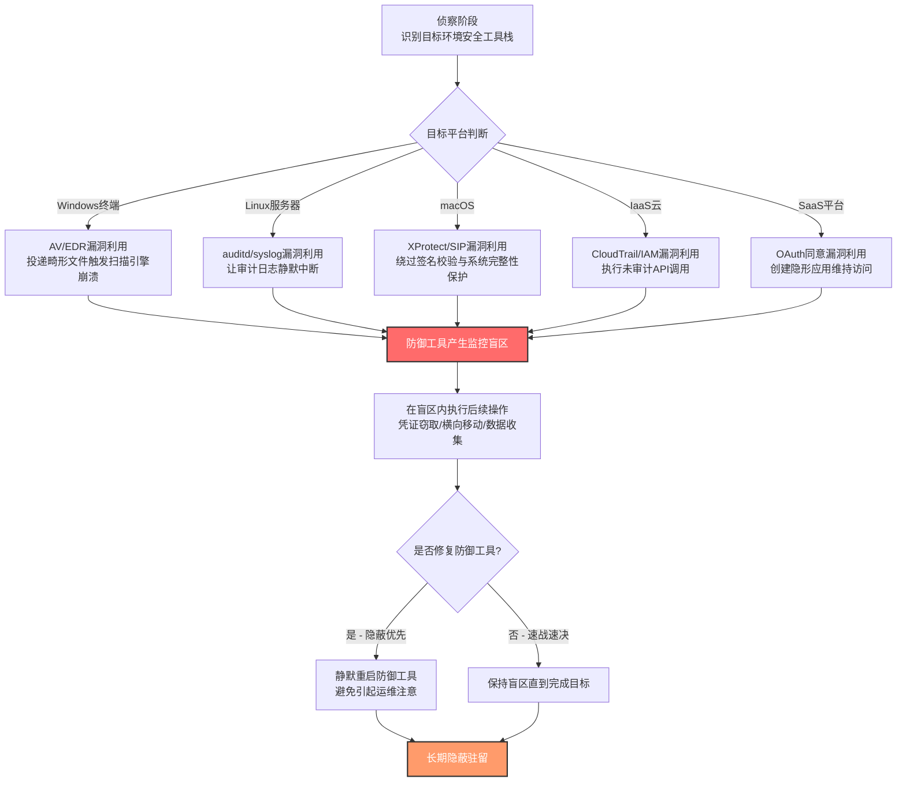

# 隐蔽性利用 (T1211)

## 一句话通俗理解

攻击者像小偷找到了安保系统的"系统漏洞"——不是砸坏摄像头，而是利用摄像头软件的某个编程缺陷让它"选择性失明"，自己绕过去而不留任何报警记录。

## 30秒速查卡

| 维度 | 你需要知道的 |
|------|-------------|
| 这是什么？ | 利用系统或应用程序中的漏洞（编程缺陷）来规避检测、隐藏活动、压制日志，而不是直接禁用防御 |
| 为什么危险？ | 与"砍断摄像头"不同，"利用漏洞让摄像头变瞎"几乎不留痕迹，防御方甚至不知道自己已经被绕过；安全工具的信任边界被悄悄突破 |
| 谁需要关心？ | EDR/AV研发人员、SOC分析师、云安全工程师、SaaS平台管理员、漏洞猎人 |
| 你的第一步防御 | 建立漏洞补丁管理的SLA、监控防御进程自身的异常崩溃与未签名模块加载、对云审计日志的删除/暂停行为告警 |
| 如果只做一件事 | 监控所有安全防御进程（AV/EDR/auditd/XProtect）的异常退出与未签名模块加载事件，建立"防御进程基线"，任何偏离立即告警 |

## 难度等级

⭐⭐⭐ 高级（需要深入的漏洞研究能力和对目标环境的侦察）

隐蔽性利用属于高级隐蔽技术，原因在于：
- 攻击者需要掌握未公开漏洞（0-day）或已公开但未打补丁漏洞的利用技术
- 不同平台（Windows/Linux/macOS/IaaS/SaaS）的漏洞形态差异巨大，需要针对性研究
- 防御方若不理解"防御工具自身也是软件、也有漏洞"，就无法建立"防御自身完整性"监控
- 攻击者往往需要在防御工具崩溃后迅速接管监控盲区，时序控制要求高

## 前置知识检查

**读这个文件需要什么？**

- [ ] 漏洞利用基础（栈溢出、堆损坏、UAF、逻辑漏洞）
- [ ] 操作系统安全机制（DEP、ASLR、CFG、SMEP/SMAP）
- [ ] 安全软件架构（AV/EDR的用户态与内核态组件、扫描引擎、回调机制）
- [ ] 云安全审计机制（AWS CloudTrail、Azure Activity Log、GCP Audit Logs）
- [ ] SaaS平台的安全模型（OAuth同意、服务主体、审计日志、API权限）
- [ ] macOS安全机制（Gatekeeper、XProtect、SIP、TCC）

## 技术描述

隐蔽性利用（T1211）是MITRE ATT&CK框架中**属于隐蔽战术（TA0005）**的技术。攻击者通过利用系统或应用程序中的漏洞来规避检测、隐藏活动、压制日志，从而在环境中维持访问而不被发现。

**通俗解释：**

想象你家装了一套智能安防系统：摄像头、门窗传感器、报警器都连到云端，云端把所有事件记录成"安防日志"。如果你是小偷，想进屋偷东西，有两种思路：

- **第一种（直接破坏，对应T1562 削弱防御）**：拿锤子砸坏摄像头、剪断报警器电源。简单粗暴，但安防公司会立刻发现"摄像头离线"——这是一种"自损八百"的做法，反而更容易被发现。
- **第二种（利用漏洞，对应T1211）**：你研究过这套安防系统的固件，发现它在解析某种特定格式的视频流时会崩溃5秒。你发送这个特制视频流，摄像头崩溃重启的5秒内你溜进去——日志里只显示"摄像头重启"，没有任何入侵记录。这是"神不知鬼不觉"的做法。

在计算机世界里，攻击者利用的是**安全工具自身的漏洞**——杀毒软件的解压引擎漏洞、EDR的内核回调处理漏洞、auditd的配置解析漏洞、CloudTrail的API参数处理漏洞、SaaS平台的OAuth同意漏洞。一旦利用成功，安全工具要么崩溃（产生监控盲区），要么继续运行但被悄悄绕过（不记录可疑活动），要么被植入恶意模块伪装成正常工作。

**与相邻技术的关键区别：**

- **T1211 vs T1562（削弱防御）**：T1562是"直接动手停掉防御"（kill进程、禁用注册表项、卸载组件）；T1211是"利用防御工具自身的漏洞让它失效"——本质区别在于T1562会留下"防御被禁用"的痕迹，而T1211留下的只是"防御工具异常重启"或"完全无痕迹"。
- **T1211 vs T1055（进程注入）**：T1055把代码注入到合法进程里执行；T1211可能利用注入手段攻击防御进程，但更宽泛——还包括利用云API漏洞绕过审计、利用SaaS平台漏洞绕过同意边界等非注入场景。
- **T1211 vs T1068（漏洞利用提权）**：T1068关注"利用漏洞获得更高权限"；T1211关注"利用漏洞实现隐蔽"——两者可能结合（先提权再利用防御漏洞），但目标不同。

**过渡段：** 隐蔽性利用的精髓在于"不打草惊蛇"——攻击者不去触碰防御系统的开关，而是利用防御系统的"盲区"或"漏洞"。这种技术最难防御，因为防御方信任自己的安全工具，但安全工具本身也是软件，也可能有漏洞。下面我们从攻击面分类，看看T1211在不同平台上的表现形态。

### 技术原理（按攻击面分类）

#### 一、安全软件漏洞利用（Windows/Linux/macOS核心）

安全软件（AV/EDR/XDR/auditd/XProtect）本质上也是用户态进程或内核驱动，它们解析输入（文件、网络流、API调用）时同样可能出现缓冲区溢出、UAF、整数溢出等经典漏洞。

- **AV扫描引擎漏洞**：攻击者投递一个特制文件（如畸形PE、特殊压缩包、恶意字体），AV扫描时触发漏洞导致崩溃或代码执行
- **EDR内核回调漏洞**：EDR通过内核回调（PsSetCreateProcessNotifyRoutine等）监控进程活动，回调处理逻辑中的漏洞可被利用让EDR"看不见"特定进程
- **auditd配置解析漏洞**：auditd在解析特定audit规则时崩溃，导致审计日志中断
- **XProtect签名校验绕过**：利用macOS XProtect在签名验证逻辑中的漏洞，让恶意程序被判定为可信

#### 二、云基础设施漏洞利用（IaaS）

云平台的安全审计服务本身也存在漏洞，攻击者可利用这些漏洞让恶意操作"不入账"。

- **CloudTrail绕过漏洞**：AWS CloudTrail在处理特定API调用（如AWS Service Catalog的某些操作）时不会记录日志，攻击者利用此特性执行未审计操作
- **IAM提权漏洞**：利用IAM策略解析漏洞获得未授权权限，且这些操作可能在审计日志中被归类为"正常API调用"
- **元数据服务漏洞**：利用IMDSv1的设计缺陷获取实例凭证，再用这些凭证执行操作而绕过基于角色的监控

#### 三、SaaS平台漏洞利用

SaaS平台（Google Workspace、Microsoft 365、Salesforce等）的OAuth同意、API权限、租户边界等机制中的漏洞，可被攻击者利用实现隐蔽访问。

- **GhostToken类漏洞**：利用GCP平台漏洞创建"隐形"OAuth应用，使其在用户授权应用列表中不可见，但持续保持对账户的访问权
- **同意钓鱼绕过**：利用SaaS平台同意框架的漏洞，让恶意应用获得高权限而不触发管理员审核
- **审计日志漏洞**：利用SaaS平台审计日志API的漏洞，让特定操作不被记录或被记录为"系统操作"

#### 四、网络设备漏洞利用

网络设备（交换机、路由器、防火墙）的固件或操作系统漏洞，可被利用实现隐蔽横向移动或持久化。

- **网络设备CLI逃逸**：利用设备CLI的漏洞从受限命令行逃逸到底层操作系统，实现任意命令执行
- **固件后门植入**：利用固件更新机制的漏洞植入持久化后门，重置设备也无法清除

**用途与影响：**

T1211是高级APT组织和红队最爱用的"高价值、低频率"技术。它的价值体现在三个层面：**持久性**（一次成功的漏洞利用可长期维持隐蔽）、**可信度**（攻击行为发生在安全工具"信任"的组件内，不触发告警）、**抗分析**（防御方即使事后调查也找不到"防御被绕过"的直接证据）。典型场景包括：APT28利用CVE-2015-4902绕过Office安全功能部署Sofacy后门、Velvet Ant利用CVE-2024-20399在Cisco交换机上逃逸NX-OS实现长期隐蔽驻留。

## 真实攻击流程

### 典型攻击流程

```
侦察目标环境的安全工具栈 --> 发现防御工具的可利用漏洞 --> 投递触发漏洞的载荷 --> 防御工具崩溃/被绕过 --> 在监控盲区内执行后续操作 --> (可选)修复防御工具以避免引起注意
```



**步骤详解：**

1. **侦察目标环境的安全工具栈**
   - 通俗描述：攻击者像小偷踩点，先搞清楚"这家装了什么安防系统、什么型号、什么版本"
   - 技术细节：识别终端AV/EDR产品（Sysmon日志、注册表特征）、服务器审计组件（auditd配置、syslog-ng版本）、云平台审计配置（CloudTrail是否启用、日志投递延迟）、SaaS应用集成清单
   - 常用工具：BloodHound、SharpHound、CloudFox、pacu、自定义侦察脚本

2. **发现防御工具的可利用漏洞**
   - 通俗描述：找出安防系统的"系统漏洞"——可能是公开CVE，也可能是0-day
   - 技术细节：通过漏洞数据库（CVE/NVD）查找匹配版本的已知漏洞，或通过模糊测试、代码审计发现0-day；重点关注解析复杂输入的组件（扫描引擎、配置解析器、API网关）
   - 常用工具：AFL、libFuzzer、IDA Pro、Ghidra、Burp Suite（用于云API漏洞测试）

3. **投递触发漏洞的载荷**
   - 通俗描述：把"特制触发器"送到防御工具面前，让它去解析
   - 技术细节：通过钓鱼邮件附件触发AV扫描、通过API调用触发CloudTrail解析、通过OAuth同意流程触发SaaS平台漏洞
   - 常用工具：msfvenom、自定义exploit、pacu（云漏洞利用框架）

4. **防御工具崩溃或被绕过**
   - 通俗描述：安防系统"选择性失明"了——要么崩溃重启产生盲区，要么继续运行但被绕过
   - 技术细节：AV进程因解析畸形文件崩溃（产生Application Error日志）、EDR内核驱动因回调处理漏洞导致监控缺失、CloudTrail因API处理漏洞不记录特定调用
   - 常用工具：无（这是利用成功的表现）

5. **在监控盲区内执行后续操作**
   - 通俗描述：趁着摄像头黑屏的几秒/几分钟，赶紧干坏事
   - 技术细节：在盲区窗口内执行凭证转储（Mimikatz）、横向移动（WMI/PsExec）、数据收集与渗漏；操作必须在防御工具恢复前完成
   - 常用工具：Cobalt Strike、Mimikatz、Impacket、自定义C2框架

6. **（可选）修复防御工具以避免引起注意**
   - 通俗描述：偷完东西后把摄像头重新接上，让 homeowner根本不知道家里进过贼
   - 技术细节：触发AV/EDR服务自动重启机制（Windows服务恢复策略）、删除崩溃日志、修复auditd配置；高明攻击者会让防御工具"看起来一直在正常运行"

## 检测方法

**用人话说：** 隐蔽性利用的检测核心是"监控防御工具自身的健康状态"。安全软件平时是怎么运行的——加载哪些模块、占用多少内存、每天崩溃几次、日志写入频率如何——这些都要建立基线。一旦发现防御工具异常崩溃、加载了未签名模块、日志写入突然中断或频率异常，就高度可疑。云环境的检测重点是审计日志的"完整性"——是否有时间段无日志、是否有异常的API调用模式。

### 网络层检测

**检测方法：** 监控SaaS/IaaS平台的API调用异常。重点检查：CloudTrail日志中是否出现"日志缺失时间段"（特定API调用未被记录）、是否有异常的OAuth同意授予事件、是否有从未见过的服务主体调用高权限API。

### 主机层检测

**Windows事件ID：**
- Sysmon Event ID 1：进程创建（关注AV/EDR进程的子进程，正常情况下不应有）
- Sysmon Event ID 5：进程终止（监控AV/EDR进程的非预期终止）
- Sysmon Event ID 7：Image Loaded（**核心**——监控AV/EDR进程加载的未签名DLL）
- Sysmon Event ID 17/18：管道事件（EDR常使用命名管道通信，异常管道操作可疑）
- Event ID 1000：应用程序错误（监控AV/EDR进程的崩溃事件）
- Event ID 7031/7034：服务意外终止（监控安全服务的崩溃）
- Event ID 7045：服务创建（监控可疑新服务，可能是利用后的持久化）
- Event ID 4656/4663：文件/对象访问（监控对安全工具二进制文件的修改尝试）

**Linux/macOS事件：**
- auditd日志：监控auditd自身的崩溃与重启、`/var/log/audit/audit.log`的写入中断
- dmesg/journalctl：监控内核oops、segfault事件，特别是涉及安全组件的
- process accounting（pacct）：监控auditd/syslog进程的异常终止
- macOS unified log：监控XProtect、SIP相关日志的异常

**具体命令示例：**
```powershell
# 检测AV/EDR进程的崩溃事件（Windows Event ID 1000）
Get-WinEvent -FilterHashtable @{LogName='Application'; ID=1000} |
    Where-Object { $_.Message -match 'MsMpEng|MsSense|SENSE|EDR|Defender|CrowdStrike|CarbonBlack' } |
    Select-Object TimeCreated, Message -First 50

# 检测安全服务的意外终止（Event ID 7031）
Get-WinEvent -FilterHashtable @{LogName='System'; ID=7031} |
    Where-Object { $_.Message -match 'Defender|Sense|CrowdStrike|CarbonBlack|Symantec' } |
    Select-Object TimeCreated, Message

# 检测AV/EDR进程加载未签名DLL（Sysmon Event ID 7）
Get-WinEvent -FilterHashtable @{LogName='Microsoft-Windows-Sysmon/Operational'; ID=7} |
    Where-Object { $_.Message -match 'MsMpEng|Sense' -and $_.Message -notmatch 'Signed: true' } |
    Select-Object TimeCreated, Message -First 30

# 检测Sysmon自身的停止与启动（防御被绕过的强信号）
Get-WinEvent -FilterHashtable @{LogName='Microsoft-Windows-Sysmon/Operational'; ID=4} |
    Select-Object TimeCreated, Message -First 20
```

```bash
# Linux: 检测auditd异常重启
grep -E "auditd.*start|auditd.*stop|auditd.*reload" /var/log/audit/audit.log | tail -20

# Linux: 检测安全相关进程的崩溃
journalctl --since "24 hours ago" | grep -E "SEGFAULT|killed|auditd|syslog-ng"

# macOS: 检测XProtect相关日志异常
log show --predicate 'process == "XProtect" OR process == "XProtectRemediator"' --last 24h
```

### 应用层检测（云/SaaS）

**IaaS云检测要点：**

1. **CloudTrail完整性监控**
   - 日志来源：AWS CloudTrail Log File Validation、CloudWatch Logs Insights
   - 关注字段：日志文件哈希、事件时间分布、API调用来源
   - 异常特征：特定时间段无日志、日志文件哈希校验失败、来自异常IP的API调用激增后骤降

2. **IAM异常操作检测**
   - 日志来源：AWS CloudTrail（`iam:`前缀事件）、Azure Activity Log、GCP Audit Logs
   - 关注字段：eventName（如`AssumeRole`、`UpdateAssumeRolePolicy`）、userIdentity、sourceIPAddress
   - 异常特征：从未见过的角色被假设、信任策略被修改为包含外部账户

3. **元数据服务访问监控**
   - 日志来源：VPC Flow Logs、实例元数据代理日志
   - 关注字段：169.254.169.254的访问模式
   - 异常特征：非预期的实例元数据访问、IMDSv1的使用（应强制v2）

**SaaS平台检测要点：**

1. **OAuth应用同意监控**
   - 关注字段：应用同意授予事件、应用权限范围、 consenting用户
   - 异常特征：高权限应用被普通用户同意、应用名称与已知合法应用相似（typosquatting）

2. **服务主体异常调用**
   - 关注字段：服务主体ID、调用API、调用频率
   - 异常特征：休眠的服务主体突然活跃、服务主体调用不在其设计用途范围内的API

3. **审计日志完整性**
   - 关注字段：审计日志的连续性、日志条目完整性
   - 异常特征：审计日志中的"时间空洞"、特定操作的日志条目缺失

## 检测规则示例

### Sigma规则：检测AV/EDR进程崩溃与异常重启

```yaml
title: 安全防御进程异常崩溃检测
id: a1b2c3d4-e5f6-4a7b-8c9d-0e1f2a3b4c5d
status: experimental
description: 检测AV/EDR等安全防御进程的异常崩溃与意外终止，可能表明T1211利用防御工具漏洞实现隐蔽
references:
    - https://attack.mitre.org/techniques/T1211/
    - https://attack.mitre.org/detectionstrategies/DET0595/
author: ATT&CK知识库
date: 2026/07/24
logsource:
    product: windows
    service: system
detection:
    selection_service_crash:
        EventID: 7031
        Message|contains:
            - 'Microsoft Defender Antivirus Service'
            - 'Microsoft Defender Advanced Threat Protection'
            - 'Windows Defender'
            - 'CrowdStrike Falcon'
            - 'CarbonBlack'
            - 'Symantec Endpoint Protection'
    selection_app_error:
        EventID: 1000
        Message|contains:
            - 'MsMpEng.exe'
            - 'SenseCE.exe'
            - 'CSFalconService.exe'
            - 'CbDefense.exe'
    condition: selection_service_crash or selection_app_error
falsepositives:
    - 安全软件正常更新导致的服务重启（需排除更新时间段）
    - 已知兼容性问题导致的崩溃（需建立基线）
    - 资源耗尽导致的崩溃（需结合系统资源监控）
level: high
tags:
    - attack.t1211
    - attack.defense_evasion
    - attack.stealth
```

### Sigma规则：检测AV/EDR进程加载未签名模块

```yaml
title: 防御进程加载未签名模块检测
id: b2c3d4e5-f6a7-4b8c-9d0e-1f2a3b4c5d6e
status: experimental
description: 检测AV/EDR进程加载未签名DLL的行为，可能是T1211利用漏洞注入恶意代码到防御进程中
references:
    - https://attack.mitre.org/techniques/T1211/
author: ATT&CK知识库
date: 2026/07/24
logsource:
    product: windows
    service: sysmon
detection:
    selection_defender_loaded:
        EventID: 7
        Image|contains:
            - 'MsMpEng.exe'
            - 'SenseCE.exe'
            - 'CSFalconService.exe'
            - 'CbDefense.exe'
            - 'windefend.exe'
    filter_signed:
        Signed: 'true'
    filter_known_modules:
        ImageLoaded|contains:
            - 'C:\Program Files\Windows Defender\'
            - 'C:\Program Files\CrowdStrike\'
            - 'C:\Program Files\CarbonBlack\'
            - 'C:\Windows\System32\'
    condition: selection_defender_loaded and not filter_signed and not filter_known_modules
falsepositives:
    - 安全软件更新过程中加载的新模块（需建立更新基线）
    - 第三方安全插件（需白名单）
level: critical
tags:
    - attack.t1211
    - attack.defense_evasion
    - attack.stealth
```

### Sigma规则：检测CloudTrail日志异常中断

```yaml
title: AWS CloudTrail日志异常中断检测
id: c3d4e5f6-a7b8-4c9d-0e1f-2a3b4c5d6e7f
status: experimental
description: 检测AWS CloudTrail日志的异常中断，可能是T1211利用CloudTrail漏洞实现未审计API调用
references:
    - https://attack.mitre.org/techniques/T1211/
    - https://securitylabs.datadoghq.com/articles/bypass-cloudtrail-aws-service-catalog-and-other/
author: ATT&CK知识库
date: 2026/07/24
logsource:
    product: aws
    service: cloudtrail
detection:
    selection_trail_disabled:
        eventName:
            - 'StopLogging'
            - 'DeleteTrail'
            - 'UpdateTrail'
        eventType: 'AwsApiCall'
    condition: selection_trail_disabled
falsepositives:
    - 合法的Trail维护操作（需审批工单关联）
    - 测试环境的Trail重新配置
level: critical
tags:
    - attack.t1211
    - attack.defense_evasion
    - attack.stealth
```

## 缓解措施

### 优先级1：关键措施

**措施名称：** 防御工具漏洞补丁管理SLA

**具体实施步骤：**
1. 建立所有安全工具（AV/EDR/auditd/XProtect/CloudTrail/SaaS审计）的清单与版本基线
2. 订阅所有安全工具厂商的安全公告邮件列表
3. 制定"安全工具补丁SLA"：Critical漏洞24小时内、High漏洞7天内、Medium漏洞30天内打补丁
4. 在变更管理流程中将"安全工具更新"设为最高优先级，绕过常规变更窗口
5. 部署自动化补丁部署工具（如SCCM、Ansible、Terraform for cloud），并验证补丁实际应用

### 优先级2：重要措施

**措施名称：** 应用沙箱化与控制流完整性保护

**具体实施步骤：**
1. 在Windows上启用Windows Defender Exploit Guard（WDEG），为安全工具进程配置CFG（控制流完整性）、DEP、ASLR
2. 在Linux上为auditd配置AppArmor或SELinux策略，限制其对非必要资源的访问
3. 在云环境中使用服务控制策略（SCP）限制对审计服务的修改权限
4. 对SaaS应用实施最小权限原则，限制应用同意权限到必要的最小范围

### 优先级3：建议措施

**措施名称：** 威胁情报驱动防御与防御完整性监控

**具体实施步骤：**
1. 建立内部威胁情报能力，跟踪公开的0-day漏洞利用情报与APT组织TTP
2. 部署防御完整性监控系统：
   - 监控所有安全进程的运行状态、内存占用、模块加载
   - 监控审计日志的连续性与完整性（CloudTrail日志文件验证、Linux audit日志哈希）
   - 建立防御工具行为的"正常基线"，任何偏离告警
3. 实施"防御的防御"（Defense of Defense）策略：用一个独立的监控系统监控主防御系统
4. 定期进行红队演练，测试攻击者能否绕过防御工具

### MITRE ATT&CK 缓解措施映射

| 缓解措施ID | 缓解措施名称 | 适用性 | 说明 |
|------------|-------------|--------|------|
| M1048 | 应用隔离与沙箱化 | 适用 | 通过沙箱化增加漏洞利用难度，应用微分段也能限制漏洞利用的影响范围 |
| M1050 | 漏洞利用防护 | 适用 | 使用Windows Defender Exploit Guard、EMET等工具检测和阻止利用行为，控制流完整性校验可识别和阻止软件漏洞利用 |
| M1019 | 威胁情报项目 | 适用 | 建立强大的网络威胁情报能力，确定哪些威胁可能对特定组织使用软件漏洞和0-day攻击 |
| M1051 | 更新软件 | 适用 | 通过补丁管理定期更新内部企业终端和服务器上的软件，包括安全工具本身 |

## 动手实验

> ⚠️ **重要提示**：所有实验必须在隔离的实验室环境中进行，禁止对生产环境或未授权的真实系统进行测试。利用安全工具漏洞可能违反厂商许可协议。

### 实验环境准备

**所需工具：**
- 隔离的Windows 10/11虚拟机（启用Sysmon与Windows Defender）
- 隔离的Linux虚拟机（启用auditd）
- AWS沙箱账号（仅用于实验，启用CloudTrail）
- 一个已公开披露的AV/EDR漏洞PoC（仅在实验环境使用）
- Process Monitor、Wireshark用于观察行为

### 实验1：观察AV进程崩溃与盲区窗口（初级）

**实验目标：** 理解当AV进程崩溃时，系统会产生多长的监控盲区，以及如何在日志中识别这一事件

**实验步骤：**
1. 在实验虚拟机上确认Windows Defender正在运行：`Get-Service WinDefend`
2. 记录当前时间作为基线
3. 使用Process Monitor监控`MsMpEng.exe`进程的所有活动
4. （模拟崩溃）通过任务管理器或`Stop-Service WinDefend`停止Defender服务
5. 立即创建一个测试文件（如`test.txt`），观察是否被实时扫描
6. 等待Defender服务自动重启（Windows服务恢复策略）
7. 检查事件日志：
   ```powershell
   Get-WinEvent -FilterHashtable @{LogName='System'; ID=7031} | Select-Object -First 5
   Get-WinEvent -FilterHashtable @{LogName='Application'; ID=1000} | Select-Object -First 5
   ```
8. 计算"盲区窗口"时长：从服务停止到服务恢复的时间差
9. 清理：恢复Defender服务，删除测试文件

**预期结果：** Defender服务停止后创建的文件不会被实时扫描，事件日志记录了7031（服务意外终止）和7036（服务状态变更）事件，盲区窗口通常为30秒到2分钟

**学习要点：** 理解防御工具崩溃产生的监控盲区是T1211的核心价值——攻击者就是利用这个窗口执行恶意操作

### 实验2：模拟CloudTrail日志绕过（中级）

**实验目标：** 理解如何检测CloudTrail日志的异常中断

**实验步骤：**
1. 在AWS实验账号中确认CloudTrail已启用并投递到S3
2. 记录当前CloudTrail配置：`aws cloudtrail describe-trails`
3. 模拟攻击者停止日志记录（这会触发告警）：
   ```bash
   aws cloudtrail stop-logging --name MyTrail
   ```
4. 立即执行几个API调用（如`aws s3 ls`、`aws iam list-users`）
5. 重新启动CloudTrail日志记录：
   ```bash
   aws cloudtrail start-logging --name MyTrail
   ```
6. 检查CloudWatch Logs或S3日志，验证步骤4的API调用是否被记录
7. 配置CloudWatch告警规则，监控`StopLogging`和`DeleteTrail`事件

**预期结果：** CloudTrail日志停止期间执行的API调用未被记录，证明存在审计盲区；CloudWatch告警规则可检测到StopLogging事件

**学习要点：** 理解云审计日志的"完整性"是T1211在云环境下的核心检测点

## 真实案例

### 案例1：APT28利用CVE-2015-4902绕过Office安全功能（2015年）

- **时间**：2015年
- **目标**：政府机构、外交组织、国防承包商
- **攻击组织**：APT28（Fancy Bear、Sofacy、STRONTIUM）
- **手法**：APT28利用CVE-2015-4902（Microsoft Office远程代码执行漏洞）作为其Sofacy后门投放链的一部分。这个漏洞允许攻击者绕过Office的安全沙箱与受保护视图，在用户打开特制文档时静默执行恶意代码，而不触发Office宏警告或AMSI检测。攻击者利用此漏洞实现了"无宏"攻击——文档看起来是普通的.docx/.xlsx，但实际上在解析时触发了漏洞利用，将Sofacy后门植入系统。由于利用发生在Office进程内部，且规避了所有传统的"宏检测"逻辑，传统AV无法识别。
- **影响**：多个政府机构与外交组织被入侵，Sofacy后门长期驻留窃取敏感信息
- **参考链接**：[MITRE - APT28](https://attack.mitre.org/groups/G0007/)、[Bitdefender - APT28 Under the Scope](https://download.bitdefender.com/resources/media/materials/white-papers/en/Bitdefender_In-depth_analysis_of_APT28%E2%80%93The_Political_Cyber-Espionage.pdf)、[Microsoft Security Intelligence Report Vol 19](http://download.microsoft.com/download/4/4/C/44CDEF0E-7924-4787-A56A-16261691ACE3/Microsoft_Security_Intelligence_Report_Volume_19_English.pdf)

### 案例2：Velvet Ant利用CVE-2024-20399在Cisco交换机上逃逸（2024年）

- **时间**：2024年
- **目标**：跨国企业网络基础设施、Cisco Nexus交换机
- **攻击组织**：Velvet Ant（G1047，中国背景威胁组织）
- **手法**：Velvet Ant在已通过认证访问Cisco Nexus交换机后，利用CVE-2024-20399（Cisco NX-OS软件命令注入漏洞）从NX-OS命令行界面逃逸到底层Linux操作系统。这个漏洞存在于NX-OS的CLI解析逻辑中，攻击者通过精心构造的命令参数触发漏洞，获得底层操作系统的root权限。逃逸后，攻击者在交换机上植入持久化后门，建立隐蔽的C2通道，并将交换机作为网络内的"跳板"用于横向移动。由于后门运行在网络设备固件层面，传统的终端EDR完全无法检测——这是T1211的典型应用：利用漏洞绕过所有基于主机的监控。
- **影响**：受害企业网络基础设施被长期渗透，攻击者获得了网络流量的中转与篡改能力
- **参考链接**：[MITRE - Velvet Ant](https://attack.mitre.org/groups/G1047/)、[Sygnia - Velvet Ant Advisory](https://www.sygnia.co/threat-reports-and-advisories/china-nexus-threat-group-velvet-ant-exploits-cisco-0-day/)

### 案例3：GhostToken漏洞允许攻击者在Google账户中创建隐形应用（2023年）

- **时间**：2023年
- **目标**：Google Workspace用户、GCP项目所有者
- **攻击组织**：未公开归属
- **手法**：GhostToken（CVE-2023-21956）是Google Cloud Platform中的一个漏洞，允许攻击者创建一个"隐形"的OAuth应用。正常情况下，用户可以在"第三方应用访问权限"页面查看并撤销已授权的应用。但利用GhostToken漏洞创建的应用不会显示在该列表中——即使用户已授予高权限访问，用户和管理员都看不到它的存在。攻击者通过此漏洞创建隐形应用后，可长期隐蔽访问受害者Gmail、Google Drive、Calendar等所有Google服务数据，且任何基于"应用列表审计"的检测都失效。这是T1211在SaaS平台的典型应用：利用平台漏洞绕过审计可见性。
- **影响**：漏洞被Google修复前，潜在影响所有Google Workspace用户；攻击者可获得对受害者Google生态系统的长期隐蔽访问
- **参考链接**：[BleepingComputer - GhostToken GCP flaw](https://www.bleepingcomputer.com/news/security/ghosttoken-gcp-flaw-let-attackers-backdoor-google-accounts/)

### 案例4：CloudTrail绕过漏洞允许未审计API调用（2023年）

- **时间**：2023年
- **目标**：AWS云环境
- **攻击组织**：未公开归属（云安全研究披露）
- **手法**：Datadog安全实验室研究发现，AWS CloudTrail在某些特定API调用场景下不会记录日志。例如，AWS Service Catalog的某些操作（如`ProvisionProduct`、`TerminateProvisionedProduct`）在特定条件下不会生成CloudTrail事件。攻击者利用此漏洞可执行未审计的资源调配操作——创建EC2实例、配置网络资源、部署持久化基础设施，而这些操作在CloudTrail日志中完全不可见。这违背了"CloudTrail记录所有AWS API调用"的默认假设，使得基于CloudTrail的SIEM检测、合规审计、入侵调查都出现盲区。这是T1211在IaaS平台的典型应用：利用云审计服务的漏洞让其"选择性失明"。
- **影响**：潜在影响所有AWS账户；攻击者可在不触发审计告警的情况下建立云内持久化
- **参考链接**：[Datadog Security Labs - Bypassing CloudTrail](https://securitylabs.datadoghq.com/articles/bypass-cloudtrail-aws-service-catalog-and-other/)

## 术语解释

| 术语 | 英文原名 | 通俗解释 |
|------|----------|----------|
| 隐蔽性利用 | Exploitation for Stealth | 利用漏洞实现隐蔽，而非直接破坏防御 |
| 防御削弱 | Defense Evasion (Impair Defenses) | 直接禁用或破坏防御工具，与T1211的区别在于是否留下"防御被禁用"的痕迹 |
| 0-day漏洞 | Zero-day Vulnerability | 厂商尚未发布补丁的未公开漏洞 |
| 漏洞利用 | Exploitation | 利用软件中的编程缺陷执行非预期代码 |
| 控制流完整性 | Control Flow Integrity (CFG) | 编译时与运行时技术，阻止控制流被劫持 |
| 应用沙箱化 | Application Sandboxing | 限制应用程序可访问的资源范围，增加漏洞利用难度 |
| CloudTrail | AWS CloudTrail | AWS云API调用审计日志服务 |
| auditd | Linux Audit Daemon | Linux系统的内核级审计服务 |
| XProtect | macOS XProtect | macOS内置的恶意软件检测系统 |
| OAuth同意 | OAuth Consent | SaaS平台中用户授予第三方应用访问权限的流程 |
| GhostToken | GhostToken | GCP漏洞，允许创建在应用列表中不可见的OAuth应用 |
| 服务主体 | Service Principal | SaaS/IaaS中代表应用或服务的身份 |
| 监控盲区 | Monitoring Blind Spot | 防御工具失效期间产生的监控空白窗口 |
| 防御的防御 | Defense of Defense | 用独立系统监控主防御系统的完整性 |

## 参考资料

### 📚 官方文档（深入了解）

- [MITRE ATT&CK - T1211 Exploitation for Stealth](https://attack.mitre.org/techniques/T1211/)
- [MITRE ATT&CK - TA0005 Stealth](https://attack.mitre.org/tactics/TA0005/)
- [MITRE ATT&CK - DET0595 Detection Strategy for Exploitation for Stealth](https://attack.mitre.org/detectionstrategies/DET0595/)
- [MITRE ATT&CK - M1050 Exploit Protection](https://attack.mitre.org/mitigations/M1050/)
- [MITRE ATT&CK - M1048 Application Isolation and Sandboxing](https://attack.mitre.org/mitigations/M1048/)

### 📰 安全报告（真实攻击）

- [Datadog Security Labs - Bypassing CloudTrail in AWS Service Catalog](https://securitylabs.datadoghq.com/articles/bypass-cloudtrail-aws-service-catalog-and-other/) - AWS CloudTrail日志绕过漏洞分析
- [BleepingComputer - GhostToken GCP Flaw](https://www.bleepingcomputer.com/news/security/ghosttoken-gcp-flaw-let-attackers-backdoor-google-accounts/) - Google账户后门漏洞报告
- [Bitdefender - APT28 Under the Scope](https://download.bitdefender.com/resources/media/materials/white-papers/en/Bitdefender_In-depth_analysis_of_APT28%E2%80%93The_Political_Cyber-Espionage.pdf) - APT28深度分析，含CVE-2015-4902利用细节
- [Microsoft Security Intelligence Report Vol 19](http://download.microsoft.com/download/4/4/C/44CDEF0E-7924-4787-A56A-16261691ACE3/Microsoft_Security_Intelligence_Report_Volume_19_English.pdf) - 微软安全情报报告，覆盖APT28活动
- [Sygnia - Velvet Ant Cisco Zero-Day Advisory](https://www.sygnia.co/threat-reports-and-advisories/china-nexus-threat-group-velvet-ant-exploits-cisco-0-day/) - Velvet Ant利用CVE-2024-20399详细分析

### 🔧 工具与资源（动手试试）

- [Windows Defender Exploit Guard](https://learn.microsoft.com/en-us/microsoft-365/security/defender-endpoint/enable-exploit-protection) - Windows漏洞利用防护工具
- [AWS CloudTrail Log File Validation](https://docs.aws.amazon.com/awscloudtrail/latest/userguide/cloudtrail-log-file-validation-intro.html) - CloudTrail日志完整性验证
- [Linux Audit Framework](https://man7.org/linux/man-pages/man8/auditd.8.html) - Linux审计系统文档
- [Atomic Red Team - T1211 Tests](https://atomicredteam.io/) - 可执行的检测测试用例
- [Pacu](https://github.com/RhinoSecurityLabs/pacu) - AWS漏洞利用与攻击模拟框架
- [CloudFox](https://github.com/BishopFox/cloudfox) - 云环境侦察工具，辅助识别审计盲区

## 相关技术

- **[T1562 削弱防御](../08-Defense-Impairment/T1685-Disable-or-Modify-Tools.md)**：与T1211的核心区别——T1562直接禁用或破坏防御工具，留下"防御被禁用"的痕迹；T1211利用防御工具的漏洞让其失效，更难被发现。攻击者常将两者结合：先尝试T1211隐蔽绕过，失败后再用T1562直接破坏
- **[T1055 进程注入](./T1055-Process-Injection.md)**：T1211可能利用进程注入手段攻击防御进程（如向AV进程注入恶意DLL），但T1211更宽泛——还包括云API漏洞、SaaS平台漏洞等非注入场景
- **[T1068 漏洞利用提权](../06-Privilege-Escalation/T1068-Exploitation-for-Privilege-Escalation.md)**：与T1211使用相同的漏洞利用技术，但目标不同——T1068为提权，T1211为隐蔽；攻击者常先用T1068提权，再用T1211绕过防御
- **[T1210 利用远程服务](../11-Lateral-Movement/T1210-Exploitation-of-Remote-Services.md)**：横向移动战术中的漏洞利用，与T1211同属"利用漏洞"类技术，但T1210目标是横向移动，T1211目标是隐蔽
- **[T1212 利用受信任的开发工具](../09-Credential-Access/T1212-Exploitation-for-Credential-Access.md)**：初始访问战术中的漏洞利用，与T1211形成攻击链不同阶段的互补
- **[T1497 虚拟化/沙箱规避](./T1497-Virtualization-Sandbox-Evasion.md)**：另一种"绕过防御"的技术，但T1497是规避分析环境（沙箱/虚拟机），T1211是规避生产防御工具
- **[T1070 清除痕迹](./T1070-Indicator-Removal.md)**：T1211利用漏洞让日志"不记录"可疑活动，T1070是事后"删除"已记录的日志；两者结合可形成"日志既不被记录也不会被删除"的完美隐蔽
