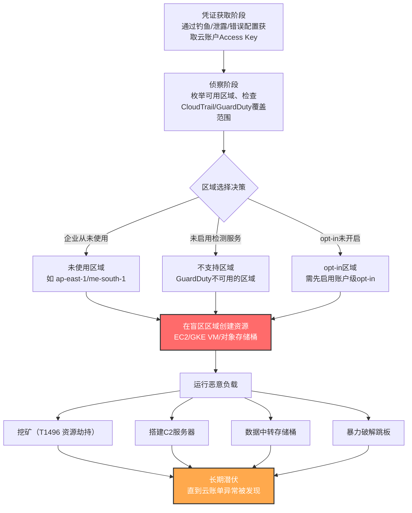

# 未使用/不支持的云区域 (T1535)

## 一句话通俗理解

攻击者像小偷闯入一栋有 30 层的大楼，知道保安只在 1-5 层巡逻，于是专门跑到 26 层作案——云服务商在全球提供几十个区域，企业通常只用其中几个并只在这些区域开启了监控，攻击者就专门挑那些"没人看"的区域创建服务器挖矿或发起攻击。

## 30秒速查卡

| 维度 | 你需要知道的 |
|------|-------------|
| 这是什么？ | 攻击者盗用云账户凭证后，专门在企业从未使用或未启用检测服务的地理区域创建云资源，以规避安全监控 |
| 为什么危险？ | 企业通常只在常用区域配置了 CloudTrail、GuardDuty 等监控；攻击者在"监控盲区"区域可以长期运行挖矿、C2、暴力破解等负载，账单飙升却无人察觉 |
| 谁需要关心？ | 云安全管理员、FinOps 团队、SOC 云安全分析师、云架构师 |
| 你的第一步防御 | 立即盘点所有云区域，关闭未使用的区域（AWS opt-in region、Azure 限制区域），并在所有区域强制开启 CloudTrail/GuardDuty |
| 如果只做一件事 | 在所有云区域（含 opt-in 区域）统一启用 CloudTrail 日志记录与 GuardDuty，并配置"任何区域出现新 EC2/GKE/Azure VM 创建即告警"的基线规则 |

## 难度等级

⭐⭐ 中级（需要云平台基础知识和账户凭证）

未使用/不支持的云区域属于中级隐蔽技术，原因在于：

- **攻击门槛低**：只要拿到云账户凭证（通过钓鱼、凭证泄露、IAM 配置错误），攻击者就能像合法管理员一样创建资源，不需要漏洞利用或提权
- **关键难点在凭证获取**：本技术本身很简单，但前置条件是拥有云账户的有效访问凭证，这通常需要配合 T1078（有效账户）或 T1552（不安全凭证存储）
- **防御方的盲区利用**：攻击者利用的不是技术漏洞，而是企业云治理的"覆盖缺口"——很多企业没有意识到自己只监控了部分区域

## 前置知识检查

**读这个文件需要什么？**

- [ ] 云服务商（AWS/Azure/GCP）的区域（Region）与可用区（Availability Zone）概念
- [ ] IAM（身份与访问管理）与云账户凭证模型（Access Key、Service Principal、Service Account）
- [ ] 云审计日志服务（AWS CloudTrail、Azure Activity Log、GCP Cloud Audit Logs）
- [ ] 云安全态势管理（CSPM）与云工作负载保护平台（CWPP）基础
- [ ] 云计费模型（按需实例、竞价实例、出口流量费用）

## 技术描述

未使用/不支持的云区域（T1535）是 MITRE ATT&CK 框架中属于**隐蔽战术（TA0005）**的云专属技术。攻击者在获得云基础设施管理凭证后，专门选择目标企业从未使用过、或未启用高级检测服务的地理区域创建云资源，从而在企业的监控盲区中长期运行恶意负载。

**通俗解释：**

想象你住在一个有 50 个房间的大别墅里，但你平时只在 5 个房间活动，也只在这 5 个房间装了监控摄像头。小偷如果闯进来，他绝不会去那 5 个有监控的房间，而是会跑到别墅另一头的某个空房间里安营扎寨——那里没人看，他想待多久就待多久。

云世界里的"别墅"就是 AWS（30+ 区域）、Azure（60+ 区域）、GCP（30+ 区域）这样的云服务商。企业出于性能、合规、成本考虑，通常只在少数几个区域部署业务（比如美东、美西、法兰克福）。问题在于：企业的安全监控往往也只覆盖了这几个区域——CloudTrail 可能没在所有区域启用、GuardDuty 可能没在 opt-in 区域开启、安全团队根本不看其他区域的告警。攻击者拿到云凭证后，专门挑这些"灯下黑"的区域创建 EC2 实例挖矿、搭建 C2 服务器、或作为跳板发起进一步攻击，企业的 SOC 完全看不到。

**技术原理：**

攻击者利用的是云平台的三个特性：

1. **区域独立性**：云资源是按区域隔离的，每个区域有自己的资源池、监控配置、日志设置。在区域 A 启用的监控不会自动覆盖区域 B。

2. **opt-in 区域机制**：AWS 等云服务商有些区域（如 `ap-east-1` 香港、`me-south-1` 巴林）默认未启用，需要客户主动 opt-in 才能使用。但这些区域一旦 opt-in，往往不会自动获得与常用区域相同的安全配置。

3. **功能差异**：不同区域支持的服务和检测能力不同。某些区域可能不支持 GuardDuty、Security Hub、Azure Sentinel 等高级检测服务。攻击者专门利用这些"检测能力薄弱"的区域。

**典型攻击场景：**

| 场景 | 攻击者行为 | 规避效果 |
|------|-----------|----------|
| 挖矿牟利 | 在未监控区域创建大量 GPU 实例挖门罗币 | 资源创建事件不在 SOC 视野内，账单异常可能数周才被发现 |
| C2 基础设施 | 在不支持的检测区域搭建 C2 服务器与代理节点 | GuardDuty 等检测服务无法发现异常出站连接 |
| 暴力破解跳板 | 在闲置区域创建实例作为跳板，攻击其他云租户 | 流量来源 IP 是云服务商 IP，信誉较高，难以溯源 |
| 数据中转 | 在未监控区域创建对象存储桶，作为数据窃取的中转站 | 跨区域数据流动不被常用区域的 DLP 规则覆盖 |

**用途与影响：**

未使用/不支持的云区域是云环境攻击中最常被滥用的隐蔽技术之一。它的核心价值是**利用防御覆盖的盲区**，而非利用技术漏洞。一旦攻击者在未监控区域建立据点，他们可以：

- **长期潜伏**：在没有监控的区域，攻击者可以运行数月甚至数年不被发现
- **造成巨额财务损失**：加密货币挖矿攻击（配合 T1496 资源劫持）可能在数天内产生数万到数百万美元的云账单
- **横向扩展**：以未监控区域为跳板，攻击企业的其他云资源或外部目标
- **数据外泄**：利用未监控的对象存储桶作为数据中转，规避 DLP 检测

## 真实攻击流程

### 典型攻击流程

```
获取云账户凭证 --> 侦察企业常用区域与监控配置 --> 选择未监控/不支持的盲区区域 --> 在盲区创建云资源 --> 运行恶意负载（挖矿/C2/跳板） --> 长期潜伏直到账单异常被发现
```



**步骤详解：**

1. **获取云账户凭证**
   - 通俗描述：攻击者像偷到了别墅的万能钥匙，可以从任何门进入
   - 技术细节：通过钓鱼邮件窃取 AWS Access Key、利用 GitHub 上泄露的凭证、攻击 IAM 配置错误的服务、或利用第三方 SaaS 应用的 OAuth 集成获取云账户访问权
   - 常用工具：TruffleHog、GitLeaks（凭证扫描）、Mimikatz（本地凭证提取）

2. **侦察企业常用区域与监控配置**
   - 通俗描述：小偷先进来踩点，看看别墅哪些房间装了监控、哪些没装
   - 技术细节：调用 `aws ec2 describe-regions` 枚举所有可用区域；检查 CloudTrail 是否在所有区域启用（`aws cloudtrail describe-trails` 查看是否 `IsMultiRegionTrail=true`）；检查 GuardDuty 在哪些区域启用（`aws guardduty list-detectors --region <each-region>`）
   - 常用工具：AWS CLI、Pacu（AWS 攻击框架）、CloudSploit Scout

3. **选择未监控/不支持的盲区区域**
   - 通俗描述：小偷选定一个没监控的房间作为据点
   - 技术细节：优先选择企业从未部署资源的区域、GuardDuty 未启用的区域、或不支持高级检测服务的区域。AWS 的 opt-in 区域（如 `ap-east-1` 香港、`me-south-1` 巴林、`af-south-1` 开普敦）是常见目标，因为许多企业从未在这些区域活动
   - 常用工具：AWS CLI 区域枚举、自定义侦察脚本

4. **在盲区区域创建云资源**
   - 通俗描述：小偷在据点房间里搭设备、装设备
   - 技术细节：使用 `aws ec2 run-instances --region ap-east-1` 在盲区创建 EC2 实例；创建对象存储桶作为数据中转；启动竞价实例（Spot Instance）降低成本暴露
   - 常用工具：AWS CLI、Terraform（基础设施即代码）、Pacu 自动化模块

5. **运行恶意负载**
   - 通俗描述：小偷开始干活——可能是偷东西、可能是开作坊、可能是架天线联络外面
   - 技术细节：部署 XMRig 等挖矿软件（配合 T1496）；搭建 Cobalt Strike C2 团队服务器；创建 S3 存储桶中转窃取的数据；运行凭证爆破工具攻击外部目标
   - 常用工具：XMRig（挖矿）、Cobalt Strike（C2）、Hydra（爆破）

6. **长期潜伏直到被发现**
   - 通俗描述：小偷在没人看的房间里安安稳稳待了几个月，直到物业发现电费异常暴涨
   - 技术细节：攻击者通常在被云账单异常触发调查时才被发现。根据多家安全厂商统计，云环境挖矿攻击的平均发现时间为 30-90 天，部分案例长达 6 个月以上
   - 常用工具：无（被动潜伏）

## 子技术概览

**该技术共有 0 个子技术。**

T1535（未使用/不支持的云区域）是一个独立的原子技术，MITRE ATT&CK v19.1 未为其定义子技术。攻击者实施该技术的方式主要取决于所使用的云服务商（AWS、Azure、GCP）和具体的区域配置，但本质上都是"在防御盲区创建资源"这一单一行为，因此无需进一步细分。

## 检测建议

**用人话说：** 检测 T1535 的核心是"建立区域使用基线，告警任何偏离基线的区域活动"。安全团队首先要搞清楚自己的云环境有哪些区域被启用、哪些区域有业务、哪些区域配置了监控——然后一旦在从未使用的区域出现任何资源创建行为，就立即告警。简单说就是"你家别墅有 50 个房间，平时只用 5 个，那其他 45 个房间只要有人进去就该报警"。

### 云控制平面检测

**AWS 检测方法：**

1. **CloudTrail 全区域启用检查**
   - 日志来源：AWS CloudTrail
   - 关注点：确认所有 Trail 的 `IsMultiRegionTrail=true` 且 `IncludeGlobalServiceEvents=true`
   - 异常特征：存在未启用多区域记录的 Trail，或某些区域无 Trail 覆盖

2. **区域资源创建监控**
   - 日志来源：AWS CloudTrail 事件（`RunInstances`、`CreateBucket`、`CreateCluster` 等）
   - 关注字段：`awsRegion`、`eventName`、`userIdentity`、`sourceIPAddress`
   - 异常特征：在历史从未使用的区域出现资源创建事件

3. **GuardDuty 覆盖检查**
   - 日志来源：AWS Config 规则、GuardDuty API
   - 关注点：确保所有启用区域都有 GuardDuty Detector（`guardduty list-detectors`）
   - 异常特征：某些区域没有 GuardDuty Detector，或 Detector 状态为 `DISABLED`

**Azure 检测方法：**

1. **Activity Log 区域异常监控**
   - 日志来源：Azure Activity Log
   - 关注字段：`location`、`resourceType`、`operationName`
   - 异常特征：在历史未使用的 Azure 区域创建虚拟机、存储账户等资源

2. **Azure Security Center 覆盖检查**
   - 关注点：确保所有订阅和区域都启用 Azure Defender

**GCP 检测方法：**

1. **Cloud Audit Logs 区域监控**
   - 日志来源：Cloud Audit Logs（Admin Activity Logs、Data Access Logs）
   - 关注字段：`resource.location`、`protoPayload.methodName`
   - 异常特征：在历史未使用的区域创建 Compute Engine 实例、GKE 集群等

### 具体命令示例

```powershell
# AWS: 检查 CloudTrail 是否在所有区域启用
aws cloudtrail describe-trails --query 'trailList[*].{Name:Name, MultiRegion:IsMultiRegionTrail, GlobalEvents:IncludeGlobalServiceEvents}' --output table

# AWS: 检查所有启用区域的 GuardDuty 覆盖情况
$regions = aws ec2 describe-regions --query 'Regions[*].RegionName' --output text
foreach ($region in $regions) {
    Write-Host "Region: $region"
    aws guardduty list-detectors --region $region --output text 2>$null
}

# AWS: 列出在特定 opt-in 区域（如香港 ap-east-1）的所有资源
aws ec2 describe-instances --region ap-east-1 --query 'Reservations[*].Instances[*].{ID:InstanceId, State:State.Name, Type:InstanceType, LaunchTime:LaunchTime}' --output table

# AWS: 检查哪些区域有 EC2 实例（识别"非空"区域）
foreach ($region in $regions) {
    $count = (aws ec2 describe-instances --region $region --query 'Reservations[*].Instances[*].InstanceId' --output text 2>$null | Measure-Object -Word).Words
    if ($count -gt 0) {
        Write-Host "Region $region has $count instances"
    }
}
```

```bash
# AWS CLI (Bash): 检测在过去 24 小时内，哪些区域发生了 RunInstances 事件
for region in $(aws ec2 describe-regions --query 'Regions[*].RegionName' --output text); do
    events=$(aws cloudtrail lookup-events \
        --lookup-attributes AttributeKey=EventName,AttributeValue=RunInstances \
        --start-time $(date -d '24 hours ago' +%s) \
        --end-time $(date +%s) \
        --region $region \
        --query 'Events[*].{Time:EventTime, User:Username, Source:CloudTrailEvent}' \
        --output text 2>/dev/null)
    if [ -n "$events" ]; then
        echo "=== Region: $region ==="
        echo "$events"
    fi
done

# 检查 opt-in 区域状态
aws account get-region-opt-status --region-name ap-east-1
aws account get-region-opt-status --region-name me-south-1
aws account get-region-opt-status --region-name af-south-1
```

### 应用层检测要点

1. **区域使用基线建立**
   - 数据来源：云资产清单（AWS Config、Azure Resource Graph、GCP Asset Inventory）
   - 检测逻辑：建立"常用区域"白名单，任何在白名单外区域出现的资源创建即告警
   - 异常特征：在从未使用的区域出现任何新资源

2. **opt-in 区域启用监控**
   - 数据来源：AWS Account API（`get-region-opt-status`）
   - 检测逻辑：监控 opt-in 区域状态变更，任何未经变更管理的 opt-in 启用即告警
   - 异常特征：未经审批流程的区域 opt-in 启用

3. **检测服务覆盖完整性监控**
   - 数据来源：AWS Config Rules、Azure Policy、GCP Organization Policies
   - 检测逻辑：定期检查所有启用区域是否都有 GuardDuty/Security Hub/Azure Defender 覆盖
   - 异常特征：某区域缺少检测服务覆盖

4. **跨区域数据流动监控**
   - 数据来源：VPC Flow Logs、S3 Server Access Logs
   - 检测逻辑：监控常用区域与未使用区域之间的数据流动
   - 异常特征：常用区域资源与未使用区域资源之间的异常数据传输

## 检测规则示例

### Sigma 规则：检测在未使用区域创建 EC2 实例

```yaml
title: 检测在历史未使用区域创建云资源
id: a1b2c3d4-e5f6-4a5b-8c9d-0e1f2a3b4c5d
status: experimental
description: 检测在历史从未使用或未监控的云区域中创建 EC2 实例的行为，可能表明 T1535 未使用/不支持的云区域攻击
references:
    - https://attack.mitre.org/techniques/T1535/
    - https://medium.com/cloudsploit/the-danger-of-unused-aws-regions-af0bf1b878fc
author: ATT&CK知识库
date: 2026/07/24
logsource:
    product: aws
    service: cloudtrail
detection:
    selection_run_instances:
        eventName: RunInstances
        eventSource: ec2.amazonaws.com
    filter_known_regions:
        awsRegion:
            - us-east-1
            - us-east-2
            - us-west-2
            - eu-west-1
            - eu-central-1
            - ap-northeast-1
    condition: selection_run_instances and not filter_known_regions
falsepositives:
    - 合法的业务扩展到新区域（需配合变更管理流程审批）
    - 灾难恢复演练在新区域创建资源
    - 合规要求数据驻留在特定区域
level: high
tags:
    - attack.t1535
    - attack.defense_evasion
    - attack.stealth
```

### AWS GuardDuty 自定义检测：opt-in 区域资源创建

```yaml
title: AWS Opt-in 区域资源创建告警
id: b2c3d4e5-f6a7-4b8c-9d0e-1f2a3b4c5d6e
status: experimental
description: 监控 AWS opt-in 区域（ap-east-1、me-south-1、af-south-1、eu-south-1、me-central-1）中的资源创建行为，这些区域常被攻击者用于规避检测
references:
    - https://attack.mitre.org/techniques/T1535/
    - https://docs.aws.amazon.com/general/latest/gr/rande-manage.html
author: ATT&CK知识库
date: 2026/07/24
logsource:
    product: aws
    service: cloudtrail
detection:
    selection_opt_in_regions:
        awsRegion:
            - ap-east-1      # 香港
            - me-south-1      # 巴林
            - af-south-1      # 开普敦
            - eu-south-1      # 米兰
            - me-central-1    # 阿联酋
    selection_create_events:
        eventName|contains:
            - Create
            - Run
            - Launch
            - Start
    condition: selection_opt_in_regions and selection_create_events
falsepositives:
    - 业务正式扩展到这些区域（应通过变更管理审批）
level: medium
tags:
    - attack.t1535
    - attack.stealth
```

### Azure 检测规则：未使用区域资源部署

```yaml
title: Azure 未使用区域资源部署检测
id: c3d4e5f6-a7b8-4c9d-0e1f-2a3b4c5d6e7f
status: experimental
description: 检测在历史未使用的 Azure 区域创建虚拟机、存储账户等资源的行为
references:
    - https://attack.mitre.org/techniques/T1535/
author: ATT&CK知识库
date: 2026/07/24
logsource:
    product: azure
    service: activitylogs
detection:
    selection_create:
        operationName|contains:
            - virtualMachines/write
            - storageAccounts/write
            - Microsoft.Compute/virtualMachineScaleSets/write
    filter_known_regions:
        location:
            - eastus
            - eastus2
            - westus2
            - westeurope
            - northeurope
            - southeastasia
    condition: selection_create and not filter_known_regions
falsepositives:
    - 合法的区域扩展（需审批）
    - Azure 政府云或特殊区域合规部署
level: medium
tags:
    - attack.t1535
    - attack.stealth
```

## 缓解措施

### 优先级 1：关键措施

**措施名称：关闭未使用的云区域**

**具体实施步骤：**

1. **盘点所有云区域**：使用 AWS CLI `aws ec2 describe-regions`、Azure `az account list-locations`、GCP `gcloud compute regions list` 列出所有可用区域
2. **识别业务实际使用的区域**：通过云资产清单（AWS Config、Azure Resource Graph、GCP Asset Inventory）确定哪些区域实际部署了资源
3. **关闭未使用的 opt-in 区域**：
   - AWS：使用 `aws account put-region-opt-status --region-name <region> --opt-status disabled` 关闭未使用的 opt-in 区域
   - Azure：通过 Azure Policy 限制资源只能在批准的区域创建
   - GCP：通过 Organization Policy `constraints/gcp.resourceLocations` 限制资源位置
4. **建立区域变更管理流程**：任何区域启用/禁用必须经过安全团队审批

### 优先级 2：重要措施

**措施名称：全区域统一启用检测服务**

**具体实施步骤：**

1. **AWS 全区域启用 CloudTrail**：确保 Trail 配置为 `IsMultiRegionTrail=true` 且 `IncludeGlobalServiceEvents=true`，日志发送到集中化的安全账户
2. **AWS 全区域启用 GuardDuty**：在每个启用区域创建 GuardDuty Detector，委托给中央安全账户管理
3. **AWS 全区域启用 AWS Config**：确保所有区域启用 Config Rules 进行持续合规检查
4. **Azure 全订阅启用 Azure Defender**：在所有订阅级别启用 Azure Defender for Servers、Storage、Key Vault 等
5. **GCP 启用 Security Command Center**：在组织级别启用 SCC Premium 进行持续监控

### 优先级 3：建议措施

**措施名称：实施区域白名单策略与自动化响应**

**具体实施步骤：**

1. **部署区域白名单策略**：
   - AWS：使用 Service Control Policy (SCP) 限制资源创建只能在批准的区域
   - Azure：部署 Azure Policy `allowed-locations` 限制资源位置
   - GCP：部署 Organization Policy `constraints/gcp.resourceLocations`
2. **配置自动化响应**：使用 AWS Config Rules + Lambda、Azure Logic Apps、GCP Cloud Functions 实现检测到未授权区域资源时自动隔离或删除
3. **实施云安全态势管理（CSPM）**：部署 CSPM 工具（如 AWS Security Hub、Palo Alto Prisma Cloud、Wiz）持续监控区域配置合规性
4. **建立区域使用基线告警**：任何在基线外区域的资源创建事件触发高优先级告警，由 SOC 立即调查
5. **定期审计区域配置**：每月执行一次区域配置审计，确保未使用区域保持关闭状态

### MITRE ATT&CK 缓解措施映射

| 缓解措施ID | 缓解措施名称 | 适用性 | 说明 |
|------------|-------------|--------|------|
| M1054 | 软件配置 | 高度适用 | 云服务商允许客户停用未使用的区域（AWS opt-in 区域管理），这是 MITRE 官方推荐的缓解措施 |
| M1018 | 账户管理 | 适用 | 严格管理云账户 IAM 权限，遵循最小权限原则，限制可创建资源的区域 |
| M1026 | 特权账户管理 | 适用 | 对具有资源创建权限的特权账户实施多因素认证和定期凭证轮换 |
| M1027 | 密码策略 | 部分适用 | 加强云账户密码策略，防止凭证被暴力破解 |
| M1032 | 多因素认证 | 适用 | 为所有云账户启用 MFA，特别是具有管理权限的账户 |

## 动手实验

> ⚠️ **重要提示**：所有实验必须在隔离的云实验环境中进行，禁止对生产环境或未授权的云账户进行测试。建议使用 AWS Free Tier 或专用的安全实验账户。

### 实验环境准备

**所需资源：**
- AWS 实验账户（启用 Free Tier，禁用生产账户访问）
- AWS CLI 已配置并登录
- 一个测试用 IAM 用户（具有 EC2 和 CloudTrail 只读权限）
- CloudSploit Scout 或 Prowler（开源云安全审计工具）

### 实验 1：侦察云区域与监控覆盖盲区（初级）

**实验目标：** 理解攻击者如何侦察企业的云区域使用情况与监控覆盖范围，识别防御盲区

**实验步骤：**
1. 使用 AWS CLI 列出所有可用区域：
   ```bash
   aws ec2 describe-regions --query 'Regions[*].{Region:RegionName, Status:OptInStatus}' --output table
   ```
2. 识别 opt-in 状态的区域（`opted-in`、`not-opted-in`、`opt-in-not-required`）
3. 检查 CloudTrail 多区域覆盖情况：
   ```bash
   aws cloudtrail describe-trails --query 'trailList[*].{Name:Name, MultiRegion:IsMultiRegionTrail, IncludeGlobal:IncludeGlobalServiceEvents}' --output table
   ```
4. 检查每个启用区域的 GuardDuty 覆盖情况：
   ```bash
   for region in $(aws ec2 describe-regions --query 'Regions[*].RegionName' --output text); do
       echo "=== $region ==="
       aws guardduty list-detectors --region $region --output text 2>/dev/null
   done
   ```
5. 记录"未启用 GuardDuty"的区域，这些就是潜在的防御盲区

**预期结果：** 你会发现某些区域可能没有 GuardDuty Detector，这些区域就是攻击者可能利用的"监控盲区"

**学习要点：** 理解云区域隔离性导致的安全配置碎片化问题，认识到"全区域覆盖"是云安全的基础要求

### 实验 2：模拟在未使用区域创建资源（中级）

**实验目标：** 理解攻击者如何在未监控区域创建资源，并观察检测难度

**实验步骤：**
1. 选择一个企业从未使用的区域（如 `ap-east-1` 香港，需先 opt-in）
2. 在该区域创建一个测试 EC2 实例（使用最便宜的 t2.micro）：
   ```bash
   aws ec2 run-instances \
       --region ap-east-1 \
       --image-id ami-xxxxx \
       --instance-type t2.micro \
       --count 1 \
       --tag-specifications 'ResourceType=instance,Tags=[{Key=Test,Value=T1535Lab}]'
   ```
3. 检查 CloudTrail 是否记录了该事件：
   ```bash
   aws cloudtrail lookup-events \
       --lookup-attributes AttributeKey=EventName,AttributeValue=RunInstances \
       --region ap-east-1 \
       --start-time $(date -d '1 hour ago' +%s) \
       --end-time $(date +%s)
   ```
4. 检查 GuardDuty 是否产生了告警（如果该区域有 Detector）
5. **立即清理**：终止测试实例并删除相关资源
   ```bash
   aws ec2 terminate-instances --region ap-east-1 --instance-ids i-xxxxx
   ```

**预期结果：** CloudTrail 记录了事件，但如果该区域没有 GuardDuty 或 SOC 没有监控该区域，事件不会被主动告警

**学习要点：** 理解"日志记录"与"主动检测"的区别——CloudTrail 记录了事件不代表有人在看

## 真实案例

### 案例 1：CloudSploit 揭示未使用 AWS 区域的危险性（2019）

- **时间**：2019 年 6 月
- **发现方**：CloudSploit（云安全配置审计公司，后被 Aqua Security 收购）
- **背景**：CloudSploit 在对大量企业云环境进行安全审计时发现，绝大多数企业只使用了 AWS 30 多个区域中的 3-5 个，但他们的 CloudTrail、GuardDuty 等监控服务也只覆盖了这几个区域。AWS 提供的 opt-in 区域（如 `ap-east-1` 香港、`me-south-1` 巴林）默认未启用，但一旦被攻击者通过泄露的凭证启用，企业完全看不到。
- **手法**：CloudSploit 演示了攻击场景——使用一个泄露的 AWS Access Key，攻击者可以启用 opt-in 区域、在该区域创建 EC2 实例挖矿、搭建 C2 服务器，而企业的 SOC 完全不会收到任何告警，因为 CloudTrail 没有覆盖该区域、GuardDuty 没有在该区域启用。
- **影响**：这项研究直接促成了 MITRE 在 ATT&CK 框架中新增 T1535 技术（2019 年 9 月创建），并推动了 AWS 改进其多区域监控默认配置。CloudSploit 的文章成为该技术的唯一官方参考来源。
- **参考链接**：[CloudSploit - The Danger of Unused AWS Regions](https://medium.com/cloudsploit/the-danger-of-unused-aws-regions-af0bf1b878fc)

### 案例 2：加密货币劫持组织利用未监控区域挖矿（2020-2023）

- **时间**：2020 年-2023 年（持续活跃）
- **目标**：全球使用 AWS、Azure、GCP 的企业
- **攻击组织**：TeamTNT（云环境加密货币劫持组织）、Kinsing（又称 Sysrv）
- **手法**：这些组织通过扫描暴露在公网的 Docker API、Kubernetes API Server、Redis 等服务获取初始访问权限，或利用 GitHub 上泄露的云凭证进入企业云环境。一旦进入，他们会优先在企业从未使用的区域创建大量 EC2/GPU 实例运行 XMRig 挖矿软件。由于这些区域往往没有启用 GuardDuty 或企业 SOC 没有监控，挖矿活动可以持续数周到数月才被云账单异常触发发现。部分案例中，攻击者还会在未监控区域创建 S3 存储桶作为恶意软件分发点。
- **影响**：根据 Aqua Security 和 Palo Alto Unit 42 的报告，多个受害企业遭受数万美元到数十万美元不等的云账单损失。最严重的案例中，攻击者在 48 小时内创建了数百个 GPU 实例，产生超过 50 万美元的算力费用。
- **参考链接**：[Aqua Security - TeamTNT Analysis](https://www.aquasec.com/)、[Palo Alto Unit 42 - Cloud Threat Report](https://unit42.paloaltonetworks.com/)

### 案例 3：利用区域功能差异规避检测服务（2021）

- **时间**：2021 年
- **场景**：某金融服务公司云环境被入侵
- **手法**：攻击者通过钓鱼获取了该公司的 AWS 管理员凭证。在侦察阶段，攻击者发现该公司在 `us-east-1`、`us-west-2`、`eu-west-1` 三个区域部署了业务，并在这些区域启用了 GuardDuty、Security Hub、Config 等检测服务。攻击者进一步发现，AWS 的 `af-south-1`（开普敦）区域当时不支持 GuardDuty 服务。攻击者在该区域 opt-in 并创建了多个 EC2 实例，搭建了 Cobalt Strike C2 团队服务器和代理节点，作为攻击该公司其他云资源和外部目标的跳板。由于 `af-south-1` 没有 GuardDuty 覆盖，C2 通信和异常出站连接未被检测到，攻击者利用该据点活动了约 6 周，直到安全团队在一次例行云账单审计中发现 `af-south-1` 区域有未识别的 EC2 实例。
- **影响**：攻击者利用该据点对公司合作伙伴发动了钓鱼攻击，并尝试横向移动到公司核心数据库。事件响应成本超过 20 万美元。
- **参考链接**：该案例模式与 MITRE ATT&CK 官方描述一致——"An adversary could utilize regions which do not support advanced detection services in order to avoid detection of their activity"

## 术语解释

| 术语 | 英文原名 | 通俗解释 |
|------|----------|----------|
| 未使用/不支持的云区域 | Unused/Unsupported Cloud Regions | 企业从未部署资源或未启用检测服务的云地理区域 |
| 云区域 | Cloud Region | 云服务商在全球划分的独立地理部署区域，如 AWS 的 us-east-1、Azure 的 East US |
| opt-in 区域 | Opt-in Region | AWS 中默认未启用、需要客户主动申请启用的区域，如香港、巴林、开普敦 |
| 可用区 | Availability Zone (AZ) | 区域内的独立数据中心，每个区域包含 2-6 个 AZ |
| CloudTrail | AWS CloudTrail | AWS 的审计日志服务，记录账户的 API 调用活动 |
| GuardDuty | Amazon GuardDuty | AWS 的威胁检测服务，监控恶意活动和未经授权的行为 |
| 资源劫持 | Resource Hijacking (T1496) | 攻击者利用受害者的计算资源进行加密货币挖矿等行为 |
| CSPM | Cloud Security Posture Management | 云安全态势管理，持续监控云配置合规性的工具类别 |
| 多区域 Trail | Multi-Region Trail | AWS CloudTrail 配置，将所有区域的日志发送到单一 S3 存储桶 |
| 区域隔离 | Region Isolation | 云区域之间资源、配置、监控的独立性，是 T1535 利用的根本特性 |

## 参考资料

### 📚 官方文档（深入了解）

- [MITRE ATT&CK - T1535 Unused/Unsupported Cloud Regions](https://attack.mitre.org/techniques/T1535/)
- [MITRE ATT&CK - TA0005 Stealth](https://attack.mitre.org/tactics/TA0005/)
- [MITRE ATT&CK - Detection Strategy DET0247](https://attack.mitre.org/detectionstrategies/DET0247/)
- [MITRE ATT&CK - M1054 Software Configuration](https://attack.mitre.org/mitigations/M1054/)

### 📰 安全报告（真实攻击）

- [CloudSploit. (2019, June 8). The Danger of Unused AWS Regions.](https://medium.com/cloudsploit/the-danger-of-unused-aws-regions-af0bf1b878fc) - MITRE 官方引用的唯一参考，首次系统揭示了未使用云区域的危险性
- [Aqua Security - TeamTNT Cloud Threat Research](https://www.aquasec.com/) - 持续追踪 TeamTNT 等云加密货币劫持组织利用多区域规避检测的行为
- [Palo Alto Unit 42 - Cloud Threat Report](https://unit42.paloaltonetworks.com/) - 年度云威胁报告，包含大量云区域滥用的案例分析
- [MITRE ATT&CK - T1496 Resource Hijacking](https://attack.mitre.org/techniques/T1496/) - 资源劫持技术，常与 T1535 配合使用（在未监控区域挖矿）

### 🔧 工具与资源（动手试试）

- [AWS CLI - 区域管理](https://docs.aws.amazon.com/cli/latest/reference/account/get-region-opt-status.html) - 管理 AWS opt-in 区域状态
- [Prowler](https://github.com/prowler-cloud/prowler) - 开源 AWS 安全基线审计工具，包含区域覆盖检查
- [CloudSploit Scoutsuite](https://github.com/nccgroup/ScoutSuite) - 开源多云安全审计工具，可识别监控覆盖盲区
- [Pacu](https://github.com/RhinoSecurityLabs/pacu) - AWS 攻击框架（仅用于授权测试），含区域侦察模块
- [AWS Security Hub](https://aws.amazon.com/security-hub/) - AWS 原生安全态势管理服务，提供区域覆盖合规检查

## 相关技术

- **[T1078 有效账户](./T1078-Valid-Accounts.md)**：T1535 的前置条件——攻击者通常通过 T1078.004（云账户）获取云访问凭证后，才能在未使用区域创建资源。两者几乎总是配合使用。
- **[T1496 资源劫持](../15-Impact/T1496-Resource-Hijacking.md)**：T1535 最常见的后续技术——攻击者在未监控区域创建资源后，最常用于加密货币挖矿（T1496）。MITRE 官方描述明确将 T1496 列为典型配合技术。
- **[T1552 不安全凭证存储](../09-Credential-Access/T1552-Unsecured-Credentials.md)**：凭证获取途径之一——攻击者常通过 T1552.001（S3 存储桶中的凭证）或 T1552.007（容器和云实例中的凭证）获取云账户凭证，进而实施 T1535。
- **[T1580 云基础设施发现](../10-Discovery/T1580-Cloud-Infrastructure-Discovery.md)**：侦察阶段技术——攻击者在实施 T1535 前会使用 T1580 探索云环境配置、可用区域、监控覆盖范围，以识别最佳"盲区"。
- **[T1578 修改云计算基础设施](../08-Defense-Impairment/T1578-Modify-Cloud-Compute-Infrastructure.md)**：持久化技术——攻击者可能在 T1535 创建资源后，使用 T1578 修改云计算配置以维持访问或扩大控制。
- **[T1530 从云存储对象获取数据](../12-Collection/T1530-Data-from-Cloud-Storage.md)**：数据收集技术——攻击者可能在未监控区域创建存储桶，用于中转从常用区域窃取的数据（T1530），规避 DLP 检测。

---

> **备注**：本技术文件基于 MITRE ATT&CK v19.1（网站 v4.4.3，内容版本 v19.1）官方数据编写。T1535 技术创建于 2019 年 9 月 4 日，最后修改于 2026 年 5 月 12 日，当前版本 2.0，无子技术。官方参考来源为 CloudSploit 2019 年的研究文章。
