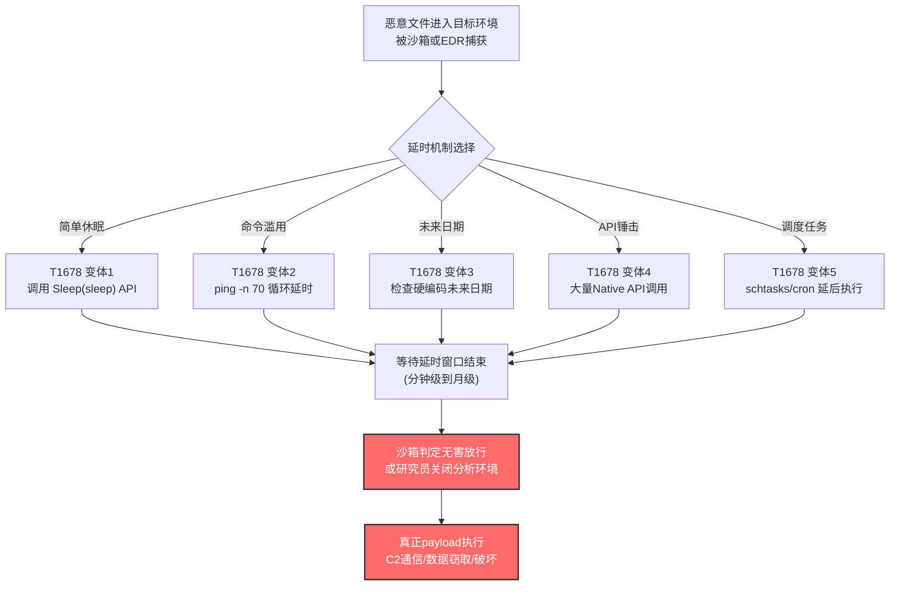

# 延迟执行 (T1678)

## 一句话通俗理解

攻击者像在马拉松比赛中途偷偷停下来喝杯咖啡——让恶意代码"睡一觉"再跑，借此熬过沙箱分析的限时窗口、绕过安全研究员的耐心阈值，让自动化检测系统误以为"这程序什么都没干"。

## 30秒速查卡

| 维度 | 你需要知道的 |
|------|-------------|
| 这是什么？ | 通过`sleep`、`ping`循环、API锤击、调度任务等基于时间的方法，让恶意代码延后执行或拉长执行周期 |
| 为什么危险？ | 多数沙箱只跑5-10分钟，攻击者让恶意代码睡15分钟到几个月，沙箱等不到结果就放行了；同时还能拖慢人工分析节奏、压垮分析环境 |
| 谁需要关心？ | 沙箱产品研发、EDR/SIEM分析师、SOC一线研判员、恶意软件逆向工程师 |
| 你的第一步防御 | 在沙箱中启用"时间快进"机制（hook系统时间API），并对短生命周期进程关联监控`Sleep`/`nanosleep`/`ping -n`等延时调用 |
| 如果只做一件事 | 在EDR中建立规则——当短生命周期脚本进程（wscript/powershell/bash）连续调用延时函数累计超过300秒且无用户交互时，标记为高可疑 |

## 难度等级

⭐⭐ 中级（需要基础编程与系统调度知识）

延迟执行属于中级隐蔽技术，原因在于：
- 攻击者只需调用系统原生`sleep`/`Sleep`/`nanosleep`函数或滥用`ping`这类合法命令即可实现，技术门槛低
- 但要"恰到好处"地规避不同沙箱的时间阈值（5分钟、10分钟、30分钟），需要了解常见分析环境的配置
- API锤击、未来日期检查等高级变体需要理解Native API与系统时钟机制

## 前置知识检查

**读这个文件需要什么？**

- [ ] 操作系统进程调度与时间管理基础（系统时钟、定时器）
- [ ] Windows `Sleep`/`SleepEx`/`WaitForSingleObject` API 与 Linux `nanosleep`/`sleep` 系统调用
- [ ] 沙箱工作原理（限时分析、API hook、虚拟化检测）
- [ ] `ping`、`timeout`、`at`/`cron`/Scheduled Task 等系统原生延时工具
- [ ] Native API 与用户态API的区别（API锤击变体所需）

## 技术描述

延迟执行（T1678）是 MITRE ATT&CK v19.1 框架中**属于隐蔽（TA0005）战术**的技术。攻击者通过各种基于时间的方法来规避检测与分析——这些技术通常利用系统时钟、延时或定时机制来掩盖恶意活动、混入正常活动流、避开审查。攻击者可以在虚拟化/沙箱环境内或原生主机系统上执行此类行为。

**通俗解释：**

想象你是个小偷，知道某家安保公司的监控录像每10分钟循环覆盖一次。如果你闯入后立刻动手，监控会拍到你；但如果你闯入后先在衣柜里躲15分钟，等监控把"你闯入"这段画面覆盖掉了再出来作案，监控里就只剩下空荡荡的房间。延迟执行就是恶意软件版本的"躲衣柜"——它进入系统后先睡一觉，等沙箱的限时分析窗口过去、等安全研究员失去耐心关掉虚拟机、等自动化系统判定"这文件无害"之后，再开始真正的恶意行为。

**过渡段：** 延迟执行的精髓在于"耗时间"——它不破解任何防御、不绕过任何检测，而是利用防御方"分析时间有限"这个根本约束。沙箱不可能跑一整天分析一个文件，研究员不可能盯着一个不动的进程看几小时。攻击者只要把延时设得比分析窗口长一点，就能"熬过"绝大多数自动化防御。下面我们看看攻击者具体怎么"熬时间"。

**技术原理（按延时机制分类）：**

### 一、程序化休眠类（最常见）

恶意代码直接调用操作系统提供的延时API，让进程挂起一段时间后再继续执行。

1. **Windows `Sleep`/`SleepEx` API**：最基础的延时方式。调用`Sleep(5000)`让进程休眠5秒。SystemBC就使用了十六进制参数`Sleep(0x2710u)`（10秒）和`Sleep(0xEA60u)`（60秒）来确保命令执行节奏。
2. **Linux/macOS `sleep`/`nanosleep`**：Shell脚本中最常见的`sleep 60`命令，或C程序调用`nanosleep`实现纳秒级精度延时。
3. **自定义延时函数**：如Fooder恶意软件实现了自定义的`delayExecution(integer)`函数封装延时逻辑，配合`Sleep(integer)` API调用 slows down 代码执行节奏。

### 二、合法命令滥用类

利用系统自带的合法命令"消耗时间"，比直接调用`sleep`更难被特征检测。

1. **`ping` 循环延时**：Mustang Panda 的经典手法——`cmd /c ping 8.8.8.8 -n 70&&"%temp%\<legitimate executable>"`。`ping -n 70`会发送70个ICMP包，每个间隔1秒，总共延时约70秒，之后再执行恶意payload。这种写法看起来像正常的网络诊断，容易绕过基于命令行特征的安全检测。
2. **`timeout` 命令**：Windows自带的`timeout /t 60 /nobreak`可以实现60秒延时，且不像`sleep`那样显眼。
3. ** needless 命令重复**：通过循环执行无意义命令（如重复`ping`、`dir`）消耗时间，既能延时又能撑爆分析环境的数据采集上限。

### 三、调度任务类

利用系统原生的任务调度功能，将恶意执行推迟到未来某个时间点。

1. **Windows 计划任务（Scheduled Task/Job，T1053）**：通过`schtasks`创建未来某个时间触发的任务。BRICKSTORM就内置了"延时启动"逻辑，等待硬编码的未来日期（几个月后）才开始向C2域名beacon。
2. **Linux `cron`/`at`**：在crontab或at队列中添加未来执行的恶意命令。
3. **macOS `launchd`**：通过plist配置未来执行的LaunchAgent/LaunchDaemon。AppleScript中也可调用`delay`函数实现延时。

### 四、未来日期检查类（高级）

恶意代码在启动时计算一个未来的日期（通常是1-4周后），然后持续检查当前系统时间，直到达到该日期才执行真正的payload。

3CX供应链攻击中的AppleJeus软件就是典型案例——它生成1-4周范围内的随机未来日期，然后恶意软件一直`sleep`直到系统时间到达该日期。这种手法不仅规避沙箱（沙箱不会等几周），还能让攻击者在合适的时间窗口集中触发攻击。

### 五、API锤击类（API Hammering）

一种特殊的延时变体——通过大量调用Native API函数来"消耗时间"，同时还能用垃圾数据淹没分析环境。

- Nymaim、TrickBot等恶意软件会循环调用`NtSetInformationFile`、`NtCreateFile`、`NtClose`等Native API数千次，每次调用都产生大量日志和数据
- 双重效果：既实现了延时（数千次API调用累计耗时可观），又让分析环境被垃圾数据撑爆，使真正的恶意行为淹没在噪音中

### 六、后台进程分叉类

通过将自身fork到后台进程实现"延后"执行更大payload。

Shai-Hulud蠕虫就采用了这种手法——它通过fork自身到后台进程，延迟执行更大的payload，让前台进程看起来无害，真正的恶意活动在后台静默进行。

**用途与影响：**

延迟执行是现代恶意软件的"标配"技术之一。它的核心价值在于对抗**自动化分析**——绝大多数沙箱、EDR的云端分析、自动化 detonation 系统都有时间限制（通常5-30分钟）。攻击者只要把延时设得比这个窗口长，就能让恶意代码在"分析期"内表现得像无害程序。从APT组织（Kimsuky、Mustang Panda、MuddyWater）到勒索软件（Qilin、DynoWiper），从供应链攻击（3CX）到国家级间谍软件（BRICKSTORM），延迟执行几乎出现在每一类高级威胁中。它与T1497（虚拟化/沙箱规避）、T1053（计划任务）高度关联，共同构成了恶意软件的"反分析三件套"。

## 真实攻击流程

### 典型攻击流程

```
恶意文件进入分析环境/目标系统 --> 调用延时机制(sleep/ping/未来日期检查/API锤击) --> 等待延时窗口结束 --> 沙箱已判定无害/研究员已关闭分析 --> 真正的payload开始执行
```



**步骤详解：**

1. **恶意文件进入目标环境**
   - 通俗描述：恶意文件像"特洛伊木马"被送进系统——可能是邮件附件、供应链投毒、U盘自动运行
   - 技术细节：文件被沙箱捕获 detonation，或被EDR上传到云端分析环境
   - 常见载体：3CX供应链攻击中的合法签名软件、Mustang Panda的钓鱼邮件附件

2. **调用延时机制**
   - 通俗描述：恶意代码开始"躲衣柜"——选一种方式把时间消耗掉
   - 技术细节：根据目标环境选择延时方式。简单场景用`Sleep`，规避命令行检测用`ping`循环，对抗长时间分析用未来日期检查
   - 常用手段：`Sleep(0xEA60u)`（60秒）、`ping 8.8.8.8 -n 70`（70秒）、随机未来日期循环检查

3. **等待延时窗口结束**
   - 通俗描述：熬时间——等沙箱的限时分析窗口过去
   - 技术细节：多数沙箱分析5-10分钟，BRICKSTORM甚至等几个月后才beacon，远超任何自动化分析窗口
   - 关键阈值：5分钟（基础沙箱）、10分钟（高级沙箱）、30分钟（深度分析）、数月（人工不可能等待）

4. **沙箱放行/分析停止**
   - 通俗描述：监控录像循环覆盖了——分析系统判定"这文件什么都没干"，放行
   - 技术细节：沙箱在超时后生成"无害"报告，文件被放行到真实用户系统
   - 后果：恶意代码成功进入"监控盲区"

5. **真正payload执行**
   - 通俗描述：小偷从衣柜出来作案
   - 技术细节：开始C2通信、横向移动、数据窃取或破坏性攻击
   - 常见后续：SystemBC建立Tor隐匿C2通道、DynoWiper执行文件覆盖与系统重启

## 检测建议

**用人话说：** 延迟执行的检测核心是"识别短生命周期进程中的异常延时调用"——如果一个脚本进程刚启动就连续`sleep`或`ping`几百秒，且没有任何用户交互，那它大概率在"躲衣柜"。安全软件平时记录进程的API调用模式，一旦发现`Sleep`/`nanosleep`调用累计时长异常、`ping`命令被用作延时器而非网络诊断、短生命周期进程关联大量Native API调用，就高度可疑。

### 网络层检测

**检测方法：** 监控异常的ICMP流量模式。当`ping`被用作延时器时，往往表现为对同一目标（如8.8.8.8）的高频、固定间隔ICMP请求，且请求方进程是脚本解释器（powershell、wscript、bash）而非系统ping工具。Mustang Panda的`ping 8.8.8.8 -n 70&&payload`模式就是典型特征——70个连续ICMP包后紧跟可执行文件启动。

### 主机层检测

**Windows事件ID与API监控：**
- Sysmon Event ID 1：进程创建（关注脚本进程启动后的延时行为）
- Sysmon Event ID 22：DNS查询（关注延时后突然开始的C2域名解析）
- ETW（Event Tracing for Windows）：监控`kernel32!Sleep`、`ntdll!NtDelayExecution`调用
- 进程API调用追踪：监控短生命周期进程中的`Sleep`累计时长

**具体命令示例：**
```powershell
# 检测脚本进程启动后的异常延时调用（通过ETW或API hook日志）
# 查找powershell/wscript/cscript进程在启动后30秒内调用Sleep超过60秒的行为
Get-WinEvent -FilterHashtable @{LogName='Microsoft-Windows-Sysmon/Operational'; ID=1} |
    Where-Object { $_.Message -match 'powershell|wscript|cscript|cmd\.exe' } |
    Select-Object TimeCreated, Message -First 100

# 检测ping命令被用作延时器（命令行包含 -n 数字 且后接 && 执行其他程序）
Get-WinEvent -FilterHashtable @{LogName='Microsoft-Windows-Sysmon/Operational'; ID=1} |
    Where-Object { $_.Message -match 'ping.*-n\s+\d+.*&&' } |
    Select-Object TimeCreated, Message

# 检测计划任务中创建的未来时间触发器（延时执行变体）
schtasks /query /fo LIST /v | Select-String -Pattern "TaskName|Next Run Time|Status" -Context 0,2
```

**Linux/macOS检测：**
```bash
# 检测bash脚本中的sleep调用模式
# 通过auditd监控nanosleep系统调用的异常频繁使用
auditctl -a always,exit -F arch=b64 -S nanosleep -k sleep_monitor
ausearch -k sleep_monitor | audit2report

# 检测cron中可疑的未来时间任务
crontab -l | grep -v '^#'
ls -la /etc/cron.*/  /var/spool/cron/

# 检测macOS launchd中的延时LaunchAgent
launchctl list | grep -v 'com.apple'
ls ~/Library/LaunchAgents/ /Library/LaunchAgents/ /Library/LaunchDaemons/
```

### 应用层检测

**检测要点：**

1. **延时函数关联调用检测（对应AN1048检测分析）**
   - 日志来源：ETW、API hook日志、EDR行为日志
   - 关注字段：进程名、调用API（`kernel32!Sleep`、`NTDLL APIs`）、调用时长、父进程
   - 异常特征：短生命周期进程中关联使用延时机制，父进程是可疑脚本（wscript、powershell）且缺少用户交互

2. **Shell脚本延时命令检测（对应AN1049检测分析）**
   - 日志来源：进程审计、命令行日志
   - 关注字段：命令行参数（`sleep`、`ping`、`nanosleep`）、进程链、执行时长
   - 异常特征：Shell脚本或二进制程序在短生命周期执行链中调用`sleep`、`ping`或低级系统调用（如`nanosleep`），无用户或系统交互；常见于恶意cron任务或payload stager

3. **macOS延时机制检测（对应AN1050检测分析）**
   - 日志来源：Endpoint Security框架、launchd日志
   - 关注字段：AppleScript的`delay`函数、bash的`sleep`、launchd任务触发时间
   - 异常特征：AppleScript、bash或launchd任务调用延时函数，父进程交互有限，且后续执行分阶段命令

4. **未来日期检查检测**
   - 日志来源：API调用追踪、系统时间查询日志
   - 关注字段：`GetSystemTime`/`time()`调用频率、与硬编码日期的比较逻辑
   - 异常特征：进程启动后反复查询系统时间并与某个常量比较，直到匹配才继续执行——这是3CX攻击中AppleJeus的典型行为

5. **API锤击检测**
   - 日志来源：Native API调用追踪
   - 关注字段：`NtSetInformationFile`、`NtCreateFile`、`NtClose`等Native API的调用频率
   - 异常特征：单个进程在短时间内调用Native API数千次，产生大量文件操作日志但无实际业务效果

## 检测规则示例

### Sigma规则：检测ping命令滥用为延时器

```yaml
title: 可疑ping命令延时执行行为检测
id: a1b2c3d4-e5f6-4a5b-8c9d-0e1f2a3b4c5d
status: experimental
description: 检测ping命令被用作延时器（-n参数后接大数字且通过&&连接后续可执行文件），可能表明T1678延迟执行
references:
    - https://attack.mitre.org/techniques/T1678/
    - https://www.welivesecurity.com/2022/03/23/mustang-panda-hodur-old-tricks-new-korplug-variant/
author: ATT&CK知识库
date: 2026/07/24
logsource:
    product: windows
    service: sysmon
detection:
    selection_ping_delay:
        EventID: 1
        CommandLine|contains|all:
            - 'ping'
            - '-n'
        CommandLine|re: '.*-n\s+\d{2,}.*'
    selection_chain:
        CommandLine|contains:
            - '&&'
            - '&'
    filter_legitimate:
        Image|endswith:
            - '\ping.exe'
            - '\cmd.exe'
    condition: selection_ping_delay and selection_chain
falsepositives:
    - 合法网络诊断脚本使用ping延时（需建立基线白名单）
    - 运维脚本中的网络连通性检查（通常-n参数较小）
level: high
tags:
    - attack.t1678
    - attack.defense_evasion
    - attack.stealth
```

### Sigma规则：检测脚本进程异常长休眠

```yaml
title: 脚本进程异常长休眠行为检测
id: b2c3d4e5-f6a7-4b8c-9d0e-1f2a3b4c5d6e
status: experimental
description: 检测脚本解释器进程（powershell/wscript/cscript）调用长延时函数，累计休眠超过300秒且无用户交互，可能表明T1678延迟执行
references:
    - https://attack.mitre.org/techniques/T1678/
    - https://www.cisa.gov/news-events/analysis-reports/ar25-087a
author: ATT&CK知识库
date: 2026/07/24
logsource:
    product: windows
    service: sysmon
detection:
    selection_script_process:
        EventID: 1
        Image|endswith:
            - '\powershell.exe'
            - '\wscript.exe'
            - '\cscript.exe'
            - '\mshta.exe'
    selection_sleep_api:
        CommandLine|contains:
            - 'Start-Sleep'
            - 'sleep'
            - 'timeout'
    filter_admin:
        User|contains:
            - 'SYSTEM'
            - 'Administrators'
    condition: selection_script_process and selection_sleep_api and not filter_admin
falsepositives:
    - 合法运维脚本中的延时逻辑（需建立基线白名单）
    - 软件安装脚本中的等待逻辑
level: medium
tags:
    - attack.t1678
    - attack.defense_evasion
    - attack.stealth
```

### Sigma规则：检测计划任务未来时间触发器

```yaml
title: 可疑计划任务未来延时触发器检测
id: c3d4e5f6-a7b8-4c9d-0e1f-2a3b4c5d6e7f
status: experimental
description: 检测创建未来时间触发的计划任务（延迟数小时到数月），可能表明T1678延迟执行配合T1053计划任务
references:
    - https://attack.mitre.org/techniques/T1678/
    - https://cloud.google.com/blog/topics/threat-intelligence/brickstorm-espionage-campaign
author: ATT&CK知识库
date: 2026/07/24
logsource:
    product: windows
    service: security
detection:
    selection_task_create:
        EventID: 4698
    selection_future_trigger:
        TaskContent|contains:
            - 'StartBoundary'
    filter_system_update:
        TaskName|contains:
            - 'Microsoft'
            - 'WindowsUpdate'
            - 'OneDrive'
    condition: selection_task_create and selection_future_trigger and not filter_system_update
falsepositives:
    - 合法的定时备份任务
    - 软件更新检查任务
level: medium
tags:
    - attack.t1678
    - attack.t1053
    - attack.defense_evasion
    - attack.persistence
```

## 缓解措施

### 优先级1：关键措施

**措施名称：** 沙箱启用时间快进与延时检测

**具体实施步骤：**
1. 在沙箱中hook系统时间API（`GetSystemTime`、`NtQuerySystemTime`），对`Sleep`/`NtDelayExecution`调用实现"时间快进"——让恶意代码以为睡了60秒，实际只过了1秒
2. 配置沙箱分析时长不低于30分钟，覆盖大多数`Sleep`类延时
3. 对超过分析窗口仍未触发行为的样本，自动标记为"可疑延时"并延长分析时间或转人工研判

### 优先级2：重要措施

**措施名称：** EDR建立延时行为关联检测

**具体实施步骤：**
1. 在EDR中配置规则，监控短生命周期进程（存活<5分钟）中的`Sleep`/`nanosleep`/`ping -n`调用，累计延时超过300秒即告警
2. 建立"脚本进程+延时调用+后续可执行文件启动"的关联检测规则，识别Mustang Panda式的`ping -n 70&&payload`模式
3. 对Native API调用频率建立基线，单个进程每秒调用`NtSetInformationFile`等超过100次即标记为API锤击

### 优先级3：建议措施

**措施名称：** 计划任务与调度审计

**具体实施步骤：**
1. 定期审计所有计划任务（`schtasks /query`、`crontab -l`、`launchctl list`），关注触发时间为未来数小时到数月的任务
2. 限制普通用户创建未来时间触发的计划任务，需管理员审批
3. 对`/etc/ld.so.preload`、`~/.bashrc`、`~/.bash_profile`等启动脚本中的`sleep`调用实施文件完整性监控（FIM）
4. 启用macOS Endpoint Security框架监控`delay` AppleScript命令与launchd任务创建

### MITRE ATT&CK 缓解措施映射

| 缓解措施ID | 缓解措施名称 | 适用性 | 说明 |
|------------|-------------|--------|------|
| M1040 | 行为检测 | 适用 | 监控异常延时调用模式，建立API调用基线 |
| M1038 | 执行防护 | 部分适用 | 限制脚本解释器（wscript/powershell）的延时调用 |
| M1047 | 审计 | 适用 | 审计计划任务与调度作业的创建 |
| M1015 | 修改系统配置 | 部分适用 | 限制普通用户创建未来时间触发的计划任务 |

> **官方说明：** MITRE ATT&CK 官方页面明确指出——"此类攻击技术无法通过预防性控制轻松缓解，因为它基于对系统功能的滥用"。因此检测与行为分析是主要应对手段，缓解措施应侧重于提升检测能力而非试图阻断延时调用本身。

## 动手实验

> ⚠️ **重要提示：** 所有实验必须在隔离的实验室环境中进行，禁止对未授权的真实系统进行测试。

### 实验环境准备

**所需工具：**
- Windows 10/11虚拟机（启用Sysmon日志与ETW追踪）
- Linux虚拟机（启用auditd）
- 一个简单的测试payload（如弹出msgbox或echo命令）
- Process Monitor（ProcMon）或类似API监控工具

### 实验1：基础Sleep延时检测（初级）

**实验目标：** 理解T1678最基础的`Sleep`延时机制，观察EDR/Sysmon如何记录延时调用

**实验步骤：**
1. 在Windows虚拟机中创建测试脚本`delay_test.ps1`：
   ```powershell
   Write-Host "延时开始: $(Get-Date)"
   Start-Sleep -Seconds 60
   Write-Host "延时结束: $(Get-Date)"
   calc.exe
   ```
2. 启动Sysmon日志记录，运行测试脚本
3. 在Sysmon Event ID 1日志中观察powershell.exe进程的创建与calc.exe的启动时间差
4. 使用ProcMon过滤`powershell.exe`的`NtDelayExecution`调用，确认60秒延时被记录
5. 测试EDR告警——如果配置了延时检测规则，确认告警是否触发

**预期结果：** Sysmon记录显示powershell.exe启动60秒后calc.exe才启动，ProcMon捕获到`NtDelayExecution`调用

**学习要点：** 理解最基础的延时机制，以及EDR如何通过API调用追踪识别延时行为

### 实验2：ping命令延时模拟Mustang Panda（中级）

**实验目标：** 理解T1678中`ping`命令滥用为延时器的手法，模拟Mustang Panda的攻击模式

**实验步骤：**
1. 创建测试批处理文件`ping_delay.bat`：
   ```batch
   @echo off
   echo 模拟Mustang Panda延时手法
   cmd /c ping 8.8.8.8 -n 70&&"%temp%\test_payload.exe"
   ```
2. 创建一个无害的`test_payload.exe`（如echo "Hello"的简单程序）放到`%temp%`目录
3. 启动Sysmon与网络抓包（Wireshark），运行批处理文件
4. 在Wireshark中观察70个ICMP请求（每秒1个，共70秒）
5. 在Sysmon中观察ping.exe启动70秒后test_payload.exe启动的进程链
6. 尝试编写Sigma规则匹配这种`ping -n N&&payload`模式

**预期结果：** 70个ICMP包发送完毕后test_payload.exe启动，进程链显示`cmd.exe → ping.exe`后接`test_payload.exe`

**学习要点：** 理解如何用合法命令伪装延时，以及如何通过进程链与命令行参数检测这种模式

### 实验3：未来日期检查模拟3CX攻击（高级）

**实验目标：** 理解T1678中未来日期检查的高级变体，模拟3CX供应链攻击中AppleJeus的延时逻辑

**实验步骤：**
1. 创建测试Python脚本`future_date_check.py`：
   ```python
   import time
   import datetime
   import random
   
   # 模拟AppleJeus: 生成1-4周后的随机日期
   future_offset = random.randint(7, 28)  # 7-28天
   target_date = datetime.datetime.now() + datetime.timedelta(days=future_offset)
   print(f"目标执行日期: {target_date}")
   
   # 模拟延时检查（实验中缩短为秒级，真实场景为天级）
   target_time = time.time() + 30  # 实验: 30秒后执行; 真实: 数天后
   print(f"等待 {30} 秒...")
   
   while time.time() < target_time:
       time.sleep(5)
       print(f"当前时间: {datetime.datetime.now()}, 仍未到目标时间")
   
   print("到达目标时间! 执行payload")
   # 这里放置测试payload
   ```
2. 运行脚本，观察它如何反复检查系统时间
3. 在ProcMon或API监控中观察`GetSystemTime`/`time()`的频繁调用模式
4. 思考：如果延时是数天，沙箱如何检测？提示——需要hook时间API实现"时间快进"

**预期结果：** 脚本每5秒检查一次系统时间，30秒后执行payload；API监控显示频繁的时间查询调用

**学习要点：** 理解未来日期检查的逻辑，以及为什么这种手法对传统沙箱几乎完全有效

## 真实案例

### 案例1：3CX供应链攻击——AppleJeus未来日期延时（2023）

- **时间**：2023年3月
- **目标**：全球3CXDesktopApp用户（数百个组织）
- **攻击组织**：AppleJeus（G1049，朝鲜APT）
- **手法**：在3CX供应链攻击中，AppleJeus的恶意软件生成1-4周范围内的随机未来日期。该时间戳随后与受感染机器的当前时间进行比对，恶意软件会一直`sleep`直到系统时间到达该未来日期。这种延时机制让3CX恶意代码在受害者机器上潜伏1-4周后才触发真正的C2通信，完全规避了所有自动化沙箱分析（没有任何沙箱会等几周），也让初始应急响应人员误判"恶意软件已失效"。当延时到达后，多个组织的攻击在同一时间窗口集中爆发，造成重大影响。
- **影响**：数百个组织被入侵，3CX公司声誉受损，全球供应链信任危机
- **参考链接**：[MITRE - 3CX Supply Chain Attack (C0057)](https://attack.mitre.org/campaigns/C0057/)、[Unit 42 - 3CXDesktopApp Supply Chain Attack](https://unit42.paloaltonetworks.com/3cxdesktopapp-supply-chain-attack/)

### 案例2：Mustang Panda的ping延时——Korplug/Hodur变体（2022）

- **时间**：2022年3月
- **目标**：俄罗斯语用户、外交机构、NGO组织
- **攻击组织**：Mustang Panda（G0129，中国APT）
- **手法**：Mustang Panda在分发Korplug/Hodur变体时，使用`ping`命令作为延时器——典型命令行模式为`cmd /c ping 8.8.8.8 -n 70&&"%temp%\<legitimate executable>"`。`ping -n 70`发送70个ICMP包（约70秒），之后才执行真正的恶意可执行文件。这种手法的巧妙之处在于：`ping`是系统自带的合法网络诊断命令，不会像`sleep`那样触发安全软件的特征检测；同时ICMP流量看起来像正常的网络连通性检查。Secureworks和ESET都报道了这一手法的多个变体，Mustang Panda在不同战役中反复使用。
- **影响**：多个外交机构与NGO被长期渗透
- **参考链接**：[MITRE - Mustang Panda (G0129)](https://attack.mitre.org/groups/G0129/)、[ESET - Mustang Panda's Hodur](https://www.welivesecurity.com/2022/03/23/mustang-panda-hodur-old-tricks-new-korplug-variant/)、[Secureworks - BRONZE PRESIDENT](https://www.secureworks.com/blog/bronze-president-targets-russian-speakers-with-updated-plugx)

### 案例3：BRICKSTORM后门——硬编码未来日期延时（2025-2026）

- **时间**：2025年9月-2026年4月（持续活跃）
- **目标**：美国科技与法律行业、欧洲工业
- **攻击组织**：UNC5221（BRICKSTORM运营方）
- **手法**：BRICKSTORM后门内置了"延时启动"逻辑，尝试规避长期持久化的检测。据Google Mandiant、Picus Security、NVISO等多家安全厂商分析，BRICKSTORM被观察到配置了内置的"delay"定时器，等待硬编码的未来日期（**数月之后**）才开始向配置的C2域名beacon。这种延时远超任何沙箱分析窗口（数月 vs 数分钟），让BRICKSTORM在被部署后的几个月内保持"休眠"状态，完全不产生任何网络流量，从而规避基于网络行为的检测。当延时到达后，BRICKSTORM才开始 espionage 活动。CISA在Ivanti Connect Secure (RESURGE) 的分析报告AR25-087A中也记录了类似的延时执行模式（SPAWNCHIMERA变体）。
- **影响**：多个科技与法律行业组织被长期间谍渗透，部分潜伏数月才被发现
- **参考链接**：[MITRE - BRICKSTORM (S9015)](https://attack.mitre.org/software/S9015/)、[Google Mandiant - BRICKSTORM Espionage Campaign](https://cloud.google.com/blog/topics/threat-intelligence/brickstorm-espionage-campaign)、[Picus Security - BRICKSTORM Analysis](https://www.picussecurity.com/resource/blog/brickstorm-malware-unc5221-targets-tech-and-legal-sectors-in-the-united-states)、[CISA - AR25-087A](https://www.cisa.gov/news-events/analysis-reports/ar25-087a)

### 其他典型案例速览

| 恶意软件/组织 | 延时手法 | 一句话描述 |
|--------------|---------|-----------|
| SystemBC (S9001) | `Sleep(0x2710u)`/`Sleep(0xEA60u)` | 在命令前后使用Sleep函数确保执行，分别等待10秒和60秒 |
| DynoWiper (S9038) | `Sleep(5000)` | 在三阶段攻击（文件覆盖/删除/重启）之间使用5秒延时 |
| Fooder (S9033) | `delayExecution(integer)`+`Sleep(integer)` | 自定义延时函数配合Sleep API调用放慢代码执行 |
| MuddyViper (S9032) | 默认1分钟sleep | MuddyWater组织工具，默认休眠1分钟 |
| GlassWorm (S9010) | `timeout 9e5`（15分钟） | macOS恶意软件，设置900000毫秒延时规避检测 |
| Kimsuky (G0094) | `Sleep`函数 | 朝鲜APT，使用Sleep确保脚本执行完成 |
| PureCrypter (S9019) | 指定秒数延时 | 加载器在执行前延时指定秒数 |
| Qilin (S1242) | 通用延时能力 | 勒索软件具备延时执行能力 |
| RustyWater (S9037) | 随机sleep间隔 | MuddyWater的Rust变体，C2通信间使用随机延时 |
| Shai-Hulud (S9008) | fork到后台 | npm供应链蠕虫，通过fork延迟执行更大payload |
| SPAWNCHIMERA (S9024) | 定义间隔检查 | Ivanti RESURGE变体，延时后检查特定进程再继续执行 |
| PHASEJAM (S9014) | `sleep`命令 | Ivanti零日利用，用sleep生成假的HTML升级进度条 |
| TONESHELL (S1239) | 指定时长暂停 | Mustang Panda工具，操作前暂停指定时长 |
| UPPERCUT (S0275) | sleep函数 | Earth Kasha工具，使用sleep延时执行 |
| HIUPAN (S1230) | sleep倍乘器 | 配置文件存储sleep倍乘器，按设定间隔执行 |

## 子技术

**该技术共有 0 个子技术。**

T1678 在 MITRE ATT&CK v19.1 中是一个无子技术的父技术。所有延时执行的具体手法（`Sleep` API、`ping`循环、未来日期检查、API锤击、调度任务延时、后台fork等）都被视为该技术下的不同实现变体，而非独立的子技术。这与T1497（虚拟化/沙箱规避）下设有独立子技术（如T1497.003基于时间的规避）形成对比——T1497.003侧重于"通过延时规避沙箱时间限制"这一**目的**，而T1678更广泛地涵盖所有**基于时间的延时机制**，包括但不限于沙箱规避。

> **注意区分：** T1497.003（基于时间的规避）与T1678（延迟执行）存在概念重叠。T1497.003更聚焦于"规避沙箱"这一具体目的，而T1678是v19.1新增的更通用技术，涵盖所有基于时间的延时行为，包括用于非沙箱规避目的的延时（如等待前置命令完成、等待用户离线、协调多机协同攻击等）。在实战标定中，若延时行为的主要目的是规避沙箱分析，应同时标定T1497.003与T1678。

## 术语解释

| 术语 | 英文原名 | 通俗解释 |
|------|----------|----------|
| 延迟执行 | Delay Execution | 通过基于时间的机制让恶意代码延后执行或拉长执行周期 |
| API锤击 | API Hammering | 通过大量调用Native API函数实现延时，同时用垃圾数据淹没分析环境 |
| 时间快进 | Time Acceleration | 沙箱防御技术，hook时间API让恶意代码以为睡了很久实际只过几秒 |
| 未来日期检查 | Future Date Check | 恶意代码计算未来日期并持续检查系统时间，到达才执行 |
| ping延时 | Ping Delay | 滥用ping命令的-n参数实现延时，伪装成网络诊断 |
| Native API | Native API | Windows内核暴露的底层API，API锤击的主要调用对象 |
| NtDelayExecution | NtDelayExecution | Windows Native API中的延时函数，`Sleep`的底层实现 |
| nanosleep | nanosleep | Linux/macOS系统调用，实现纳秒级精度的进程休眠 |
| 调度任务 | Scheduled Task/Job | 操作系统原生的任务调度功能，可设置未来时间触发 |
| 沙箱时间窗口 | Sandbox Time Window | 沙箱分析单个样本的时间限制，通常5-30分钟 |

## 参考资料

### 📚 官方文档（深入了解）

- [MITRE ATT&CK - T1678 Delay Execution](https://attack.mitre.org/techniques/T1678/)
- [MITRE ATT&CK - TA0005 Stealth](https://attack.mitre.org/tactics/TA0005/)
- [MITRE ATT&CK - DET0372 Multi-Platform Detection Strategy for T1678](https://attack.mitre.org/detectionstrategies/DET0372)

### 📰 安全报告（真实攻击）

- [Unit 42 - 3CXDesktopApp Supply Chain Attack (AppleJeus未来日期延时)](https://unit42.paloaltonetworks.com/3cxdesktopapp-supply-chain-attack/)
- [ESET - Mustang Panda's Hodur: Old tricks, new Korplug variant (ping延时)](https://www.welivesecurity.com/2022/03/23/mustang-panda-hodur-old-tricks-new-korplug-variant/)
- [Secureworks - BRONZE PRESIDENT Targets Russian Speakers with Updated PlugX](https://www.secureworks.com/blog/bronze-president-targets-russian-speakers-with-updated-plugx)
- [Google Mandiant - Another BRICKSTORM: Stealthy Backdoor Enabling Espionage (硬编码未来日期)](https://cloud.google.com/blog/topics/threat-intelligence/brickstorm-espionage-campaign)
- [Picus Security - BRICKSTORM Malware: UNC5221 Targets Tech and Legal Sectors](https://www.picussecurity.com/resource/blog/brickstorm-malware-unc5221-targets-tech-and-legal-sectors-in-the-united-states)
- [NVISO - BRICKSTORM Backdoor Analysis](https://blog.nviso.eu/wp-content/uploads/2025/04/NVISO-BRICKSTORM-Report.pdf)
- [CISA - AR25-087A: Ivanti Connect Secure (RESURGE) Analysis (SPAWNCHIMERA延时)](https://www.cisa.gov/news-events/analysis-reports/ar25-087a)
- [Sophos - SystemBC RAT Analysis (Sleep函数使用)](https://news.sophos.com/en-us/2020/12/16/systembc/)
- [ESET Research - MuddyWater: Snakes by the riverbank (Fooder/MuddyViper)](https://www.welivesecurity.com/en/eset-research/muddywater-snakes-riverbank/)
- [Koi.ai - GlassWorm Goes Mac (timeout 9e5延时)](https://www.koi.ai/blog/glassworm-goes-mac-fresh-infrastructure-new-tricks)
- [Unit 42 - Shai-Hulud Worm Compromises npm Ecosystem (fork延时)](https://unit42.paloaltonetworks.com/npm-supply-chain-attack/)
- [CERT Polska - Energy Sector Incident Report (DynoWiper Sleep(5000))](https://cert.pl/uploads/docs/CERT_Polska_Energy_Sector_Incident_Report_2025.pdf)
- [ESET - DynoWiper update: Technical analysis and attribution](https://www.welivesecurity.com/en/eset-research/dynowiper-update-technical-analysis-attribution/)

### 🔧 反分析技术参考（防御方必读）

- [Joe Security - Nymaim: evading Sandboxes with API hammering](https://www.joesecurity.org/blog/3660886847485093803)
- [Joe Security - TrickBot's new API-Hammering explained](https://www.joesecurity.org/blog/498839998833561473)
- [Netskope - Nitol Botnet makes a resurgence with evasive sandbox analysis technique](https://www.netskope.com/blog/nitol-botnet-makes-resurgence-evasive-sandbox-analysis-technique)
- [Sophos - Independence Day: REvil uses supply chain exploit (延时规避沙箱)](https://news.sophos.com/en-us/2021/07/04/independence-day-revil-uses-supply-chain-exploit-to-attack-hundreds-of-businesses/)

### 🔧 工具与资源（动手试试）

- [Sysinternals Process Monitor](https://learn.microsoft.com/en-us/sysinternals/downloads/procmon) - 监控进程的API调用，可观察`NtDelayExecution`延时调用
- [API Monitor](http://www.rohitab.com/apimonitor) - Windows API调用追踪工具，可详细记录`Sleep`/`NtDelayExecution`调用
- [auditd (Linux)](https://man7.org/linux/man-pages/man8/auditd.8.html) - Linux审计系统，可监控`nanosleep`系统调用
- [Sigma Rules Repository](https://github.com/SigmaHQ/sigma) - 检测规则格式与社区规则库
- [Atomic Red Team - T1678 Tests](https://atomicredteam.io/) - 可执行的检测测试用例（如有）

## 相关技术

- **[T1497 虚拟化/沙箱规避](./T1497-Virtualization-Sandbox-Evasion.md)**：T1497.003（基于时间的规避）与T1678高度重叠——T1497.003侧重"通过延时规避沙箱"这一目的，T1678是更通用的延时技术。实战标定中两者常同时出现
- **[T1053 计划任务/作业](../05-Persistence/T1053-Scheduled-Task-Job.md)**：T1678的"调度任务类"变体直接使用T1053的技术实现延时——通过`schtasks`/`cron`/`launchd`创建未来时间触发的任务
- **[T1480 执行护栏](./T1480-Execution-Guardrails.md)**：T1480.002（时间段延迟执行）与T1678概念相近——T1480.002更强调"在特定时间窗口才执行"的护栏逻辑，T1678更强调"延后执行"本身
- **[T1027 混淆文件或信息](./T1027-Obfuscated-Files-or-Information.md)**：混淆与延时经常配合使用——恶意代码混淆后延时执行，双重规避静态检测与动态分析
- **[T1070 清除痕迹](./T1070-Indicator-Removal.md)**：延时执行后常配合痕迹清除——等沙箱分析窗口过去、日志被覆盖后再执行真正的payload
- **[T1106 原生API调用](../04-Execution/T1106-Native-API.md)**：API锤击变体大量调用Native API，与T1106原生API调用技术直接相关
- **[T1059 命令与脚本解释器](../04-Execution/T1059-Command-and-Scripting-Interpreter.md)**：`ping`延时、`sleep`延时常通过脚本解释器（bash/powershell）执行，与T1059关联
