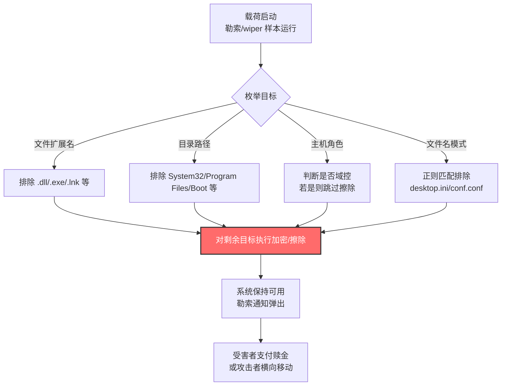

# 选择性排除 (T1679)

## 一句话通俗理解

攻击者像个小偷在"洗劫"前先列好"不能碰"清单——专门绕开系统关键文件（`.dll`/`.exe`/`.lnk`、System32、Program Files 等），确保破坏性载荷既能得手又不会让系统当场崩溃暴露自己。

## 30秒速查卡

| 维度 | 你需要知道的 |
|------|-------------|
| 这是什么？ | 勒索软件/破坏性载荷在执行加密或擦除时，故意排除特定文件、目录、扩展名或系统组件，避免破坏系统稳定性或触发告警 |
| 为什么危险？ | 攻击者通过"精准避让"保持系统可运行（让勒索通知能弹出）、绕过安全工具检测、延长潜伏时间，让防御方更难发现异常 |
| 谁需要关心？ | Windows 系统管理员、SOC 分析师、EDR 研发人员、勒索软件应急响应团队 |
| 你的第一步防御 | 监控非白名单进程对防病毒/备份排除规则的注册表修改，以及对关键扩展名与系统目录的枚举行为 |
| 如果只做一件事 | 部署 Sigma 规则检测非白名单进程修改 Defender 排除配置的行为（对应 MITRE DET0897 / AN2030） |

## 难度等级

⭐⭐ 中级（需要一定的系统与威胁知识）

选择性排除属于中级隐蔽技术，原因在于：
- 攻击者需要理解哪些系统文件/组件一旦破坏会导致系统崩溃、蓝屏或安全工具立即告警
- 不同勒索家族采用不同实现：硬编码路径列表、正则匹配、主机名判断（如域控豁免）
- 防御方的难点不在技术，而在于区分"合法的防病毒排除配置"与"攻击者伪造的排除规则"

## 前置知识检查

**读这个文件需要什么？**

- [ ] Windows 文件系统结构与关键目录（System32、Program Files、Boot、`$Recycle.Bin`）
- [ ] 勒索软件的典型加密流程与文件扩展名处理
- [ ] 防病毒软件的排除规则机制（如 Microsoft Defender 的 `Add-MpPreference -ExclusionPath`）
- [ ] Windows 注册表与文件系统枚举 API（`FindFirstFile`/`FindNextFile`、`RegEnumKey`）
- [ ] 域控制器在 Active Directory 中的角色与系统标识方式

## 技术描述

选择性排除（T1679）是 MITRE ATT&CK v19.1 中**隐蔽战术（TA0005）**下的一项技术，于 2025 年 9 月 25 日首次创建，v19.1 中版本号为 2.0。攻击者在执行勒索软件或破坏性载荷（如 wiper）时，故意排除特定文件、文件夹、目录、文件类型或系统组件，使其免受加密或篡改。攻击者可能避免加密的文件扩展名包括 `.dll`、`.exe` 和 `.lnk`。

**通俗解释：**

想象一个小偷潜入你家准备砸烂所有东西来威胁你交赎金，但他会事先列一张"不能砸"的清单：不砸承重墙（否则房子塌了自己也跑不掉）、不砸电话（否则你没法打电话付赎金）、不砸邻居家（否则邻居立刻报警）。攻击者做同样的事——他们不加密 `.dll`、`.exe`、`.lnk` 这些系统运行必需的文件，不碰 System32、Program Files 这些核心目录，甚至不擦除域控制器，目的就是让系统"刚好够用"——能开机、能弹勒索通知、能联网付赎金，但又不至于立刻崩溃引发紧急响应。

**过渡段：** 选择性排除的精髓在于"精准避让"——攻击者不是不能破坏这些文件，而是主动选择不破坏。这是一种深思熟虑的隐蔽策略，与"无差别破坏"形成鲜明对比。它的价值不在于攻击能力本身，而在于让攻击效果最大化、暴露风险最小化。下面我们看看攻击者具体会排除哪些内容，以及为什么要排除。

**技术原理（按排除对象分类）：**

### 一、按文件扩展名排除

攻击者避免加密特定扩展名的文件，确保系统与自身载荷可继续运行：

1. **系统可执行文件扩展名**：`.dll`、`.exe`、`.sys`——这些是 Windows 运行所必需的，破坏会导致蓝屏或无法启动
2. **快捷方式与配置文件**：`.lnk`、`.ini`——保留快捷方式让用户能看到勒索通知
3. **勒索软件自身相关**：`.lock`、`.encrypted` 等已加密文件标记，避免重复加密损坏数据

### 二、按目录排除

攻击者跳过特定目录，避免破坏系统核心组件：

1. **Windows 系统目录**：`System32`、`Windows`、`Boot`、`PerfLogs`——破坏这些会导致系统无法启动
2. **程序安装目录**：`Program Files`、`Program Files (x86)`——保留关键应用以便用户能打开勒索说明
3. **系统临时与回收站**：`Temp`、`Recycle.Bin`、`$Recycle.Bin`——这些目录无价值且可能触发监控
4. **用户配置目录**：`AppData`、`Documents and Settings`——保留用户配置以便登录

### 三、按系统角色排除

攻击者根据主机身份决定是否执行破坏：

1. **域控制器豁免**：如 LazyWiper 会枚举主机名，若判断为域控制器则不擦除——因为破坏域控会导致整个域瘫痪，引发立即响应，且域控上的 AD 数据库有更高价值的窃取目标
2. **关键基础设施豁免**：避免破坏特定行业的关键系统（如医疗生命维持设备），这是部分勒索团伙的"公关策略"

### 四、按文件名/路径模式排除

攻击者使用正则表达式或字符串匹配排除特定文件：

1. **系统配置文件**：`desktop.ini`、`conf.conf` 等——保留桌面显示与配置
2. **安全工具路径**：避免触碰 EDR/防病毒安装目录，防止触发自我保护机制
3. **勒索说明文件**：`README_RECOVER.txt` 等——确保受害者能看到勒索信息

**用途与影响：**

选择性排除是现代勒索软件和破坏性恶意软件的"标配"技术。它的价值体现在三个层面：**保证系统可用性**（让勒索通知能弹出、赎金能支付）、**规避检测**（避免触发安全工具的自我保护与告警）、**延长攻击窗口**（系统不崩溃，攻击者有更多时间横向移动）。从 Medusa、Embargo 到 DynoWiper、LazyWiper，几乎所有 2024-2026 年的主流破坏性载荷都采用了某种形式的选择性排除策略。这反映了勒索软件生态的成熟——攻击者从"无差别破坏"进化到"精准外科手术式破坏"，以最大化收益最小化风险。

## 真实攻击流程

### 典型攻击流程

```
载荷启动 --> 枚举文件系统/主机信息 --> 判断排除条件 --> 对未排除目标执行加密/擦除 --> 保留系统可用性 --> 投递勒索通知
```



**步骤详解：**

1. **载荷启动**
   - 通俗描述：勒索软件或 wiper 在受害者系统上开始运行
   - 技术细节：载荷可能通过初始访问（钓鱼、漏洞利用、RDP 爆破）进入，提权后启动加密/擦除例程
   - 常见样本：Medusa Ransomware、Embargo、DynoWiper、LazyWiper、SameCoin

2. **枚举目标与排除条件判断**
   - 通俗描述：样本"点名"——决定哪些文件/目录/系统可以动，哪些不能动
   - 技术细节：使用 `FindFirstFile`/`FindNextFile` 递归遍历目录，结合硬编码列表、正则匹配、主机名查询（`GetComputerName`）判断排除
   - 常见排除对象：System32、Windows、Program Files、`$Recycle.Bin`、AppData、`.dll`/`.exe`/`.lnk` 扩展名

3. **对未排除目标执行破坏**
   - 通俗描述：开始"砸东西"，但只砸清单上没列的
   - 技术细节：对未排除文件执行 AES/RSA 加密（勒索软件）或随机数据覆写（wiper）
   - 关键点：保留系统关键文件确保系统可启动、勒索通知可显示

4. **保留系统可用性并投递勒索通知**
   - 通俗描述：留下"勒索信"，让受害者知道该联系谁付钱
   - 技术细节：在每个加密目录放置 README/勒索说明文本文件，部分样本会修改桌面壁纸
   - 价值：系统可用让受害者能联网支付，最大化赎金收益

5. **后续：横向移动或撤退**
   - 通俗描述：拿钱走人，或继续向其他机器扩张
   - 技术细节：部分勒索团伙在加密后会清除痕迹（T1070），或利用保留的凭证横向移动

## 子技术概览

**该技术无子技术。**

T1679 选择性排除在 MITRE ATT&CK v19.1 中是一项独立技术，未拆分子技术。其涵盖的排除对象（文件扩展名、目录、系统角色、文件名模式）均在本父技术文档中统一描述。

## 检测建议

**用人话说：** 选择性排除的检测核心是"识别非白名单进程对防病毒/备份排除规则的配置行为，以及对关键系统文件/目录的异常枚举"。安全软件平时知道哪些进程有权修改 Defender 排除列表——一旦发现陌生进程在添加排除路径，或一个未知进程在遍历 System32 却不碰它（说明它在"避让"），就高度可疑。

### 网络层检测

**检测方法：** 监控网络流量中可疑的文件枚举命令回传。部分勒索软件在加密前会将排除列表与目标清单回传 C2 服务器，可通过流量基线异常发现。同时关注 C2 通信中包含 `.dll`、`.exe`、`System32` 等关键字符串的模式。

### 主机层检测

**Windows 事件 ID：**
- Sysmon Event ID 1：进程创建（关注父进程为可疑载荷的子进程）
- Sysmon Event ID 11：FileCreate（监控在多个目录批量创建勒索说明文件）
- Sysmon Event ID 7：Image Loaded（关注加载加密相关 API 的进程）
- Event ID 4657：注册表值修改（**核心**——监控 Defender 排除路径的修改）
- Event ID 4663：对象访问（监控对关键扩展名文件的批量访问模式）
- Sysmon Event ID 13：注册表值设置（监控 `Add-MpPreference` 排除配置）

**具体命令示例：**
```powershell
# 检测 Defender 排除路径被修改（Sysmon 注册表监控）
Get-WinEvent -FilterHashtable @{LogName='Microsoft-Windows-Sysmon/Operational'; ID=13} |
    Where-Object { $_.Message -match 'ExclusionPath|ExclusionProcess|ExclusionExtension' } |
    Select-Object TimeCreated, Message -First 50

# 检测 Defender 配置变更事件
Get-WinEvent -FilterHashtable @{LogName='Microsoft-Windows-Windows Defender/Operational'; ID=5007} |
    Where-Object { $_.Message -match 'Exclusion' } |
    Select-Object TimeCreated, Message -First 50

# 检测可疑的勒索说明文件批量创建（遍历但跳过系统目录）
Get-WinEvent -FilterHashtable @{LogName='Microsoft-Windows-Sysmon/Operational'; ID=11} |
    Where-Object { $_.Message -match 'README|DECRYPT|ransom|how_to|restore' } |
    Select-Object TimeCreated, Message -First 50

# 审计当前 Defender 排除配置基线
Get-MpPreference | Select-Object -ExpandProperty ExclusionPath
Get-MpPreference | Select-Object -ExpandProperty ExclusionExtension
Get-MpPreference | Select-Object -ExpandProperty ExclusionProcess
```

### 应用层检测

**检测要点：**

1. **防病毒排除规则异常检测**
   - 日志来源：Windows Defender Event ID 5007（配置变更）、Sysmon Event ID 13
   - 关注字段：ExclusionPath、ExclusionProcess、ExclusionExtension
   - 异常特征：非白名单进程（如非 `MsMpEng.exe`、非组策略进程）修改排除配置

2. **文件系统枚举模式异常检测**
   - 日志来源：Sysmon Event ID 11、文件审计日志
   - 关注字段：目标路径、访问模式（读/写）、扩展名
   - 异常特征：单个进程遍历大量目录但跳过 System32/Program Files，或在每个目录创建 README 文件

3. **批量文件操作模式检测**
   - 日志来源：Sysmon Event ID 11、FileShare 审计
   - 关注字段：操作类型（加密/重命名/删除）、时间窗口、文件扩展名
   - 异常特征：短时间内对大量非系统文件执行重命名（如添加 `.locked` 扩展名），但跳过 `.dll`/`.exe`

4. **主机角色判断行为检测**
   - 日志来源：Sysmon Event ID 1（进程命令行）、Event ID 4657
   - 关注字段：`GetComputerName` 调用、域控相关 API 查询
   - 异常特征：未知进程查询主机名后立即决定不执行破坏行为

## 检测规则示例

### Sigma 规则：检测 Defender 排除路径被非白名单进程修改

```yaml
title: 非白名单进程修改 Defender 排除配置检测
id: a1b2c3d4-e5f6-4789-9012-345678901abc
status: experimental
description: 检测非白名单进程修改 Microsoft Defender 排除路径/扩展名/进程配置，可能表明 T1679 选择性排除或 T1685 禁用或修改工具
references:
    - https://attack.mitre.org/techniques/T1679/
    - https://attack.mitre.org/detectionstrategies/DET0897/
author: ATT&CK 知识库
date: 2026/07/24
logsource:
    product: windows
    service: sysmon
detection:
    selection_registry_change:
        EventID: 13
        TargetObject|contains:
            - 'ExclusionPath'
            - 'ExclusionProcess'
            - 'ExclusionExtension'
            - 'ExclusionBackup'
    filter_legitimate_process:
        Image|endswith:
            - 'MsMpEng.exe'
            - 'MpCmdRun.exe'
            - 'svchost.exe'
            - 'powershell.exe'
            - 'mmc.exe'
    condition: selection_registry_change and not filter_legitimate_process
falsepositives:
    - 管理员通过组策略或 PowerShell 批量配置 Defender 排除
    - 第三方防病毒软件集成配置
level: high
tags:
    - attack.t1679
    - attack.t1685
    - attack.defense_evasion
```

### Sigma 规则：检测可疑勒索说明文件批量创建

```yaml
title: 可疑勒索说明文件批量创建检测
id: b2c3d4e5-f6a7-4890-1234-56789012bcd3
status: experimental
description: 检测短时间内多个非系统目录中出现 README/DECRYPT/ransom 等勒索说明文件，可能表明 T1679 选择性排除的勒索软件行为
references:
    - https://attack.mitre.org/techniques/T1679/
    - https://attack.mitre.org/detectionstrategies/DET0897/
author: ATT&CK 知识库
date: 2026/07/24
logsource:
    product: windows
    service: sysmon
detection:
    selection_file_create:
        EventID: 11
        TargetFilename|contains:
            - 'README'
            - 'DECRYPT'
            - 'ransom'
            - 'how_to'
            - 'restore'
    filter_system_dirs:
        TargetFilename|contains:
            - 'C:\Windows\System32\'
            - 'C:\Windows\SysWOW64\'
            - 'C:\Program Files\'
            - 'C:\Program Files (x86)\'
    timeframe: 5m
    condition: selection_file_create and not filter_system_dirs | count() by Image > 10
falsepositives:
    - 软件安装程序在多个用户目录放置 README 文件
    - 文档管理系统的批量文件创建
level: high
tags:
    - attack.t1679
    - attack.defense_evasion
    - attack.impact
```

## 缓解措施

> ⚠️ **MITRE 官方说明：** 此类攻击技术基于对系统功能的滥用，难以通过预防性控制措施完全缓解。

### 优先级 1：关键措施

**措施名称：** 严格管控防病毒排除规则配置

**具体实施步骤：**
1. 通过组策略强制限制 Defender 排除路径的修改权限，仅允许 Domain Admins 与特定的安全运维账户操作
2. 部署配置基线监控，定期比对 Defender 排除列表与白名单基线，任何偏离立即告警
3. 启用 Windows Defender 的 Tamper Protection（防篡改保护），阻止非授权进程修改配置
4. 审计所有现有的 Defender 排除路径，清理过宽或不当的排除项

### 优先级 2：重要措施

**措施名称：** 部署行为检测与异常文件操作告警

**具体实施步骤：**
1. 部署基于行为的勒索软件检测（如 Windows Defender 的 AntiRansomware 模块、受控文件夹访问 Controlled Folder Access）
2. 启用文件服务器审计，监控短时间内对大量文件的修改/重命名/加密行为
3. 配置 Sysmon Event ID 11 的批量文件操作告警规则，设置阈值（如 5 分钟内修改超过 100 个文件）
4. 部署 EDR 的勒索软件行为检测策略，识别"遍历-排除-加密"模式

### 优先级 3：建议措施

**措施名称：** 加固域控制器与关键系统标识

**具体实施步骤：**
1. 为域控制器部署专用防护（如 Microsoft Defender for Identity），监控异常主机名查询行为
2. 在关键系统上部署文件完整性监控（FIM），对 System32、Boot 等目录的任何修改立即告警
3. 实施网络分段，隔离域控制器与关键基础设施，限制横向移动路径
4. 定期备份关键数据，并验证备份的可恢复性（遵循 3-2-1 备份原则）

### MITRE ATT&CK 缓解措施映射

| 缓解措施 ID | 缓解措施名称 | 适用性 | 说明 |
|------------|-------------|--------|------|
| M1040 | 行为检测 | 适用 | 监控异常文件枚举与选择性避让行为 |
| M1050 | 数据备份 | 适用 | 遭遇破坏性载荷时快速恢复 |
| M1038 | 执行防护 | 部分适用 | 限制未知进程对系统配置的修改 |
| M1047 | 审计 | 适用 | 审计 Defender 排除配置变更与文件操作 |
| M1018 | 账户管理 | 部分适用 | 限制可修改防病毒配置的账户范围 |

## 动手实验

> ⚠️ **重要提示**：所有实验必须在隔离的实验室环境中进行，禁止对未授权的真实系统进行测试。

### 实验环境准备

**所需工具：**
- Windows 10/11 虚拟机（启用 Sysmon 日志与 Windows Defender）
- PowerShell（用于审计 Defender 配置）
- 一个测试用的"伪勒索"脚本（仅枚举不实际加密）
- Sysinternals Process Monitor（ProcMon）

### 实验 1：观察选择性排除的枚举模式（初级）

**实验目标：** 理解 T1679 选择性排除的文件系统遍历模式，识别"避让关键目录"的行为特征

**实验步骤：**
1. 启用 ProcMon 监控文件系统操作，设置过滤器为 `Operation is CreateFile`
2. 编写一个 PowerShell 测试脚本，递归遍历 C 盘但跳过 System32/Program Files：
   ```powershell
   Get-ChildItem -Path C:\ -Recurse -ErrorAction SilentlyContinue |
       Where-Object { $_.FullName -notmatch 'System32|Program Files|Windows\\Boot' } |
       Select-Object -First 100 FullName
   ```
3. 运行脚本，观察 ProcMon 中记录的文件访问模式
4. 检查 Sysmon Event ID 11 日志，确认枚举行为被记录
5. 对比：修改脚本不排除任何目录，观察日志差异

**预期结果：** ProcMon 显示脚本遍历了用户目录但跳过了 System32，Sysmon 日志记录了文件创建事件

**学习要点：** 理解攻击者如何通过简单的路径过滤实现选择性排除，以及这种行为在日志中的特征

### 实验 2：审计 Defender 排除配置（中级）

**实验目标：** 掌握检测 Defender 排除配置变更的方法，建立基线监控

**实验步骤：**
1. 记录当前 Defender 排除配置基线：
   ```powershell
   Get-MpPreference | Select-Object ExclusionPath, ExclusionExtension, ExclusionProcess
   ```
2. 模拟攻击者添加可疑排除路径：
   ```powershell
   Add-MpPreference -ExclusionPath "C:\Temp\malicious"
   Add-MpPreference -ExclusionExtension ".test"
   ```
3. 检查 Windows Defender 事件日志（Event ID 5007）确认配置变更被记录
4. 检查 Sysmon Event ID 13 日志，确认注册表修改被记录
5. 清理：移除测试排除项
   ```powershell
   Remove-MpPreference -ExclusionPath "C:\Temp\malicious"
   Remove-MpPreference -ExclusionExtension ".test"
   ```

**预期结果：** 配置变更在 Defender 日志与 Sysmon 日志中均有记录，可用于检测规则

**学习要点：** 理解 Defender 排除配置的检测点位，建立基线监控策略

## 真实案例

### 案例 1：Medusa 勒索软件选择性排除确保系统可用性（2024）

- **时间**：2024 年 1 月起持续活跃至 2025 年
- **目标**：全球医疗机构、教育机构、政府部门的 Windows 系统
- **攻击组织**：Medusa Ransomware 运营团伙
- **手法**：Medusa 勒索软件在加密例程中刻意避开了指定的文件、文件扩展名和文件夹。被排除的对象包括系统可执行文件（`.dll`/`.exe`/`.sys`）、关键系统目录（System32、Windows、Program Files）以及部分配置文件（`.lnk`）。这种选择性排除确保了加密后系统仍能启动、勒索通知能弹出、受害者能联网支付赎金。Palo Alto Unit 42 的分析报告明确指出，Medusa 的"避让清单"是其提高赎金收益的核心策略之一。
- **影响**：多家医疗机构运营中断，部分受害者支付高额赎金，估算损失超过数千万美元
- **参考链接**：[MITRE - T1679](https://attack.mitre.org/techniques/T1679/)、[Palo Alto Unit 42 - Medusa Ransomware](https://unit42.paloaltonetworks.com/medusa-ransomware-escalation-new-leak-site/)、[Symantec - Medusa Activity](https://www.security.com/threat-intelligence/medusa-ransomware-attacks)

### 案例 2：DynoWiper 与 LazyWiper 针对波兰能源部门的选择性擦除（2025-2026）

- **时间**：2025 年 12 月 29 日攻击事件，2026 年 1 月公开分析
- **目标**：波兰能源部门关键基础设施
- **攻击组织**：未明确归因，ESET 与 CERT Polska 联合分析
- **手法**：DynoWiper 作为破坏性 wiper 载荷，在递归枚举目录时明确排除了 System32、Windows、Program Files、Program Files (x86)、Temp、Recycle.Bin、`$Recycle.Bin`、Boot、PerfLogs、AppData、Documents and Settings 等系统关键目录。同系列的 LazyWiper 则采取了另一种选择性排除策略——它会枚举主机名判断系统是否为域控制器，若是域控则跳过擦除操作。这种"域控豁免"反映了攻击者的精心算计：破坏域控会立即触发整个域的瘫痪与紧急响应，而保留域控让攻击者有更多时间窃取 AD 数据库中的高价值凭证。
- **影响**：波兰能源部门多处设施受影响，但部分系统因选择性排除策略得以恢复
- **参考链接**：[MITRE - T1679](https://attack.mitre.org/techniques/T1679/)、[CERT Polska - Energy Sector Incident Report](https://cert.pl/uploads/docs/CERT_Polska_Energy_Sector_Incident_Report_2025.pdf)、[ESET - DynoWiper Analysis](https://www.welivesecurity.com/en/eset-research/dynowiper-update-technical-analysis-attribution/)

### 案例 3：Embargo 勒索软件利用正则表达式实现灵活排除（2024）

- **时间**：2024 年 5 月发现并持续活跃
- **目标**：跨国企业与政府机构
- **攻击组织**：Embargo 运营团伙（Rust 语言开发的新兴勒索家族）
- **手法**：Embargo 勒索软件采用了一种更灵活的选择性排除实现——在 Rust 编写的二进制文件中嵌入正则表达式，动态匹配需要排除的文件和目录。相比硬编码列表，正则匹配让攻击者能快速调整排除规则，适应不同受害环境。例如，可以通过 `.*\.(dll|exe|sys|lnk)$` 一次性排除所有系统可执行文件，或通过 `C:\\(Windows|Program Files.*)\\.*` 排除系统目录。Cyble 的分析报告指出，这种基于正则的排除策略使 Embargo 在不同 Windows 版本与配置下都能精准避让关键文件。
- **影响**：多个跨国企业遭受加密攻击，部分数据被双重勒索
- **参考链接**：[MITRE - T1679](https://attack.mitre.org/techniques/T1679/)、[Cyble - Embargo Ransomware Analysis](https://cyble.com/blog/the-rust-revolution-new-embargo-ransomware-steps-in/)

## 术语解释

| 术语 | 英文原名 | 通俗解释 |
|------|----------|----------|
| 选择性排除 | Selective Exclusion | 攻击者在破坏性载荷中故意排除特定文件/目录/组件，避免系统崩溃或触发告警 |
| 勒索软件 | Ransomware | 加密受害者文件并索要赎金的恶意软件 |
| Wiper | Wiper | 以破坏数据为目的的恶意软件，通常不可恢复 |
| 排除路径 | Exclusion Path | 防病毒软件配置中指定的不扫描路径，可被攻击者滥用 |
| 域控制器 | Domain Controller | Active Directory 中负责认证的中心服务器，破坏会导致整个域瘫痪 |
| 受控文件夹访问 | Controlled Folder Access | Windows Defender 的勒索软件防护功能，限制未知进程修改受保护文件夹 |
| 防篡改保护 | Tamper Protection | Windows Defender 的安全功能，阻止非授权进程修改配置 |
| Add-MpPreference | Add-MpPreference | PowerShell cmdlet，用于添加 Defender 排除配置 |

## 参考资料

### 📚 官方文档（深入了解）

- [MITRE ATT&CK - T1679 Selective Exclusion](https://attack.mitre.org/techniques/T1679/)
- [MITRE ATT&CK - TA0005 Stealth](https://attack.mitre.org/tactics/TA0005/)
- [MITRE ATT&CK - DET0897 Detection of Selective Exclusion](https://attack.mitre.org/detectionstrategies/DET0897/)

### 📰 安全报告（真实攻击）

- [Palo Alto Unit 42 - Medusa Ransomware Turning Your Files into Stone](https://unit42.paloaltonetworks.com/medusa-ransomware-escalation-new-leak-site/)
- [CERT Polska - Energy Sector Incident Report 2025](https://cert.pl/uploads/docs/CERT_Polska_Energy_Sector_Incident_Report_2025.pdf)
- [ESET - DynoWiper Update: Technical Analysis and Attribution](https://www.welivesecurity.com/en/eset-research/dynowiper-update-technical-analysis-attribution/)
- [Cyble - The Rust Revolution: New Embargo Ransomware Steps In](https://cyble.com/blog/the-rust-revolution-new-embargo-ransomware-steps-in/)
- [eSentire - Bored BeaverTail & InvisibleFerret Yacht Club](https://www.esentire.com/blog/bored-beavertail-invisibleferret-yacht-club-a-lazarus-lure-pt-2)
- [Palo Alto Unit 42 - Two Campaigns by North Korea Bad Actors](https://unit42.paloaltonetworks.com/two-campaigns-by-north-korea-bad-actors-target-job-hunters/)
- [Symantec - Medusa Ransomware Activity Continues to Increase](https://www.security.com/threat-intelligence/medusa-ransomware-attacks)
- [SecurityScorecard - A Deep Dive into Medusa Ransomware](https://securityscorecard.com/wp-content/uploads/2024/01/deep-dive-into-medusa-ransomware.pdf)
- [Check Point - Hamas-affiliated Threat Actor WIRTE](https://research.checkpoint.com/2024/hamas-affiliated-threat-actor-expands-to-disruptive-activity/)
- [FBI Flash - Iran Cyber Actors Telegram C2 (2026)](https://www.ic3.gov/CSA/2026/260320.pdf)

### 🔧 工具与资源（动手试试）

- [Microsoft Defender PowerShell 模块](https://learn.microsoft.com/en-us/powershell/module/defender/) - 审计与配置 Defender 排除规则
- [Sysinternals Process Monitor](https://learn.microsoft.com/en-us/sysinternals/downloads/procmon) - 监控文件系统枚举行为
- [Sigma Rule Repository](https://github.com/SigmaHQ/sigma) - 通用检测规则库
- [Atomic Red Team](https://atomicredteam.io/) - 可执行的检测测试用例

## 相关技术

- **[T1685 禁用或修改工具](../08-Defense-Impairment/T1685-Disable-or-Modify-Tools.md)**：禁用或修改工具与选择性排除经常配合使用——攻击者先添加 Defender 排除规则削弱检测，再实施选择性排除的破坏性载荷
- **[T1070 清除痕迹](./T1070-Indicator-Removal.md)**：清除痕迹与选择性排除同属隐蔽战术，破坏性载荷在执行后会清除日志掩盖行踪
- **[T1486 数据加密以影响](../15-Impact/T1486-Data-Encrypted-for-Impact.md)**：勒索软件的加密影响行为，T1679 选择性排除是其在隐蔽战术下的"配套策略"
- **[T1485 数据破坏](../15-Impact/T1485-Data-Destruction.md)**：wiper 类破坏性载荷的核心影响技术，T1679 选择性排除决定其破坏范围
- **[T1014 Rootkit](./T1014-Rootkit.md)**：Rootkit 与选择性排除都是"精准避让"的体现——前者避让检测，后者避让破坏
- **[T1083 文件与目录发现](https://attack.mitre.org/techniques/T1083/)**：发现战术中的文件目录枚举，选择性排除前的目标识别阶段
- **[T1490 内容抑制](https://attack.mitre.org/techniques/T1490/)**：抑制系统恢复技术，常与选择性排除配合——保留系统可用但破坏恢复点
