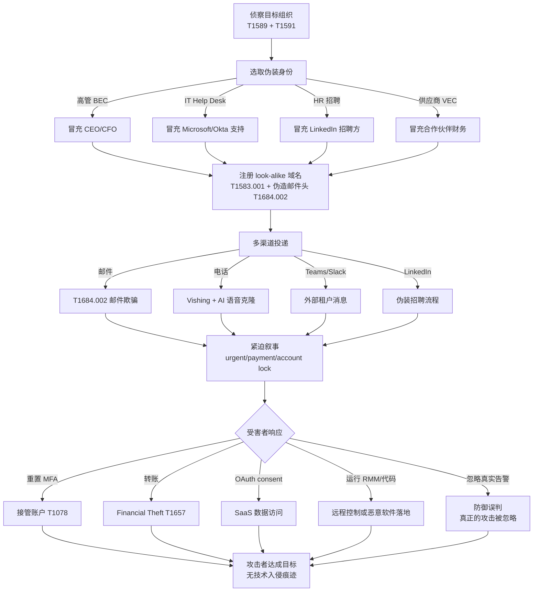

# 社会工程 (T1684)

## 一句话通俗理解

攻击者伪造身份或操纵认证警报信息，让防御系统误判威胁来源、让用户误信"权威指令"——好比小偷穿上警服自己拉响警报，值班员反而去协助"警察"抓错人。

## 30秒速查卡

| 维度 | 你需要知道的 |
|------|-------------|
| 攻击目标 | 让安全团队/用户/Help Desk 主动做出错误判断（重置凭证、批准授权、忽略告警） |
| 攻击者收益 | 无需技术漏洞即可接管账户，社会工程成功率显著高于传统漏洞利用 |
| 常见手法 | 冒充高管/IT 帮助台/招聘方、伪造邮件头、外部 Teams 租户冒充、AI 语音克隆 |
| 检测重点 | 发件人显示名与 SMTP 地址不匹配、Help Desk 短时批量重置、外部租户首次联系+敏感关键词 |
| 防御要点 | Help Desk 反向验证（回拨 HR 登记电话）、强制 DMARC reject、邮件标签外部发件人、多渠道意识培训 |

## 难度等级

⭐⭐ 中级（难度 2）—— 主要依赖社会工程学而非技术漏洞。攻击者无需掌握高级漏洞利用或恶意软件编写能力，但需要侦察目标、编写可信叙述和"人对人"操控的能力。

## 前置知识检查

**读这个文件需要什么？**

- [ ] SMTP 协议基础（MAIL FROM、RCPT TO、邮件头字段）
- [ ] DMARC / DKIM / SPF 三件套的认证流程与失败模式
- [ ] OAuth 2.0 consent 流程与 SaaS 应用授权机制
- [ ] MFA 注册/改绑流程及 IAM 系统的审计日志字段
- [ ] SIEM 告警机制与行为时序关联（"外部通信后短时间内触发高价值操作"）

## 技术描述

社会工程（T1684，Social Engineering）是 MITRE ATT&CK v19.1 在隐蔽（TA0005）战术下新增的技术，2026 年 4 月 14 日随 v19.1 版本正式发布。该技术涵盖攻击者通过社会工程手段影响用户采取行动，导致未经授权的访问、变更批准、敏感信息披露或执行攻击者提供的指令。本知识库早期版本曾将其误记为"欺骗认证警报"（Spoof Authentication Alert），现已被更正为 MITRE 官方名称"社会工程"。

**通俗解释：**

传统的凭证窃取（如 T1110 暴力破解）是攻击者"绕过"防御——破解密码、伪造令牌；而 T1684 专注于"欺骗"——让防御者**主动**做出错误判断。攻击者通过伪造身份、伪造邮件来源或操纵认证警报，让安全团队误判威胁来源、让用户误信"权威指令"、让 Help Desk 自愿重置攻击者想要的账户。这种"借力打力"的策略成功率显著高于纯技术入侵，且往往不留技术入侵痕迹。

与钓鱼（T1566）不同：T1566 重点是"投递恶意 payload 或收集凭据"的渠道；T1684 强调的是"通过身份和警报欺骗让防御体系主动配合攻击者"。MGM Resorts 事件中 Scattered Spider 全程没有投递任何 payload，只是打电话给 Help Desk 冒充员工，就造成了 1 亿美元损失。

**技术原理：**

1. **身份伪造**：攻击者冒充可信的人或组织（CEO、Microsoft 帮助台、HR 招聘方、合作伙伴），通过通信渠道诱导受害者执行操作——对应子技术 [T1684.001 伪装身份](./T1684/T1684.001-Impersonation.md)
2. **邮件来源伪造**：通过伪造邮件头字段（From、Reply-To、Return-Path）让邮件看起来来自可信发件人，绕过邮件网关的初步检查——对应子技术 [T1684.002 电子邮件欺骗](./T1684/T1684.002-Email-Spoofing.md)
3. **多渠道互证**：邮件 → Teams → 电话的组合投递，三个渠道互相"印证"让受害者几乎不会怀疑
4. **认证警报操纵**：利用紧迫叙事（"account lock"、"urgent payment"、"password reset required"）逼迫受害者在被检测到之前快速行动
5. **链式利用**：先用 T1078 Valid Accounts 入侵一个组织，再用被入侵的内部账户对其他实体发起伪装攻击（VEC 模式）

**用途与影响：**

T1684 已成为 2023 年以来最高频的初始访问和提权路径之一。CISA 在多份警报（AA23-320A Scattered Spider、AA24-285A BEC 顾问）中明确指出：社会工程式攻击的损失已超过传统勒索软件。攻击者偏好此技术的原因是：

- **无技术入侵痕迹**——检测系统看到的是"用户主动执行了密码重置"
- **成功率高**——人对人的操控成功率远高于漏洞利用
- **绕过 MFA**——不需要破解 MFA，骗 Help Desk 直接改绑即可
- **跨平台**——邮件、Teams、电话、LinkedIn 全渠道适用

## 真实攻击流程



**步骤详解：**

1. **侦察目标**：通过 LinkedIn、公司官网、Hunter.io 收集组织架构、汇报关系、IT 部门联系方式、内部术语
2. **选取伪装身份**：根据攻击目的选择对应伪装角色——想要转账冒充 CFO，想要重置 MFA 冒充 IT Help Desk，想要 OAuth 授权冒充 Microsoft 安全通知
3. **伪造发件人身份**：注册 look-alike 域名（如 `microsoftonlines[.]com`），伪造邮件头字段让邮件显示为可信发件人
4. **多渠道投递欺骗邮件/消息**：邮件 + Teams 外部租户 + 电话多管齐下，三个渠道互相"印证"
5. **用户误判**：受害者在紧迫叙事下"自愿"重置密码、批准 OAuth、运行 RMM 工具或转账
6. **防御告警被误导**：检测系统看到的是"用户主动执行了合法操作"，安全团队可能反而去调查被冒充的真实员工，攻击者趁机横向移动

## 子技术概览

| ID | 名称 | 一句话理解 | 平台 |
|----|------|-----------|------|
| [T1684.001](./T1684/T1684.001-Impersonation.md) | 伪装身份 | 攻击者穿上"高管/同事/IT 帮助台/招聘方"的戏服，通过邮件、电话、Teams 让受害者"自愿"做事 | Windows, Linux, macOS, Office Suite, SaaS |
| [T1684.002](./T1684/T1684.002-Email-Spoofing.md) | 电子邮件欺骗 | 伪造邮件头字段（From、Reply-To、Return-Path）让邮件显示为可信发件人，绕过邮件网关检查 | Windows, Linux, macOS, Office Suite, SaaS, Google Workspace, Microsoft 365 |

## 检测建议

### 网络层检测：邮件认证与发件人一致性

**检测方法：** 强制启用 DMARC（p=reject）+ DKIM 签名验证 + SPF 对齐检查；监控邮件网关日志中发件人显示名与 SMTP 地址不匹配的事件；检测 DMARC 失败但仍投递到收件箱的邮件。

**具体命令示例：**

```bash
# 使用 PowerShell 查询 M365 邮件追踪日志中显示名与 SMTP 地址不匹配的邮件
Get-MessageTrace -StartDate (Get-Date).AddDays(-7) -EndDate (Get-Date) |
  Where-Object { $_.SenderAddress -notmatch $_.FromAddress } |
  Select-Object ReceivedTime, SenderAddress, FromAddress, Subject, RecipientAddress |
  Format-Table -AutoSize
```

```bash
# 检查 DMARC 失败但仍投递的邮件（应配置为 reject，但日志中可能仍有 quarantine 记录）
Get-MessageTrace -StartDate (Get-Date).AddDays(-7) -EndDate (Get-Date) |
  Where-Object { $_.DmarcAction -ne 'Reject' -and $_.DmarcResult -eq 'Fail' }
```

### 主机层检测：Help Desk 异常重置与外部租户消息

**关键事件来源：**

- Azure AD Audit Log：`Update user` + `Admin registered MFA`（密码重置 + MFA 改绑）
- M365 Audit Log：`Add-MailboxPermission`、`SendAs`、`SendOnBehalfOf`（异常授权）
- Microsoft Teams 管理日志：`ExternalUserStartingTeamsCommunication`、`ChannelMessageAdded`
- Windows Security Event ID 4724（用户账户密码重置）+ Event ID 4624（登录）短时间内连续出现
- Windows Security Event ID 4738（用户账户属性更改，可能包含 MFA 改绑）

**异常特征：**

- 密码重置请求来自与员工历史登录不符的地理位置
- 短时间内多个账户被同一 Help Desk 账户重置
- Help Desk 工程师账户在非工作时间执行批量重置
- 外部 Teams 租户首次联系内部员工，消息包含"IT support"、"Help Desk"、"password reset"等关键词
- SendAs 权限新授权给非管理员账户或外部账户

### 应用层检测：行为时序关联

**检测方法：** 关联"用户与外部通信"后短时间内触发高价值操作的模式（MITRE 检测对象 DET0286 AN0792-AN0796）。

**EDR 查询示例（Microsoft 365 Defender KQL）：**

```kusto
// 检测外部 Teams 消息后短时间内触发密码重置或 MFA 改绑的模式
let external_contact = TeamsData
| where Timestamp > ago(24h)
| where OperationName in ('ExternalUserStartingTeamsCommunication', 'ChannelMessageAdded')
| where MessageText has_any ('IT support', 'Help Desk', 'password reset', '密码重置', '帮助台')
| summarize FirstContact = min(Timestamp) by RecipientUpn, SenderExternalUpn;
let sensitive_action = AuditLogs
| where Timestamp > ago(24h)
| where OperationName in ('Update user', 'Admin registered MFA', 'Reset password')
| summarize ActionTime = min(Timestamp) by InitiatedByUpn, TargetUserUpn;
external_contact
| join kind=inner sensitive_action on $left.RecipientUpn == $right.TargetUserUpn
| where datetime_diff('minute', ActionTime, FirstContact) between (0 .. 60)
| project FirstContact, RecipientUpn, SenderExternalUpn, ActionTime, OperationName
```

## 缓解措施

### 优先级1：关键措施

**措施名称：** Help Desk 反向验证 + 带外二次确认

**具体实施步骤：**

1. Help Desk 接到密码重置请求时，必须**回拨到 HR 系统登记的电话号码**（而非来电显示的号码）
2. 重置凭证前要求员工提供至少 2 项"非公开信息"（员工号 + 经理姓名 + 入职日期 + 最近报销单号）
3. 对 MFA 改绑操作启用"24 小时延迟生效"+ 邮件 + 短信双重通知
4. Help Desk 操作全程录音，并启用用户行为分析（UBA）检测异常重置模式

### 优先级2：重要措施

**措施名称：** 强制 DMARC reject 策略 + 邮件标签外部发件人

**具体实施步骤：**

1. 在自有域名上配置 DMARC `p=reject`，并启用 DKIM 签名所有出站邮件
2. 在邮件网关上配置 DMARC 失败的入站邮件直接拒绝（不要仅 quarantine）
3. 在 Outlook / Gmail 中启用"外部发件人标签"功能，所有来自组织外部的邮件显示醒目标签
4. 配置邮件网关检测发件人显示名与 SMTP 地址不匹配，对内部高管姓名进行特殊保护

### 优先级3：建议措施

**措施名称：** 多渠道安全意识培训 + MFA 硬件令牌

**具体实施步骤：**

1. 每季度对所有员工进行**多渠道**（邮件、电话、Teams、LinkedIn）社会工程演练
2. Help Desk 团队和 HR 招聘团队单独培训"反社工"流程
3. 对高价值账户（高管、IT 管理员、财务）强制使用 FIDO2 硬件令牌（YubiKey），杜绝 SIM swap 和 MFA 短信劫持
4. 阻止外部 Teams 租户到内部消息，仅允许已知合作伙伴租户

### MITRE ATT&CK 缓解措施映射

| 缓解措施 ID | 缓解措施名称 | 适用性 | 说明 |
|------------|-------------|--------|------|
| M1019 | 威胁情报计划 | 适用 | 让防御者了解活跃的伪装诱饵和 BEC/VEC 活动 |
| M1017 | 用户培训 | 适用 | 训练用户识别伪装身份套路，通过独立渠道二次确认 |
| M1036 | 账户使用策略 | 适用 | Help Desk 重置需要二次验证 |
| M1047 | 审计 | 适用 | 关联邮件/身份/SaaS/端点活动以发现看似合法的可疑操作 |
| M1021 | 限制网络访问 | 部分适用 | 阻止外部 Teams 租户到内部消息 |

## 动手实验

> ⚠️ **重要提示**：所有实验必须在隔离的实验室环境中进行，禁止对未授权的真实员工或系统进行测试。社会工程测试**必须**有书面授权。本实验聚焦于**检测**电子邮件欺骗，不教授如何发起欺骗攻击。

### 实验环境准备

**所需工具：**

- 测试用 M365 租户或本地邮件服务器（如 hMailServer）
- PowerShell 7+（用于查询邮件追踪日志）
- Python 3.10+（用于解析邮件头和 DMARC 报告）
- 测试邮箱账户（攻击者账户 + 受害者账户 + 内部高管账户）

### 实验1：电子邮件欺骗检测——显示名与 SMTP 地址不匹配识别（初级）

**实验目标：** 在隔离测试环境中模拟 Scattered Spider 式邮件欺骗场景，编写检测脚本识别发件人显示名与 SMTP 地址不匹配的邮件，掌握 T1684.002 邮件欺骗的检测方法。

**实验步骤：**

1. **准备测试邮件样本**

   在测试 M365 租户中创建两个账户：
   - `attacker@external-test.com`（攻击者账户）
   - `ceo-name@internal-test.com`（真实 CEO 账户，用于对照）

   从攻击者账户向受害者账户发送 3 封测试邮件：
   - 邮件 A：发件人显示名设为 "CEO Name"（内部 CEO 真实姓名），SMTP 地址为 `attacker@external-test.com`
   - 邮件 B：发件人显示名设为 "Microsoft IT Support"，SMTP 地址为 `attacker@external-test.com`
   - 邮件 C（对照）：发件人显示名和 SMTP 地址均为 `ceo-name@internal-test.com`（真实 CEO）

2. **编写检测脚本识别不匹配**

   新建文件 `spoof_detector.py`：

   ```python
   #!/usr/bin/env python3
   """
   实验1：电子邮件欺骗检测——显示名与 SMTP 地址不匹配识别
   仅用于检测目的，在隔离测试环境中运行
   """
   from dataclasses import dataclass
   from email.utils import parseaddr
   import re

   # 内部高管姓名白名单（用于检测冒充）
   INTERNAL_EXECUTIVES = {
       "ceo name": "ceo-name@internal-test.com",
       "cfo name": "cfo-name@internal-test.com",
       "microsoft it support": "it-support@internal-test.com",
   }

   @dataclass
   class SpoofAlert:
       sender_display: str
       sender_smtp: str
       reason: str
       severity: str  # high / medium / low

   def detect_display_name_smtp_mismatch(display_name: str, smtp_address: str) -> SpoofAlert | None:
       """检测显示名与 SMTP 地址不匹配"""
       display_lower = display_name.strip().lower()
       smtp_lower = smtp_address.strip().lower()

       # 检查 1：显示名是内部高管，但 SMTP 地址不是内部域
       if display_lower in INTERNAL_EXECUTIVES:
           expected_smtp = INTERNAL_EXECUTIVES[display_lower]
           if smtp_lower != expected_smtp:
               return SpoofAlert(
                   sender_display=display_name,
                   sender_smtp=smtp_address,
                   reason=f"显示名 '{display_name}' 是内部高管，但 SMTP 地址 {smtp_address} 不是 {expected_smtp}",
                   severity="high",
               )

       # 检查 2：显示名包含 "Microsoft"、"IT Support"、"Help Desk" 但 SMTP 地址不是 microsoft.com 或内部域
       trust_keywords = ["microsoft", "it support", "help desk", "帮助台", "it 帮助台"]
       if any(kw in display_lower for kw in trust_keywords):
           if not (smtp_lower.endswith("@microsoft.com") or
                   smtp_lower.endswith("@internal-test.com")):
               return SpoofAlert(
                   sender_display=display_name,
                   sender_smtp=smtp_address,
                   reason=f"显示名 '{display_name}' 模仿可信组织，但 SMTP 地址 {smtp_address} 不属于可信域",
                   severity="high",
               )

       # 检查 3：显示名看起来像内部员工但 SMTP 地址是外部域
       if "@" not in display_name and len(display_name) > 2:
           if not smtp_lower.endswith("@internal-test.com"):
               # 仅当显示名包含常见姓名模式时告警
               if re.search(r"^[a-z]+ [a-z]+$", display_lower):
                   return SpoofAlert(
                       sender_display=display_name,
                       sender_smtp=smtp_address,
                       reason=f"显示名 '{display_name}' 像内部员工，但 SMTP 地址 {smtp_address} 是外部域",
                       severity="medium",
                   )

       return None

   def parse_email_headers(raw_headers: str) -> tuple[str, str]:
       """从原始邮件头解析显示名和 SMTP 地址"""
       from_field = ""
       for line in raw_headers.splitlines():
           if line.lower().startswith("from:"):
               from_field = line[5:].strip()
               break
       display_name, smtp_address = parseaddr(from_field)
       return display_name, smtp_address

   def main():
       print("[*] T1684.002 电子邮件欺骗检测实验")
       print("=" * 60)

       # 模拟 3 封测试邮件的 From 头
       test_emails = [
           ('CEO Name', 'attacker@external-test.com', '邮件 A - 冒充 CEO'),
           ('Microsoft IT Support', 'attacker@external-test.com', '邮件 B - 冒充 Microsoft 支持'),
           ('CEO Name', 'ceo-name@internal-test.com', '邮件 C - 对照（真实 CEO）'),
       ]

       for display, smtp, desc in test_emails:
           print(f"\n[*] 检测: {desc}")
           print(f"    显示名: {display}")
           print(f"    SMTP 地址: {smtp}")
           alert = detect_display_name_smtp_mismatch(display, smtp)
           if alert:
               print(f"    [!] 告警 [{alert.severity.upper()}]: {alert.reason}")
           else:
               print(f"    [OK] 未检测到不匹配")

       print("\n" + "=" * 60)
       print("[*] 学习要点：")
       print("    - 显示名与 SMTP 地址不匹配是 T1684.002 最常见的特征")
       print("    - 内部高管姓名 + 外部 SMTP 地址 = 高严重性告警")
       print("    - 防御方应在邮件网关层强制执行此检测，而非依赖终端用户识别")

   if __name__ == "__main__":
       main()
   ```

3. **运行检测脚本**

   ```bash
   python3 spoof_detector.py
   ```

4. **观察输出并扩展检测规则**

   - 邮件 A 和 B 应触发 high 严重性告警
   - 邮件 C 不应告警
   - 尝试添加更多检测规则：检查 Reply-To 与 From 不一致、检查 Return-Path 与 From 不一致、检查 DKIM 签名域与 From 域不一致

**预期结果：**

- 检测脚本正确识别邮件 A、B 为欺骗邮件，邮件 C 通过
- 理解显示名与 SMTP 地址不匹配是 T1684.002 最易检测的特征
- 掌握将此检测逻辑迁移到邮件网关（如 Proofpoint、Mimecast、EOP）的方法

**学习要点：**

- 理解 T1684.002 邮件欺骗的核心检测点：显示名/SMTP 地址一致性、DMARC/DKIM/SPF 三件套、Reply-To/Return-Path 一致性
- 掌握"内部高管姓名白名单 + 外部 SMTP 地址"的高风险组合检测模式
- 学习检测逻辑应部署在邮件网关层，而非依赖终端用户识别

## 真实案例

### 案例1：Scattered Spider 冒充 IT 帮助台接管 MGM Resorts（2023年9月）

- **时间**: 2023年9月
- **目标**: 美国 MGM Resorts International
- **攻击组织**: Scattered Spider（G1015，又称 OCTO TEMPEST/UNC3944）
- **手法**: 攻击者通过 LinkedIn 找到 MGM IT 部门员工信息，然后冒充该员工拨打 MGM IT Help Desk 电话，骗取密码重置和 MFA 令牌改绑。Help Desk 在没有反向验证的情况下重置了凭证。攻击者随后通过 Okta 单点登录横向移动，部署 BlackCat 勒索软件。CISA AA23-320A 警报明确指出"Scattered Spider 利用社会工程迫使 IT 帮助台重置密码和 MFA 令牌"。Microsoft 报告也指出 Scattered Spider 还通过 Microsoft Teams 冒充内部 IT 支持人员联系员工
- **影响**: MGM 旗下赌场、酒店、ATM 全面停摆约 10 天，损失估算超 1 亿美元
- **参考链接**: [CISA AA23-320A Scattered Spider](https://www.cisa.gov/news-events/cybersecurity-advisories/aa23-320a)

### 案例2：LAPSUS$ 冒充员工致电 Help Desk 入侵多家巨头（2022年3月）

- **时间**: 2022年3月
- **目标**: NVIDIA、Microsoft、三星、Okta、Ubisoft 等多家科技巨头
- **攻击组织**: LAPSUS$（G1004，又称 DEV-0537）
- **手法**: LAPSUS$ 通过侦察收集目标员工的个人信息（包括姓名、职位、汇报关系），然后致电目标公司的 Help Desk，冒充该员工声称"忘记密码"或"丢失 MFA 设备"，要求重置凭证。Microsoft 安全博客详细描述了 LAPSUS$ "通过电话联系受害者 Help Desk，利用已收集的合法用户信息冒充身份以获取特权账户访问"。LAPSUS$ 还使用了被入侵的内部账户对其他实体发起社会工程攻击（链式利用模式）
- **影响**: 多家科技巨头源代码、内部数据被窃取；Okta 一名支持工程师账户被入侵影响 2.5% 客户
- **参考链接**: [Microsoft - DEV-0537 Criminal Actor Targeting Organizations](https://www.microsoft.com/security/blog/2022/03/22/dev-0537-criminal-actor-targeting-organizations-for-data-exfiltration-and-destruction/)

### 案例3：朝鲜 Contagious Interview 冒充 HR 招聘投放恶意软件（2024-2025 持续活跃）

- **时间**: 2024-2025 年持续活跃
- **目标**: 全球软件开发者（特别是 DevOps 和前端工程师）
- **攻击组织**: Contagious Interview（G1052，朝鲜背景，与 Lazarus Group 关联）
- **手法**: 攻击者在 LinkedIn 和招聘网站上伪装成招聘方，通过聊天和视频面试诱导受害者在"编程测试"中下载运行恶意 npm 包或 Node.js 脚本，落地 BeaverTail 和 InvisibleFerret 信息窃取木马。2025 年 6 月该组织一次性投放了 35 个新的恶意 npm 包。攻击者精心准备了与目标技能匹配的"职位描述"和"技术测试题"，让受害者完全相信这是真实招聘流程
- **影响**: 大量开发者凭证（包括加密钱包、SSH 密钥、浏览器密码）被窃取，部分用于进一步入侵雇主公司
- **参考链接**: [Unit42 - North Korean Threat Actors Lure Tech Job Seekers](https://unit42.paloaltonetworks.com/north-korean-threat-actors-lure-tech-job-seekers-as-fake-recruiters/)

## 检测规则示例

### Sigma 规则：发件人显示名与 SMTP 地址不匹配检测

```yaml
title: T1684 - 发件人显示名与 SMTP 地址不匹配（邮件欺骗检测）
status: experimental
description: |
  检测邮件网关日志中发件人显示名为内部高管或可信组织名称，但 SMTP 地址属于外部域的情况。
  此模式为 T1684.002 电子邮件欺骗和 T1684.001 伪装身份的典型特征，常用于 BEC/VEC 攻击。
  参考：CISA AA23-320A Scattered Spider、AA24-285A BEC 顾问
references:
    - https://attack.mitre.org/techniques/T1684/
    - https://attack.mitre.org/techniques/T1684/002/
    - https://www.cisa.gov/news-events/cybersecurity-advisories/aa23-320a
author: ATT&CK 知识库
date: 2026/07/23
logsource:
    product: m365
    service: exchange
detection:
    selection_external_smtp:
        SenderAddress|endswith:
            - '@external.com'
            - '@gmail.com'
            - '@outlook.com'
            - '@yahoo.com'
            - '@protonmail.com'
    selection_trust_display_name:
        FromAddress|contains:
            - 'CEO'
            - 'CFO'
            - 'Chief Executive'
            - 'Chief Financial'
            - 'Microsoft IT Support'
            - 'Microsoft Help Desk'
            - 'Help Desk'
            - 'IT Support'
    filter_legitimate_external:
        SenderAddress|endswith:
            - '@microsoft.com'
            - '@internal-test.com'
    condition: selection_external_smtp and selection_trust_display_name and not filter_legitimate_external
falsepositives:
    - 合法的外部 IT 供应商使用包含"IT Support"的显示名
    - 第三方招聘方使用包含"HR"的显示名
level: high
tags:
    - attack.t1684
    - attack.t1684.001
    - attack.t1684.002
    - attack.stealth
    - attack.initial_access
```

### Sigma 规则：外部 Teams 租户冒充 IT 支持联系员工

```yaml
title: T1684 - 外部 Teams 租户冒充 IT 支持联系员工
status: experimental
description: |
  检测外部 Microsoft Teams 租户首次向内部员工发送消息，且消息内容包含 IT 支持相关关键词。
  此模式为 Scattered Spider / LAPSUS$ 等组织的社会工程典型手法，常用于骗取 Help Desk 重置凭证。
references:
    - https://attack.mitre.org/techniques/T1684/001/
    - https://www.cisa.gov/news-events/cybersecurity-advisories/aa23-320a
author: ATT&CK 知识库
date: 2026/07/23
logsource:
    product: m365
    service: teams
detection:
    selection_event:
        OperationName|contains:
            - 'ExternalUserStartingTeamsCommunication'
            - 'ChannelMessageAdded'
    selection_keywords:
        MessageText|contains:
            - 'IT 支持'
            - 'IT support'
            - 'Help Desk'
            - '帮助台'
            - '密码重置'
            - 'password reset'
            - 'Microsoft'
            - 'account lock'
            - 'MFA'
    condition: selection_event and selection_keywords
falsepositives:
    - 合法的外部 IT 供应商首次联系
    - Microsoft 官方通知（应通过 Message Center 验证）
level: high
tags:
    - attack.t1684
    - attack.t1684.001
    - attack.stealth
```

## 参考资料

### 📚 官方文档（深入了解）

- [MITRE ATT&CK - T1684 Social Engineering](https://attack.mitre.org/techniques/T1684/)
- [MITRE ATT&CK - T1684.001 Impersonation](https://attack.mitre.org/techniques/T1684/001/)
- [MITRE ATT&CK - T1684.002 Email Spoofing](https://attack.mitre.org/techniques/T1684/002/)
- [MITRE ATT&CK v19.1 Release Notes](https://attack.mitre.org/resources/updates/updates-april-2026/)

### 📰 安全报告（真实攻击）

- [CISA AA23-320A - Scattered Spider 社会工程攻击](https://www.cisa.gov/news-events/cybersecurity-advisories/aa23-320a) - CISA 关于 Scattered Spider 冒充 IT Help Desk 入侵 MGM 的官方警报
- [CISA AA24-285A - BEC 商业邮件欺诈防护指南](https://www.cisa.gov/stopransomware) - CISA 关于商业邮件欺诈（BEC）的防护建议
- [Microsoft - DEV-0537 (LAPSUS$) Help Desk Impersonation](https://www.microsoft.com/security/blog/2022/03/22/dev-0537-criminal-actor-targeting-organizations-for-data-exfiltration-and-destruction/) - Microsoft 关于 LAPSUS$ 冒充员工致电 Help Desk 的详细分析
- [Google TAG - APT42 Phishing Campaigns](https://blog.google/threat-analysis-group/iranian-backed-group-steps-up-phishing-campaigns-against-israel-us/) - Google TAG 关于 APT42 冒充可信人物钓鱼的报告

### 🔧 工具与资源（动手试试）

- [Microsoft - DMARC 配置指南](https://learn.microsoft.com/en-us/microsoft-365/security/office-365-security/use-dmarc-to-validate-email) - Microsoft 365 中配置 DMARC/DKIM/SPF 的官方指南
- [GoPhish - 钓鱼模拟平台](https://getgophish.com/) - 开源的社会工程演练平台
- [MIMEcast - Email Spoofing Detection](https://www.mimecast.com/content/email-spoofing/) - 邮件欺骗检测与防护方案
- [CISA - StopRansomware Guide](https://www.cisa.gov/stopransomware) - CISA 综合勒索软件防护指南（含社会工程章节）

## 相关技术

- **[T1566 Phishing](../03-Initial-Access/T1566-Phishing.md)**：钓鱼是 T1684 伪装身份落地的常见渠道，T1684 强调"让防御者主动配合"的策略层面，T1566 侧重"投递 payload 或收集凭据"的执行层面
- **[T1078 Valid Accounts](./T1078-Valid-Accounts.md)**：T1684 攻击成功后往往使用 T1078 凭借被重置/被改绑的账户登录；T1078 也是 VEC 链式利用的前置
- **[T1134 Access Token Manipulation](./T1134-Access-Token-Manipulation.md)**：T1134 是技术层面的令牌操纵，T1684 是社会工程层面的"令牌操纵"——骗 Help Desk 改绑 MFA 令牌
- **[T1534 Internal Spearphishing](../11-Lateral-Movement/T1534-Internal-Spearphishing.md)**：从被入侵的内部账户发起的钓鱼，本质是"最完美的伪装"，是 T1684 链式利用模式的具体实现
- **[T1657 Financial Theft](../15-Impact/T1657-Financial-Theft.md)**：BEC/VEC 伪装攻击的最终目的之一
