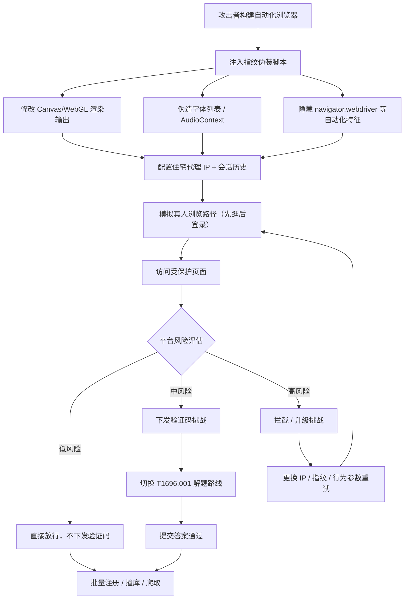

# 规避验证码 (T1696.002)

> 父技术：[反自动化防御规避 (T1696)](../T1696-Anti-Automation-Evasion.md)

## 一句话通俗理解

机器人不答题，而是穿上仿生皮肤、练出真人步态、换上普通居民家的门牌（IP），让安检门压根认不出它是机器人——不给你出验证码的机会。

## 30秒速查卡

| 维度 | 你需要知道的 |
|------|-------------|
| 这是什么？ | 攻击者通过浏览器指纹伪装、行为模拟、IP 信誉优化，让平台不向机器人下发验证码挑战 |
| 为什么危险？ | 规避挑战比解题更"干净"——不产生打码流量、不留下解题延迟特征，且能无限次复用，成本远低于解题 |
| 谁需要关心？ | SaaS 平台风控团队、WAF/机器人管理运维、反欺诈分析师 |
| 你的第一步防御 | 消费设备指纹一致性评分与行为信号，而非只看 IP；对"零挑战通过"的流量做抽样复核 |
| 如果只做一件事 | 监控"从未被挑战却大量注册"的流量——一个从不触发验证码的高产 IP/指纹本身就是异常 |

**适用平台：** SaaS（防护对象为面向公众提供 Web 服务的在线平台）

## 难度等级

⭐⭐⭐ 高级（需要较深基础）

## 前置知识检查

**读这个文件需要什么？**

- [ ] 浏览器工作原理（JavaScript 执行、DOM、Cookie、localStorage）
- [ ] 浏览器指纹（Browser Fingerprint）概念：Canvas、字体、AudioContext、WebGL 等
- [ ] 浏览器自动化基础（Selenium、Playwright、Puppeteer 及无头模式）
- [ ] IP 信誉与代理网络基本概念（住宅代理、数据中心 IP）
- [ ] 了解父技术 [反自动化防御规避 (T1696)](../T1696-Anti-Automation-Evasion.md) 的整体框架

## 技术描述

规避验证码（Avoid CAPTCHA，T1696.002）是 [反自动化防御规避 (T1696)](../T1696-Anti-Automation-Evasion.md) 的子技术。自动化检测（如验证码）通常由防御方部署，用于检测和阻止机器人及垃圾流量访问受保护的 Web 页面，常置于登录界面或表单字段之前。传统验证码要求用户识别一串字符并输入提交；reCAPTCHA 则要求用户识别图片、勾选复选框，或通过鼠标移动轨迹与设备 Cookie 等行为特征评估用户是否为真人。

**通俗解释：**

安检门有两层逻辑：第一层是"看人"——根据脸（设备指纹）、步态（行为）、门牌（IP 信誉）判断你是不是机器人，大概率是机器人就直接拦下，不是就直接放行；第二层才是"出题"——拿不准的时候才让你做验证码。这个子技术攻击的是第一层：机器人把"脸"P 得跟真人一样（伪造 Canvas 指纹、字体列表）、把步态练得像真人（模拟鼠标轨迹与页面交互节奏）、把门牌换成普通居民家的（住宅代理 IP），于是安检门的第一层判断它"大概率是真人"，直接放行，根本不出题。

**过渡段：** 与 [自动化完成验证码 (T1696.001)](./T1696.001-Automate-CAPTCHA-Completion.md) 不同，规避验证码不产生"解题"行为，因此没有打码平台流量、没有解题延迟特征，检测难度更高。它的核心是"伪装"——本质上是 [伪装 (T1036)](../T1036-Masquerading.md) 技术在浏览器维度的应用，其中 [浏览器指纹伪装 (T1036.012)](../T1036/T1036.012-Browser-Fingerprint.md) 是最直接的关联子技术。下面我们来看具体的伪装手段。

**技术原理：**

攻击者规避验证码挑战的手段包括：

1. **浏览器指纹伪装（Browser Fingerprint Spoofing）**
   - 通过浏览器自动化框架（如 Selenium）向网站文档对象模型（DOM，Document Object Model）注入 JavaScript
   - 注入脚本修改浏览器属性：AudioContext（音频上下文）指纹、语音引擎列表、图形渲染（Canvas/WebGL）输出、已安装字体列表、navigator 对象（如 navigator.webdriver、plugins、languages）
   - 目标：让机器人浏览器的指纹特征落入"正常真人指纹分布"内，避免触发指纹异常检测
2. **行为模拟（Behavioral Mimicry）**
   - 模拟人类鼠标轨迹（非直线的贝塞尔曲线移动）、键盘输入节奏（带随机间隔的按键）
   - 模拟页面停留、滚动、悬停等交互行为，填充"真人交互时间线"
   - 维持会话历史（Session History）：携带真实浏览路径访问目标页面，而非直接打开登录页
3. **IP 信誉优化（IP Reputation Optimization）**
   - 使用住宅代理（Residential Proxy）网络，让请求来自真实家庭宽带 IP 而非数据中心 IP
   - 维持 IP 使用时长与历史行为，避免"新 IP 直接访问敏感页面"的高风险模式
4. **环境一致性维护**
   - 确保指纹各维度自洽：语言设置、时区、屏幕分辨率、IP 地理位置相互一致
   - 自相矛盾的环境（如中文浏览器+美国时区+东南亚 IP）本身是强检测特征

**用途与影响：**

规避验证码是规模化 Web 滥用的"静默"路线。由于不触发挑战、不产生解题流量，攻击者可以：以极低频率持续批量注册账户（配合 [创建账户 (T1136)](../../05-Persistence/T1136-Create-Account.md)）、以"正常用户"姿态发起撞库（配合 [暴力破解 (T1110)](../../09-Credential-Access/T1110-Brute-Force.md)）、长期爬取数据而不被机器人管理标记。其检测难度高于解题路线，因为平台看到的是"看起来完全正常"的流量，只能依赖更细粒度的行为统计与指纹一致性分析。

## 攻击流程

### 典型攻击流程

```
构建伪装浏览器环境 --> 住宅代理 IP 接入 --> 模拟真人浏览路径 --> 平台风险评估（未触发挑战） --> 直接访问受保护页面
```



**步骤详解：**

1. **构建伪装浏览器环境**
   - 通俗描述：给机器人"整容"——P 脸、换声线、练步态
   - 技术细节：基于 Selenium/Playwright 注入 JS 脚本，覆盖 Canvas 指纹、字体枚举、AudioContext、navigator 属性等指纹采集点；使用 undetected-chromedriver 等补丁库隐藏自动化框架痕迹
   - 常用工具：Selenium、Playwright、Puppeteer + stealth 插件、undetected-chromedriver

2. **IP 与信誉准备**
   - 通俗描述：把"门牌"换成普通居民家的
   - 技术细节：接入住宅代理网络，为每个会话分配有历史行为的住宅 IP；保持 IP 地理位置与浏览器时区/语言自洽
   - 常用工具：住宅代理服务、代理池管理脚本

3. **行为模拟与路径伪装**
   - 通俗描述：先像真人一样逛一圈，再登录
   - 技术细节：模拟鼠标轨迹（贝塞尔曲线）、键盘节奏（随机间隔）、页面滚动与停留；构造真实浏览路径（首页→列表页→详情页→登录），携带会话历史
   - 常用工具：自动化框架的输入模拟 API、自定义行为脚本

4. **通过风险评估访问受保护页面**
   - 通俗描述：安检门看了一圈没发现破绽，直接放行
   - 技术细节：平台机器人管理服务基于指纹一致性、行为评分、IP 信誉综合评估，低风险流量不触发挑战；若被挑战则降级到 T1696.001 解题路线
   - 常用工具：无（依赖前序伪装质量）

## 真实案例

### 案例1：PurpleUrchin 的浏览器自动化注册流水线（2022）

- **时间**: 2022年
- **目标**: 全球 SaaS 平台、CI/CD 服务商的免费试用账户
- **攻击组织**: PurpleUrchin（Cisco Talos 命名）
- **手法**: PurpleUrchin 使用浏览器自动化框架构建注册流水线，批量注册 SaaS 与 CI/CD 平台免费试用账户用于加密货币挖矿（"Freejacking"）。其自动化环境通过伪装浏览器属性降低被机器人管理标记的概率，在触发验证码时再切换到脚本化求解（ImageMagick RGB 反色比对）——展示了"规避+解题"两条路线组合使用的实战形态。
- **影响**: 大量平台免费试用资源被盗用
- **参考链接**: [Cisco Talos 博客](https://blog.talosintelligence.com/)

### 案例2：FBI 警示：代理网络与指纹伪装降低撞库挑战率（2022）

- **时间**: 2022年1月
- **目标**: 美国金融科技公司（FinTech）
- **攻击组织**: 多个凭证填充犯罪团伙
- **手法**: FBI 闪报警示的凭证填充攻击中，攻击者组合使用住宅代理网络与浏览器指纹伪装技术，使撞库请求在设备指纹与 IP 信誉维度接近正常用户，从而降低触发验证码挑战的概率，减少撞库流水线的整体成本。对确实被挑战的请求，再集成 2Captcha、Anti-Captcha 等打码服务兜底。
- **影响**: 多家金融机构用户账户面临批量盗用风险
- **参考链接**: [BleepingComputer 报道](https://www.bleepingcomputer.com/news/security/fbi-credential-stuffing-attacks-are-hitting-financial-organizations/)

### 案例3：安全研究：Selenium 注入脚本绕过 CAPTCHA 防护（2023）

- **时间**: 2023年
- **目标**: 主流 CAPTCHA/机器人防护产品
- **攻击组织**: 安全研究团队（如 SentinelLabs 等厂商研究）
- **手法**: 多家安全厂商的研究披露了通过 Selenium 向网站 DOM 注入 JavaScript 绕过 CAPTCHA 防护的技术路径：注入脚本修改 AudioContext、语音引擎、图形渲染、已安装字体与 navigator 对象等浏览器属性，使自动化浏览器在指纹采集点上呈现"真人特征"。此类研究反复验证了浏览器指纹伪装对机器人管理评分的实际影响，也推动了防护产品对指纹一致性与 CDP（Chrome DevTools Protocol）痕迹检测的强化。
- **影响**: 推动机器人管理产品从"单点指纹匹配"转向"指纹一致性+行为+协议层痕迹"的复合检测
- **参考链接**: [MITRE ATT&CK - T1696.002](https://attack.mitre.org/techniques/T1696/002)

### 案例4：机器人管理年度报告中的"规避型机器人"趋势（2023-2025）

- **时间**: 2023-2025年（持续）
- **目标**: 电商、金融、内容平台
- **攻击组织**: 各类商业爬虫与滥用团伙
- **手法**: Akamai 等 CDN/机器人管理厂商的年度"恶意机器人"（Bad Bot）报告持续显示，规避型机器人（Evasive Bots）占比逐年上升：攻击者使用住宅代理、真实浏览器指纹池、行为模拟技术，使机器人流量在 IP 信誉与设备指纹维度难以与真人区分，主要目标是价格爬取、库存监控、抢购与账户滥用。
- **影响**: 平台侧机器人管理成本持续上升，"零挑战放行"流量的抽样复核成为必要环节
- **参考链接**: [Akamai Bot Manager](https://www.akamai.com/bot-manager)

## 红队视角

> ⚠️ **免责声明**：以下内容仅用于合法的安全测试、渗透测试和教育目的。未经授权对他人系统进行测试是违法行为。

### 实战技巧

1. **指纹一致性优先于指纹真实性**
   单点伪造一个"完美"指纹不如让所有维度自洽：语言、时区、屏幕分辨率、IP 地理位置、字体列表必须相互吻合。检测方越来越依赖"维度间矛盾"而非"单点异常"来识破伪装。

2. **行为时间线填充**
   直接打开登录页的"冷启动"访问是高风险模式。构造真实浏览路径（首页→内容页→登录），填充鼠标移动、滚动、停留等交互事件，让会话时间线符合真人分布。

3. **自动化痕迹清理**
   navigator.webdriver、CDP 连接痕迹、缺失的插件/媒体设备列表是自动化框架的"胎记"。使用 undetected-chromedriver 或 stealth 插件清理，但需注意：清理本身也可能被检测（如补丁库的版本特征），需要跟进目标检测逻辑的更新。

4. **低速率长周期运营**
   规避路线的优势在于"静默"，滥用这个优势：单 IP/指纹的日请求量控制在真人分布的 P95 以内，用大量指纹池分摊总量，而非单点高速。被挑战率是核心 KPI——挑战率上升即说明伪装质量下降，需轮换指纹池。

### 常用工具

| 工具名称 | 用途 | 平台 | 链接 |
|----------|------|------|------|
| Selenium | 浏览器自动化框架，指纹注入基础 | 跨平台 | https://www.selenium.dev/ |
| Playwright | 微软浏览器自动化框架 | 跨平台 | https://playwright.dev/ |
| Puppeteer + stealth 插件 | Chrome 自动化 + 自动化特征隐藏 | 跨平台 | https://github.com/berstend/puppeteer-extra |
| undetected-chromedriver | Selenium 补丁库，隐藏 chromedriver 特征 | 跨平台 | https://github.com/ultrafunkamsterdam/undetected-chromedriver |
| bot.sannysoft.com | 浏览器指纹测试页，验证伪装效果 | Web | https://bot.sannysoft.com/ |
| 住宅代理服务 | 提供真实家庭宽带 IP 的代理网络 | Web API | 多家商业服务 |

### 注意事项

- 指纹伪装是"军备竞赛"：检测方每次升级采集点，伪装脚本就要跟进，维护成本持续存在
- stealth 补丁库本身会留下版本特征，过时的补丁比没有补丁更容易被识别
- 住宅代理的 IP 池质量参差不齐，"被标记过的住宅 IP"比数据中心 IP 更糟
- 行为模拟的"过度拟人"（过于完美的曲线、零失误操作）同样是异常特征，真人行为本身有噪声
- 针对真实平台的规避测试必须限定在授权范围内，大规模滥用可能触犯法律

## 蓝队视角

### 检测要点

1. **指纹一致性分析（核心指标）**
   - 日志来源：WAF/机器人管理日志、前端指纹采集埋点
   - 关注字段：Canvas 指纹、字体列表、WebGL Vendor、时区、语言、屏幕分辨率、IP 地理位置
   - 异常特征：维度间矛盾（中文浏览器+美国时区+东南亚 IP）；大量会话共享完全相同的 Canvas/字体指纹（真人设备指纹存在自然差异，"完全相同"反而是机器人指纹池的标志）

2. **自动化协议层痕迹**
   - 日志来源：WAF 机器人管理日志、TLS 指纹（JA3/JA4）
   - 关注字段：CDP 痕迹、navigator.webdriver、TLS 指纹与声明浏览器版本的匹配度
   - 异常特征：声明为 Chrome 但 TLS 指纹属于自动化框架；CDP 端口暴露痕迹

3. **"零挑战高产"流量识别**
   - 日志来源：机器人管理决策日志、账户行为日志
   - 关注字段：从未被挑战的会话的注册/登录/操作量
   - 异常特征：某 IP/指纹池长期零挑战却持续高产注册——"从不触发验证码的高产流量"本身就是异常

4. **行为时间线异常**
   - 日志来源：前端交互埋点（鼠标、滚动、点击事件流）
   - 关注字段：交互事件密度、鼠标轨迹曲率、键盘间隔分布
   - 异常特征：零交互直开登录页；交互轨迹过于平滑（无真人噪声）；操作间隔呈机械等距

### 监控建议

- 建立指纹一致性评分：维度间矛盾度 + 指纹复用度（相同 Canvas 指纹的会话数）双指标
- 对"零挑战放行"流量做抽样复核（如 1% 抽样强制下发挑战），验证放行质量
- 监控指纹池规模：单一 Canvas/字体指纹承载的会话数超阈值即告警
- 将 TLS 指纹与声明浏览器版本交叉验证，识别"声明 Chrome 实为自动化框架"
- 定期用授权范围内的红队手段（stealth 浏览器 + 住宅代理）验证自身检测有效性

## 避坑指南

常见误区一：**"指纹对上了就是真人"**。单点指纹匹配早已被指纹池技术破解——攻击者维护成千上万个"真实采集"的指纹轮换使用。必须做指纹复用度统计：真人不会有两万人共享同一个 Canvas 指纹。

常见误区二：**"只看 IP 信誉"**。住宅代理让 IP 信誉维度基本失效。IP 信誉只能作为评分因子之一，不能作为放行依据。

常见误区三：**"行为模拟检测靠鼠标轨迹就够了"**。轨迹检测是行为分析的一部分，但攻击者可以生成"带噪声的拟人轨迹"。有效的行为检测需要时间线完整性（交互事件密度、页面停留分布、操作序列合理性）联合判断。

## 检测建议

**用人话说：** 检测规避型机器人就像查"高仿"——单看脸（指纹）可能是真的，但你要看"这张脸是不是被 1 万人同时用着"（指纹复用度）、"这人的步态是不是太完美了"（行为噪声）、"他的口音和身份证地址对不对得上"（维度一致性）。

### 网络层检测

**检测方法：** TLS 指纹（JA3/JA4）与声明浏览器版本交叉验证；住宅代理 IP 段识别（结合 IP 情报数据源）。

**具体规则/命令示例：**
```
# Suricata 规则示例：结合 TLS 指纹识别自动化框架流量
# （JA3 指纹库需预先导入，以下为逻辑示意）
alert tls $HOME_NET any -> any (msg:"TLS指纹与声明浏览器不匹配-疑似自动化"; tls.ja3; content:"<已知自动化框架JA3>"; sid:1696201; rev:1;)
```

### 主机层检测

**适用场景：** 攻击者将伪装浏览器集群部署在已入侵的主机上，或企业内网主机被用作滥用跳板。

**Windows 事件ID：**
- 事件ID 4688：进程创建（关注 chromedriver.exe、node.exe 启动 puppeteer 集群）
- 事件ID 4624：登录事件（关注批量自动化会话）

**具体命令示例：**
```powershell
# 检测自动化浏览器驱动进程（攻击者基础设施排查）
Get-Process | Where-Object { $_.ProcessName -match "chromedriver|geckodriver" } |
    Select-Object Id, ProcessName, Path, StartTime
# 检测带远程调试端口的 Chrome 启动（stealth 浏览器集群典型特征）
Get-CimInstance Win32_Process -Filter "Name='chrome.exe'" |
    Where-Object { $_.CommandLine -match "remote-debugging-port" } |
    Select-Object ProcessId, CommandLine
# 统计同一主机上 Chrome 进程数（指纹池集群通常并发数十实例）
(Get-Process chrome -ErrorAction SilentlyContinue).Count
```

### 应用层检测

**检测方法：** 基于前端指纹采集埋点与机器人管理决策日志，统计指纹复用度、维度一致性矛盾、零挑战高产流量。

**具体规则/命令示例：**
```sql
-- 应用层查询示例（伪 SQL，基于前端指纹采集 + 机器人管理决策日志）
-- 检测：同一 Canvas 指纹在 24 小时内被超过 50 个会话使用（指纹池特征）
SELECT canvas_hash, COUNT(DISTINCT session_id) AS session_count
FROM device_fingerprints
WHERE ts >= NOW() - INTERVAL 24 HOUR
GROUP BY canvas_hash
HAVING session_count > 50
ORDER BY session_count DESC;

-- 检测：维度矛盾会话（语言/时区/IP地理位置不一致）
SELECT session_id, browser_lang, timezone, ip_geo_country
FROM device_fingerprints
WHERE ts >= NOW() - INTERVAL 1 HOUR
  AND (browser_lang NOT LIKE CONCAT('%', ip_geo_country, '%')
       OR timezone NOT IN (SELECT tz FROM geo_timezone_map WHERE country = ip_geo_country));

-- 检测：零挑战高产流量（24 小时从未被挑战但注册超过 5 个账户）
SELECT fingerprint_hash, COUNT(DISTINCT account_id) AS reg_count
FROM account_registrations r
LEFT JOIN captcha_challenges c ON r.fingerprint_hash = c.fingerprint_hash
WHERE r.ts >= NOW() - INTERVAL 24 HOUR
  AND c.challenge_id IS NULL
GROUP BY fingerprint_hash
HAVING reg_count > 5;
```

**Sigma 规则示例（主机侧自动化浏览器集群检测）：**
```yaml
title: 自动化浏览器驱动进程启动
status: experimental
description: 检测 chromedriver/geckodriver 等浏览器自动化驱动进程启动
logsource:
    category: process_creation
    product: windows
detection:
    selection:
        Image|endswith:
            - '\chromedriver.exe'
            - '\geckodriver.exe'
    condition: selection
level: medium
tags:
    - attack.t1696.002
```

## 缓解措施

### 优先级1：关键措施

**措施名称：** 部署指纹一致性评分与行为分析复合检测

**具体实施步骤：**
1. 在前端部署指纹采集埋点（Canvas、字体、WebGL、AudioContext、时区、语言、分辨率）
2. 机器人管理服务启用维度一致性评分：维度间矛盾度 + 指纹复用度双指标
3. 启用行为分析：交互事件密度、鼠标轨迹噪声、操作序列合理性
4. 将 TLS 指纹与声明浏览器版本交叉验证

### 优先级2：重要措施

**措施名称：** "零挑战放行"流量抽样复核

**具体实施步骤：**
1. 对从未被挑战的放行流量按比例（如 1%）强制下发挑战，验证放行质量
2. 建立指纹池监控：单一指纹承载会话数超阈值自动告警并升级挑战
3. 对高产零挑战指纹池实施渐进式限制（限速、二次验证）
4. 将 IP 情报（住宅代理识别）接入评分，但仅作为因子而非依据

### 优先级3：建议措施

**措施名称：** 持续对抗与检测有效性验证

**具体实施步骤：**
1. 定期开展授权范围内的红队演练：stealth 浏览器 + 住宅代理 + 行为模拟，验证检测命中率
2. 跟进 stealth 补丁库与指纹伪装工具的公开更新，评估自身采集点暴露面
3. 建立检测特征更新机制：新指纹池模式出现后 48 小时内更新评分规则
4. 与机器人管理厂商共享威胁情报（新规避模式、新代理池特征）

### MITRE ATT&CK 缓解措施映射

| 缓解措施ID | 缓解措施名称 | 适用性 | 说明 |
|------------|-------------|--------|------|
| M1021 | 限制基于Web的内容 | 适用 | WAF/机器人管理服务基于指纹一致性与行为分析限制自动化流量 |
| M1031 | 网络入侵防护 | 适用 | 边缘网络层 TLS 指纹识别与住宅代理 IP 段拦截 |
| M1037 | 过滤网络流量 | 部分适用 | 结合 IP 情报过滤已知代理池流量 |
| M1047 | 审计 | 适用 | 零挑战放行流量抽样审计与指纹池复用度审计 |

## 动手实验

> ⚠️ **重要提示**：所有实验必须在隔离的实验室环境中进行，禁止对未授权的真实系统进行测试。

### 实验环境准备

**推荐靶场/实验平台：**

| 平台名称 | 类型 | 难度 | 链接 |
|----------|------|------|------|
| bot.sannysoft.com | 公开浏览器指纹测试页 | 初级 | https://bot.sannysoft.com/ |
| 自建 Flask 靶机 | 本地实验 | 中级 | 本实验自建 |

**所需工具：**
- Python 3 + Selenium + Chrome：浏览器自动化
- undetected-chromedriver：自动化特征隐藏
- Playwright：行为模拟
- Flask：本地指纹采集靶机
- Wireshark：流量观察

### 实验1：观察并隐藏自动化浏览器指纹（初级）

**实验目标：** 理解平台如何从指纹维度识别自动化浏览器，以及 stealth 技术能隐藏什么

**实验步骤：**
1. 在普通 Chrome 中打开 https://bot.sannysoft.com/ ，记录 WebDriver、WebGL Vendor、Canvas 指纹、字体列表等字段
2. 用原生 Selenium 启动自动化 Chrome 访问同一页面，对比输出，标记所有差异字段
3. 改用 undetected-chromedriver 启动，再次访问对比，观察哪些差异被消除、哪些仍然存在
4. 用 Playwright 重复步骤 2-3，对比两个自动化框架的"胎记"差异

**预期结果：** 能列出自动化浏览器在指纹维度上的典型暴露点，理解 T1696.002 "指纹伪装"的技术基础，并认识到 stealth 补丁的覆盖边界

### 实验2：本地指纹一致性检测原型（中级）

**实验目标：** 在本地实现"指纹复用度 + 维度一致性"检测逻辑，理解蓝队核心检测思路

**实验步骤：**
1. 用 Flask 搭建本地指纹采集页：通过 JS 采集 Canvas 指纹、字体列表、时区、语言、屏幕分辨率，POST 到后端
2. 编写 Selenium 脚本模拟 20 个"真人"会话（使用不同住宅代理 IP 模拟不同地理位置，随机化时区/语言但保持自洽）和 10 个"机器人"会话（共享同一 Canvas 指纹、语言/时区/IP 地理位置矛盾）
3. 后端实现两条检测逻辑：
   - 指纹复用度：统计同一 Canvas 指纹的会话数，>3 告警
   - 维度一致性：校验语言/时区/IP 地理位置是否匹配，矛盾告警
4. 运行脚本，观察两条规则对"机器人"会话的命中率与对"真人"会话的误报率
5. 调整阈值（复用度阈值 3→5，一致性权重），观察命中率/误报率变化

**预期结果：** 本地跑通"指纹池识别 + 维度矛盾识别"的完整检测原型，直观理解为什么"指纹复用度"和"维度一致性"是识别规避型机器人的两个核心指标，并体会阈值调优在真实检测中的重要性

## 术语解释

| 术语 | 英文原名 | 通俗解释 |
|------|----------|----------|
| 浏览器指纹 | Browser Fingerprint | 浏览器暴露的一组设备特征（Canvas、字体、屏幕、AudioContext 等），像浏览器的"脸" |
| Canvas 指纹 | Canvas Fingerprint | 利用 Canvas 渲染结果差异生成的设备指纹，同一设备渲染结果稳定，跨设备存在差异 |
| AudioContext 指纹 | AudioContext Fingerprint | 利用 Web Audio API 处理音频的细微硬件差异生成的指纹 |
| WebGL 指纹 | WebGL Fingerprint | 利用 GPU 渲染参数（Vendor/Renderer）生成的指纹 |
| 无头浏览器 | Headless Browser | 没有图形界面的浏览器，专为自动化设计，但容易被检测 |
| WebDriver | WebDriver | 浏览器自动化协议/驱动，navigator.webdriver 属性是自动化检测的关键点 |
| CDP | Chrome DevTools Protocol | Chrome 调试协议，自动化框架通过它控制浏览器，连接痕迹可被检测 |
| TLS 指纹 | TLS Fingerprint (JA3/JA4) | TLS 握手参数生成的"指纹"，不同浏览器/框架的握手特征不同 |
| 住宅代理 | Residential Proxy | 借用真实家庭宽带的 IP 转发请求，让机器人流量"看起来"来自普通用户 |
| 指纹池 | Fingerprint Pool | 攻击者维护的大量"真实采集"指纹集合，轮换使用以规避复用度检测 |
| 行为模拟 | Behavioral Mimicry | 模拟人类鼠标轨迹、键盘节奏、页面交互节奏，填充"真人交互时间线" |
| 规避型机器人 | Evasive Bot | 主动伪装以规避机器人检测的自动化流量（区别于无伪装的"基础型机器人"） |
| 零挑战放行 | Zero-Challenge Pass | 从未触发验证码挑战即通过风险评估的流量，高产零挑战流量是异常信号 |
| DOM | Document Object Model | 文档对象模型，网页的结构化表示，自动化脚本通过注入 JS 修改它 |
| 渐进式信任 | Progressive Trust | 新账户先限制高危操作，行为正常后逐步解锁权限的风控策略 |

## 参考资料

### 📚 官方文档（深入了解）

- [MITRE ATT&CK - T1696.002 Avoid CAPTCHA](https://attack.mitre.org/techniques/T1696/002)
- [MITRE ATT&CK - T1696 Anti-Automation Evasion](https://attack.mitre.org/techniques/T1696)
- [MITRE ATT&CK - T1036.012 Browser Fingerprint](https://attack.mitre.org/techniques/T1036/012)
- [Cloudflare 学习中心 - 验证码如何工作](https://www.cloudflare.com/learning/bots/how-captchas-work/)

### 📰 安全报告（真实攻击）

- [Cisco Talos - PurpleUrchin 分析报告](https://blog.talosintelligence.com/)
- [BleepingComputer - FBI 凭证填充攻击警示](https://www.bleepingcomputer.com/news/security/fbi-credential-stuffing-attacks-are-hitting-financial-organizations/)
- [Akamai Bot Manager - 恶意机器人年度报告](https://www.akamai.com/bot-manager)

### 🔧 工具与资源（动手试试）

- [bot.sannysoft.com - 浏览器指纹测试页](https://bot.sannysoft.com/)
- [Selenium - 浏览器自动化框架](https://www.selenium.dev/)
- [Playwright - 微软浏览器自动化框架](https://playwright.dev/)
- [undetected-chromedriver - 自动化特征隐藏补丁](https://github.com/ultrafunkamsterdam/undetected-chromedriver)
- [OWASP Automated Threats to Web Applications](https://owasp.org/www-project-automated-threats-to-web-applications/)
