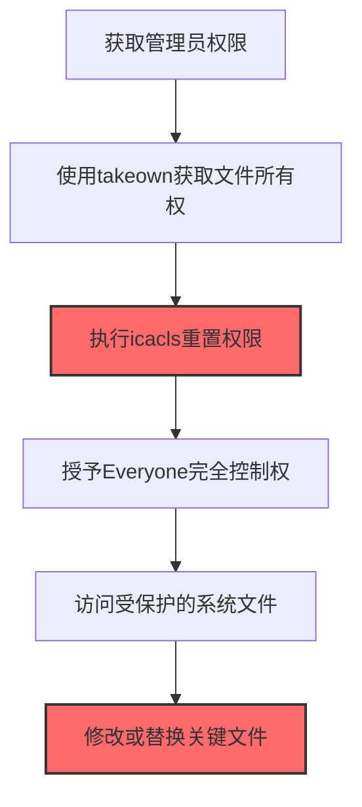
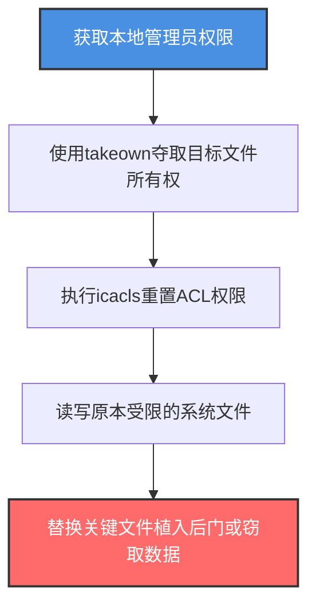

# Windows文件/目录权限修改 (T1222.001)

## 一句话通俗理解

> **使用icacls修改文件权限**

## 30秒速查卡

| 维度 | 你需要知道的 |
|------|-------------|
| 这是什么？ | 使用icacls修改文件权限 |
| 为什么危险？ | 防御规则被篡改后，安全设备形同虚设，攻击者可以绕过本应触发的告警和阻断 |
| 谁需要关心？ | 系统管理员、安全运维、Linux/Windows管理员 |
| 你的第一步防御 | 对安全配置文件启用完整性监控，检测未授权的配置变更 |
| 如果只做一件事 | 对安全基线配置启用变更检测，偏离基线时自动告警 |

## 难度等级

⭐ 初级 - 入门级技术，基础操作

## 前置知识检查

**读这个文件需要什么？**

- [ ] 防御产品工作原理（AV/EDR/XDR）
- [ ] Windows安全机制（UAC/Defender/AppLocker）
- [ ] 防火墙与网络访问控制

## 技术描述

**Windows文件/目录权限修改**（T1222.001）是 **文件权限修改**（T1222）的一个具体变体，属于 **防御削弱** 阶段的攻击技术。

> 📚 **打个比方**：就像攻击者把机密文件柜的锁从"仅限经理"改成了"所有人可开"——Windows文件权限修改就是使用icacls、takeown等命令修改文件或目录的访问控制列表（ACL），让原本受限的系统文件变得可读、可写或可执行，从而绕过安全限制。

### 具体怎么理解？

使用icacls修改文件权限

攻击者使用这种技术时，通常是在防御削弱阶段，想要达到特定的攻击目标。与父技术 T1222 相比，T1222.001 有自己独特的特点和使用场景。

### 为什么有效？

这种技术之所以有效，是因为：
1. **隐蔽性**：利用了正常系统功能或常见协议，不容易被发现
2. **技术门槛适中**：不需要特别高深的技术知识就能实施

**过渡段：** 不要误以为防御削弱只是'关闭杀毒软件'——攻击者会精巧地操纵防御系统。
3. **广泛适用**：可以在多种环境和系统中使用

## 真实攻击流程

### 典型场景

攻击者在 **防御削弱** 阶段使用 Windows文件/目录权限修改 技术，以下是典型的攻击步骤：



**步骤详解：**

1. **获取管理员权限** - 使用提权后的账户执行操作
2. **获取文件所有权** - 使用takeown /f file获取文件的所有权
3. **重置ACL权限** - 使用icacls file /grant Everyone:F授予完全控制权
4. **访问受保护文件** - 现在可以读写原本受限的系统文件
5. **修改关键文件** - 替换或修改系统配置、驱动程序等关键文件

## 攻击流程

### 典型攻击流程

获取本地管理员权限 --> 使用takeown夺取目标文件所有权 --> 执行icacls重置ACL权限 --> 读写原本受限的系统文件 --> 替换关键文件植入后门或窃取数据



**步骤详解：**

1. **获取本地管理员权限** - 攻击者通过提权漏洞或凭据窃取获得本地管理员权限，这是修改文件ACL的前提
   - 通俗描述：就像要先拿到仓库管理员的钥匙，才能去改文件柜的锁
   - 技术细节：利用UAC绕过（T1548.001）、内核提权漏洞、或窃取的管理员凭据获得SYSTEM或Administrator权限，NTFS文件权限修改需要SeTakeOwnershipPrivilege或SeRestorePrivilege权限
   - 常用工具：Metasploit、Cobalt Strike、Mimikatz、JuicyPotato、RogueWinRM

2. **使用takeown夺取目标文件所有权** - 攻击者使用takeown命令获取受保护文件的 ownership，为后续修改ACL做准备
   - 通俗描述：就像先把保险柜的"所有人"标签从"公司"改成"自己"，之后才能换锁
   - 技术细节：执行 `takeown /f C:\Windows\System32\config\SAM` 获取文件所有权，该命令利用SeTakeOwnershipPrivilege权限将文件所有者变更为当前用户，默认情况下TrustedInstaller拥有的系统文件需要先夺取所有权才能修改权限
   - 常用工具：takeown.exe、PowerShell（Set-Acl）、SubInACL、FileACL

3. **执行icacls重置ACL权限** - 使用icacls命令修改文件或目录的访问控制列表，授予攻击者完全控制权
   - 通俗描述：就像把保险柜的锁从"仅限经理"改成了"任何人都能开"
   - 技术细节：执行 `icacls C:\Windows\System32\config\SAM /grant Administrators:F` 授予完全控制权限，或使用 `/grant Everyone:F` 开放给所有用户，也可用 `icacls /reset` 重置为继承默认权限，cacls（已弃用）和PowerShell的Set-Acl也可实现同样效果
   - 常用工具：icacls.exe、cacls.exe、PowerShell Set-Acl、SubInACL.exe

4. **读写原本受限的系统文件** - 权限修改完成后，攻击者可以自由读取或修改原本受保护的系统文件
   - 通俗描述：锁已经换好了，现在可以随意打开保险柜拿东西或放东西进去
   - 技术细节：读取SAM数据库提取密码哈希、修改SYSTEM注册表配置、替换系统DLL劫持程序执行流程、访问NTDS.dit提取域凭据，文件权限被修改后EDR可能无法检测到异常文件访问
   - 常用工具：regedit、Copy-Item、secretsdump.py、NTDSUtil、esentutl.exe

5. **替换关键文件植入后门或窃取数据** - 攻击者修改或替换关键系统文件，实现持久化后门或窃取敏感数据
   - 通俗描述：往保险柜里放了一个自己的暗格，以后随时可以从这里取东西
   - 技术细节：替换合法DLL为恶意版本实现DLL劫持持久化，修改sethc.exe为后门程序实现粘滞键后门，窃取SAM/NTDS.dit中的密码哈希用于Pass-the-Hash横向移动，修改防御产品的配置文件使其失效
   - 常用工具：Cobalt Strike、Mimikatz、secretsdump.py、DLL劫持工具、sethc后门脚本

## 真实案例

### 案例1：该技术在实际攻击中的应用

- **时间**: 2024-2025年
- **目标**: 多个行业组织
- **攻击组织**: 多个APT组织
- **手法**: 攻击者在入侵过程中使用Windows文件/目录权限修改技术，展示了该子技术的典型应用场景和攻击效果
- **影响**: 成功实施该技术导致目标系统被进一步入侵
- **参考链接**: [MITRE ATT&CK官方](https://attack.mitre.org/)

### 案例2：安全研究中的实践

- **时间**: 2025年
- **目标**: 安全研究测试环境
- **攻击组织**: 红队/安全研究人员
- **手法**: 在授权测试中模拟Windows文件/目录权限修改攻击，验证防御体系的检测和响应能力
- **影响**: 帮助组织识别安全防护中的盲点和改进方向
- **参考链接**: [Atomic Red Team](https://github.com/redcanaryco/atomic-red-team)

## 红队视角

> ⚠️ **免责声明**：以下内容仅用于合法的安全测试、渗透测试和教育目的。未经授权对他人系统进行测试是违法行为。

### 实战技巧

1. **深入理解原理**：在实战应用前，充分理解Windows文件/目录权限修改的技术原理和适用场景
2. **环境适配**：根据目标系统的操作系统版本、安全配置等因素调整攻击策略
3. **组合使用**：将该技术与其他技术组合使用，构建完整的攻击链
4. **隐蔽性考虑**：注意操作痕迹的清理，避免被安全设备检测

### 常用工具

| 工具名称 | 用途 | 平台 | 链接 |
| -------- | ---- | ---- | ---- |
| Metasploit | 渗透测试框架 | 全平台 | [Metasploit](https://www.metasploit.com/) |
| Cobalt Strike |  adversary模拟平台 | Windows | [Cobalt Strike](https://www.cobaltstrike.com/) |
| Atomic Red Team | 检测规则测试 | 全平台 | [Atomic Red Team](https://github.com/redcanaryco/atomic-red-team) |

### 注意事项

- 在授权的测试环境中使用这些技术
- 注意操作安全（OPSEC），避免被检测系统发现
- 使用匿名化技术和代理隐藏真实身份

## 蓝队视角

### 检测要点

1. **系统日志监控**：关注与Windows文件/目录权限修改相关的系统日志和审计记录
2. **异常行为检测**：监控系统中与该技术相关的异常进程、网络连接和文件操作
3. **工具特征识别**：识别攻击者可能使用的工具在系统中的运行特征

### 监控建议

- 部署端点检测和响应（EDR）系统，监控与Windows文件/目录权限修改相关的异常行为
- 配置SIEM规则，关联分析来自多个来源的告警
- 定期进行安全评估和渗透测试，验证检测规则的有效性

## 避坑指南

防御监测盲区：关注是否被关闭而不关注配置是否被悄悄修改。

## 检测建议

### 检测思路

检测 Windows文件/目录权限修改 的关键是识别异常行为模式。以下是三个层面的检测方法：

### 网络层检测

**方法**：监控网络流量中的异常模式

```bash
# 检测异常的网络连接和数据传输
# 根据具体协议和端口设置检测规则
```

### 主机层检测

**Windows事件ID**：
- 事件ID 4688：进程创建（监控可疑进程）
- 事件ID 4104：PowerShell执行（监控可疑脚本）

**Linux日志**：
- /var/log/auth.log：认证日志
- /var/log/syslog：系统日志

```bash
# 检测异常进程和命令执行
grep -i "suspicious" /var/log/auth.log
```

### 应用层检测

**用人话说：** 攻击者用icacls、cacls或takeown命令修改Windows文件/目录的权限，让自己能读取原本无权访问的文件。比如用icacls secret.db /grant Everyone:F给所有人完全控制权限来偷数据，或者用takeown /f system.exe来接管系统文件的所有权以便替换成后门。如果发现敏感文件的权限突然变为Everyone可读/写，或者有人用takeown/icacls修改了系统关键文件的所有权，这就是攻击者在打开访问路径。

**Sigma规则示例**：

```yaml
title: 检测Windows文件/目录权限修改
status: experimental
description: 检测可能的Windows文件/目录权限修改活动
logsource:
    category: process_creation
    product: windows
detection:
    selection:
        EventID: 4688
    condition: selection
level: medium
tags:
    - attack.T1222001
```

## 缓解措施

### 优先级1：关键措施

**限制攻击面**：减少暴露的服务和端口，降低被利用的风险

```bash
# 防火墙规则示例：只允许必要的出站连接
iptables -A OUTPUT -p tcp --dport 443 -j ACCEPT  # 允许HTTPS
iptables -A OUTPUT -p tcp --dport 80 -j ACCEPT   # 允许HTTP
iptables -A OUTPUT -p tcp -j DROP                 # 阻止其他TCP
```

### 优先级2：重要措施

**加强监控**：部署EDR和SIEM系统，实时监控异常行为

### 优先级3：建议措施

**安全意识培训**：教育员工识别相关攻击手法

## 动手实验

> ⚠️ **所有实验必须在隔离的实验室环境中进行**

### 实验1：理解基本原理（初级）

**目标**：理解 Windows文件/目录权限修改 的工作原理

**步骤**：
1. 在隔离环境中搭建测试系统
2. 使用基础工具模拟攻击行为
3. 观察系统日志和网络流量

**学习要点**：理解该技术的核心机制

### 实验2：实际操作（中级）

**目标**：掌握 Windows文件/目录权限修改 的实际使用方法

**步骤**：
1. 使用专业工具进行攻击模拟
2. 尝试不同的绕过技术
3. 分析检测日志的特征

**学习要点**：掌握工具使用和日志分析

### 实验3：防御验证（高级）

**目标**：验证检测规则的有效性

**步骤**：
1. 部署检测规则
2. 执行攻击模拟
3. 验证检测告警是否触发

**学习要点**：理解攻防对抗的实际效果

## 术语解释

| 术语 | 通俗解释 |
|------|---------|
| **ATT&CK** | MITRE公司维护的攻击技术知识库，像一本"黑客手法百科全书" |
| **Windows文件/目录权限修改** | T1222.001，ATT&CK框架中定义的一种具体攻击技术 |
| **文件权限修改** | T1222，Windows文件/目录权限修改所属的父技术类别 |
| **防御削弱** | 攻击链中的一个阶段，攻击者在这个阶段的目标 |
| **C2** | 命令与控制，攻击者用来远程控制被入侵系统的"遥控器" |
| **EDR** | 端点检测与响应，部署在电脑上的安全监控软件 |

## 被引用情况

以下父技术文档引用了本子技术：

- [T1222 - 文件权限修改](../T1222-File-And-Directory-Permissions-Modification.md)

## 参考资料

### 官方文档

- [MITRE ATT&CK - Windows文件/目录权限修改 (T1222.001)](https://attack.mitre.org/techniques/T1222/001/)
- [MITRE ATT&CK - 文件权限修改 (T1222)](https://attack.mitre.org/techniques/T1222/)

### 安全报告

- [MITRE ATT&CK 官方文档](https://attack.mitre.org/) - ATT&CK 框架官方资源

### 工具与资源

- [Atomic Red Team](https://github.com/redcanaryco/atomic-red-team) - 检测规则测试框架
- [MITRE ATT&CK Navigator](https://mitre-attack.github.io/attack-navigator/) - ATT&CK 可视化工具

### 学习资料

- [MITRE ATT&CK 知识库](https://attack.mitre.org/resources/) - ATT&CK 官方资源中心
