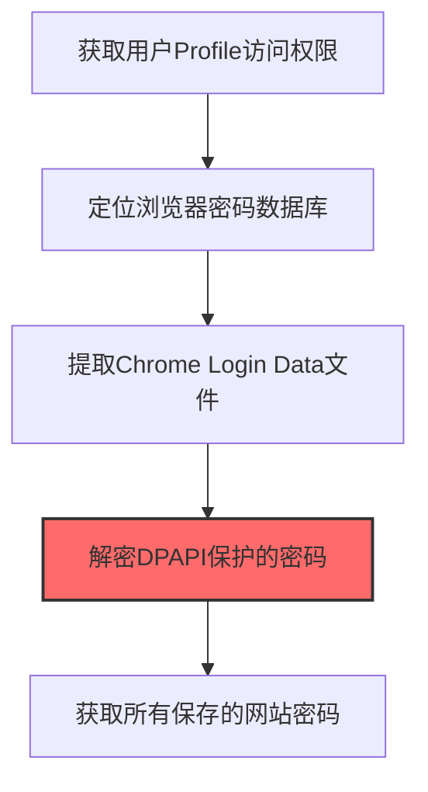
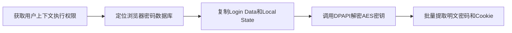

# Web Browsers (T1555.003)

## 一句话通俗理解

> **从Chrome/Firefox/Edge保存的密码中提取明文**

## 30秒速查卡

| 维度 | 你需要知道的 |
|------|-------------|
| 这是什么？ | 从Chrome、Firefox、Edge等浏览器保存的密码中提取明文密码 |
| 为什么危险？ | 浏览器保存了大量网站的登录密码，而且密码数据库通常用用户登录密码加密，拿到解密密钥就能读取所有密码 |
| 谁需要关心？ | 终端安全工程师、SOC分析师 |
| 你的第一步防御 | 禁用浏览器密码保存功能，使用企业密码管理器替代 |
| 如果只做一件事 | 监控浏览器密码数据库文件（Login Data、logins.json）的异常访问和复制 |

## 难度等级

⭐⭐ 中级 - 需要一定的技术基础和经验

## 前置知识检查

**读这个文件需要什么？**

- [ ] Windows认证体系（NTLM/Kerberos/LSASS）
- [ ] 哈希基础（NTLM Hash/SHA）
- [ ] 网络认证协议（SMB/LDAP/Kerberos）

## 技术描述

**Web浏览器**（T1555.003）是 **密码存储凭证提取**（T1555）的一个具体变体，属于 **凭证访问** 阶段的攻击技术。

> 🌐 **打个比方**：就像翻看浏览器"保存的密码"列表——攻击者从Chrome、Firefox等浏览器的密码管理器提取保存的登录信息。

### 具体怎么理解？

从Chrome/Firefox/Edge保存的密码中提取明文

攻击者使用这种技术时，通常是在凭证访问阶段，想要达到特定的攻击目标。与父技术 T1555 相比，T1555.003 有自己独特的特点和使用场景。

### 为什么有效？

这种技术之所以有效，是因为：
1. **隐蔽性**：利用了正常系统功能或常见协议，不容易被发现
2. **技术门槛适中**：不需要特别高深的技术知识就能实施

**过渡段：** 不要误解凭证访问只是'窃取密码'——在现代企业中，凭证存在于内存、磁盘、网络流量等多个位置。
3. **广泛适用**：可以在多种环境和系统中使用

## 真实攻击流程

### 典型场景

攻击者在 **凭证访问** 阶段使用 Web浏览器 技术，以下是典型的攻击步骤：



**步骤详解：**

1. **获取用户Profile访问权限** - 需要在当前用户上下文中执行，因为浏览器密码使用用户DPAPI密钥加密
2. **定位浏览器密码数据库** - Chrome密码存储在%LOCALAPPDATA%\Google\Chrome\User Data\Default\Login Data（SQLite数据库）
3. **提取Chrome Login Data文件** - 复制Login Data文件和Local State文件（包含加密密钥），或使用LaZagne等自动化工具
4. **解密DPAPI保护的密码** - Chrome使用DPAPI和AES-256-GCM加密密码，需从Local State中获取密钥后解密
5. **获取所有保存的网站密码** - 解密后得到用户保存在浏览器中的所有网站用户名和明文密码

## 攻击流程

```
获取用户上下文执行权限 --> 定位浏览器密码数据库 --> 复制Login Data和Local State --> 调用DPAPI解密AES密钥 --> 批量提取明文密码和Cookie
```



**步骤详解：**
1. **获取用户上下文执行权限**
   - 通俗描述：在受害用户登录的会话中运行恶意程序，才能读取属于该用户的浏览器数据
   - 技术细节：通过钓鱼邮件、破解软件或漏洞利用植入stealer，在当前用户进程上下文中执行，因为浏览器密码使用用户DPAPI密钥加密
   - 常用工具：RedLine Stealer、LummaC2、Raccoon Stealer、Cobalt Strike
2. **定位浏览器密码数据库**
   - 通俗描述：找到Chrome或Firefox存储密码的数据库文件位置
   - 技术细节：Chrome密码存储在`%LOCALAPPDATA%\Google\Chrome\User Data\Default\Login Data`（SQLite数据库），Firefox存储在`%APPDATA%\Mozilla\Firefox\Profiles\*\logins.json`配合key4.db
   - 常用工具：LaZagne、SharpChrome、自定义文件枚举脚本
3. **复制Login Data和Local State**
   - 通俗描述：把密码数据库和加密密钥文件都拷贝出来，避免锁定问题
   - 技术细节：复制Login Data SQLite文件和Local State文件（包含AES-256-GCM加密密钥），Firefox还需复制key4.db和logins.json，避免直接读取被Chrome进程锁定的数据库
   - 常用工具：copy/xcopy、LaZagne、SharpChrome
4. **调用DPAPI解密AES密钥**
   - 通俗描述：用Windows自带的DPAPI解开加密密钥，再用密钥解开密码
   - 技术细节：从Local State中获取Base64编码的encrypted_key，去掉"DPAPI"前缀后调用CryptUnprotectData解密得到AES-256-GCM密钥，再用该密钥解密Login Data中的password_value字段
   - 常用工具：SharpChrome、LaZagne、CryptUnprotectData API、Python dpapi库
5. **批量提取明文密码和Cookie**
   - 通俗描述：把所有网站的明文密码、Cookie和自动填充数据都提取出来
   - 技术细节：解析SQLite数据库中的所有条目，解密密码字段，同时提取Cookies、自动填充数据、加密货币钱包扩展数据，外传至C2服务器
   - 常用工具：LaZagne、SharpChrome、BrowserPasswordDump、SharpEdge

## 真实案例

### 案例1：RedLine Stealer 全球蔓延的浏览器凭证窃取

- **时间**: 2022-2024年
- **目标**: 全球数千家企业员工，通过钓鱼邮件和破解软件分发
- **攻击组织**: RedLine Stealer运营组织（据信位于俄罗斯）
- **手法**: RedLine Stealer通过读取Chrome的Login Data SQLite数据库和Local State文件，调用Chrome CryptProtectData API或DPAPI直接解密AES-256-GCM加密的密码字段，批量窃取Chrome/Edge/Firefox保存的网站密码、自动填充数据、Cookie和加密货币钱包扩展数据
- **影响**: 全球超过数百万台设备感染，导致大量企业VPN、O365、GitHub账户凭证泄露，受害者包括多家财富500强企业
- **参考链接**: [MITRE ATT&CK官方](https://attack.mitre.org/)

### 案例2：APT29 (Nobelium) SolarWinds供应链攻击中的浏览器Cookie窃取

- **时间**: 2020-2021年
- **目标**: SolarWinds客户（美国财政部、国务院、国土安全部等）
- **攻击组织**: APT29 (Nobelium / Midnight Blizzard)
- **手法**: APT29在入侵后通过读取Chrome和Edge的Login Data和Cookies数据库，窃取受害者浏览器中保存的O365、Azure AD、Yahoo Mail等云服务会话Cookie和密码，结合窃取的ADFS SAML令牌，伪造合法浏览器会话绕过MFA直接访问高管邮箱和云资源
- **影响**: 攻击者通过浏览器Cookie冒充合法用户访问约30,000个美国国务院邮箱长达数月
- **参考链接**: [CISA Alert AA21-148A](https://www.cisa.gov/news-events/cybersecurity-advisories/aa21-148a)

### 案例3：Lumma Stealer (LummaC2) 全球浏览器凭证窃取

- **时间**: 2022-2025年
- **目标**: 全球多个关键基础设施部门的用户，通过钓鱼邮件和虚假CAPTCHA验证页面分发
- **攻击组织**: LummaC2运营组织（俄罗斯背景，MaaS模式）
- **手法**: LummaC2读取Chromium和Mozilla浏览器的Login Data SQLite数据库，提取AES-256-GCM加密的密码字段，配合从Local State文件获取的DPAPI密钥解密，批量窃取Chrome/Edge/Firefox保存的网站密码、Cookie、自动填充数据和加密货币钱包扩展数据
- **影响**: 2024年4-6月期间超过21,000条LummaC2窃取日志在地下论坛出售，同比增长71.7%，影响多个关键基础设施部门
- **参考链接**: [CISA Advisory AA25-141B](https://www.cisa.gov/news-events/cybersecurity-advisories/aa25-141b)

## 红队视角

> ⚠️ **免责声明**：以下内容仅用于合法的安全测试、渗透测试和教育目的。未经授权对他人系统进行测试是违法行为。

### 实战技巧

1. **深入理解原理**：在实战应用前，充分理解Web Browsers的技术原理和适用场景
2. **环境适配**：根据目标系统的操作系统版本、安全配置等因素调整攻击策略
3. **组合使用**：将该技术与其他技术组合使用，构建完整的攻击链
4. **隐蔽性考虑**：注意操作痕迹的清理，避免被安全设备检测

### 常用工具

| 工具名称 | 用途 | 平台 | 链接 |
| -------- | ---- | ---- | ---- |
| LaZagne | 自动化凭证提取工具，覆盖Chrome/Edge/Firefox/Safari浏览器密码 | 全平台 | [LaZagne GitHub](https://github.com/AlessandroZ/LaZagne) |
| SharpChrome | C#编写的Chrome凭证提取工具，可提取Login Data/Cookies/History | Windows | [SharpChrome GitHub](https://github.com/GhostPack/SharpDPAPI) |
| BrowserPasswordDump | 浏览器密码批量提取工具，支持20+浏览器 | Windows | [SecurityXploded](https://securityxploded.com/browser-password-dump-pro.php) |
| SharpEdge | C#编写的Microsoft Edge凭证提取工具，提取登录数据和Cookie | Windows | [SharpEdge - GhostPack](https://github.com/GhostPack/SharpDPAPI) |

### 注意事项

- 在授权的测试环境中使用这些技术
- 注意操作安全（OPSEC），避免被检测系统发现
- 使用匿名化技术和代理隐藏真实身份

## 蓝队视角

### 检测要点

1. **系统日志监控**：关注与Web Browsers相关的系统日志和审计记录
2. **异常行为检测**：监控系统中与该技术相关的异常进程、网络连接和文件操作
3. **工具特征识别**：识别攻击者可能使用的工具在系统中的运行特征

### 监控建议

- 部署端点检测和响应（EDR）系统，监控与Web Browsers相关的异常行为
- 配置SIEM规则，关联分析来自多个来源的告警
- 定期进行安全评估和渗透测试，验证检测规则的有效性

## 避坑指南

组织中最危险盲区：认为强密码就足够安全。

## 检测建议

### 检测思路

检测 Web浏览器 的关键是识别异常行为模式。以下是三个层面的检测方法：

### 网络层检测

**方法**：监控网络流量中的异常模式

```bash
# 检测异常的网络连接和数据传输
# 根据具体协议和端口设置检测规则
```

### 主机层检测

**Windows事件ID**：
- 事件ID 4688：进程创建（监控可疑进程）
- 事件ID 4104：PowerShell执行（监控可疑脚本）

**Linux日志**：
- /var/log/auth.log：认证日志
- /var/log/syslog：系统日志

```bash
# 检测异常进程和命令执行
grep -i "suspicious" /var/log/auth.log
```

### 应用层检测

**用人话说：** 这条规则在监控是否有非浏览器进程在读取浏览器的密码数据库。Chrome、Firefox等浏览器会把用户保存的密码存在本地数据库中。正常情况下只有浏览器自己会读这些数据库。如果有陌生进程读取这些文件，那就是攻击者在偷浏览器保存的所有网站密码。

**Sigma规则示例**：

```yaml
title: 检测Web浏览器
status: experimental
description: 检测可能的Web浏览器活动
logsource:
    category: process_creation
    product: windows
detection:
    selection:
        EventID: 4688
    condition: selection
level: medium
tags:
    - attack.T1555003
```

## 缓解措施

### 优先级1：关键措施

**限制攻击面**：减少暴露的服务和端口，降低被利用的风险

```bash
# 防火墙规则示例：只允许必要的出站连接
iptables -A OUTPUT -p tcp --dport 443 -j ACCEPT  # 允许HTTPS
iptables -A OUTPUT -p tcp --dport 80 -j ACCEPT   # 允许HTTP
iptables -A OUTPUT -p tcp -j DROP                 # 阻止其他TCP
```

### 优先级2：重要措施

**加强监控**：部署EDR和SIEM系统，实时监控异常行为

### 优先级3：建议措施

**安全意识培训**：教育员工识别相关攻击手法

## 动手实验

> ⚠️ **所有实验必须在隔离的实验室环境中进行**

### 实验1：理解基本原理（初级）

**目标**：理解 Web浏览器 的工作原理

**步骤**：
1. 在隔离环境中搭建测试系统
2. 使用基础工具模拟攻击行为
3. 观察系统日志和网络流量

**学习要点**：理解该技术的核心机制

### 实验2：实际操作（中级）

**目标**：掌握 Web浏览器 的实际使用方法

**步骤**：
1. 使用专业工具进行攻击模拟
2. 尝试不同的绕过技术
3. 分析检测日志的特征

**学习要点**：掌握工具使用和日志分析

### 实验3：防御验证（高级）

**目标**：验证检测规则的有效性

**步骤**：
1. 部署检测规则
2. 执行攻击模拟
3. 验证检测告警是否触发

**学习要点**：理解攻防对抗的实际效果

## 术语解释

| 术语 | 通俗解释 |
|------|---------|
| **ATT&CK** | MITRE公司维护的攻击技术知识库，像一本"黑客手法百科全书" |
| **Web浏览器** | T1555.003，ATT&CK框架中定义的一种具体攻击技术 |
| **密码存储凭证提取** | T1555，Web浏览器所属的父技术类别 |
| **凭证访问** | 攻击链中的一个阶段，攻击者在这个阶段的目标 |
| **C2** | 命令与控制，攻击者用来远程控制被入侵系统的"遥控器" |
| **EDR** | 端点检测与响应，部署在电脑上的安全监控软件 |

## 被引用情况

以下父技术文档引用了本子技术：

- T1503 - 浏览器凭证窃取
- [T1555 - 密码存储凭证提取](../T1555-Credentials-from-Password-Stores.md)

## 参考资料

### 📚 官方文档（深入了解）

- [MITRE ATT&CK - Web Browsers (T1555.003)](https://attack.mitre.org/techniques/T1555/003/)
- [MITRE ATT&CK - 密码存储凭证提取 (T1555)](https://attack.mitre.org/techniques/T1555/)

### 📰 安全报告（真实攻击）

- [MITRE ATT&CK 官方文档](https://attack.mitre.org/) - ATT&CK 框架官方资源

### 🔧 工具与资源（动手试试）

- [Atomic Red Team](https://github.com/redcanaryco/atomic-red-team) - 检测规则测试框架
- [MITRE ATT&CK Navigator](https://mitre-attack.github.io/attack-navigator/) - ATT&CK 可视化工具

### 📚 学习资料（深入了解）

- [MITRE ATT&CK 知识库](https://attack.mitre.org/resources/) - ATT&CK 官方资源中心
