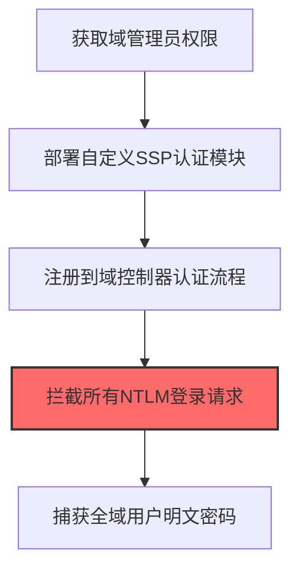

# Domain Controller Authentication (T1556.001)

## 一句话通俗理解

> **Domain Controller Authentication就是修改域控的认证流程以捕获所有登录密码。**

## 30秒速查卡

| 维度 | 你需要知道的 |
|------|-------------|
| 这是什么？ | 修改域控制器的认证流程，捕获所有用户的登录密码 |
| 为什么危险？ | 域控是认证的'中枢'，修改它就能截获所有用户的密码，而且这种修改很难被发现 |
| 谁需要关心？ | 域管理员、Active Directory安全工程师、SOC分析师 |
| 你的第一步防御 | 监控域控制器认证流程的变更，启用域控审计策略 |
| 如果只做一件事 | 监控域控制器上lsass.exe进程的异常修改和DLL注入 |

## 难度等级

⭐⭐⭐ 高级 - 需要一定的技术基础和实践经验

## 前置知识检查

**读这个文件需要什么？**

- [ ] Windows认证体系（NTLM/Kerberos/LSASS）
- [ ] 哈希基础（NTLM Hash/SHA）
- [ ] 网络认证协议（SMB/LDAP/Kerberos）

## 技术描述

**通俗解释：**

**过渡段：** 不要误解凭证访问只是'窃取密码'——在现代企业中，凭证存在于内存、磁盘、网络流量和云API等多个位置。攻击者关注的不是密码本身，而是'能用它做什么'：一个服务账号的哈希就能横向移动到数十台服务器，OAuth令牌可以访问整个SaaS租户的数据。
修改域控的认证流程以捕获所有登录密码

> 🎭 **打个比方**：就像在税务局门口冒充工作人员——攻击者篡改域控制器认证过程，让自己伪装成合法用户通过验证。

**技术原理：**
T1556.001 是 修改认证流程（T1556）的子技术，专注于Domain Controller Authentication这一特定方面。攻击者在凭证访问阶段，通过Domain Controller Authentication来获取目标系统或组织的相关信息，为后续攻击步骤做准备。

**用途与影响：**
- 为后续攻击提供关键信息支撑
- 提高攻击的成功率和精准度
- 降低攻击被发现的概率

## 真实攻击流程



**步骤详解：**

1. **获取域管理员权限** - 需要Domain Admin权限才能在域控制器上部署和注册自定义认证模块
2. **部署自定义SSP认证模块** - 编写恶意Security Support Provider (SSP) DLL并注册到域控制器的认证子系统
3. **注册到域控制器认证流程** - 通过注册表HKLM\SYSTEM\CurrentControlSet\Control\Lsa\Authentication Packages加载恶意SSP
4. **拦截所有NTLM登录请求** - 恶意SSP在每次用户NTLM认证时被调用，可以记录明文密码而用户无感知
5. **捕获全域用户明文密码** - 所有通过该域控认证的用户密码都会被SSP截获并写入日志文件

## 攻击流程

```
获取域管权限 --> 部署恶意SSP --> 注册到认证流程 --> 拦截NTLM认证 --> 捕获明文密码
```


**步骤详解：**
1. **获取域管权限**
   - 通俗描述：先要拿下域控制器的高权限账户，相当于拿到"金库钥匙"
   - 技术细节：通过Kerberoasting、Pass-the-Hash或利用域内漏洞（如ZeroLogon CVE-2020-1472）提升至Domain Admin权限
   - 常用工具：Mimikatz、Impacket、Kekeo、CVE-2020-1472 PoC
2. **部署恶意SSP**
   - 通俗描述：在域控上放一个"假安检员"，伪装成正常的认证模块
   - 技术细节：编写恶意Security Support Provider DLL，实现SpInitialize、SpAcceptCredentials等回调函数，在认证时记录明文凭证
   - 常用工具：Visual Studio C++、Mimikatz misc::memssp、Custom SSP DLL
3. **注册到认证流程**
   - 通俗描述：把这个"假安检员"挂到域控的认证系统里，让它每次都能看到用户登录
   - 技术细节：修改注册表`HKLM\SYSTEM\CurrentControlSet\Control\Lsa\Authentication Packages`添加恶意DLL路径，重启或加载SSP生效
   - 常用工具：reg add、PowerShell、mimikatzprivilege::debug
4. **拦截NTLM认证**
   - 通俗描述：每次有人登录，这个假安检员都会偷偷记下密码
   - 技术细节：SSP在LSASS进程内运行，每次NTLM/Kerberos认证时SpAcceptCredentials被调用，明文密码作为参数传入
   - 常用工具：LSASS注入、API Monitor、Process Monitor
5. **捕获明文密码**
   - 通俗描述：把偷到的密码存起来，等着回去慢慢用
   - 技术细节：将凭证写入隐藏文件或通过命名管道外传，规避日志监控；定期清理避免被发现
   - 常用工具：自定义日志写入、C2 Beacon、Cobalt Strike命名管道

## 真实案例

### 案例1：APT29 Skeleton Key 后门攻击欧洲外交机构

- **时间**: 2014-2015年
- **目标**: 欧洲外交机构和政府组织
- **攻击组织**: APT29（Cozy Bear / NOBELIUM）
- **手法**: 攻击者获得域管理员权限后在域控制器上执行 `mimikatz "privilege::debug" "misc::skeleton"`，向LSASS进程注入一个万能密码"mimikatz"，使任何域账户都可以用这个密码通过认证，无需知道真实密码即可登录任意域主机
- **影响**: 攻击者获得了对整个域环境的持久化后门访问权限，且无需修改任何用户密码即可横向移动，防御者难以察觉
- **参考链接**: [CrowdStrike APT29 报告](https://www.crowdstrike.com/blog/big-game-hunting-with-russia/) | [MITRE ATT&CK - T1556.001](https://attack.mitre.org/techniques/T1556/001/)

### 案例2：APT29 DCShadow 篡改域控 Active Directory 对象

- **时间**: 2018年
- **目标**: 欧洲多个国家的外交部和非政府组织
- **攻击组织**: APT29（Cozy Bear）
- **手法**: 攻击者通过临时注册一个伪造的域控制器，直接修改Active Directory中对象的属性（如向特定用户账户添加 SID History 或授予 DCsync 权限），修改完成后取消伪造DC注册，整个过程不留传统的DC日志痕迹
- **影响**: 攻击者绕过了正常的域控审计机制，悄悄提升了账户权限并为后续攻击铺路，传统的DC安全监控完全失效
- **参考链接**: [DCShadow 介绍 - Vinny Troia](https://www.vinnytroia.com/post/dcshadow) | [MITRE ATT&CK - T1556.001](https://attack.mitre.org/techniques/T1556/001/)

### 案例3：Sandworm Team 2015年乌克兰电网攻击中篡改域控认证环境

- **时间**: 2015年12月
- **目标**: 乌克兰三家电力分配公司（Prykarpattyaoblenergo、Chernivtsioblenergo、Kyivoblenergo）
- **攻击组织**: Sandworm Team（APT44 / IRIDIUM，俄罗斯GRU 74455部队）
- **手法**: 攻击者通过BlackEnergy 3鱼叉钓鱼获得初始访问后，使用Mimikatz从域控LSASS内存中提取域管理员凭证，获取域管权限后在域控上创建后门域账户（如"admin"和"система"）并修改其权限委派，将其加入特权组；同时通过PSExec + 域管凭证横向到SCADA运维工作站，使用域管账户登录VPN绕过运维网络的认证流程
- **影响**: 攻击者控制了三家电力公司的域控认证环境，通过新建的特权账户持续访问工业控制网络，最终远程操作SCADA系统断开50+变电站断路器，导致22.5万用户断电1-6小时，被MITRE ATT&CK收录为首个公开的国家级电网网络攻击战役（C0028）
- **参考链接**: [MITRE ATT&CK - 2015 Ukraine Electric Power Attack](https://attack.mitre.org/campaigns/C0028/) | [ESET BlackEnergy 分析报告](https://www.virusbulletin.com/uploads/pdf/magazine/2016/VB2016-Cherepanov-Lipovsky.pdf)

## 红队视角

> ⚠️ **免责声明**：以下内容仅用于合法的安全测试、渗透测试和教育目的。未经授权对他人系统进行测试是违法行为。

### 实战技巧

1. **隐蔽优先**：在凭证访问阶段使用被动方式收集信息，避免触发安全告警
2. **信息验证**：对收集到的信息进行交叉验证，确保准确性和时效性
3. **工具选择**：根据目标环境选择合适的工具，避免使用已被广泛检测的工具
4. **OPSEC意识**：使用匿名网络、临时环境进行操作，防止溯源

### 常用工具

| 工具名称 | 用途 | 平台 | 链接 |
| -------- | ---- | ---- | ---- |
| Mimikatz | `misc::skeleton` 注入万能密码后门、`lsadump::dcshadow` 修改AD对象 | Windows | [Mimikatz](https://github.com/gentilkiwi/mimikatz) |
| DCShadow (内置 Mimikatz) | 临时注册恶意DC篡改Active Directory对象属性，绕过传统审计 | Windows | [DCShadow - gentilkiwi](https://gentilkiwi.com/security/dcshadow) |
| Impacket | Python实现的AD协议工具包，可用于操作域控认证相关接口 | 跨平台 | [Impacket](https://github.com/fortra/impacket) |
| DCSync (内置 Mimikatz) | `lsadump::dcsync` 模拟域控复制以提取krbtgt/账户哈希，常与DC认证篡改配合 | Windows | [Mimikatz DCSync](https://attack.mitre.org/techniques/T1003/006/) |

### 注意事项

- 仅在授权范围内使用Domain Controller Authentication技术
- 注意操作的隐蔽性，避免被蓝队发现
- 记录操作日志，用于后续分析和报告编写

## 蓝队视角

### 检测要点

1. **异常信息收集行为**：监控来自内部系统的异常数据查询和收集行为
2. **可疑工具使用**：检测与Domain Controller Authentication相关的工具在内部网络中的使用
3. **异常网络流量**：监控对外部信息收集平台的可疑网络连接
4. **权限异常**：关注非授权用户的信息收集和查询行为

### 监控建议

- 部署信息收集行为的检测规则
- 建立基准行为模型，及时发现异常
- 定期审计敏感信息的访问记录

## 避坑指南

组织中最危险盲区：认为强密码就足够安全。

## 检测建议

### 网络层检测

**检测方法：** 监控与Domain Controller Authentication相关的网络流量特征

**具体规则/命令示例：**

```bash
# 监控异常DNS查询
tcpdump -i eth0 port 53 | grep -E "可疑域名"
```

### 主机层检测

**Windows事件ID：**

- 事件ID 4688：可疑进程创建
- 事件ID 4104：PowerShell脚本块日志

**Linux日志：**

- 日志文件：`/var/log/syslog`
- 关键字段：可疑命令执行

**用人话说：** 这条规则在监控域控制器的认证流程是否被篡改。域控制器的lsass.exe负责处理所有域用户的登录认证。正常情况下这个进程不会被修改。如果发现lsass.exe被注入了新的DLL或配置被修改，那就是攻击者在篡改认证流程，准备截获所有用户的登录密码。

### 应用层检测

**Sigma规则示例：**

```yaml
title: Suspicious Domain Controller Authentication Activity
status: experimental
description: Detects potential Domain Controller Authentication behavior
logsource:
  category: process_creation
  product: windows
detection:
  selection:
    Image|endswith: '\\可疑工具.exe'
  condition: selection
level: medium
tags:
  - attack.T1556/001
```

## 缓解措施

### 优先级1：关键措施

**措施名称：** 敏感信息保护

**具体实施步骤：**

1. 识别和分类组织内的敏感信息
2. 对敏感信息实施访问控制和加密
3. 部署信息泄露防护（DLP）解决方案

### 优先级2：重要措施

**措施名称：** 员工安全意识培训

**具体实施步骤：**

1. 定期开展信息安全意识培训
2. 教育员工识别社交工程攻击
3. 建立信息报告和响应机制

### 优先级3：建议措施

**措施名称：** 安全配置加固

**具体实施步骤：**

1. 限制公开可访问的系统信息
2. 配置合适的日志记录和告警策略
3. 定期进行安全评估和渗透测试

## 动手实验

> ⚠️ **重要提示**：所有实验必须在隔离的实验室环境中进行，禁止对未授权的真实系统进行测试。

### 实验环境准备

**推荐靶场/实验平台：**

| 平台名称 | 类型 | 难度 | 链接 |
|---------|------|:----:|------|
| 本地虚拟机 | 虚拟环境 | 初级 | 本机搭建 |
| TryHackMe | 在线靶场 | 初级 | https://tryhackme.com |

**所需工具：**

- 根据具体技术需求准备相应工具

**环境搭建：**

```bash
# 准备隔离的实验环境
# 具体命令根据实验内容而定
```

### 实验1：基础实践（初级）

**实验目标：** 理解和练习Domain Controller Authentication的基本操作

**实验步骤：**

1. 在隔离环境中搭建实验系统
2. 按照技术描述执行基本操作
3. 观察和记录实验现象

**预期结果：** 成功完成Domain Controller Authentication的基本操作

**学习要点：** 理解Domain Controller Authentication的原理和操作方法

## 术语解释

| 术语 | 英文原名 | 通俗解释 |
|-----|---------|---------|
| Domain Controller Authentication | Domain Controller Authentication | Domain Controller Authentication的基本概念和操作方法 |
| 侦察 | Reconnaissance | 收集目标信息的过程，为后续攻击做准备 |
| OPSEC | Operational Security | 操作安全，保护行动信息不被对手发现 |

## 被引用情况

以下父技术文档引用了本子技术：

- [T1556 - 修改认证流程](../../05-Persistence/T1556-Modify-Authentication-Process.md)
- [T1556 - 修改认证流程](../T1556-Modify-Authentication-Process.md)
- [T1556 - 修改认证流程](../../08-Defense-Impairment/T1556-Modify-Authentication-Process.md)
- [T1556 - 修改认证流程](../T1556-Modify-Authentication-Process.md)

## 参考资料

### 📚 官方文档（深入了解）

- [MITRE ATT&CK - T1556](https://attack.mitre.org/techniques/T1556/)
- [MITRE ATT&CK - T1556.001](https://attack.mitre.org/techniques/T1556/001/)
- [MITRE ATT&CK - T1556.001 检测](https://attack.mitre.org/techniques/T1556/001/detections/)

### 📰 安全报告（真实攻击）

- [CISA Known Exploited Vulnerabilities](https://www.cisa.gov/known-exploited-vulnerabilities-catalog)
- [Microsoft Security Blog](https://www.microsoft.com/en-us/security/blog/)

### 学习资源

- [MITRE ATT&CK 官方文档](https://attack.mitre.org/)
- [ATT&CK STIX Data](https://github.com/mitre-attack/attack-stix-data)

