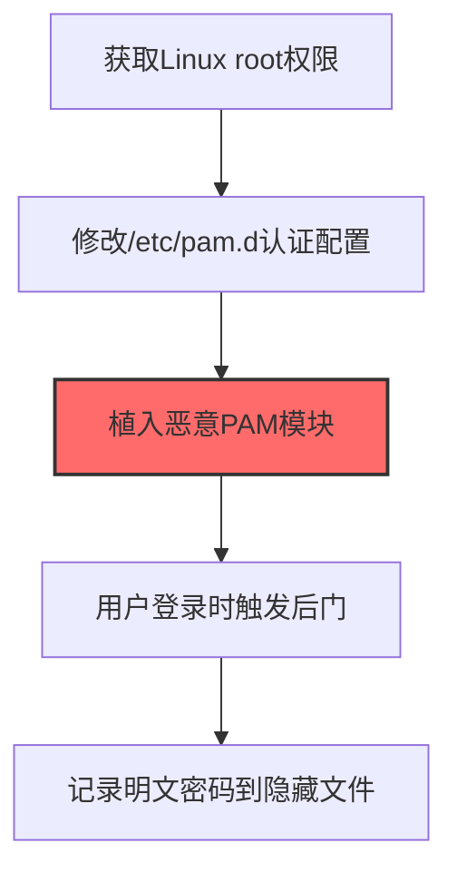

# Pluggable Authentication Modules (T1556.003)

## 一句话通俗理解

> **Pluggable Authentication Modules就是修改Linux的认证模块。**

## 30秒速查卡

| 维度 | 你需要知道的 |
|------|-------------|
| 这是什么？ | 修改Linux的PAM认证模块，添加后门密码或记录用户密码 |
| 为什么危险？ | PAM是Linux认证的'门卫'，修改它就能控制谁能登录，还能记录所有密码 |
| 谁需要关心？ | Linux系统管理员、SOC分析师 |
| 你的第一步防御 | 监控PAM配置文件的变更，使用文件完整性检测 |
| 如果只做一件事 | 使用AIDE或Tripwire监控/etc/pam.d/目录下配置文件的任何修改 |

## 难度等级

⭐⭐⭐ 高级 - 需要一定的技术基础和实践经验

## 前置知识检查

**读这个文件需要什么？**

- [ ] Windows认证体系（NTLM/Kerberos/LSASS）
- [ ] 哈希基础（NTLM Hash/SHA）
- [ ] 网络认证协议（SMB/LDAP/Kerberos）

## 技术描述

**通俗解释：**

**过渡段：** 不要误解凭证访问只是'窃取密码'——在现代企业中，凭证存在于内存、磁盘、网络流量和云API等多个位置。攻击者关注的不是密码本身，而是'能用它做什么'：一个服务账号的哈希就能横向移动到数十台服务器，OAuth令牌可以访问整个SaaS租户的数据。
修改Linux的认证模块，添加后门密码

> 🧩 **打个比方**：就像在门禁系统的认证模块里插入一个"记录仪"——攻击者在Linux PAM（可插拔认证模块）中植入恶意模块来捕获密码。

**技术原理：**
T1556.003 是 修改认证流程（T1556）的子技术，专注于Pluggable Authentication Modules这一特定方面。攻击者在凭证访问阶段，通过Pluggable Authentication Modules来获取目标系统或组织的相关信息，为后续攻击步骤做准备。

**用途与影响：**
- 为后续攻击提供关键信息支撑
- 提高攻击的成功率和精准度
- 降低攻击被发现的概率

## 真实攻击流程



**步骤详解：**

1. **获取Linux root权限** - 需要root权限才能修改PAM配置和加载自定义认证模块
2. **修改/etc/pam.d认证配置** - 在sshd、login等服务的PAM配置文件中添加自定义模块引用
3. **植入恶意PAM模块** - 编写或植入恶意的.so共享库文件到/lib/security/目录，实现后门认证
4. **用户登录时触发后门** - 每次用户通过SSH或本地登录时，恶意PAM模块被加载执行
5. **记录明文密码到隐藏文件** - 后门模块在验证密码的同时将明文密码记录到/tmp/.hidden等隐蔽位置

## 攻击流程

```
获取root权限 --> 修改PAM配置 --> 植入恶意so --> 等待SSH登录 --> 提取明文密码
```


**步骤详解：**
1. **获取root权限**
   - 通俗描述：先拿下Linux机器的最高权限，才能改动PAM认证系统
   - 技术细节：通过内核漏洞（如DirtyPipe CVE-2022-0847）、SUID滥用、sudo配置错误或已有特权账户提权至root
   - 常用工具：LinPEAS、DirtyPipe PoC、PwnKit CVE-2021-4034、脏牛漏洞
2. **修改PAM配置**
   - 通俗描述：在登录配置文件里加一行"额外的安检步骤"，让系统加载我们的恶意模块
   - 技术细节：编辑`/etc/pam.d/sshd`或`/etc/pam.d/login`，在auth段添加`auth optional custom_module.so`，确保模块被加载但不影响正常认证
   - 常用工具：vi/nano、sed、echo追加
3. **植入恶意so**
   - 通俗描述：把假安检员程序放到系统指定目录里
   - 技术细节：编译实现`pam_sm_authenticate`函数的.so共享库，放置在`/lib/security/`或`/lib64/security/`，函数内通过`pam_get_item`获取密码
   - 常用工具：gcc -shared -fPIC、自定义PAM模块模板
4. **等待SSH登录**
   - 通俗描述：躲起来，等用户或管理员通过SSH登录时触发恶意模块
   - 技术细节：用户执行SSH登录时，pam_unix.so和自定义模块依次被调用，明文密码通过`PAM_AUTHTOK`项传入
   - 常用工具：无需主动操作，被动等待
5. **提取明文密码**
   - 通俗描述：定期把记录的密码取走
   - 技术细节：将密码写入隐藏文件（如`/tmp/.x`、`/dev/shm/.cache`），或通过DNS隧道、ICMP外传规避网络监控
   - 常用工具：cron定时任务、curl/wget外传、DNS-C2框架

## 真实案例

### 案例1：TeamTNT 在云Linux主机部署PAM后门记录SSH密码

- **时间**: 2020-2023年
- **目标**: AWS、Azure、GCP等云平台上的Linux主机和Docker容器
- **攻击组织**: TeamTNT（云挖矿APT组织）
- **手法**: 攻击者通过暴露的Docker API或Redis未授权访问获得root权限后，编译了修改版 `pam_unix.so` 模块替换 `/lib/x86_64-linux-gnu/security/pam_unix.so`，在 `pam_sm_authenticate` 函数中插入后门密码"w00t"和密码记录逻辑，所有SSH登录密码都会被写入 `/tmp/.pwlog`
- **影响**: 攻击者不仅获得了持久化后门访问（任意账户可用w00t登录），还持续收集了所有SSH用户的明文密码用于横向移动到其他云主机
- **参考链接**: [TeamTNT 分析报告 - Trend Micro](https://www.trendmicro.com/en_us/research/21/c/teamtnt-now-deploys-doki.html) | [MITRE ATT&CK - T1556.003](https://attack.mitre.org/techniques/T1556/003/)

### 案例2：APT41 在Linux服务器植入PAM后门长期潜伏

- **时间**: 2019-2020年
- **目标**: 东南亚电信运营商和政府机构的Linux服务器
- **攻击组织**: APT41（Winnti / Barium，中国APT组织）
- **手法**: 攻击者通过CVE-2019-3398 Atlassian Confluence漏洞获得初始访问和root权限后，使用 `pam_backdoor.py` 脚本自动修改 `/etc/pam.d/sshd`，添加 `auth sufficient pam_backdoor.so` 配置项，使后门密码可在任何账户上跳过其他认证模块直接通过
- **影响**: 攻击者在受害者服务器上维持了超过6个月的持久化访问，期间持续收集SSH凭证并横向移动到关联的数据库和内部应用服务器
- **参考链接**: [APT41 分析报告 - FireEye](https://www.fireeye.com/blog/threat-research/2019/08/apt41-leads-blue-foal-operations.html) | [MITRE ATT&CK - T1556.003](https://attack.mitre.org/techniques/T1556/003/)

### 案例3：Rocke 组织在内网Linux服务器部署PAM后门维持挖矿持久化

- **时间**: 2018-2019年
- **目标**: 企业内网Linux服务器、云主机和Redis/Docker暴露主机
- **攻击组织**: Rocke（8220 挖矿Gang，中国背景加密货币挖矿组织）
- **手法**: 攻击者通过暴露的Redis未授权访问或Struts2漏洞获得root权限后，使用脚本 `systemst` 自动备份原始 `pam_unix.so` 并替换为修改版模块，在 `pam_sm_authenticate` 函数中插入硬编码后门密码"system"和密码记录逻辑；同时通过修改 `/etc/pam.d/system-auth` 和 `/etc/pam.d/password-auth` 使后门模块在SSH、su、sudo等所有认证场景生效，所有用户登录密码被写入 `/usr/include/.../pwn` 隐藏文件
- **影响**: 攻击者不仅通过后门密码"system"以任意用户身份登录绕过正常认证，还持续收集了所有SSH/su/sudo密码用于横向移动到内网其他Linux主机，支撑了大规模门罗币挖矿僵尸网络的扩张（监测到峰值感染主机超10万台）
- **参考链接**: [Cisco Talos - Rocke 挖矿组织分析](https://blog.talosintelligence.com/2018/08/rocke-champion-of-monero-miners.html) | [MITRE ATT&CK - T1556.003](https://attack.mitre.org/techniques/T1556/003/)

## 红队视角

> ⚠️ **免责声明**：以下内容仅用于合法的安全测试、渗透测试和教育目的。未经授权对他人系统进行测试是违法行为。

### 实战技巧

1. **隐蔽优先**：在凭证访问阶段使用被动方式收集信息，避免触发安全告警
2. **信息验证**：对收集到的信息进行交叉验证，确保准确性和时效性
3. **工具选择**：根据目标环境选择合适的工具，避免使用已被广泛检测的工具
4. **OPSEC意识**：使用匿名网络、临时环境进行操作，防止溯源

### 常用工具

| 工具名称 | 用途 | 平台 | 链接 |
| -------- | ---- | ---- | ---- |
| pam_backdoor 脚本 | 自动编译修改版 `pam_unix.so` 并替换系统原文件，注入后门密码和密码记录逻辑 | Linux | [linux-pam-backdoor](https://github.com/zephrax/linux-pam-backdoor) |
| pamtester | 命令行PAM认证测试工具，用于验证后门模块是否能正确触发认证回调 | Linux | [pamtester](http://pamtester.sourceforge.net/) |
| strace | 追踪lsass/sshd进程加载的.so文件，用于审计PAM模块依赖关系是否被篡改 | Linux | [strace](https://strace.io/) |
| ldd | 检查PAM共享库的动态链接依赖，识别被替换或新增的可疑.so文件 | Linux | [ldd (man page)](https://man7.org/linux/man-pages/man1/ldd.1.html) |

### 注意事项

- 仅在授权范围内使用Pluggable Authentication Modules技术
- 注意操作的隐蔽性，避免被蓝队发现
- 记录操作日志，用于后续分析和报告编写

## 蓝队视角

### 检测要点

1. **异常信息收集行为**：监控来自内部系统的异常数据查询和收集行为
2. **可疑工具使用**：检测与Pluggable Authentication Modules相关的工具在内部网络中的使用
3. **异常网络流量**：监控对外部信息收集平台的可疑网络连接
4. **权限异常**：关注非授权用户的信息收集和查询行为

### 监控建议

- 部署信息收集行为的检测规则
- 建立基准行为模型，及时发现异常
- 定期审计敏感信息的访问记录

## 避坑指南

组织中最危险盲区：认为强密码就足够安全。

## 检测建议

### 网络层检测

**检测方法：** 监控与Pluggable Authentication Modules相关的网络流量特征

**具体规则/命令示例：**

```bash
# 监控异常DNS查询
tcpdump -i eth0 port 53 | grep -E "可疑域名"
```

### 主机层检测

**Windows事件ID：**

- 事件ID 4688：可疑进程创建
- 事件ID 4104：PowerShell脚本块日志

**Linux日志：**

- 日志文件：`/var/log/syslog`
- 关键字段：可疑命令执行

**用人话说：** 这条规则在监控Linux的PAM认证模块是否被篡改。PAM（可插拔认证模块）是Linux的'门卫'，负责验证用户登录。正常情况下PAM配置文件不会被修改。如果发现/etc/pam.d/下的配置文件被新增或修改，那就是攻击者在修改认证流程，可能添加了后门密码或密码记录功能。

### 应用层检测

**Sigma规则示例：**

```yaml
title: Suspicious Pluggable Authentication Modules Activity
status: experimental
description: Detects potential Pluggable Authentication Modules behavior
logsource:
  category: process_creation
  product: windows
detection:
  selection:
    Image|endswith: '\\可疑工具.exe'
  condition: selection
level: medium
tags:
  - attack.T1556/003
```

## 缓解措施

### 优先级1：关键措施

**措施名称：** 敏感信息保护

**具体实施步骤：**

1. 识别和分类组织内的敏感信息
2. 对敏感信息实施访问控制和加密
3. 部署信息泄露防护（DLP）解决方案

### 优先级2：重要措施

**措施名称：** 员工安全意识培训

**具体实施步骤：**

1. 定期开展信息安全意识培训
2. 教育员工识别社交工程攻击
3. 建立信息报告和响应机制

### 优先级3：建议措施

**措施名称：** 安全配置加固

**具体实施步骤：**

1. 限制公开可访问的系统信息
2. 配置合适的日志记录和告警策略
3. 定期进行安全评估和渗透测试

## 动手实验

> ⚠️ **重要提示**：所有实验必须在隔离的实验室环境中进行，禁止对未授权的真实系统进行测试。

### 实验环境准备

**推荐靶场/实验平台：**

| 平台名称 | 类型 | 难度 | 链接 |
|---------|------|:----:|------|
| 本地虚拟机 | 虚拟环境 | 初级 | 本机搭建 |
| TryHackMe | 在线靶场 | 初级 | https://tryhackme.com |

**所需工具：**

- 根据具体技术需求准备相应工具

**环境搭建：**

```bash
# 准备隔离的实验环境
# 具体命令根据实验内容而定
```

### 实验1：基础实践（初级）

**实验目标：** 理解和练习Pluggable Authentication Modules的基本操作

**实验步骤：**

1. 在隔离环境中搭建实验系统
2. 按照技术描述执行基本操作
3. 观察和记录实验现象

**预期结果：** 成功完成Pluggable Authentication Modules的基本操作

**学习要点：** 理解Pluggable Authentication Modules的原理和操作方法

## 术语解释

| 术语 | 英文原名 | 通俗解释 |
|-----|---------|---------|
| Pluggable Authentication Modules | Pluggable Authentication Modules | Pluggable Authentication Modules的基本概念和操作方法 |
| 侦察 | Reconnaissance | 收集目标信息的过程，为后续攻击做准备 |
| OPSEC | Operational Security | 操作安全，保护行动信息不被对手发现 |

## 被引用情况

以下父技术文档引用了本子技术：

- [T1556 - 修改认证流程](../../05-Persistence/T1556-Modify-Authentication-Process.md)
- [T1556 - 修改认证流程](../T1556-Modify-Authentication-Process.md)
- [T1556 - 修改认证流程](../../08-Defense-Impairment/T1556-Modify-Authentication-Process.md)
- [T1556 - 修改认证流程](../T1556-Modify-Authentication-Process.md)

## 参考资料

### 📚 官方文档（深入了解）

- [MITRE ATT&CK - T1556](https://attack.mitre.org/techniques/T1556/)
- [MITRE ATT&CK - T1556.003](https://attack.mitre.org/techniques/T1556/003/)
- [MITRE ATT&CK - T1556.003 检测](https://attack.mitre.org/techniques/T1556/003/detections/)

### 📰 安全报告（真实攻击）

- [CISA Known Exploited Vulnerabilities](https://www.cisa.gov/known-exploited-vulnerabilities-catalog)
- [Microsoft Security Blog](https://www.microsoft.com/en-us/security/blog/)

### 学习资源

- [MITRE ATT&CK 官方文档](https://attack.mitre.org/)
- [ATT&CK STIX Data](https://github.com/mitre-attack/attack-stix-data)

