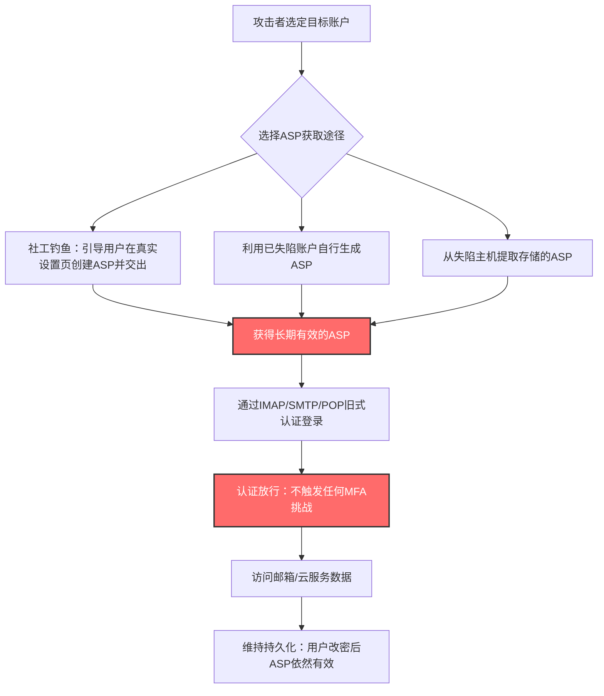

# 窃取应用专用密码 (T1697)

## 一句话通俗理解

攻击者偷不走你的门禁卡（多因素认证），就骗你亲手配一把"万能备用钥匙"（应用专用密码）交给他——这把钥匙开门时完全不需要刷卡。

## 30秒速查卡

| 维度 | 你需要知道的 |
|------|-------------|
| 这是什么？ | 窃取应用专用密码（Application Specific Password, ASP），用它登录账户并绕过多因素认证（MFA） |
| 为什么危险？ | ASP 是长期有效的备用密码，用它登录时不触发任何 MFA 挑战，等于给"铁门+指纹锁"留了一扇不验指纹的侧门 |
| 谁需要关心？ | SaaS 租户管理员（M365/Google Workspace）、邮件安全工程师、身份安全团队 |
| 你的第一步防御 | 在身份提供商处禁用 ASP 创建功能，并用条件访问（Conditional Access）全面阻断旧式认证协议 |
| 如果只做一件事 | 审计租户中所有已存在的应用专用密码并全部吊销，同时封锁 IMAP/SMTP/POP 等旧式认证路径 |

## 难度等级

⭐⭐ 中级（攻击门槛低，社工成分重，防御需要云租户管理知识）

## 前置知识检查

**读这个文件需要什么？**

- [ ] 多因素认证（Multi-Factor Authentication, MFA）的基本原理
- [ ] 新式认证（Modern Authentication, OAuth 2.0）与旧式认证（Legacy/Basic Authentication）的区别
- [ ] SaaS 租户管理基础（Microsoft 365 / Entra ID 或 Google Workspace 管理控制台）

## 技术描述

窃取应用专用密码（Steal Application Specific Passwords，T1697）是 MITRE ATT&CK v20 新增的凭证访问（Credential Access）技术。攻击者窃取应用专用密码（Application Specific Password, ASP），用于访问[有效账户 (T1078)](../03-Initial-Access/T1078-Valid-Accounts.md)，并绕过账户上设置的多因素认证（MFA）方法。

**通俗解释：**

想象你家大门装了指纹锁（MFA），小偷按不了你的指纹，进门无望。但门锁厂商考虑到老式送奶箱不兼容指纹锁，允许户主额外生成一把 16 位的传统备用钥匙（ASP），专门给"不支持指纹的老设备"用——这把钥匙开门时**不验指纹**。小偷只要骗你说"我是物业，请按我说的步骤生成一把备用钥匙，然后把钥匙号念给我"，或者干脆翻进你家（已经拿下你的账户会话）自己偷偷配一把，以后就能天天从侧门进出。这就是应用专用密码攻击的全部逻辑。

**过渡段：** ASP 诞生于一个善意的工程妥协：打印机、旧邮件客户端、智能家电等"遗留设备"不支持 OAuth 2.0 交互式登录，云厂商于是允许 MFA 用户生成一串独立于主密码的长期密码给这些设备用。问题在于，身份提供商在验证 ASP 时会把它当作"设备太老、没法做 MFA"而直接放行——**ASP 认证路径天然绕过 MFA**。攻击者获取 ASP 的方式有三种：社工用户亲手生成并交出、在已失陷账户上自行生成以维持持久化、从主机或配置存储中直接窃取。下面逐一展开。

**技术原理：**

1. **ASP 的机制**：Google Workspace 为开启两步验证的账户提供 16 位应用专用密码；Microsoft 365 提供 App Password 功能。ASP 创建后长期有效（除非吊销），通过 IMAP、SMTP、POP 等旧式认证协议使用时，身份提供商跳过 MFA 挑战直接放行。
2. **获取途径一——社工钓鱼**：攻击者仿冒 IT 支持、云服务通知，通过[钓鱼获取信息 (T1598)](../01-Reconnaissance/T1598-Phishing-for-Information.md)式的引导，让用户在真实的安全设置页面亲手创建 ASP，再把生成的密码输入攻击者的仿冒页面。
3. **获取途径二——失陷账户自助生成**：攻击者已通过其他手段控制账户（如窃取会话 Cookie），登录后自行创建 ASP。即使原会话失效、用户改密码，攻击者仍握有一条不触发 MFA 的持久化访问通道（Persistence）。
4. **获取途径三——本地窃取**：ASP 可能以配置形式存储在邮件客户端、脚本或系统配置中，攻击者可从失陷主机上直接提取（参照[不安全的凭证 (T1552)](./T1552-Unsecured-Credentials.md)与[密码存储凭证提取 (T1555)](./T1555-Credentials-from-Password-Stores.md)的思路）。
5. **后续利用**：拿到 ASP 后，攻击者通过 IMAP/SMTP 等协议访问受害者邮箱（参考[邮件收集 (T1114)](../12-Collection/T1114-Email-Collection.md)），进行邮件窃取、横向钓鱼或长期潜伏。与[暴力破解 (T1110)](./T1110-Brute-Force.md)、[MFA 请求生成 (T1621)](./T1621-Multi-Factor-Authentication-Request-Generation.md)等 MFA 绕过路径不同，ASP 路径完全静默——没有失败的登录尝试，也没有轰炸用户手机的推送。

**用途与影响：**

ASP 滥用使重金投入的 MFA 体系出现"旁门"。Microsoft 已于 2022 年 10 月起在 Exchange Online 默认停用基本认证（Basic Authentication），但在允许 App Password 的租户中，这一通道仍可存活；Google 账户的 ASP 功能至今仍在为不支持 OAuth 的设备保留。对攻击者而言，ASP 是"一次到手、长期有效、永不再触发 MFA"的理想凭证；对防御者而言，它是身份安全审计中最容易被遗忘的角落。

**与其他 MFA 绕过路径的对比：**

| MFA 绕过路径 | 攻击成本 | 静默程度 | 失效条件 |
|--------------|----------|----------|----------|
| 窃取 ASP（本技术） | 低（社工为主） | 极高（无失败登录、无推送骚扰） | 管理员禁用 ASP/旧式认证并吊销存量 |
| AiTM 钓鱼（仿冒登录页中继） | 中（需搭建中继基础设施） | 中（用户可能察觉假页面） | 设备合规检查、令牌绑定 |
| [MFA 请求生成 (T1621)](./T1621-Multi-Factor-Authentication-Request-Generation.md)（推送轰炸） | 低 | 低（大量推送易引起用户警觉） | 推送频次告警、号码匹配 |
| [MFA 拦截 (T1111)](./T1111-Multi-Factor-Authentication-Interception.md)（劫持验证码） | 高（需控制手机/植入恶意软件） | 中 | 验证器绑定设备、FIDO2 硬件密钥 |

对比可见：ASP 是少数"零噪声"的 MFA 绕过路径——既不触发告警风暴，也不需要终端植入，这正是它被 APT 组织长期青睐的原因。

## 攻击流程

### 典型攻击流程

```
选择目标账户 --> 社工引导用户创建ASP / 失陷账户自助生成 / 本地窃取
--> 获得ASP --> 通过IMAP/SMTP等旧式认证登录 --> 绕过MFA --> 邮箱访问与持久化
```



**步骤详解：**

1. **选择目标账户**
   - 通俗描述：攻击者锁定开启了 MFA 的邮箱/云账户——正是 MFA 挡住了密码喷洒，才逼他们走 ASP 这条侧门
   - 技术细节：目标通常是企业高管、学术人士、记者等高价值账户，或已知启用旧式协议的租户
   - 常用工具：OSINT 情报收集、组织架构 Recon

2. **获取 ASP（三选一）**
   - 通俗描述：要么骗你自己配钥匙交出来，要么先溜进你家自己配一把，要么翻抽屉找你藏的备用钥匙
   - 技术细节：社工路径需要精心仿冒 IT 支持话术并引导用户进入真实的账户安全设置页；自助生成路径依赖已失陷的会话（如被窃的会话 Cookie）
   - 常用工具：定制钓鱼页面、AiTM 钓鱼框架

3. **旧式认证登录**
   - 通俗描述：用备用钥匙走侧门，指纹锁形同虚设
   - 技术细节：通过 IMAP4/SMTP AUTH/POP3 向邮件服务发起基本认证，身份提供商将其归类为"遗留客户端"并跳过 MFA
   - 常用工具：任意邮件客户端（Thunderbird）、脚本化 IMAP 库

4. **访问与持久化**
   - 通俗描述：进门后长期住下，哪怕主人换了大门锁也不影响
   - 技术细节：ASP 不随主密码修改而失效，除非被显式吊销或管理员禁用功能；攻击者可持续读取邮件、发起内部钓鱼
   - 常用工具：邮件收集脚本、自动转发规则

## 真实案例

### 案例1：APT42 为失陷账户生成 ASP 维持访问（2022-2024）

- **时间**: 2022 年-2024 年
- **目标**: 全球学者、记者、外交人员及企业邮箱账户
- **攻击组织**: APT42（伊朗背景，APT 组织，ATT&CK 编号 G1044）
- **手法**: APT42 在钓鱼窃取到 Google 账户凭证后，会在已失陷账户上生成应用专用密码，即使后续用户重置密码或会话失效，攻击者仍可通过 ASP 长期访问邮箱，完全绕过两步验证。据 Mandiant/Google 的报告，该组织同样利用过 Microsoft 的 App Password 功能绕过 MFA。
- **影响**: 长期静默访问高价值目标邮箱，窃取通信内容并用于后续社工
- **参考链接**: [MITRE - APT42 (G1044)](https://attack.mitre.org/groups/G1044)、[Mandiant - APT42: Crooked Charms, Cons and Compromises](https://services.google.com/fh/files/misc/apt42-crooked-charms-cons-and-compromises.pdf)

### 案例2：UNC6293"创意钓鱼"诱导学者自建 ASP（2025）

- **时间**: 2025 年 6 月披露
- **目标**: 知名学者与俄罗斯的批评人士
- **攻击组织**: UNC6293（Mandiant 命名，疑似俄罗斯背景）
- **手法**: 攻击者通过精心设计的社工话术（伪装成学术合作、文件分享等"创意"场景），一步步引导受害者在自己的 Google 账户安全设置中亲手创建应用专用密码，并让受害者把生成的 16 位密码输入攻击者控制的仿冒页面。整个过程用户操作的全是 Google 官方页面，传统 URL 检测完全失效。
- **影响**: 跨国学者与活动人士邮箱被静默接管，MFA 形同虚设
- **参考链接**: [Google Threat Intelligence - What's in an ASP?](https://cloud.google.com/blog/topics/threat-intelligence/creative-phishing-academics-critics-of-russia)

### 案例3：俄罗斯背景社工活动系统性 targeting ASP（2025）

- **时间**: 2025 年 6 月披露
- **目标**: 学术界、政策圈与媒体人士
- **攻击组织**: 疑似俄罗斯政府关联的社会工程团伙（Citizen Lab 追踪）
- **手法**: Citizen Lab 在"Same Sea, New Phish"报告中披露，该团伙长期冒充学者、基金会工作人员等可信身份，通过多轮邮件往来建立信任后，以"账户迁移""文件授权"等借口诱导目标创建应用专用密码并回传。报告指出这是旧式"凭证钓鱼"在 MFA 普及后的直接进化——钓鱼目标从"主密码"转向"绕过 MFA 的备用凭证"。
- **影响**: 多国研究人员账户被接管，通信与文件被窃取
- **参考链接**: [Citizen Lab - Same Sea, New Phish](https://citizenlab.ca/research/russian-government-linked-social-engineering-targets-app-specific-passwords/)

### 案例4：App Password 钓鱼成为工业化 MFA 绕过手段（2024-2025）

- **时间**: 2024 年-2025 年
- **目标**: 使用 Microsoft 365 与 Google Workspace 的企业用户
- **攻击组织**: 多个钓鱼即服务（Phishing-as-a-Service）运营者
- **手法**: Push Security 在 2025 年的行业研究中系统记录了"应用专用密码钓鱼"这一手法的扩散：钓鱼套件不再只窃取主密码，而是在仿冒页面中嵌入逐步引导，指引用户去真实的安全设置页创建 App Password 并回填。由于 passkey（通行密钥）与 MFA 均不覆盖 ASP 认证路径，这一手法被证实可绕过包括通行密钥在内的现代认证防线。
- **影响**: ASP 钓鱼成为继 MFA 疲劳推送、AiTM 中继之后的主流 MFA 绕过路径
- **参考链接**: [Push Security - App-Specific Password phishing](https://pushsecurity.com/blog/app-specific-password-phishing)

## 红队视角

> ⚠️ **免责声明**：以下内容仅用于合法的安全测试、渗透测试和教育目的。未经授权对他人系统进行测试是违法行为。

### 实战技巧

1. **"官方页面钓鱼"最难检测**
   引导用户去真实的账户安全设置页创建 ASP，所有 URL、HTTPS 证书都是官方的。红队应把话术重点放在"为什么需要这把钥匙"的可信叙事上（如"IT 正在迁移邮件系统，旧客户端需要授权"），而不是伪造登录页。

2. **先用其他途径拿会话，再自助生成 ASP**
   在已拿到有效会话 Cookie（参考[窃取 Web 会话 Cookie (T1539)](./T1539-Steal-Web-Session-Cookie.md)思路）的情况下，登录安全设置直接创建 ASP，为未来的访问留一条不依赖会话、不触发 MFA 的后路。用户改密码后这条通道依然有效。

3. **先探测租户哪些端点还接受旧式认证**
   并非所有租户都封了 IMAP/SMTP 基本认证。红队应先指纹识别目标租户的旧式认证暴露面，再决定是否值得投入 ASP 攻击。

### 常用工具

| 工具名称 | 用途 | 平台 | 链接 |
|----------|------|------|------|
| GoPhish | 钓鱼 campaign 编排与话术投递 | 跨平台 | https://getgophish.com/ |
| MFASweep | 探测 M365 各端点是否仍接受旧式/基本认证 | Windows | https://github.com/dafthack/MFASweep |
| Thunderbird | 通过 ASP + IMAP 验证邮箱访问 | 跨平台 | https://www.thunderbird.net/ |
| Evilginx2 | AiTM 会话窃取（ASP 自助生成的前置手段） | Linux | https://github.com/kgretzky/evilginx2 |

### 注意事项

- ASP 创建行为本身会进入管理员审计视野（如 Google 管理控制台的安全日志），做完实验环境演练后应及时清理痕迹
- Microsoft 已默认禁用基本认证，红队前先确认目标租户策略，避免浪费环节
- 社工引导用户创建 ASP 属于对"人"的攻击，务必在授权范围内进行并留档

## 蓝队视角

### 检测要点

1. **检测旧式认证协议上的成功登录**
   - 日志来源：Entra ID 登录日志（Sign-in Logs）、Google 管理控制台安全报告
   - 关注字段：`ClientAppUsed`/客户端应用 = "Other clients"、"IMAP4"、"SMTP"、"POP3"；`ResultType` = 0（成功）
   - 异常特征：账户已启用 MFA，但成功登录的认证要求（AuthenticationRequirement）为"单因素"——典型的 ASP/旧式认证放行特征

2. **检测 ASP 创建事件**
   - 日志来源：身份提供商审计日志
   - 关注字段：应用专用密码创建/删除事件
   - 异常特征：创建事件与异常来源 IP、新设备、工作时间外的活动相关联

3. **检测"非预期客户端"的首见访问**
   - 日志来源：SaaS 审计日志统一汇入 SIEM
   - 关注字段：客户端类型、设备指纹、地理位置
   - 异常特征：账户历史上从未用过 IMAP 客户端，突然出现 IMAP 会话并伴随大量邮件下载（[自动收集]模式）

### 监控建议

- 建立租户级"旧式认证基线"：哪些账户确实需要 IMAP/SMTP（如多功能打印机），其余全部告警
- 对"ASP 创建 → 短时间异地 IMAP 登录"的链路做关联检测（MITRE 官方检测策略 DET0926 即基于此关联模式）
- 将 SaaS 认证日志全量接入 SIEM，覆盖 Microsoft 365 与 Google Workspace 双栈
- 定期（至少每季度）导出并审计租户内所有 ASP 的存在情况
- Google Workspace 侧：在管理控制台的安全调查工具中关注应用专用密码的创建/撤销事件与随后的异常 IMAP 会话
- 对"用户改密码后 24 小时内仍有成功的旧式认证登录"单独告警——这是失陷账户自助生成 ASP 逃过密码重置的典型指纹

## 避坑指南

常见防御误区：认为"全员上了 MFA/通行密钥就安全了"。应用专用密码是身份提供商为兼容遗留设备保留的官方旁路，只要它存在且可创建，MFA 防线就有一扇不验指纹的侧门。正确的做法不是加强 MFA 本身，而是**收窄甚至关闭 ASP 通道**。

第二个坑：蓝队只盯着交互式登录日志。ASP 滥用全部发生在非交互式（Non-interactive）登录里，若仪表盘只过滤交互式登录，攻击活动完全不可见。

## 检测建议

**用人话说：** 想象公司大门 everyone 刷卡进，但地库有一扇"老设备专用门"只认钥匙号。你要盯的不是正门的刷卡记录，而是那扇侧门——谁配了钥匙、钥匙配完多久后有人从侧门进来、进来的车是不是熟面孔。

### 网络层检测

**检测方法：** 监控出站 IMAP/SMTP/POP 认证流量，识别使用基本认证（而非 OAuth）的邮件会话。

**具体规则/命令示例：**
```
# 识别内网主机向云邮件服务发起的旧式认证（端口 993/587/995 上的基本认证握手）
# Zeek 思路：对 imap/smtp/auth 会话记录客户端是否声明 AUTH=PLAIN/LOGIN 机制
# 配合威胁情报：目的 IP 应为官方邮件服务网段，客户端却使用基本认证即告警
```

### 主机层检测

**Windows/客户端事件：**
- 邮件客户端配置中的明文/可解密 ASP 存储（注册表与配置文件扫描）
- 非标准邮件客户端进程突然发起外联（如脚本宿主进程访问 IMAP 端口）

**具体命令示例：**
```powershell
# 排查本机 Thunderbird/Outlook 配置中保存的账户与认证方式（取证视角）
Get-ChildItem -Path "$env:APPDATA\Thunderbird\Profiles" -Recurse -Filter prefs.js |
    Select-String -Pattern 'smtp|imap|authMethod'
```

### 应用层检测

**KQL（Entra ID 登录日志）示例：**
```kql
// 检测：启用 MFA 的账户通过旧式认证协议成功登录（ASP 滥用核心特征）
SigninLogs
| where ResultType == 0
| where ClientAppUsed in ("Other clients", "IMAP4", "SMTP", "POP3")
| where AuthenticationRequirement == "singleFactor"
| project TimeGenerated, UserPrincipalName, ClientAppUsed,
    IPAddress, Location, AppDisplayName
```

**Sigma规则示例：**
```yaml
title: 启用MFA账户通过旧式认证成功登录(疑似应用专用密码滥用)
status: experimental
description: 检测单因素认证要求下通过IMAP/SMTP等旧式协议的成功登录
logsource:
    product: azure
    service: signinlogs
detection:
    selection:
        ResultType: 0
        ClientAppUsed:
            - 'Other clients'
            - 'IMAP4'
            - 'SMTP'
            - 'POP3'
    condition: selection
level: high
tags:
    - attack.credential_access
    - attack.t1697
```

**Google Workspace 侧排查思路：**
```
# 管理控制台 > 安全 > 调查工具（Security Investigation）
# 事件类型: 用户账号活动 > 应用专用密码 创建/撤销
# 交叉关联: 同账户随后来自新地理位置的 IMAP 会话、新邮件转发规则
```

## 缓解措施

### 优先级1：关键措施

**措施名称：** 禁用 ASP 功能与旧式认证（对应 M1042：禁用或删除功能或程序）

**具体实施步骤：**
1. Microsoft 365：在 Entra ID 中禁用用户创建 App Password 的能力，并确保租户已默认关闭基本认证
2. 通过条件访问策略显式阻止所有旧式认证协议（"要求使用新式认证"），使存量 ASP 立即失效
3. Google Workspace：如无遗留设备需求，收紧账户安全设置中的 ASP 可用性

### 优先级2：重要措施

**措施名称：** 账户使用策略收窄（对应 M1036：账户使用策略）

**具体实施步骤：**
1. 用条件访问将邮件访问限定在受管设备、合规客户端与预期国家/地区
2. 明确"遗留设备白名单"：确需旧式认证的账户单独分组、单独策略、定期复审
3. 确保策略覆盖非交互式登录——很多条件访问默认只拦交互式流量
4. 将"旧式认证允许名单"纳入季度访问评审，人员离职或设备退役时即时移除

### 优先级3：建议措施

**措施名称：** 账户治理与用户培训（对应 M1018/M1017）

**具体实施步骤：**
1. 定期导出并吊销租户内所有存量 ASP（Google 管理员可查看/撤销用户的应用专用密码；Microsoft 管理员可禁用创建并删除现有 App Password）
2. 在全员安全意识培训中加入"任何要求你创建/念出应用密码的请求都是攻击"的专项内容
3. 将 ASP 创建事件纳入变更告警，通知账户属主本人二次确认

### MITRE ATT&CK 缓解措施映射

| 缓解措施ID | 缓解措施名称 | 适用性 | 说明 |
|------------|-------------|--------|------|
| M1042 | 禁用或删除功能或程序 | 适用 | 官方推荐：禁用 ASP 功能与旧式认证，使 ASP 不再可用 |
| M1036 | 账户使用策略 | 适用 | 限制使用 ASP 的认证路径、客户端与来源位置 |
| M1018 | 用户账户管理 | 适用 | 限制可创建 ASP 的用户范围，清理存量 ASP |
| M1017 | 用户培训 | 适用 | 防范社工诱导用户创建/泄露 ASP |

## 动手实验

> ⚠️ **重要提示**：所有实验必须在自有的测试租户/隔离环境中进行，禁止对未授权的真实系统进行测试。

### 实验环境准备

**推荐靶场/实验平台：**

| 平台名称 | 类型 | 难度 | 链接 |
|----------|------|------|------|
| Microsoft 365 Developer Program（测试租户） | 云沙箱 | 初级 | https://developer.microsoft.com/microsoft-365/dev-program |
| Google Workspace 试用租户 | 云沙箱 | 初级 | https://workspace.google.com/ |

**所需工具：**
- 一个自有的 M365 测试租户（含测试用户 + 已启用的 MFA）
- Thunderbird 邮件客户端（充当"遗留设备"）
- Azure Portal 或 Graph PowerShell（查看登录日志）

### 实验1：复现"ASP 绕过 MFA"访问路径（初级）

**实验目标：** 亲手验证应用专用密码登录不触发 MFA

**实验步骤：**
1. 在测试租户为用户启用 MFA，并允许创建 App Password
2. 以该用户身份生成一个 App Password（记录 16 位密码）
3. 配置 Thunderbird 使用 IMAP + 该 App Password 连接邮箱
4. 打开 Entra ID 登录日志，找到该次登录：确认 `ClientAppUsed` 为 IMAP4/Other clients、认证要求为单因素、无任何 MFA 事件

**预期结果：** 邮箱正常收发邮件，登录日志中 MFA 步骤完全缺席——亲眼看到侧门如何绕过指纹锁

### 实验2：构建旧式认证检测规则（中级）

**实验目标：** 为 ASP 滥用建立可用的 SIEM 检测

**实验步骤：**
1. 将测试租户的 Sign-in Logs 接入 Azure Monitor（或本地 KQL 查询门户）
2. 执行实验1 的登录若干次，混入若干正常 OAuth 客户端登录作为对照组
3. 编写 KQL：过滤 `ResultType == 0 AND ClientAppUsed in ("Other clients","IMAP4","SMTP") AND AuthenticationRequirement == "singleFactor"`
4. 验证规则只命中 IMAP 登录而不误报 OAuth 登录
5. 进阶：追加"该账户历史上首次出现此客户端类型"的首见（first-seen）逻辑

**预期结果：** 得到一条高信噪比规则，能从混合登录日志中精准揪出旧式认证成功事件

## 术语解释

| 术语 | 英文原名 | 通俗解释 |
|------|----------|----------|
| 应用专用密码 | Application Specific Password (ASP) | 云厂商给"不支持 MFA 的老设备"发的长期备用密码，用它登录不触发 MFA，像大门指纹锁旁的不验指纹侧门 |
| 多因素认证 | Multi-Factor Authentication (MFA) | 除密码外再验第二样东西（手机推送、验证码、指纹），像进门既要钥匙又要刷脸 |
| 旧式/基本认证 | Legacy / Basic Authentication | 老协议（IMAP/SMTP/POP）上直接传用户名密码的认证方式，不支持现代 MFA 交互 |
| 新式认证 | Modern Authentication | 基于 OAuth 2.0 的认证体系，支持令牌、条件访问与 MFA |
| 条件访问 | Conditional Access | 云端的"门禁规则引擎"：谁、从哪、用什么客户端、在什么条件下才放行 |
| 通行密钥 | Passkey | 基于 FIDO2 的免密码登录凭证，比传统 MFA 更强，但同样不覆盖 ASP 路径 |
| 钓鱼获取信息 | Phishing for Information | 用假冒身份骗取敏感信息的社工手法，是 ASP 窃取的主要入口 |
| 有效账户 | Valid Accounts | 攻击者持有合法凭证直接登录，不触发任何漏洞告警 |
| 非交互式登录 | Non-interactive Sign-in | 用户不在场时由客户端自动完成的登录（如邮件客户端后台收信），ASP 滥用全部发生在这里 |
| 中间人攻击 | Adversary-in-the-Middle (AiTM) | 夹在用户与真实网站之间转发流量的攻击，是另一类常见 MFA 绕过路径 |
| 推送轰炸 | MFA Fatigue / Push Bombing | 反复轰炸用户手机推送 MFA 验证请求，直到用户误点批准 |
| 密码喷洒 | Password Spraying | 用同一弱密码批量尝试大量账户，MFA 普及后攻击者更多转向 ASP 等旁路 |

## 参考资料

### 📚 官方文档（深入了解）

- [MITRE ATT&CK - T1697 Steal Application Specific Passwords](https://attack.mitre.org/techniques/T1697/)
- [MITRE ATT&CK - APT42 (G1044)](https://attack.mitre.org/groups/G1044)

### 📰 安全报告（真实攻击）

- [Mandiant - APT42: Crooked Charms, Cons and Compromises](https://services.google.com/fh/files/misc/apt42-crooked-charms-cons-and-compromises.pdf)
- [Google Threat Intelligence - What's in an ASP? Creative Phishing Attack on Prominent Academics and Critics of Russia](https://cloud.google.com/blog/topics/threat-intelligence/creative-phishing-academics-critics-of-russia)
- [Citizen Lab - Same Sea, New Phish](https://citizenlab.ca/research/russian-government-linked-social-engineering-targets-app-specific-passwords/)
- [Push Security - App-Specific Password phishing](https://pushsecurity.com/blog/app-specific-password-phishing)
- [Astrix Security - App-Specific Passwords: Origins, Functionality, Security Risks](https://astrix.security/learn/blog/app-specific-passwords-origins-functionality-security-risks/)

### 🔧 工具与资源（动手试试）

- [MFASweep - 旧式认证暴露面探测](https://github.com/dafthack/MFASweep)
- [GoPhish - 钓鱼演练框架](https://getgophish.com/)
- [Microsoft Entra ID 登录日志文档](https://learn.microsoft.com/entra/identity/monitoring-health/concept-sign-in-log-activity-details)
