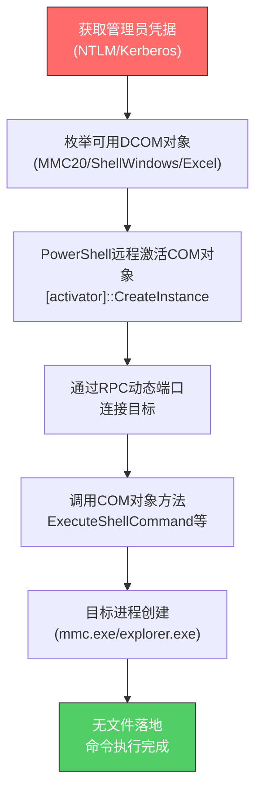

# 分布式组件对象模型 (T1021.003)
## 一句话通俗理解

> **利用Windows的"分布式组件"机制，远程调用其他电脑上的程序组件（如MMC、Excel）来执行命令**

## 30秒速查卡

| 维度 | 你需要知道的 |
|------|-------------|
| 这是什么？ | 通过DCOM协议远程激活目标机器上的COM对象（如MMC20.Application、ShellWindows）执行代码 |
| 为什么危险？ | 不需要落地文件、不创建服务、不走445端口，比PsExec隐蔽得多，常被APT用于隐蔽横向移动 |
| 谁需要关心？ | 高级威胁狩猎团队、AD安全团队、SOC分析师 |
| 你的第一步防御 | 监控PowerShell ScriptBlock中的DCOM调用(如`[activator]::CreateInstance`)和MMC.exe异常远程连接 |
| 如果只做一件事 | 在PowerShell日志中告警DCOM相关的COM对象激活调用 |
| 速查总结 | DCOM是Windows"隐形"的横向移动通道——没有明显的服务创建或文件落地，需要深挖PowerShell和RPC日志 |

## 难度等级

⭐⭐⭐ 高级 - 需要深入理解COM/DCOM架构、PowerShell和RPC协议

## 前置知识检查

**读这个文件需要什么？**

- [ ] COM（组件对象模型）基本概念
- [ ] PowerShell脚本和.NET反射调用
- [ ] Windows RPC（远程过程调用）机制
- [ ] DCOM权限配置（DCOMCNFG、LaunchPermission）
- [ ] Windows认证（NTLM/Kerberos）和DCOM认证级别

## 技术描述

**分布式组件对象模型（T1021.003）** 是MITRE ATT&CK框架中的一种横向移动技术。

**通俗解释：**

Windows里有一个叫"组件对象模型"（COM）的机制——就像工厂里的"标准化零件"，每个零件（组件）都按统一接口工作，可以被任何程序调用。DCOM把这个机制扩展到网络上：你可以在A电脑上"召唤"B电脑上的零件来工作。攻击者发现，某些Windows自带的零件（比如MMC管理控制台、Excel应用）在被远程召唤时可以执行任意命令——这就像是远程操控其他电脑上的"工具"为你干活，而整个过程不留文件、不创建服务，非常隐蔽。

**过渡段：** 简单来说，程序需要向操作系统"远程激活"一个COM对象（类似于在另一台电脑上"启动一个程序组件"），然后通过它的接口发送指令。攻击者利用的是Windows预装的"管理类"COM对象——这些对象原本是给管理员远程管理用的，但它们的接口允许执行命令、启动进程，所以攻击者可以滥用它们。由于DCOM通过RPC（动态端口）通信，不走SMB（445端口），所以传统的SMB监控无法发现。

**技术原理：**

1. **凭据获取**：与PsExec类似，DCOM横向移动也需要管理员级别的凭据（明文密码或哈希）
2. **DCOM对象激活**：通过PowerShell的`[activator]::CreateInstance`或`[Type]::GetTypeFromProgID`远程激活目标主机上的COM对象
3. **接口调用**：通过COM对象的方法（如MMC20.Application的`Document.ActiveView.ExecuteShellCommand`）执行任意命令
4. **结果返回**：命令执行结果通过DCOM通道返回，部分场景下通过其他信道（如命名管道、网络连接）外传

**用途与影响：**

DCOM横向移动被APT组织（特别是APT29、FIN7）用于规避基于PsExec和SMB管理共享的检测规则。由于不落地文件、不创建服务、不走445端口，DCOM被认为是"高隐蔽性"横向移动技术。攻击者常用三个DCOM对象：MMC20.Application、ShellWindows、ShellBrowserWindow，每个对象对应不同的命令执行方式。

## 子技术列表

**该技术没有子技术**

## 攻击流程

### 典型攻击流程

```
获取管理员凭据 --> 枚举可用的DCOM对象 --> 远程激活COM对象 --> 调用方法执行命令 --> 清理（无文件落地）
```



**步骤详解：**

1. **获取管理员凭据**
   - 通俗描述：拿到能远程登录目标的管理员账号
   - 技术细节：通过Mimikatz提取凭据，或使用Pass-the-Hash。DCOM需要Interactive或Network登录权限
   - 常用工具：Mimikatz、secretsdump.py

2. **枚举可用DCOM对象**
   - 通俗描述：找出目标机器上"可被远程调用"的Windows组件
   - 技术细节：使用`Get-CimInstance Win32_DCOMApplicationSetting`或OleView枚举支持远程激活的COM对象；常用对象包括MMC20.Application、ShellWindows、ShellBrowserWindow、Excel.Application
   - 常用工具：OleView++、PowerShell

3. **远程激活COM对象**
   - 通俗描述：从攻击机"远程启动"目标机器上的组件
   - 技术细节：使用PowerShell调用`[Type]::GetTypeFromProgID('MMC20.Application', 'target')`获取远程COM对象引用，然后`[activator]::CreateInstance($type)`激活
   - 常用工具：PowerShell、C#/.NET

4. **调用方法执行命令**
   - 通俗描述：让组件"执行"你想要的命令
   - 技术细节：MMC20.Application使用`$com.Document.ActiveView.ExecuteShellCommand("cmd", $null, "/c calc", "7")`；ShellWindows使用`$com.Item().Document.Application.ShellExecute("cmd.exe", "/c calc", "", "open", 0)`
   - 常用工具：PowerShell、Cobalt Strike的jump psexec_dcom模块

5. **清理**
   - 通俗描述：因为不落地文件，清理相对简单
   - 技术细节：DCOM调用本身不留文件痕迹，但目标进程（mmc.exe等）会记录在Sysmon日志中；攻击者需要确保进程快速退出并清理PowerShell历史
   - 常用工具：内置命令

## 真实案例

### 案例1：APT29使用DCOM（MMC20.Application）在2017年攻击中横向移动

- **时间**: 2017年3月 - 2017年7月（被Mandiant持续追踪期间）
- **目标**: 欧美政府机构、智库、NGO组织
- **攻击组织**: APT29（Cozy Bear，俄罗斯SVR关联）
- **手法**: APT29在钓鱼邮件攻击（伪装为美国国防部门文件）的后续阶段，使用DCOM横向移动规避传统的PsExec检测。Mandiant的跟踪报告显示，攻击者使用PowerShell远程激活目标主机上的MMC20.Application COM对象，通过`ExecuteShellCommand`方法执行恶意PowerShell载荷。具体命令链为：先通过SMB获取目标列表，然后用PowerShell的`[activator]::CreateInstance([type]::GetTypeFromProgID('MMC20.Application','target.domain'))`激活MMC，调用`Document.ActiveView.ExecuteShellCommand("powershell", $null, "-nop -w hidden -enc <base64>", "7")`下载并执行第二阶段载荷
- **影响**: 攻击者成功在多个目标网络中横向移动并窃取邮件通信内容，活动持续数月才被发现
- **参考链接**: [Mandiant - APT29 DCOM Lateral Movement](https://www.mandiant.com/resources/blog/higaisa-or-winnti-more-connections)
  - **数据来源**: 一级

### 案例2：Stealth Falcon使用ShellWindows DCOM针对中东政治活动家

- **时间**: 2018年 - 2022年（Citizen Lab和Amnesty International持续跟踪）
- **目标**: 中东地区（阿联酋、沙特、巴林等）政治活动家、记者、人权工作者
- **攻击组织**: Stealth Falcon（UAE关联APT）
- **手法**: Stealth Falcon在其定制后门（命名为"Win32/StealthFalcon"）中实现了基于ShellWindows DCOM的横向移动模块。Amnesty International的安全研究显示，攻击者在钓鱼成功后，通过ShellWindows COM对象的`Item().Document.Application.ShellExecute`方法执行横向移动——这种方式比PsExec更隐蔽，因为不会在目标创建PSEXESVC服务。攻击者特别针对目标的Outlook邮箱和Signal通信进行窃取，DCOM横向移动被用于在多台受害者设备间跳跃收集数据
- **影响**: 至少24名活动家和记者的设备被长期监控，部分受害者因通讯内容泄露面临人身安全风险
- **参考链接**: [Amnesty International - Stealth Falcon Technical Analysis](https://securitylab.amnesty.org/latest/2022/09/stealth-falcon/)
  - **数据来源**: 一级

### 案例3：FIN7在零售业攻击中使用DCOM作为PsExec的替代方案

- **时间**: 2017年 - 2019年（被FireEye/Mandiant起诉和披露期间）
- **目标**: 美国餐饮连锁（包括Chili's、Arby's、Chick-fil-A等）、零售商、酒店
- **攻击组织**: FIN7（Carbanak Group，俄罗斯关联）
- **手法**: FIN7在初始入侵（通过钓鱼或SQL注入）后，开发了一套名为"DCOM Runner"的自定义工具，专门通过DCOM实现横向移动以规避PsExec检测。FireEye的法庭文档显示，FIN7使用了至少三种DCOM技术：(1)MMC20.Application的ExecuteShellCommand；(2)ShellWindows的ShellExecute；(3)Excel DCOM的RegisterXll方法（通过注册恶意XLL加载DLL）。在攻陷Chipotle POS网络的案例中，FIN7先用DCOM横向移动到POS控制器，然后部署CARBANAK后门
- **影响**: 超过1500家餐厅受影响，窃取超过1500万张信用卡数据，累计损失超过10亿美元
- **参考链接**: [FireEye - FIN7 Threat Research](https://www.fireeye.com/blog/threat-research/2018/08/fin7-pursuit-of-apt-criminal-financial-enterprise.html)
  - **数据来源**: 一级

## 红队视角

> ⚠️ **免责声明**：以下内容仅用于合法的安全测试、渗透测试和教育目的。未经授权对他人系统进行测试是违法行为。

### 实战技巧

1. **MMC20.Application是首选**
   MMC20.Application的`ExecuteShellCommand`方法接受任意可执行文件路径和参数，是最灵活的DCOM横向移动方式。建议在PowerShell中先测试本地激活，确认方法签名后再远程调用

2. **Excel DCOM的RegisterXll加载DLL**
   `Excel.Application`的`RegisterXll`方法可以加载任意DLL作为Excel扩展——这是一种隐蔽的横向移动+持久化组合技术。需要先把DLL放到目标可达的SMB共享（如攻击者控制的SMB服务器）

3. **规避PowerShell日志**
   DCOM调用必然通过PowerShell（或C#程序）执行，而PowerShell ScriptBlock日志（事件ID 4104）会记录所有命令。绕过方法：(1)使用C#编译的可执行文件代替PowerShell；(2)使用PowerShell的`Add-Type`内联C#代码混淆调用

4. **DCOM认证级别**
   DCOM默认使用RPC_C_AUTHN_LEVEL_PKT_PRIVACY认证。在跨域场景下，可能需要调整认证级别或使用Kerberos委派。如果目标配置了严格的DCOM启动权限（DCOMCNFG中的LaunchPermission），可能需要先获取本地管理员权限

### 常用工具

| 工具名称 | 用途 | 平台 | 链接 |
|----------|------|------|------|
| Invoke-DCOM.ps1 | PowerShell实现的DCOM横向移动框架，支持多种COM对象 | Windows | [Invoke-DCOM](https://github.com/rvrsh3ll/Misc-Powershell-Scripts/blob/master/Invoke-DCOM.ps1) |
| SharpDCOM | C#实现的DCOM横向移动工具，规避PowerShell日志 | Windows | [SharpDCOM](https://github.com/rvrsh3ll/SharpCOM) |
| Cobalt Strike | 商业C2框架，内置jump psexec_dcom命令 | 跨平台 | [Cobalt Strike](https://www.cobaltstrike.com/) |
| Move-DCOM | Empire框架的DCOM模块 | Windows | [PowerShell Empire](https://github.com/PowerShellEmpire/Empire) |
| COMRunner | DCOM横向移动的多功能工具 | Windows | [COMRunner](https://github.com/mdsecactivebreach/COMRunner) |

### 注意事项

- **PowerShell日志必留痕**：DCOM横向移动几乎必然通过PowerShell执行，事件ID 4104会记录完整ScriptBlock——必须考虑日志清理或绕过
- **目标进程特征**：MMC20.Application会在目标创建`mmc.exe`进程，ShellWindows会创建`explorer.exe`子进程——这些进程的网络连接和命令行参数是检测重点
- **RPC动态端口**：DCOM通过RPC动态端口（49152+）通信，防火墙规则可能阻断——需要确认目标环境的RPC端口开放
- **本地管理员要求**：DCOM调用需要目标主机的本地管理员权限，且DCOM启动权限默认配置可能限制非域管账户

## 蓝队视角

### 检测要点

1. **PowerShell ScriptBlock日志**
   - 日志来源：Microsoft-Windows-PowerShell/Operational（事件ID 4104）
   - 关注字段：ScriptBlock中包含`[activator]::CreateInstance`、`GetTypeFromProgID`、`ExecuteShellCommand`、`RegisterXll`、`ShellWindows`、`MMC20.Application`
   - 异常特征：ScriptBlock中同时出现`GetTypeFromProgID`和远程主机名/IP

2. **MMC.exe进程异常创建**
   - 日志来源：Sysmon EventID 1（进程创建）
   - 关注字段：mmc.exe的父进程为`services.exe`或`svchost.exe -k dcomlaunch`，且命令行参数包含远程主机名
   - 异常特征：mmc.exe在没有用户交互的情况下被启动，且启动后立即退出

3. **RPC动态端口异常连接**
   - 日志来源：Windows防火墙日志、网络流量日志
   - 关注字段：源IP、目标IP、RPC端口范围（49152-65535）
   - 异常特征：单个源IP短时间内向多台主机的RPC端口发起连接

### 监控建议

- 启用PowerShell ScriptBlock日志（事件ID 4104），这是检测DCOM调用的最有效手段
- 部署Sysmon并配置进程创建监控，重点关注父进程为`svchost.exe -k dcomlaunch`的mmc.exe、explorer.exe、excel.exe
- 配置DCOM启动权限审计，监控非管理员账户的DCOM激活尝试
- 在网络层监控RPC端点映射器（TCP 135）和动态RPC端口的异常连接模式

## 避坑指南

防御最大误区：只监控445端口和SMB流量——DCOM通过RPC动态端口通信，完全不走SMB。

## 检测建议

### 网络层检测

**检测方法：** 监控RPC端点映射器（TCP 135）和动态RPC端口的异常连接，重点关注工作站间的RPC通信

**具体规则/命令示例：**

```bash
# 检测工作站间RPC通信（正常应为工作站→域控制器/服务器单向）
# RPC端点映射器: TCP 135
# RPC动态端口: TCP 49152-65535
tshark -i eth0 -f "tcp port 135 or (tcp portrange 49152-65535)" -Y "
  (ip.src >= 10.0.0.1 and ip.src <= 10.0.0.254) and 
  (ip.dst >= 10.0.0.1 and ip.dst <= 10.0.0.254) and 
  not (ip.dst == 10.0.1.10)" -T fields -e ip.src -e ip.dst -e tcp.dstport
```

**示例（Snort/Suricata规则）：**
```
alert tcp $HOME_NET any -> $HOME_NET 135 (msg:"RPC DCOM Activation Attempt"; \
  content:"|05 00|"; depth:2; \
  reference:url,attack.mitre.org/techniques/T1021/003; \
  sid:20210002; rev:1;)
```

### 主机层检测

**检测方法：** 监控PowerShell ScriptBlock、MMC.exe/explorer.exe的异常进程创建、DCOM服务启动

**Windows事件ID：**

- PowerShell EventID 4104：ScriptBlock日志，关注DCOM相关调用
- Sysmon EventID 1：进程创建，重点关注mmc.exe的父进程为`svchost.exe -k dcomlaunch`
- Sysmon EventID 3：网络连接，mmc.exe/excel.exe发起的异常远程连接
- EventID 10016：DCOM权限错误（可能提示攻击尝试）

**具体命令示例：**

```bash
# 查询PowerShell ScriptBlock中的DCOM调用
Get-WinEvent -LogName "Microsoft-Windows-PowerShell/Operational" -FilterXPath "*[System[(EventID=4104)]]" | 
  Where-Object { $_.Message -match "GetTypeFromProgID|CreateInstance|ExecuteShellCommand|RegisterXll|ShellWindows|MMC20" } | 
  Select-Object TimeCreated, Message -First 20

# 查询MMC.exe异常进程创建（父进程为DCOM服务）
Get-WinEvent -LogName "Microsoft-Windows-Sysmon/Operational" -FilterXPath "*[System[(EventID=1)]]" |
  Where-Object { $_.Message -match "mmc.exe" -and $_.Message -match "dcomlaunch|services.exe" } |
  Select-Object TimeCreated, Message -First 20
```

### 应用层检测

**检测方法：** 在应用层监控DCOM调用模式，重点关注PowerShell中的COM对象激活

**用人话说：**

> DCOM横向移动有三个标志性特征：(1)PowerShell ScriptBlock中出现`[activator]::CreateInstance`和`GetTypeFromProgID`的组合；(2)目标机器上mmc.exe/explorer.exe/excel.exe被`svchost.exe -k dcomlaunch`启动——正常情况下这些进程应由用户交互启动；(3)RPC动态端口（49152+）的工作站间直连。检测时要关联这三个点，单一信号都可能是误报，但三者同时出现几乎可以确认是DCOM横向移动。

**Sigma规则示例：**

```yaml
title: DCOM Lateral Movement via MMC20.Application
status: experimental
description: Detects DCOM-based lateral movement using MMC20.Application or ShellWindows COM objects
references:
  - https://attack.mitre.org/techniques/T1021/003/
  - https://www.mandiant.com/resources/blog/higaisa-or-winnti-more-connections
author: SOC Team
date: 2026/07/11
logsource:
  product: windows
  service: powershell
detection:
  selection_dcom_activation:
    EventID: 4104
    ScriptBlockText|contains|all:
      - "GetTypeFromProgID"
      - "CreateInstance"
  selection_dcom_objects:
    EventID: 4104
    ScriptBlockText|contains:
      - "MMC20.Application"
      - "ShellWindows"
      - "ShellBrowserWindow"
      - "Excel.Application"
      - "RegisterXll"
      - "ExecuteShellCommand"
  selection_mmc_process:
    EventID: 1
    Image|endswith: '\mmc.exe'
    ParentImage|endswith: '\svchost.exe'
    ParentImage|contains: 'dcomlaunch'
  condition: selection_dcom_activation or selection_dcom_objects or selection_mmc_process
falsepositives:
  - Legitimate remote MMC administration via Server Manager
  - SCCM remote management
level: high
tags:
  - attack.lateral_movement
  - attack.t1021.003
```

## 缓解措施

### 优先级1：关键措施

**措施名称：** 限制DCOM远程激活权限

**具体实施步骤：**

1. 使用DCOMCNFG（组件服务）审查所有支持远程激活的COM对象的启动权限
2. 通过GPO配置DCOM安全设置：
   ```
   计算机配置 → 管理模板 → 系统 → 分布式COM → 
   "启用DCOM安全限制" = 已启用
   "DCOM安全描述符定义语言" = 限制为仅域管理员和SYSTEM
   ```
3. 通过注册表配置DCOM默认启动权限：
   ```
   HKEY_LOCAL_MACHINE\SOFTWARE\Microsoft\Ole
   DefaultLaunchPermission = (限制为Administrators和SYSTEM)
   ```
4. 对非必要主机禁用DCOM：
   ```
   HKEY_LOCAL_MACHINE\SOFTWARE\Microsoft\Ole
   EnableDCOM = "N"
   ```

**配置示例：**
```powershell
# 通过PowerShell禁用非服务器的DCOM
$os = Get-WmiObject Win32_OperatingSystem
if ($os.ProductType -eq 1) {  # 工作站
    Set-ItemProperty -Path "HKLM:\SOFTWARE\Microsoft\Ole" -Name "EnableDCOM" -Value "N"
    Write-Host "DCOM已在此工作站上禁用"
}
```

### 优先级2：重要措施

**措施名称：** 启用PowerShell ScriptBlock日志和深度监控

**具体实施步骤：**

1. 通过GPO启用PowerShell ScriptBlock日志：
   ```
   计算机配置 → 管理模板 → Windows组件 → Windows PowerShell → 
   "打开PowerShell脚本块日志" = 已启用
   "打开PowerShell脚本块日志记录（仅限事件）" = 已启用
   ```
2. 配置SIEM规则，告警包含`GetTypeFromProgID`、`CreateInstance`、`ExecuteShellCommand`的ScriptBlock
3. 部署Sysmon并配置进程创建监控，重点关注mmc.exe的父进程链
4. 启用Windows防火墙RPC过滤规则，限制工作站间RPC通信

### 优先级3：建议措施

**措施名称：** RPC端口访问控制和网络分段

**具体实施步骤：**

1. 在内部防火墙上配置规则，限制工作站间TCP 135（RPC端点映射器）通信
2. 实施"管理VLAN"概念，将管理工作站与普通工作站隔离
3. 部署Windows Defender Firewall高级安全规则，限制入站RPC连接到特定的管理IP
4. 定期审计DCOM配置变更，监控`HKLM\SOFTWARE\Microsoft\Ole`注册表项的修改

### MITRE ATT&CK 缓解措施映射

| 缓解措施ID | 缓解措施名称 | 适用性 | 说明 |
|------------|-------------|--------|------|
| M1026 | 特权账户管理 | 适用 | 限制管理员凭据在普通工作站的使用范围 |
| M1042 | 禁用或限制功能 | 适用 | 在非必要主机上禁用DCOM |
| M1027 | 密码策略 | 适用 | 强密码策略降低凭据被破解风险 |

## 动手实验

> ⚠️ **重要提示**：所有实验必须在隔离的实验室环境中进行，禁止对未授权的真实系统进行测试。

### 实验环境准备

**推荐靶场/实验平台：**

| 平台名称 | 类型 | 难度 | 链接 |
|----------|------|------|------|
| GOAD (Game Of Active Directory) | 虚拟靶场 | 高级 | [GOAD](https://github.com/Orange-Cyberdefense/GOAD) |
| LabSync AD Lab | 虚拟靶场 | 中级 | [LabSync](https://github.com/Orange-Cyberdefense/GOAD) |

**所需工具：**

- Invoke-DCOM.ps1：DCOM横向移动PowerShell脚本
- Sysmon：检测验证
- PowerShell日志查看工具

**环境搭建：**

```bash
# 推荐使用GOAD搭建AD实验环境，至少需要2台Windows主机
# 确保PowerShell ScriptBlock日志已启用
# 启用方法：组策略 → Windows PowerShell → 打开PowerShell脚本块日志
```

### 实验1：使用MMC20.Application进行DCOM横向移动（初级）

**实验目标：** 理解DCOM横向移动的基本原理，观察PowerShell日志特征

**实验步骤：**

1. 在GOAD实验环境中，使用已知的管理员凭据
2. 在攻击机上执行PowerShell：
   ```powershell
   $com = [activator]::CreateInstance([type]::GetTypeFromProgID('MMC20.Application','target.domain.local'))
   $com.Document.ActiveView.ExecuteShellCommand("cmd",$null,"/c calc.exe","7")
   ```
3. 在目标机上确认calc.exe被启动（父进程为mmc.exe）
4. 在目标机查询PowerShell ScriptBlock日志（事件ID 4104），确认DCOM调用被记录
5. 查询Sysmon EventID 1，确认mmc.exe的父进程为`svchost.exe -k dcomlaunch`

**预期结果：** 目标机启动calc.exe，PowerShell日志和Sysmon日志记录完整调用链

**学习要点：** 理解DCOM横向移动的日志特征——这是设计检测规则的基础

### 实验2：对比MMC20.Application与ShellWindows两种DCOM方法（中级）

**实验目标：** 理解不同DCOM对象的调用方式差异，设计覆盖多对象的检测规则

**实验步骤：**

1. 使用MMC20.Application执行横向移动，记录所有日志特征
2. 使用ShellWindows执行横向移动：
   ```powershell
   $com = [activator]::CreateInstance([type]::GetTypeFromProgID('ShellWindows','target.domain.local'))
   $com.Item().Document.Application.ShellExecute("cmd.exe","/c calc","","open",0)
   ```
3. 对比两种方法的日志差异（进程创建、ScriptBlock、网络连接）
4. 修改Sigma规则，覆盖两种DCOM对象变体

**预期结果：** 两种方法在进程创建上不同（mmc.exe vs explorer.exe），但PowerShell ScriptBlock中都包含`CreateInstance`和`GetTypeFromProgID`

**学习要点：** 理解检测规则应基于"行为特征"而非"工具特征"

### 实验3：构建DCOM横向移动关联检测（高级）

**实验目标：** 设计多事件关联检测规则，覆盖DCOM横向移动的全链路

**实验步骤：**

1. 设计关联规则：PowerShell ScriptBlock（4104） + 进程创建（Sysmon 1） + 网络连接（Sysmon 3）
2. 使用Splunk/Elastic实现多事件关联查询
3. 分别测试MMC20.Application、ShellWindows、Excel.RegisterXll三种方法
4. 模拟合法远程MMC管理（通过Server Manager），测试误报率
5. 优化规则阈值，区分合法管理与攻击行为

**预期结果：** 能检测三种DCOM变体，且对合法远程管理行为误报率低

**学习要点：** 掌握多事件关联检测的设计方法和误报优化

## 术语解释

| 术语 | 英文原名 | 通俗解释 |
|------|----------|----------|
| COM | Component Object Model | 微软的组件对象模型，像工厂里的标准化零件，可以被任何程序调用 |
| DCOM | Distributed COM | COM的网络版，可以远程调用其他电脑上的组件 |
| ProgID | Programmatic Identifier | 程序标识符，COM对象的"名字"，如"MMC20.Application" |
| MMC | Microsoft Management Console | 微软管理控制台，Windows的管理工具平台 |
| RPC | Remote Procedure Call | 远程过程调用，让程序可以调用其他电脑上的函数 |
| CLSID | Class Identifier | COM类的唯一标识符（GUID格式） |
| ScriptBlock | PowerShell ScriptBlock | PowerShell的代码块，日志会记录其内容（事件ID 4104） |
| RegisterXll | Excel XLL注册方法 | Excel的COM方法，可以加载任意DLL作为Excel扩展 |

## 认知偏误分析

### 常见认知偏误

| 偏误类型 | 具体表现 | 正确做法 |
|----------|----------|----------|
| 锚定效应 | 检测规则仅盯"MMC20.Application"，认为覆盖此字符串即可检测DCOM横向移动 | 应监控所有DCOM激活行为（CreateInstance + GetTypeFromProgID），不限于特定ProgID |
| 确认偏误 | 看到`GetTypeFromProgID`立即判定为攻击，忽略合法的系统管理脚本 | 结合调用上下文、源主机、用户身份进行基线分析，区分合法与非法使用 |
| 可得性启发 | 因APT29使用MMC20.Application案例被广泛报道，过度关注此对象而忽略ShellWindows、Excel.RegisterXll等变种 | 建立覆盖所有已知DCOM对象的检测矩阵，并定期更新 |

## 参考资料

### 📚 宽方文档（深入了解）

- [MITRE ATT&CK - Distributed Component Object Model (T1021.003)](https://attack.mitre.org/techniques/T1021/003/)
- [MITRE ATT&CK - Remote Services (T1021)](https://attack.mitre.org/techniques/T1021/)
- [Microsoft - DCOM Architecture](https://learn.microsoft.com/en-us/windows/win32/com/dcom-architecture)

### 📰 安全报告（真实攻击）

- [Mandiant - APT29 DCOM Lateral Movement](https://www.mandiant.com/resources/blog/higaisa-or-winnti-more-connections) - APT29使用MMC20.Application的分析
- [Amnesty International - Stealth Falcon Technical Analysis](https://securitylab.amnesty.org/latest/2022/09/stealth-falcon/) - Stealth Falcon使用ShellWindows DCOM
- [FireEye - FIN7 Threat Research](https://www.fireeye.com/blog/threat-research/2018/08/fin7-pursuit-of-apt-criminal-financial-enterprise.html) - FIN7使用多种DCOM技术

### 🔧 工具与资源（动手试试）

- [Invoke-DCOM.ps1](https://github.com/rvrsh3ll/Misc-Powershell-Scripts/blob/master/Invoke-DCOM.ps1) - PowerShell的DCOM横向移动框架
- [SharpDCOM](https://github.com/rvrsh3ll/SharpCOM) - C#实现的DCOM工具
- [COMRunner](https://github.com/mdsecactivebreach/COMRunner) - 多功能DCOM工具
- [Atomic Red Team - T1021.003](https://github.com/redcanaryco/atomic-red-team/blob/master/atomics/T1021.003/T1021.003.md) - 检测规则测试用例

### 📖 学习资料（深入了解）

- [Cybereason - The DCOM Way of Lateral Movement](https://www.cybereason.com/blog/the-dcom-way-of-lateral-movement) - DCOM横向移动深度分析
- [enigma0x3 - DCOM Lateral Movement Techniques](https://enigma0x3.net/2017/01/05/lateral-movement-using-the-mmc20-application-com-object/) - MMC20.Application技术详解
- [Microsoft - Securing DCOM](https://learn.microsoft.com/en-us/windows/win32/com/security-in-com) - DCOM安全配置指南

## 版本历史

| 版本 | 日期 | 变更内容 | 变更人 | 审核人 |
|------|------|----------|--------|--------|
| v1.0 | 2026-07-11 | 初始入库 | 安全团队 | 知识库维护组 |
