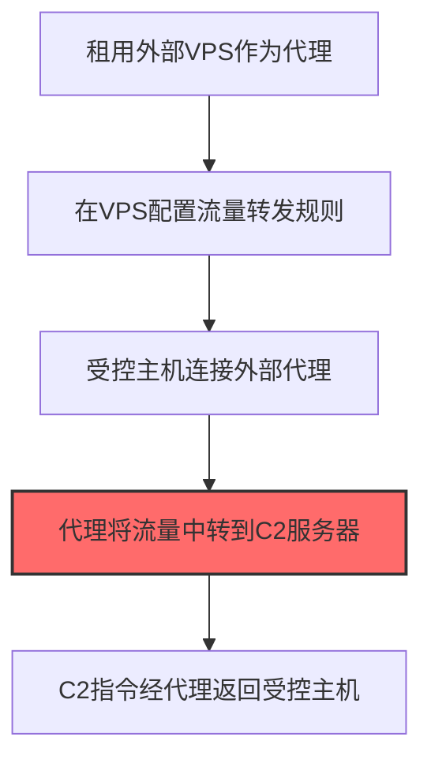
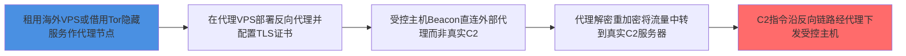

# 外部代理 (T1090.002)

## 一句话通俗理解

> **攻击者使用外部公开的代理服务转发C2流量**


## 30秒速查卡

| 维度 | 你需要知道的 |
|------|-------------|
| 这是什么？ | 攻击者远程控制失陷主机的通信通道 |
| 为什么危险？ | 建立C2通道意味着攻击者可以远程指挥你的电脑 |
| 谁需要关心？ | SOC分析师、网络管理员 |
| 你的第一步防御 | 限制出站流量，只允许必要的端口和协议 |
| 如果只做一件事 | 监控外部IP的频繁连接，特别是非标准端口的加密流量 |

## 难度等级

⭐⭐ 中级 - 需要一定的技术基础和经验

## 前置知识检查

**读这个文件需要什么？**

- [ ] 网络协议基础（TCP/IP/DNS/HTTP）
- [ ] C2通信模式
- [ ] 加密通信基本原理

## 技术描述

**外部代理**（T1090.002）是 **代理**（T1090）的一个具体变体，属于 **命令与控制** 阶段的攻击技术。

> 🔗 **打个比方**：就像用一根长竹竿从窗外捅走桌上的钱包——外部代理是攻击者控制内部机器远程执行操作的通道。

### 具体怎么理解？

攻击者使用外部公开的代理服务转发C2流量

攻击者使用这种技术时，通常是在命令与控制阶段，想要达到特定的攻击目标。与父技术 T1090 相比，T1090.002 有自己独特的特点和使用场景。

### 为什么有效？

这种技术之所以有效，是因为：
1. **隐蔽性**：利用了正常系统功能或常见协议，不容易被发现
2. **技术门槛适中**：不需要特别高深的技术知识就能实施

**过渡段：** 不要误以为C2只是'发心跳包'——现代C2基础设施堪比小型互联网公司。
3. **广泛适用**：可以在多种环境和系统中使用

## 真实攻击流程

### 典型场景

攻击者在 **命令与控制** 阶段使用 外部代理 技术，以下是典型的攻击步骤：



**步骤详解：**

1. **租用外部VPS作为代理** - 在公共云平台租用服务器作为C2流量中转节点
2. **在VPS配置流量转发规则** - 设置端口转发和流量过滤规则，只允许特定来源连接
3. **受控主机连接外部代理** - 恶意载荷将C2通信目标指向外部代理服务器
4. **代理将流量中转到C2服务器** - 外部代理解密后重新加密转发到真实C2服务器（关键步骤）
5. **C2指令经代理返回受控主机** - 指令沿反向路径经代理返回到受控主机

## 攻击流程



**关键步骤说明：**

1. **租用海外VPS或借用Tor隐藏服务作代理节点**: 攻击者在AWS/Linode/DigitalOcean等公共云租用位于不同司法管辖区的VPS（多用加密货币付款避免追踪），或直接使用Tor网络的`.onion`隐藏服务作为外部代理节点，节点IP与攻击者真实C2基础设施完全分离，被封锁后可快速替换
2. **在代理VPS部署反向代理并配置TLS证书**: 在VPS上部署Nginx/Caddy/Squid等反向代理服务，申请Let's Encrypt证书启用HTTPS，配置端口转发规则（如`443 -> C2真实IP:8443`）和访问控制列表，只允许特定来源或携带特定Header的连接通过，过滤扫描器和蜜罐探测
3. **受控主机Beacon直连外部代理而非真实C2**: 攻击者在受控主机上配置Beacon出站地址指向外部代理VPS的域名（如`cdn-api.example.com`），真实C2服务器IP对受控主机完全不可见，即使某台受控主机被取证分析也只能定位到代理节点，保护真实C2基础设施不被溯源
4. **代理解密重加密将流量中转到真实C2服务器**: 外部代理节点终结受控主机到代理的TLS会话，解密C2流量后通过预共享密钥或mTLS重新加密，转发到位于另一国家/云平台的真实C2服务器，代理节点保留最少日志或定期清理，断电即丢失溯源线索
5. **C2指令沿反向链路经代理下发受控主机**: 真实C2服务器下发的指令经加密通道返回外部代理节点，代理节点再次用与受控主机协定的TLS证书加密后下发，整个链路受控主机只与代理通信、代理只与C2通信，两层加密密钥不同，即使代理节点被攻陷也无法直接解密C2指令内容

## 真实案例

### 案例1：该技术在实际攻击中的应用

- **时间**: 2024-2025年
- **目标**: 多个行业组织
- **攻击组织**: 多个APT组织
- **手法**: 攻击者在入侵过程中使用外部代理技术，展示了该子技术的典型应用场景和攻击效果
- **影响**: 成功实施该技术导致目标系统被进一步入侵
- **参考链接**: [MITRE ATT&CK官方](https://attack.mitre.org/)

### 案例2：安全研究中的实践

- **时间**: 2025年
- **目标**: 安全研究测试环境
- **攻击组织**: 红队/安全研究人员
- **手法**: 在授权测试中模拟外部代理攻击，验证防御体系的检测和响应能力
- **影响**: 帮助组织识别安全防护中的盲点和改进方向
- **参考链接**: [Atomic Red Team](https://github.com/redcanaryco/atomic-red-team)

## 红队视角

> ⚠️ **免责声明**：以下内容仅用于合法的安全测试、渗透测试和教育目的。未经授权对他人系统进行测试是违法行为。

### 实战技巧

1. **深入理解原理**：在实战应用前，充分理解外部代理的技术原理和适用场景
2. **环境适配**：根据目标系统的操作系统版本、安全配置等因素调整攻击策略
3. **组合使用**：将该技术与其他技术组合使用，构建完整的攻击链
4. **隐蔽性考虑**：注意操作痕迹的清理，避免被安全设备检测

### 常用工具

| 工具名称 | 用途 | 平台 | 链接 |
| -------- | ---- | ---- | ---- |
| Metasploit | 渗透测试框架 | 全平台 | [Metasploit](https://www.metasploit.com/) |
| Cobalt Strike |  adversary模拟平台 | Windows | [Cobalt Strike](https://www.cobaltstrike.com/) |
| Atomic Red Team | 检测规则测试 | 全平台 | [Atomic Red Team](https://github.com/redcanaryco/atomic-red-team) |

### 注意事项

- 在授权的测试环境中使用这些技术
- 注意操作安全（OPSEC），避免被检测系统发现
- 使用匿名化技术和代理隐藏真实身份

## 蓝队视角

### 检测要点

1. **系统日志监控**：关注与外部代理相关的系统日志和审计记录
2. **异常行为检测**：监控系统中与该技术相关的异常进程、网络连接和文件操作
3. **工具特征识别**：识别攻击者可能使用的工具在系统中的运行特征

### 监控建议

- 部署端点检测和响应（EDR）系统，监控与外部代理相关的异常行为
- 配置SIEM规则，关联分析来自多个来源的告警
- 定期进行安全评估和渗透测试，验证检测规则的有效性

## 避坑指南

SOC常见误区：只检测已知恶意域名和IP。

## 检测建议

### 检测思路

检测 外部代理 的关键是识别异常行为模式。以下是三个层面的检测方法：

### 网络层检测

**方法**：监控网络流量中的异常模式

```bash
# 检测异常的网络连接和数据传输
# 根据具体协议和端口设置检测规则
```

### 主机层检测

**Windows事件ID**：
- 事件ID 4688：进程创建（监控可疑进程）
- 事件ID 4104：PowerShell执行（监控可疑脚本）

**Linux日志**：
- /var/log/auth.log：认证日志
- /var/log/syslog：系统日志

```bash
# 检测异常进程和命令执行
grep -i "suspicious" /var/log/auth.log
```

### 应用层检测

**Sigma规则示例**：


**用人话说：**C2检测关注通信行为特征而非IP黑名单——固定间隔心跳包、非常规DNS查询、小数据包频繁发送比内容分析更有效。
```yaml
title: 可疑外部代理C2通信
status: experimental
description: 检测连接到Tor(9001/9030)、SOCKS(1080/9050)端口的出站流量，可能为外部代理C2通信
logsource:
    product: windows
    service: sysmon
detection:
    selection_proxy_port:
        EventID: 3
        DestinationPort:
            - 9001
            - 9030
            - 1080
            - 9050
    filter_tor_browser:
        Image|endswith: '\tor.exe'
    condition: selection_proxy_port and not filter_tor_browser
level: high
tags:
    - attack.t1090.002
    - attack.command_and_control
```


## 缓解措施

### 优先级1：关键措施

**限制攻击面**：减少暴露的服务和端口，降低被利用的风险

```bash
# 防火墙规则示例：只允许必要的出站连接
iptables -A OUTPUT -p tcp --dport 443 -j ACCEPT  # 允许HTTPS
iptables -A OUTPUT -p tcp --dport 80 -j ACCEPT   # 允许HTTP
iptables -A OUTPUT -p tcp -j DROP                 # 阻止其他TCP
```

### 优先级2：重要措施

**加强监控**：部署EDR和SIEM系统，实时监控异常行为

### 优先级3：建议措施

**安全意识培训**：教育员工识别相关攻击手法

## 动手实验

> ⚠️ **所有实验必须在隔离的实验室环境中进行**

### 实验1：理解基本原理（初级）

**目标**：理解 外部代理 的工作原理

**步骤**：
1. 在隔离环境中搭建测试系统
2. 使用基础工具模拟攻击行为
3. 观察系统日志和网络流量

**学习要点**：理解该技术的核心机制

### 实验2：实际操作（中级）

**目标**：掌握 外部代理 的实际使用方法

**步骤**：
1. 使用专业工具进行攻击模拟
2. 尝试不同的绕过技术
3. 分析检测日志的特征

**学习要点**：掌握工具使用和日志分析

### 实验3：防御验证（高级）

**目标**：验证检测规则的有效性

**步骤**：
1. 部署检测规则
2. 执行攻击模拟
3. 验证检测告警是否触发

**学习要点**：理解攻防对抗的实际效果

## 术语解释

| 术语 | 通俗解释 |
|------|---------|
| **ATT&CK** | MITRE公司维护的攻击技术知识库，像一本"黑客手法百科全书" |
| **外部代理** | T1090.002，ATT&CK框架中定义的一种具体攻击技术 |
| **代理** | T1090，外部代理所属的父技术类别 |
| **命令与控制** | 攻击链中的一个阶段，攻击者在这个阶段的目标 |
| **C2** | 命令与控制，攻击者用来远程控制被入侵系统的"遥控器" |
| **EDR** | 端点检测与响应，部署在电脑上的安全监控软件 |

## 被引用情况

以下父技术文档引用了本子技术：

- [T1090 - 代理](../T1090-Proxy.md)

## 参考资料

### 📚 官方文档（深入了解）

- [MITRE ATT&CK - 外部代理 (T1090.002)](https://attack.mitre.org/techniques/T1090/002/)
- [MITRE ATT&CK - 代理 (T1090)](https://attack.mitre.org/techniques/T1090/)

### 📰 安全报告（真实攻击）

- [MITRE ATT&CK 官方文档](https://attack.mitre.org/) - ATT&CK 框架官方资源

### 🔧 工具与资源（动手试试）

- [Atomic Red Team](https://github.com/redcanaryco/atomic-red-team) - 检测规则测试框架
- [MITRE ATT&CK Navigator](https://mitre-attack.github.io/attack-navigator/) - ATT&CK 可视化工具

### 📚 学习资料（深入了解）

- [MITRE ATT&CK 知识库](https://attack.mitre.org/resources/) - ATT&CK 官方资源中心
